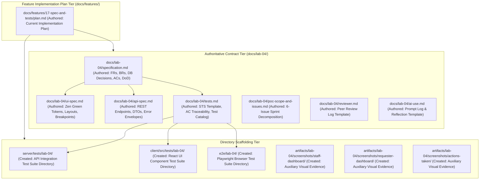

# Technical Implementation Plan: Issue 17 — Sprint 4 Engineering Contract & Software Test Planning

**Document ID**: PLAN-FEAT-17  
**Feature Branch**: `feature/17-spec-and-tests` (Issue 17)  
**Base Branch**: `lab4-staging`  
**Target Milestone**: TokTickIT Lab 4 (Sprint 4) Actions Taken, Dashboards, and Final Regression  
**Author**: TokTickIT Engineering Team  
**Authoritative References**:
* [TokTickIT-System-Level-SDS-v1.0.pdf](../../reference/TokTickIT-System-Level-SDS-v1.0.pdf) (§Security Architecture, System Invariants)
* [Lab_04_labsheet.pdf](../../reference/Lab_04_labsheet.pdf) (§1–§14)
* [docs/lab-04/specification.md](../../lab-04/specification.md) (Feature SDS)
* [docs/lab-04/ui-spec.md](../../lab-04/ui-spec.md) (UI Specification & Style Contract)
* [docs/lab-04/api-spec.md](../../lab-04/api-spec.md) (REST API Specification)
* [docs/lab-04/tests.md](../../lab-04/tests.md) (Software Test Specification Template)
* [docs/lab-04/poc-scope-and-issues.md](../../lab-04/poc-scope-and-issues.md) (Sprint 4 Issue Decomposition)
* [AGENTS.md](../../../AGENTS.md) (SDD Closed-World Rule, TDD Norms, Blur Validation, Zen Green Palette)

---

## 1. Target File Inventory

Below is the complete, exhaustive inventory of all documentation files, contract specifications, and scaffolded test/artifact directories targeted by Issue 17:

### Detailed Inventory Table

| Component / Tier | Path | Action | Description |
| :--- | :--- | :---: | :--- |
| **Feature SDS** | `docs/lab-04/specification.md` | `AUTHORED` | Authoritative engineering contract: Sprint Goal, Stakeholder Request summary, Scope Boundaries (§4.2 exclusions), `FR-01` to `FR-06`, `BR-01` to `BR-14`, 3 DB Design Decisions (§5.1), Legacy Migration/Backfill strategy, Given-When-Then `AC-01` to `AC-16`, and Product Definition of Done. |
| **UI Spec** | `docs/lab-04/ui-spec.md` | `AUTHORED` | Zen Green design system tokens (`#006B3C`, `#0B7A46`, `#EAF6EF`, `#F5F7F6`), component wireframes for Staff Dashboard, Requester Dashboard, Admin Dashboard, Actions Taken area (table/list, auto-performer display, conditional follow-up note), status workflow controls, responsive breakpoints, feedback states, and accessibility checklist. |
| **REST API Spec** | `docs/lab-04/api-spec.md` | `AUTHORED` | REST contracts for `POST /api/v1/tickets/:id/actions-taken`, `GET /api/v1/tickets/:id/actions-taken`, `PUT /api/v1/tickets/:id/actions-taken/:actionId`, `GET /api/v1/dashboards/requester`, `GET /api/v1/dashboards/staff`, `GET /api/v1/dashboards/admin`, and `PATCH /api/v1/staff/tickets/:id/status`. Request/response DTOs, status codes (`200`, `201`, `400`, `401`, `403`, `404`, `409 Conflict`), and safe error formats. |
| **Software Test Spec** | `docs/lab-04/tests.md` | `AUTHORED` | Multi-tiered verification strategy, traceability matrix mapping `AC-17.1` to `AC-17.4` and `AC-01` to `AC-16` across unit, API, UI, and E2E tiers, planned test catalog (`ACT-01` to `ACT-08`, `WRK-01` to `WRK-05`, `DSH-01` to `DSH-06`, etc.), and clean terminal log template blocks for student test evidence. |
| **Sprint Decomposition** | `docs/lab-04/poc-scope-and-issues.md` | `AUTHORED` | Sprint 4 implementation roadmap decomposing the sprint into six discrete GitHub issues (Issues 17 through 22) with merge dependencies and branch conventions. |
| **Peer Review Record** | `docs/lab-04/reviewer.md` | `AUTHORED` | Peer review record template for author (@Muhammad-Asad-Aziz) and reviewer (@ShortXander101205) with placeholder tables and sections for PRs authored and reviewed across Issues 17–22. |
| **AI Prompt Log** | `docs/lab-04/ai-use.md` | `AUTHORED` | AI prompt tracking template with blank table for 6–10 selected prompts and placeholder for student reflection essay. |
| **Feature Plan** | `docs/features/17-spec-and-tests/plan.md` | `AUTHORED` | Technical implementation plan governing Issue 17 scope, validation criteria, and execution phases. |
| **Server Scaffolding** | `server/tests/lab-04/` | `CREATED` | Designated directory for upcoming backend API integration tests (`actions-taken.api.test.ts`, `ticket-workflow.api.test.ts`, `*-dashboard.api.test.ts`). |
| **Client Scaffolding** | `client/src/tests/lab-04/` | `CREATED` | Designated directory for upcoming React UI component tests (`ActionsTaken.test.tsx`, `TicketWorkflow.test.tsx`, `*Dashboard.test.tsx`). |
| **E2E Scaffolding** | `e2e/lab-04/` | `CREATED` | Designated directory for upcoming Playwright browser E2E test suites (`actions-taken-flow.spec.ts`, `ticket-resolution.spec.ts`, `dashboards.spec.ts`). |
| **Artifacts Scaffolding** | `artifacts/lab-04/screenshots/staff-dashboard/` | `CREATED` | Designated directory for auxiliary visual verification screenshots of the IT Staff Dashboard. |
| **Artifacts Scaffolding** | `artifacts/lab-04/screenshots/requester-dashboard/` | `CREATED` | Designated directory for auxiliary visual verification screenshots of the Requester Dashboard. |
| **Artifacts Scaffolding** | `artifacts/lab-04/screenshots/actions-taken/` | `CREATED` | Designated directory for auxiliary visual verification screenshots of the Actions Taken section and modals. |

---

## 2. Step-by-Step Execution Sequence

### Phase 1: Directory Scaffolding & Template Verification

1. **Test Directory Scaffolding**:
   - Construct designated directories for upcoming test implementations:
     - `server/tests/lab-04/` (API integration tests)
     - `client/src/tests/lab-04/` (UI component tests)
     - `e2e/lab-04/` (Playwright E2E suites)
   - Verify that test runners (`vitest` in server and client, `@playwright/test` at root) can discover files in these directories without path configuration errors.
2. **Auxiliary Screenshot Directory Scaffolding**:
   - Construct dedicated artifact directories:
     - `artifacts/lab-04/screenshots/staff-dashboard/`
     - `artifacts/lab-04/screenshots/requester-dashboard/`
     - `artifacts/lab-04/screenshots/actions-taken/`
   - Verify directory paths are isolated from test assertion search paths.
3. **Template Scaffolding Verification**:
   - Validate that `docs/lab-04/ai-use.md` and `docs/lab-04/reviewer.md` are clean templates with placeholders for student authoring.
   - Validate that `docs/lab-04/tests.md` provides clean placeholder blocks for terminal logs (`server/`, `client/`, `Playwright E2E`, and regression runs) without pre-baked execution assertions.

---

### Phase 2: Specification Document Authored & Hardened

Verify that [`docs/lab-04/specification.md`](../../lab-04/specification.md) satisfies every course and architectural requirement:
1. **Sprint Goal & Stakeholder Request Summary (§1, §2)**:
   - Grounded in Lab 4 labsheet §1 & §3, delivering parent-child Actions Taken work tracking, strict Ticket Resolution Gate enforcement, and role-appropriate dashboards for Requesters, IT Staff, and Administrators.
2. **Scope Boundaries (§3)**:
   - Included features: Actions Taken parent-child tracking, multi-staff action logs with single primary ticket owner, Ticket status transition matrix & resolution gate, role-tailored dashboards, DB schema increment & Prisma migration, optimistic concurrency / conflict safety, regression hardening.
   - Explicitly excluded features (§4.2): No automatic SLA clocks/timers, no outbound email/SMS/LINE/push notifications, no inventory/parts/purchasing/cost accounting, no timesheet billing/payroll, no multi-level approval/electronic signatures, no BI/custom report builders/export warehouses, no multi-tenant orgs.
3. **Numbered Functional Requirements (`FR-01` to `FR-06`) (§4)**:
   - `FR-01`: Actions Taken Logging & Relational Management
   - `FR-02`: Multi-Staff Collaboration with Single Ticket Ownership
   - `FR-03`: Ticket Status Workflow & Formal Resolution Gate
   - `FR-04`: Role-Appropriate Operational Dashboards
   - `FR-05`: Optimistic Concurrency & Conflict Control
   - `FR-06`: Full-Stack Regression, Accessibility & System Polish
4. **Numbered Business Rules (`BR-01` to `BR-14`) (§5)**:
   - `BR-01`: Parent-Child Ticket Cardinality (Actions Taken belong to 1 ticket; chronologically ordered)
   - `BR-02`: Independent Performer & Ownership Separation (Primary owner coordinates ticket; any active staff member can log actions; performer auto-derived from session)
   - `BR-03`: Role-Based Action Taken Access Control (Requester read-only on owned tickets, 403 on write; Staff/Admin full create/edit)
   - `BR-04`: Mandatory Action Taken Attributes & Boundaries (Date/time not in future, description 5–1000 chars, result 2–1000 chars, follow-up toggle, optional attachment notes up to 500 chars)
   - `BR-05`: Conditional Follow-Up Note Enforcement (Mandatory 3–1000 chars when `followUpRequired=true`; cleared/nullified when `false`)
   - `BR-06`: Immutability of Performer Audit Trail (`performedById` cannot be transferred or spoofed)
   - `BR-07`: **Mandatory Ticket Resolution Gate Invariant** (Transition to `RESOLVED` or `CLOSED` requires $\ge 1$ recorded Action Taken; rejected with HTTP 400 `RESOLUTION_REQUIRES_ACTION_TAKEN`)
   - `BR-08`: **Requester Advisory Resolution Separation** (Requester "Problem Appears Resolved" indication sets `requesterResolvedAt`, but does NOT set status to `RESOLVED`/`CLOSED`)
   - `BR-09`: Definitive Ticket Status Transition Rules (8-state transition matrix; cancellation requires $\ge 5$ char reason; `CANCELLED` is terminal; `CLOSED` can only reopen)
   - `BR-10`: Optimistic Concurrency & Stale Update Handling (HTTP 409 Conflict if record was updated concurrently)
   - `BR-11`: Requester Dashboard Metric Boundaries (Open tickets count, waiting on requester count, recently resolved in 30d, top 5 recently updated owned tickets)
   - `BR-12`: IT Staff Dashboard Metric Boundaries (Unassigned count, owned by current user count, breakdown across 8 statuses, breakdown across 4 priorities, top 5 active tickets)
   - `BR-13`: Administrator Dashboard Extended Metrics (Staff metrics + user tallies by role and active/inactive status)
   - `BR-14`: Server-Side Authoritative Calculation (Computed via DB queries; zero client-side collection downloading; direct drill-down query parameters)
5. **Database Design Decisions & Justifications (§7.1, §5.1)**:
   - *Decision 1*: Dedicated `actions_taken` table with foreign key relations to `tickets` and `users`.
   - *Decision 2*: Server-derived `performedById` foreign key with `onDelete: Restrict` preserving institutional audit trails.
   - *Decision 3*: Composite indexes for dashboard queries (`tickets(requesterId, currentStatus, updatedAt)`, `tickets(ownerId, currentStatus)`, `actions_taken(ticketId, actionDateTime)`).
6. **Legacy Migration & Backfill Strategy (§7.3)**:
   - 100% preservation of pre-existing records (Users, Tickets, Attachments, Comments, Notes).
   - Graceful handling of legacy tickets with 0 actions taken.
   - Resolution gate enforced on any future transition to `RESOLVED`/`CLOSED` on legacy tickets.
   - Idempotent seed data plan covering realistic tickets with 0, 1, and multiple Actions Taken.
7. **Numbered Acceptance Criteria (`AC-01` to `AC-16`) (§8)**:
   - All criteria written in Given-When-Then format covering all functional aspects.
8. **Definition of Done (DoD) & Assumptions (§9, §10)**:
   - Exhaustive product-completion checklist covering contracts, database migration, security, UI styling, automated tests, and artifacts.

---

### Phase 3: UI, API, and Software Test Specification Alignment

1. **Verify UI Specification ([`docs/lab-04/ui-spec.md`](../../lab-04/ui-spec.md))**:
   - **Zen Green Tokens**: Enforces `--zen-primary-green: #006B3C`, `--zen-secondary-green: #0B7A46`, `--zen-pale-green: #EAF6EF`, `--zen-page-bg: #F5F7F6`, `--zen-surface: #FFFFFF`.
   - **Screen Layouts**:
     - *IT Staff Dashboard*: 4 KPI cards, status workload distribution, IT priority breakdown, recently updated tickets table with 1-click drill-downs, empty states.
     - *Requester Dashboard*: Personal KPI cards, amber "Action Required" banner for waiting tickets, recent tickets table.
     - *Administrator Dashboard*: Extends Staff dashboard with user role counts and account health.
     - *Actions Taken Section*: Chronological action line items, auto-performer display card, modal form with dynamic follow-up toggle and conditional textarea, attachment notes, read-only requester mode.
     - *Workflow Controls*: Dynamic status options matching state machine, Resolution Gate block alert, cancellation reason prompt, optimistic conflict modal.
   - **Responsive Breakpoints**: Zero horizontal scroll rule across Desktop ($\ge 1200\text{px}$), Tablet ($768\text{px}-1024\text{px}$), and Mobile ($< 768\text{px}$).
   - **Feedback States & A11y**: Loading skeleton shimmers, blur validation rule (`AGENTS.md` §4), non-color-alone badges with unicode symbols, visible focus rings, ARIA roles, and `data-tooltip` enforcement.
2. **Verify REST API Specification ([`docs/lab-04/api-spec.md`](../../lab-04/api-spec.md))**:
   - **Endpoints Codified**:
     - `POST /api/v1/tickets/:id/actions-taken`: Creates Action Taken with auto-assigned performer.
     - `GET /api/v1/tickets/:id/actions-taken`: Lists actions chronologically (Requester read-only on owned tickets).
     - `PUT /api/v1/tickets/:id/actions-taken/:actionId`: Updates Action Taken with immutable performer.
     - `GET /api/v1/dashboards/requester`: Scoped personal requester metrics and recent tickets.
     - `GET /api/v1/dashboards/staff`: Operational service-desk metrics and recent active queue.
     - `GET /api/v1/dashboards/admin`: Staff metrics + administrative user counts.
     - `PATCH /api/v1/staff/tickets/:id/status`: Transitions status with Resolution Gate check and optimistic concurrency validation.
   - **Contract Schemas**: Detailed request/response JSON shapes, field validation constraints, HTTP status codes (`200`, `201`, `400`, `401`, `403`, `404`, `409 Conflict`), and uniform safe error envelope.
3. **Verify Software Test Specification ([`docs/lab-04/tests.md`](../../lab-04/tests.md))**:
   - Traceability matrix linking every criterion:
     - Issue 17 deliverables: `AC-17.1` through `AC-17.4`.
     - Sprint functional criteria: `AC-01` through `AC-16`.
   - Planned test catalog mapping each test scenario to its designated file path across server API, client UI, and browser E2E tiers.
   - Regression verification catalog preserving all Lab 1, 2, and 3 test suites.

---

### Phase 4: Playwright Safeguard & Peer Review Scaffolding

1. **Playwright Visual Verification Safeguard**:
   - Verify that Playwright full-page screenshot generation is strictly documented as an **auxiliary visual verification step** for human inspection, saving artifacts to `artifacts/lab-04/screenshots/` (`staff-dashboard/`, `requester-dashboard/`, `actions-taken/`).
   - Guarantee that screenshots are **never mixed into functional test specifications** or asserted as pass/fail logic in `docs/lab-04/tests.md` or Jest/Vitest unit test specifications.
2. **Scaffold Peer Review & AI Prompt Templates**:
   - Verify `docs/lab-04/reviewer.md` template is established with tables for PRs authored and reviewed across Issues 17–22.
   - Verify `docs/lab-04/ai-use.md` template is established with a formatted prompt log table and placeholder reflection block.
   - Verify `docs/lab-04/poc-scope-and-issues.md` is established decomposing Sprint 4 into Issues 17 through 22.

---

## 3. Strict Closed-World Governance & Boundary Invariants

* **No Premature Implementation**: Under Issue 17, zero backend routes, Prisma migration executions, React UI components, or test assertion codes shall be written.
* **Closed-World Rule**: Any ambiguity or unaddressed requirement must be resolved via the authoritative contract documents (`docs/lab-04/`) before downstream implementation begins in Issues 18–22.
* **Traceability Enforced**: Downstream issues must strictly implement the models, routes, components, and tests defined in this contract plan without ad-hoc deviation.

---

## 4. Verification & Sign-off Criteria for Issue 17

Issue 17 is verified and ready for PR submission when:
1. All files listed in Section 1 exist, are non-empty, and adhere to their respective specifications.
2. Scaffolding directories `server/tests/lab-04/`, `client/src/tests/lab-04/`, `e2e/lab-04/`, and `artifacts/lab-04/screenshots/*` exist on disk.
3. Contract review explicitly confirms: **CONTRACT REVIEW: PASS**.
4. The plan is reviewed and approved by the developer before executing subsequent implementation issues.

