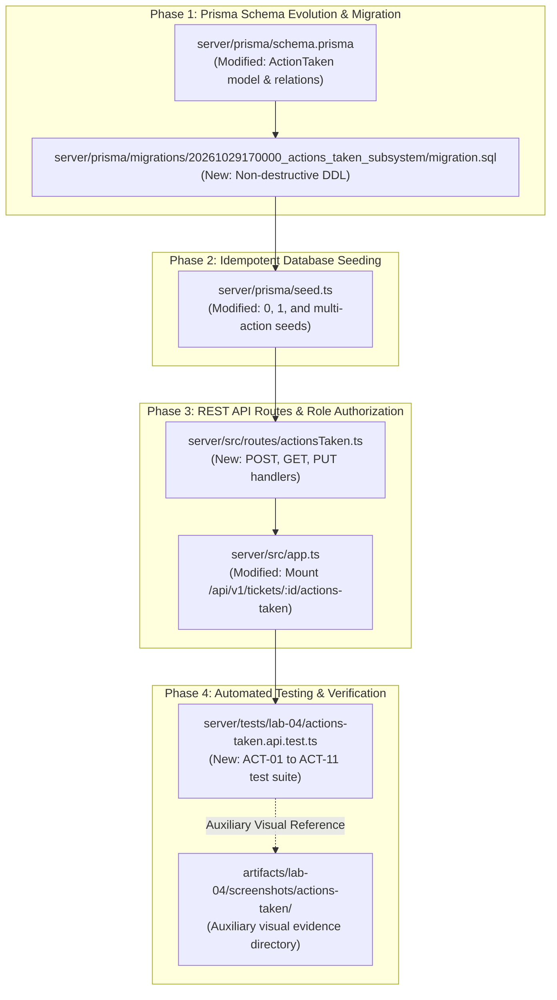
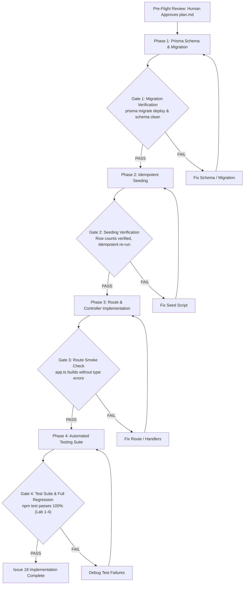

# Technical Implementation Plan: Issue 18 — Actions Taken Data Model, Migration, Seed Data & Backend APIs

**Document ID**: PLAN-FEAT-18  
**Feature Title**: Actions Taken Data Model, Migration, Seed Data & Backend APIs  
**Feature Branch**: `feature/18-actions-taken-foundation` (Issue 18)  
**Base Branch**: `lab4-staging` (incorporating `feature/17-spec-and-tests`)  
**Target Milestone**: TokTickIT Lab 4 (Sprint 4)  
**Authoritative Contract Reference**: [docs/features/18-actions-taken-foundation/contract.md](./contract.md)  
**Master Specifications**:
* [TokTickIT-System-Level-SDS-v1.0.pdf](../../reference/TokTickIT-System-Level-SDS-v1.0.pdf) (§Architecture, §Data Conventions, §Security Invariants)
* [Lab_04_labsheet.pdf](../../reference/Lab_04_labsheet.pdf) (§1, §3, §4.1, §4.2, §5.1, §6.1, §10, §11, §12, §14 Part 1–2)
* [docs/lab-04/specification.md](../../lab-04/specification.md) (`FR-01`, `FR-02`, `FR-05`, `BR-01`–`BR-06`, `BR-10`, `AC-01`–`AC-06`, Decisions 1–3)
* [docs/lab-04/api-spec.md](../../lab-04/api-spec.md) (§2.1, §2.2, §2.3)
* [docs/lab-04/tests.md](../../lab-04/tests.md) (STS Test Catalog: `ACT-01` through `ACT-08`)
* [docs/lab-04/poc-scope-and-issues.md](../../lab-04/poc-scope-and-issues.md) (Issue 18 Decomposition)
* [AGENTS.md](../../../AGENTS.md) (Developer Work Norms: Closed-World Rule, TDD, Theme Compliance, Blur Validation Rule)
**Document Status**: Ready for Review & Execution  

---

## 1. Target File Inventory

Below is the complete, exhaustive inventory of all files to be created or modified across `server/`, `prisma/`, and `tests/`:



### Detailed Target File Inventory Table

| Component | Path | Action | Description & Responsibilities |
| :--- | :--- | :---: | :--- |
| **Prisma Schema** | `server/prisma/schema.prisma` | `MODIFY` | Define `ActionTaken` model with single and composite indexes; add reciprocal relations to `Ticket` (`actionsTaken ActionTaken[]`) and `User` (`actionsTaken ActionTaken[] @relation("UserActionsTaken")`). |
| **Prisma Migration** | `server/prisma/migrations/20261029170000_actions_taken_subsystem/migration.sql` | `CREATE` | Non-destructive SQL migration script with `CREATE TABLE IF NOT EXISTS "actions_taken"` and idempotent foreign key constraints; 100% preservation of legacy data. |
| **Prisma Seed** | `server/prisma/seed.ts` | `MODIFY` | Populate seed tickets with 0 actions (`TKT-2026-00002`, `00009`, `00011`), 1 action (`00004`, `00005`), and multiple actions across distinct IT staff (`00001`, `00003`) with toggled follow-up fields and attachment notes. Guarded by count checks for idempotency. |
| **API Route / Controller** | `server/src/routes/actionsTaken.ts` | `CREATE` | Dedicated Express route and controller handlers for `POST /api/v1/tickets/:id/actions-taken`, `GET /api/v1/tickets/:id/actions-taken`, and `PUT /api/v1/tickets/:id/actions-taken/:actionId` with auth guards and payload validation. |
| **Server App** | `server/src/app.ts` | `MODIFY` | Mount `actionsTakenRouter` under `/api/v1/tickets/:id/actions-taken` and `/api/tickets/:id/actions-taken` guarded by `requirePasswordChanged`. |
| **Integration Tests** | `server/tests/lab-04/actions-taken.api.test.ts` | `CREATE` | Supertest + Vitest automated API integration test suite covering `ACT-01` through `ACT-11` and Acceptance Criteria `AC-18.1` to `AC-18.5`. |
| **Visual Artifacts** | `artifacts/lab-04/screenshots/actions-taken/` | `PRESERVE` | Auxiliary visual evidence directory for Playwright screenshots, strictly isolated from test assertion specifications. |

---

## 2. Phase 1: Prisma Schema Evolution & Non-Destructive Database Migration

### 2.1. Prisma Schema Modifications (`server/prisma/schema.prisma`)

1. **User Model (`model User`)**:
   Add reciprocal relation for actions performed by IT staff:
   ```prisma
   // server/prisma/schema.prisma
   model User {
     // ... existing fields ...
     submittedTickets   Ticket[]        @relation("RequesterTickets")
     assignedTickets    Ticket[]        @relation("StaffOwnedTickets")
     removedAttachments Attachment[]    @relation("UserRemovedAttachments")
     publicComments     PublicComment[] @relation("UserPublicComments")
     internalNotes      InternalNote[]  @relation("UserInternalNotes")

     // Issue 18 increment: Actions performed by this user (IT Staff / Administrator)
     actionsTaken       ActionTaken[]   @relation("UserActionsTaken")

     @@map("users")
   }
   ```

2. **Ticket Model (`model Ticket`)**:
   Add reciprocal relation for discrete actions taken under the ticket:
   ```prisma
   // server/prisma/schema.prisma
   model Ticket {
     // ... existing fields ...
     requester           User          @relation("RequesterTickets", fields: [requesterId], references: [id], onDelete: Restrict)
     owner               User?         @relation("StaffOwnedTickets", fields: [ownerId], references: [id], onDelete: SetNull)
     category            Category      @relation(fields: [categoryId], references: [id], onDelete: Restrict)
     relatedSystem       RelatedSystem @relation(fields: [relatedSystemId], references: [id], onDelete: Restrict)
     attachments         Attachment[]
     publicComments      PublicComment[]
     internalNotes       InternalNote[]

     // Issue 18 increment: Parent-child relationship with discrete actions taken
     actionsTaken        ActionTaken[]

     @@index([requesterId])
     @@index([ownerId])
     @@index([currentStatus])
     @@index([itPriority])
     @@index([createdAt])
     @@map("tickets")
   }
   ```

3. **ActionTaken Model (`model ActionTaken`)**:
   Define the complete data model adhering strictly to `specification.md` and `contract.md`:
   ```prisma
   // ---------------------------------------------------------------------------
   // 9. Action Taken Model (Issue 18 Increment: Granular Work Tracking)
   // ---------------------------------------------------------------------------
   model ActionTaken {
     id                Int      @id @default(autoincrement())
     ticketId          Int
     actionDateTime    DateTime @default(now())
     actionDescription String   @db.VarChar(1000)
     result            String   @db.VarChar(1000)
     performedById     Int
     followUpRequired  Boolean  @default(false)
     followUpNote      String?  @db.VarChar(1000)
     attachmentNotes   String?  @db.VarChar(500)
     createdAt         DateTime @default(now())
     updatedAt         DateTime @updatedAt

     // Relational Integrity
     ticket            Ticket   @relation(fields: [ticketId], references: [id], onDelete: Cascade)
     performedBy       User     @relation("UserActionsTaken", fields: [performedById], references: [id], onDelete: Restrict)

     @@index([ticketId])
     @@index([performedById])
     @@index([actionDateTime])
     @@index([ticketId, actionDateTime])
     @@map("actions_taken")
   }
   ```

### 2.2. Non-Destructive Migration Strategy & SQL Definition

To guarantee 100% preservation of all legacy data from Labs 1 through 3, the migration script will be created at:  
`server/prisma/migrations/20261029170000_actions_taken_subsystem/migration.sql`

```sql
-- server/prisma/migrations/20261029170000_actions_taken_subsystem/migration.sql

-- 1. Create actions_taken table if not exists
CREATE TABLE IF NOT EXISTS "actions_taken" (
    "id" SERIAL NOT NULL,
    "ticketId" INTEGER NOT NULL,
    "actionDateTime" TIMESTAMP(3) NOT NULL DEFAULT CURRENT_TIMESTAMP,
    "actionDescription" VARCHAR(1000) NOT NULL,
    "result" VARCHAR(1000) NOT NULL,
    "performedById" INTEGER NOT NULL,
    "followUpRequired" BOOLEAN NOT NULL DEFAULT false,
    "followUpNote" VARCHAR(1000),
    "attachmentNotes" VARCHAR(500),
    "createdAt" TIMESTAMP(3) NOT NULL DEFAULT CURRENT_TIMESTAMP,
    "updatedAt" TIMESTAMP(3) NOT NULL DEFAULT CURRENT_TIMESTAMP,

    CONSTRAINT "actions_taken_pkey" PRIMARY KEY ("id")
);

-- 2. Create single and composite indexes
CREATE INDEX IF NOT EXISTS "actions_taken_ticketId_idx" ON "actions_taken"("ticketId");
CREATE INDEX IF NOT EXISTS "actions_taken_performedById_idx" ON "actions_taken"("performedById");
CREATE INDEX IF NOT EXISTS "actions_taken_actionDateTime_idx" ON "actions_taken"("actionDateTime");
CREATE INDEX IF NOT EXISTS "actions_taken_ticketId_actionDateTime_idx" ON "actions_taken"("ticketId", "actionDateTime");

-- 3. Add foreign key constraints safely
DO $$
BEGIN
  IF NOT EXISTS (
    SELECT 1 FROM pg_constraint WHERE conname = 'actions_taken_ticketId_fkey'
  ) THEN
    ALTER TABLE "actions_taken" ADD CONSTRAINT "actions_taken_ticketId_fkey" 
      FOREIGN KEY ("ticketId") REFERENCES "tickets"("id") ON DELETE CASCADE ON UPDATE CASCADE;
  END IF;

  IF NOT EXISTS (
    SELECT 1 FROM pg_constraint WHERE conname = 'actions_taken_performedById_fkey'
  ) THEN
    ALTER TABLE "actions_taken" ADD CONSTRAINT "actions_taken_performedById_fkey" 
      FOREIGN KEY ("performedById") REFERENCES "users"("id") ON DELETE RESTRICT ON UPDATE CASCADE;
  END IF;
END $$;
```

* **Execution Commands**:
  ```bash
  cd server
  npx prisma generate
  npx prisma migrate deploy
  ```
* **Rollback Plan**:
  ```sql
  DROP TABLE IF EXISTS "actions_taken" CASCADE;
  ```

---

## 3. Phase 2: Idempotent Database Seeding (`server/prisma/seed.ts`)

### 3.1. Seeding Implementation Strategy

Extend `server/prisma/seed.ts` with a dedicated section `// 7. Seed Actions Taken (Issue 18 Increment)` that executes after tickets, comments, and attachments are seeded.

The seed logic must:
1. Lookup existing user IDs from `userMap` (`wichai.it@kmutt.ac.th`, `ekachai.it@kmutt.ac.th`, `nareerat.it@kmutt.ac.th`).
2. Lookup tickets by `ticketNumber`.
3. Check `const existingCount = await prismaClient.actionTaken.count({ where: { ticketId: ticket.id } })`. If `existingCount > 0`, skip insertion to ensure strict idempotency.
4. Populate the target tickets according to the master specification:

```typescript
// Seed data mapping plan
const actionsToSeed = [
  // TKT-2026-00001: 2 Actions by different IT staff members
  {
    ticketNumber: "TKT-2026-00001",
    actions: [
      {
        performerEmail: "wichai.it@kmutt.ac.th",
        actionDateTime: new Date("2026-09-03T11:15:00Z"),
        actionDescription: "Inspected CB2 3rd floor rack switch. Port 14 link flapping detected. Replaced patch cord.",
        result: "Port link stabilized at 1Gbps full duplex. Packet loss dropped to 0%.",
        followUpRequired: true,
        followUpNote: "Check port drop statistics tomorrow morning after 9:00 AM lectures.",
        attachmentNotes: "Cross-referenced with seed-wifi-signal-analysis.pdf.",
      },
      {
        performerEmail: "ekachai.it@kmutt.ac.th",
        actionDateTime: new Date("2026-09-03T14:30:00Z"),
        actionDescription: "Conducted follow-up telemetry check on switch port 14 via SNMP console.",
        result: "Zero CRC errors or packet drops over past 3 hours. Signal stable.",
        followUpRequired: false,
        followUpNote: null,
        attachmentNotes: null,
      },
    ],
  },
  // TKT-2026-00003: 2 Actions by different IT staff members
  {
    ticketNumber: "TKT-2026-00003",
    actions: [
      {
        performerEmail: "nareerat.it@kmutt.ac.th",
        actionDateTime: new Date("2026-09-03T11:30:00Z"),
        actionDescription: "Analyzed LEB2 reverse proxy firewall logs. Discovered blocked subnet from student dormitories.",
        result: "Whitelisted dormitory subnet CIDR 10.24.0.0/16 in gateway security group.",
        followUpRequired: true,
        followUpNote: "Request student test submission and monitor proxy latency during peak hours.",
        attachmentNotes: null,
      },
      {
        performerEmail: "wichai.it@kmutt.ac.th",
        actionDateTime: new Date("2026-09-03T13:45:00Z"),
        actionDescription: "Performed end-to-end SSL handshake test from CB2 dormitory terminal.",
        result: "HTTPS connection succeeded in 42ms. Homework portal loaded cleanly.",
        followUpRequired: false,
        followUpNote: null,
        attachmentNotes: null,
      },
    ],
  },
  // TKT-2026-00004: 1 Action with followUpRequired=true
  {
    ticketNumber: "TKT-2026-00004",
    actions: [
      {
        performerEmail: "wichai.it@kmutt.ac.th",
        actionDateTime: new Date("2026-09-03T12:15:00Z"),
        actionDescription: "Reconfigured Cisco AnyConnect client profile on macOS Sonoma to use DTLS 1.2 tunnel.",
        result: "VPN established successfully without packet timeouts.",
        followUpRequired: true,
        followUpNote: "Verify macOS auto-reconnect behavior after laptop sleep cycle.",
        attachmentNotes: null,
      },
    ],
  },
  // TKT-2026-00005: 1 Action with followUpRequired=false resolving hardware request
  {
    ticketNumber: "TKT-2026-00005",
    actions: [
      {
        performerEmail: "ekachai.it@kmutt.ac.th",
        actionDateTime: new Date("2026-09-03T13:00:00Z"),
        actionDescription: "Retrieved 24-inch Dell HDMI monitor from inventory (Asset #KMUTT-MON-8812) and installed at faculty desk.",
        result: "Dual display output working at 1920x1080 @ 60Hz.",
        followUpRequired: false,
        followUpNote: null,
        attachmentNotes: "Asset delivery form signed and filed.",
      },
    ],
  },
  // TKT-2026-00002, TKT-2026-00009, TKT-2026-00011: EXPLICITLY 0 ACTIONS
];
```

* **Idempotency Verification**: Running `npm run seed` twice in succession yields identical row counts in `actions_taken` without creating duplicate records or throwing foreign key conflicts.

---

## 4. Phase 3: REST API Routes, Controllers & Role Authorization

### 4.1. Dedicated Router Module (`server/src/routes/actionsTaken.ts`)

Create `server/src/routes/actionsTaken.ts` exporting `actionsTakenRouter = Router({ mergeParams: true })` containing the controller handlers:

```typescript
// server/src/routes/actionsTaken.ts architecture
import { Router, Request, Response } from "express";
import { getPrisma } from "../prisma.js";
import { requireAuth, requireRole } from "../middleware/auth.js";

export const actionsTakenRouter = Router({ mergeParams: true });
```

### 4.2. Endpoint 1: Create Action Taken
`POST /api/v1/tickets/:id/actions-taken`

* **Middleware Pipeline**: `authenticateUser` (global), `requirePasswordChanged` (global/route), `requireRole("IT_STAFF", "ADMINISTRATOR")`.
* **Execution Flow**:
  1. Validate `req.user` exists and has `IT_STAFF` or `ADMINISTRATOR` role. If `REQUESTER`, return `403 Forbidden` (`FORBIDDEN`).
  2. Parse `ticketId = parseInt(req.params.id, 10)`. If `isNaN(ticketId) || ticketId <= 0`, return `404 Not Found` (`TICKET_NOT_FOUND`).
  3. Verify ticket exists in database: `const ticket = await prisma.ticket.findUnique({ where: { id: ticketId } })`. If null, return `404 Not Found` (`TICKET_NOT_FOUND`).
  4. **Auto-derive Performer**: `const performedById = req.user.id`. Any `req.body.performedById` provided by client is ignored.
  5. **Payload Validation**:
     - `actionDateTime`: Defaults to `new Date()`. If string supplied, validate date parsing. If `parsedDate > new Date()`, return `400 Bad Request` with message `"Action date/time cannot be in the future."`.
     - `actionDescription`: Trim whitespace. Verify length between 5 and 1,000 characters. If invalid, return `400 Bad Request` (`VALIDATION_FAILED`).
     - `result`: Trim whitespace. Verify length between 2 and 1,000 characters. If invalid, return `400 Bad Request` (`VALIDATION_FAILED`).
     - `followUpRequired`: Verify boolean type (`typeof req.body.followUpRequired === "boolean"`). If invalid, return `400 Bad Request`.
     - `followUpNote`:
       - If `followUpRequired === true`: Must be a string with trimmed length between 3 and 1,000 characters. If missing or empty, return `400 Bad Request` (`VALIDATION_FAILED`) with message `"Follow-up note is required when follow-up is needed (3-1000 characters)."`.
       - If `followUpRequired === false`: Force `followUpNote = null`.
     - `attachmentNotes`: If provided, trim and verify length $\le 500$ characters. If null/undefined/empty, set `null`.
  6. **Persistence**:
     ```typescript
     const actionTaken = await prisma.actionTaken.create({
       data: {
         ticketId,
         actionDateTime,
         actionDescription: trimmedDescription,
         result: trimmedResult,
         performedById,
         followUpRequired,
         followUpNote,
         attachmentNotes,
       },
       include: {
         performedBy: {
           select: { id: true, name: true, email: true, role: true },
         },
       },
     });
     ```
  7. **Response**: Return `201 Created` with formatted DTO matching `api-spec.md` §2.1.

### 4.3. Endpoint 2: List Actions Taken for Ticket
`GET /api/v1/tickets/:id/actions-taken`

* **Middleware Pipeline**: `authenticateUser` (global), `requireAuth`.
* **Execution Flow**:
  1. Validate `req.user` exists (else `401 Unauthorized`).
  2. Parse `ticketId = parseInt(req.params.id, 10)`. If invalid, return `404 Not Found`.
  3. Query ticket: `const ticket = await prisma.ticket.findUnique({ where: { id: ticketId }, select: { id: true, requesterId: true } })`. If null, return `404 Not Found`.
  4. **Access Control Check (`BR-03`)**:
     - If `req.user.role === "REQUESTER"` and `ticket.requesterId !== req.user.id`:
       Return `403 Forbidden` (`FORBIDDEN`) with message `"You do not have permission to view actions for this ticket."`.
     - If `IT_STAFF` or `ADMINISTRATOR`, grant global access.
  5. **Query Child Actions**:
     ```typescript
     const actions = await prisma.actionTaken.findMany({
       where: { ticketId },
       orderBy: { actionDateTime: "asc" },
       include: {
         performedBy: {
           select: { id: true, name: true, email: true, role: true },
         },
       },
     });
     ```
  6. **Response**: Return `200 OK` with `{ actionsTaken: actions }`. If no actions exist, returns `{ actionsTaken: [] }` safely.

### 4.4. Endpoint 3: Update Action Taken
`PUT /api/v1/tickets/:id/actions-taken/:actionId`

* **Middleware Pipeline**: `authenticateUser` (global), `requireRole("IT_STAFF", "ADMINISTRATOR")`.
* **Execution Flow**:
  1. Verify role is `IT_STAFF` or `ADMINISTRATOR` (else `403 Forbidden`).
  2. Parse `ticketId` and `actionId`. Verify both are positive integers (else `404 Not Found`).
  3. Query existing action:
     ```typescript
     const existingAction = await prisma.actionTaken.findFirst({
       where: { id: actionId, ticketId },
     });
     ```
     If null, return `404 Not Found` (`NOT_FOUND`).
  4. **Optimistic Concurrency Check (`BR-10`)**:
     If `req.body.versionTimestamp` is provided:
     ```typescript
     if (new Date(req.body.versionTimestamp).getTime() !== existingAction.updatedAt.getTime()) {
       return res.status(409).json({
         error: {
           code: "STALE_RECORD_CONFLICT",
           message: "The action taken record was modified by another user. Please reload the ticket.",
           timestamp: new Date().toISOString(),
         },
       });
     }
     ```
  5. **Validation**: Execute identical validation rules as `POST` for `actionDateTime`, `actionDescription`, `result`, `followUpRequired`, `followUpNote`, and `attachmentNotes`.
  6. **Immutable Performer Enforcement (`BR-06`)**:
     Do **not** update `performedById`. It remains `existingAction.performedById`.
  7. **Update**:
     ```typescript
     const updatedAction = await prisma.actionTaken.update({
       where: { id: actionId },
       data: {
         actionDateTime,
         actionDescription: trimmedDescription,
         result: trimmedResult,
         followUpRequired,
         followUpNote,
         attachmentNotes,
       },
       include: {
         performedBy: {
           select: { id: true, name: true, email: true, role: true },
         },
       },
     });
     ```
  8. **Response**: Return `200 OK` with `{ actionTaken: updatedAction }`.

### 4.5. Express App Route Mounting (`server/src/app.ts`)

Mount the router in `server/src/app.ts`:
```typescript
import { actionsTakenRouter } from "./routes/actionsTaken.js";

// Mount actions taken router
app.use("/api/v1/tickets/:id/actions-taken", requirePasswordChanged, actionsTakenRouter);
app.use("/api/tickets/:id/actions-taken", requirePasswordChanged, actionsTakenRouter);
```

---

## 5. Phase 4: Automated Testing & Playwright Safeguards

### 5.1. API Integration Test Suite (`server/tests/lab-04/actions-taken.api.test.ts`)

Author the comprehensive Vitest + Supertest suite in `server/tests/lab-04/actions-taken.api.test.ts` covering all required scenarios:

```typescript
// Test mapping structure
describe("Issue 18: Actions Taken API Integration Suite", () => {
  // Session tokens & fixture variables
  let staffToken: string;
  let adminToken: string;
  let requesterToken: string;
  let otherRequesterToken: string;
  let staffCookie: string[];
  let requesterCookie: string[];
  let otherRequesterCookie: string[];
  let ownedTicketId: number;
  let unownedTicketId: number;
  let zeroActionTicketId: number;

  beforeAll(async () => {
    await seed();
    // 1. Authenticate wichai.it@kmutt.ac.th (IT Staff)
    // 2. Authenticate admin.toktick@kmutt.ac.th (Admin)
    // 3. Authenticate sompong.it@kmutt.ac.th (Requester)
    // 4. Authenticate kittisak.stu@kmutt.ac.th (Other Requester)
    // 5. Query target test tickets from database
  });

  // ACT-01: Create valid action taken by IT Staff (AC-18.1)
  it("ACT-01: IT Staff creates valid Action Taken (201 Created)", async () => { ... });

  // ACT-02: Auto-derived performer audit trail (AC-18.1, BR-02, BR-06)
  it("ACT-02: Performer ID auto-derived from session; payload spoofing ignored", async () => { ... });

  // ACT-03: Missing follow-up note when required (AC-18.3, BR-05)
  it("ACT-03: followUpRequired=true without note returns 400 Bad Request", async () => { ... });

  // ACT-04: Valid follow-up note persisted (AC-18.3, BR-05)
  it("ACT-04: followUpRequired=true with note persists successfully", async () => { ... });

  // ACT-05: Update existing action taken (AC-18.1, BR-04, BR-06)
  it("ACT-05: Staff updates action description; performer remains immutable (200 OK)", async () => { ... });

  // ACT-06: Requester queries actions for owned ticket (AC-18.4, BR-03)
  it("ACT-06: Requester retrieves actions for owned ticket (200 OK)", async () => { ... });

  // ACT-07: Requester attempts to create action taken (AC-18.2, BR-03)
  it("ACT-07: Requester write attempt (POST) rejected with 403 Forbidden", async () => { ... });

  // ACT-08: Requester attempts to update action taken (AC-18.2, BR-03)
  it("ACT-08: Requester update attempt (PUT) rejected with 403 Forbidden", async () => { ... });

  // ACT-09: Safe empty array handling for zero-action tickets (AC-18.4)
  it("ACT-09: Zero-action ticket safely returns empty array [] (200 OK)", async () => { ... });

  // ACT-10: Requester queries unowned ticket actions (AC-18.5, BR-03)
  it("ACT-10: Requester querying unowned ticket actions rejected with 403 Forbidden", async () => { ... });

  // ACT-11: Optimistic concurrency conflict on stale update (BR-10)
  it("ACT-11: Stale versionTimestamp on PUT returns 409 Conflict", async () => { ... });
});
```

### 5.2. Playwright Visual Verification Safeguard

> [!IMPORTANT]
> **Auxiliary Screenshot Isolation Rule**:  
> In accordance with course guidelines and the engineering contract:
> 1. Playwright screenshot generation is strictly an auxiliary visual verification step for developer review.
> 2. Screenshots must be saved strictly to `artifacts/lab-04/screenshots/actions-taken/`.
> 3. Visual screenshot checks must **never** be added to `docs/lab-04/tests.md` or mixed into Vitest/Jest unit/API test assertion files.
> 4. Full browser E2E workflows involving UI interactions belong to Issue 19 (`feature/19-actions-taken-ui`) and Issue 22 (`feature/22-e2e-polish-release`).

---

## 6. Execution Roadmap & Verification Gates



### Verification Gate Commands

1. **Gate 1 (Schema & Migration)**:
   ```bash
   cd server
   npx prisma generate
   npx prisma migrate status
   ```
2. **Gate 2 (Database Seeding)**:
   ```bash
   cd server
   npm run seed
   # Re-run to verify idempotency:
   npm run seed
   ```
3. **Gate 3 (Build & Typecheck)**:
   ```bash
   cd server
   npm run build
   ```
4. **Gate 4 (API Test Execution & Full Regression)**:
   ```bash
   cd server
   npx vitest run tests/lab-04/actions-taken.api.test.ts
   # Full regression pass across Labs 1-4:
   npm test
   ```

