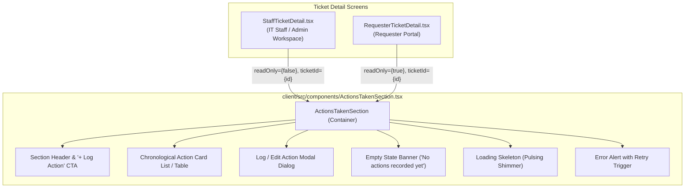
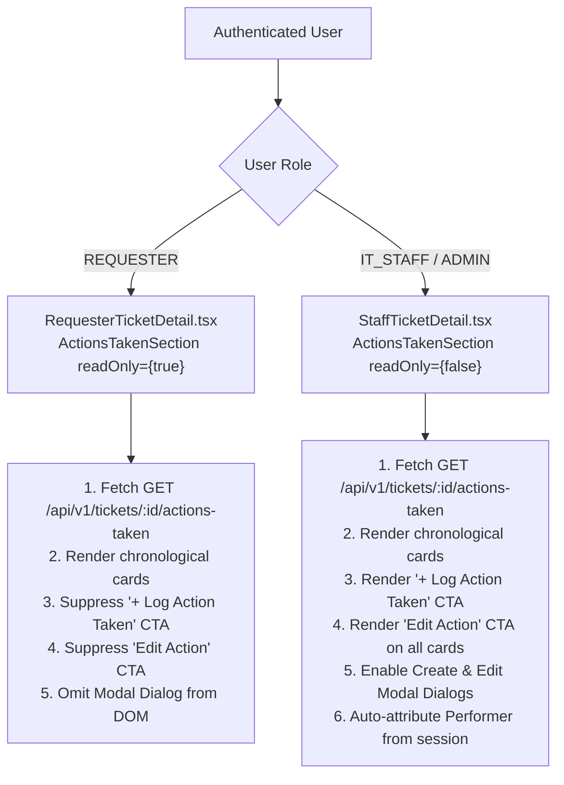

# Feature 19 Engineering Contract: Actions Taken UI, Ticket Detail Integration & Access Control

**Feature Title**: Actions Taken UI, Ticket Detail Integration & Access Control  
**Branch Name**: `feature/19-actions-taken-ui` (Issue 19)  
**Base Branch**: `lab4-staging` (incorporating `feature/17-spec-and-tests` and `feature/18-actions-taken-foundation`)  
**Document Status**: Approved Feature Engineering Contract  
**Author**: TokTickIT Engineering Team  
**Traceability References**:
* [TokTickIT-System-Level-SDS-v1.0.pdf](../../reference/TokTickIT-System-Level-SDS-v1.0.pdf) (§Architecture, §Data Conventions, §Security Invariants)
* [Lab_04_labsheet.pdf](../../reference/Lab_04_labsheet.pdf) (§1, §3, §4.1, §4.2, §7, §8, §10, §11, §12, §14 Part 3)
* [docs/lab-04/specification.md](../../lab-04/specification.md) (`FR-01`, `FR-02`, `FR-05`, `FR-06`, `BR-01`, `BR-02`, `BR-03`, `BR-04`, `BR-05`, `BR-06`, `BR-10`, `AC-01` to `AC-06`)
* [docs/lab-04/ui-spec.md](../../lab-04/ui-spec.md) (§1 Design Tokens, §2 Typography & Badges, §3.4 Actions Taken Section, §4 Responsive Breakpoints, §5 Feedback States, §6 Accessibility Checklist)
* [docs/lab-04/api-spec.md](../../lab-04/api-spec.md) (§2.1 Create Action Taken, §2.2 List Actions Taken, §2.3 Update Action Taken)
* [docs/lab-04/tests.md](../../lab-04/tests.md) (STS Test Catalog: `UI-ACT-01`, `UI-ACT-02`, `UI-ACT-03`, `E2E-01`)
* [docs/lab-04/poc-scope-and-issues.md](../../lab-04/poc-scope-and-issues.md) (Issue 19 Scope & Decomposition)
* [docs/features/18-actions-taken-foundation/contract.md](../18-actions-taken-foundation/contract.md) (Completed Backend Foundation)
* [AGENTS.md](../../../AGENTS.md) (Developer Work Norms: Strict Closed-World Rule, TDD, Theme Compliance, Blur Validation Rule)

---

## 1. Feature Goal & Scope

### 1.1. Strategic Objectives
Issue 19 implements the user interface and client integration layer for the **Actions Taken Subsystem** in TokTickIT Sprint 4 (Lab 4). While Issue 18 established the PostgreSQL relational model (`ActionTaken`), Prisma migrations, idempotent seed data, and backend REST API endpoints (`POST`, `GET`, `PUT` on `/api/v1/tickets/:id/actions-taken`), Issue 19 brings this capability to life in the web browser.

Key objectives include:
1. **Modular Work Item Component (`ActionsTakenSection.tsx`)**: Construct a highly modular, reusable React component that manages the retrieval, rendering, creation, and updating of discrete Action Taken records under any Ticket.
2. **Seamless Ticket Detail Integration**: Embed `ActionsTakenSection.tsx` into both `StaffTicketDetail.tsx` (operational workspace for IT Staff and Administrators) and `RequesterTicketDetail.tsx` (customer-facing view for Students, Faculty, and Staff).
3. **Tri-Thread Visual Differentiation**: Establish clear visual separation among TokTickIT's three distinct communication and activity streams—**Actions Taken** (technical work log), **Public Comments** (bidirectional user communication), and **Internal Notes** (confidential staff diagnostics)—using Zen Green design tokens (`#006B3C`, `#0B7A46`, `#EAF6EF`, `#F5F7F6`).
4. **Dynamic Form Controls & Blur Validation**: Provide modal dialog forms for creating and editing actions with auto-populated read-only performer displays, dynamic toggling for conditional follow-up notes, character limits, blur formatting rules, busy submit states with animated spinners, and local form state preservation during recoverable errors.
5. **Strict Role-Based UI Access Control (`BR-03`)**: Enforce complete suppression of creation and edit controls for Requesters in `RequesterTicketDetail.tsx`, presenting a read-only historical timeline of work performed. Grant full creation and update capabilities to IT Staff and Administrators in `StaffTicketDetail.tsx`.
6. **Responsive Layouts & Resilience**: Provide full-width tabular and rich card layouts on Desktop ($\ge 1200\text{px}$), compact stacked cards on Tablet ($768\text{px}-1024\text{px}$), and full-width mobile card lists on Mobile ($< 768\text{px}$) with zero horizontal scrolling. Provide elegant loading skeletons, empty states, and error banners with retry buttons.

### 1.2. In-Scope Deliverables
1. **Modular React Component (`client/src/components/ActionsTakenSection.tsx`)**:
   - Chronological list of actions sorted ascending by `actionDateTime`.
   - Card/row presentation rendering Date/Time, Performed By (with role badge), Description, Result, Follow-Up badge/callout, and Attachment Notes.
   - Interactive modal dialogs for "Log New Action Taken" and "Edit Action Taken".
   - Dynamic toggle for Follow-Up Required with conditionally displayed and validated Follow-up Note input.
   - Non-editable Performer display card auto-reflecting the authenticated user's session.
   - Local validation, blur rules, loading skeletons, empty state, and error handling.
2. **Staff Ticket Detail Integration (`client/src/components/StaffTicketDetail.tsx`)**:
   - Embed `ActionsTakenSection` prominently below ticket attributes and above the dual-thread comments/notes section.
   - Pass `ticketId={ticket.id}`, `readOnly={false}`, and staff user context.
   - Enable staff to review existing actions and log new investigation/remediation steps.
3. **Requester Ticket Detail Integration (`client/src/components/RequesterTicketDetail.tsx`)**:
   - Embed `ActionsTakenSection` with `readOnly={true}`.
   - Suppress "+ Log Action Taken" CTA button, "Edit Action" buttons, and modal dialogs.
   - Provide requesters with clear transparency into technical actions taken on their tickets.
4. **Client API Methods & TypeScript DTOs (`client/src/api.ts`)**:
   - TypeScript interfaces: `ActionTakenDTO`, `CreateActionTakenPayload`, `UpdateActionTakenPayload`, `ActionTakenListResponse`, `ActionTakenSingleResponse`.
   - API client methods:
     - `fetchActionsTaken(ticketId: number): Promise<ActionTakenListResponse>`
     - `createActionTaken(ticketId: number, payload: CreateActionTakenPayload): Promise<ActionTakenSingleResponse>`
     - `updateActionTaken(ticketId: number, actionId: number, payload: UpdateActionTakenPayload): Promise<ActionTakenSingleResponse>`
5. **Zen Green Theme Styling & Tokens (`client/src/index.css`)**:
   - Define dedicated CSS rules and variables for Action Taken cards, modal dialogs, follow-up callouts, and responsive stacking.
6. **Automated Frontend Test Suite (`client/src/tests/lab-04/ActionsTaken.test.tsx`)**:
   - Comprehensive unit and component tests verifying rendering, conditional follow-up behavior, blur validation, API submission, requester read-only mode, empty states, and responsive styling.

### 1.3. Explicitly Excluded Scope (Out of Scope for Issue 19)
* **Backend Model & API Modifications**: Schema migrations, seed data, and backend routes were delivered in Issue 18; Issue 19 consumes them without altering server code.
* **Resolution Gate State Machine Enforcement**: Programmatically rejecting ticket status transitions to `RESOLVED` or `CLOSED` when Actions Taken count is 0 is deferred to Issue 20 (`feature/20-ticket-workflow`).
* **Role-Appropriate Dashboards**: Aggregating ticket metrics for Requesters, IT Staff, and Administrators is deferred to Issue 21 (`feature/21-role-dashboards`).
* **Timesheet Billing & Payroll Calculations (§4.2)**: No hourly labor rates, staff timesheet submissions, billable hour tracking, or client invoicing.
* **Direct File Uploads within Actions Taken**: Files remain ticket-level attachments managed by `AttachmentSection.tsx`; Actions Taken capture text cross-references via `attachmentNotes` pointing to uploaded files or physical assets.
* **Automated SLA Timers & Escalations**: No automated breach alarms, warning clocks, or on-call paging.
* **Playwright Visual Assertions in STS**: Playwright screenshot generation is strictly an auxiliary visual verification step for developer review (saving screenshot artifacts to `artifacts/lab-04/screenshots/actions-taken/`). Playwright visual checks must never be added to `docs/lab-04/tests.md` or mixed into Jest/Vitest unit test specifications.

---

## 2. UI Component Architecture & Visual Differentiation

### 2.1. Component Hierarchy & Prop Contract

The Actions Taken subsystem is organized cleanly within the React component hierarchy:



#### TypeScript Props Interface for `ActionsTakenSection.tsx`:
```typescript
export interface ActionsTakenSectionProps {
  /** Target ticket ID */
  ticketId: number;
  /** Whether controls are strictly read-only (true for Requesters, false for Staff/Admin) */
  readOnly?: boolean;
  /** Authenticated user details from AuthContext or RequesterContext */
  currentUser?: {
    id: number;
    name: string;
    email: string;
    role: "REQUESTER" | "IT_STAFF" | "ADMINISTRATOR";
  } | null;
  /** Optional callback notifying parent view when an action is created or updated */
  onActionsChanged?: (actions: ActionTakenDTO[]) => void;
}
```

### 2.2. Tri-Thread Visual Differentiation: Actions vs. Comments vs. Notes

TokTickIT features three distinct operational communication and activity streams on a Ticket. Resolvers and users must instantly recognize the semantic nature and confidentiality of each stream through standardized Zen Green design system tokens:

```
+--------------------------------------------------------------------------------------------------+
| 🛠️ ACTIONS TAKEN BY IT STAFF                                               [+ Log Action Taken]  |
| Surface: #FFFFFF | Border: #D1D5DB | Header: #F9FAFB | Accent: #006B3C                           |
| Purpose: Structured technical work log, hardware repairs, configuration steps, and outcomes.      |
+--------------------------------------------------------------------------------------------------+
| 💬 PUBLIC COMMENTS                                                              [Post Comment]    |
| Surface: #EAF6EF | Border: #0B7A46 | Header: Soft Pale Green                                      |
| Purpose: Transparent bidirectional conversation between Requester and IT Staff.                  |
+--------------------------------------------------------------------------------------------------+
| 🔒 CONFIDENTIAL INTERNAL NOTES (IT Staff & Admin Only)                      [Add Internal Note]  |
| Surface: #FFFBEB | Border: #F59E0B | Amber Warning Shield                                         |
| Purpose: Private diagnostic observations, vendor discussions, and sensitive handover notes.       |
+--------------------------------------------------------------------------------------------------+
```

#### Comparative Design Token Matrix:

| Feature / Attribute | 🛠️ Actions Taken (`ActionsTakenSection`) | 💬 Public Comments (`publicComments`) | 🔒 Internal Notes (`internalNotes`) |
| :--- | :--- | :--- | :--- |
| **Primary Audience** | All roles (Requester: Read-only; Staff: Full) | All roles (Requester & Staff: Append-only) | Staff & Admin only (Requester: Blocked) |
| **Card Surface Canvas** | `--zen-surface`: `#FFFFFF` | `--zen-comment-bg`: `#EAF6EF` | `--zen-note-bg`: `#FFFBEB` |
| **Border Styling** | `1px solid var(--zen-border-neutral)` (`#D1D5DB`) | `1px solid var(--zen-secondary-green)` (`#0B7A46`) | `1px solid var(--zen-warning-border)` (`#F59E0B`) |
| **Distinguishing Badge / Icon** | 🛠️ `Actions Taken` (Primary Green badge) | 💬 `Public Comment` (Pale Green badge) | 🔒 `IT Staff Only • Confidential` (Amber badge) |
| **Header Accent** | `--zen-primary-green`: `#006B3C` | `--zen-secondary-green`: `#0B7A46` | `--zen-warning`: `#D97706` |
| **Special Callouts** | Amber callout box for Follow-up Note | None (Standard speech bubble layout) | Amber background across entire card container |
| **Mutability** | Editable by Staff (`PUT` endpoint supported) | Append-only (No edit/delete) | Append-only (No edit/delete) |

### 2.3. Chronological List & Action Card Layout Specification

Actions Taken must be rendered in ascending chronological order (`actionDateTime ASC`), documenting the linear progression of technical intervention:

```
+--------------------------------------------------------------------------------------------------+
| Actions Taken by IT Staff (2)                                              [+ Log Action Taken]  |
| Granular investigation, troubleshooting steps, and technical actions performed.                  |
|--------------------------------------------------------------------------------------------------|
| [Card 1]                                                                                         |
| 🕒 2026-10-29 09:30   Performed by: Wichai IT [Staff]                      [✏️ Edit Action]       |
|                                                                                                  |
| Action Description:                                                                              |
| Inspected Cisco 2960 switch in Building 2, Room 304. Found port 14 link flapping. Replaced      |
| damaged patch cord.                                                                              |
|                                                                                                  |
| Result:                                                                                          |
| Port link stabilized at 1Gbps full duplex. Packet loss dropped to 0%. VLAN 10 traffic restored.  |
|                                                                                                  |
| 📎 Attachment Notes: Photo of damaged RJ45 clip uploaded to Attachments (switch_patch_bad.jpg).  |
|                                                                                                  |
| +----------------------------------------------------------------------------------------------+ |
| | ⚠️ Follow-up Required                                                                         | |
| | Check port drop statistics tomorrow morning after 9:00 AM lecture rush.                      | |
| +----------------------------------------------------------------------------------------------+ |
|--------------------------------------------------------------------------------------------------|
| [Card 2]                                                                                         |
| 🕒 2026-10-29 14:15   Performed by: Ekachai IT [Staff]                      [✏️ Edit Action]       |
|                                                                                                  |
| Action Description:                                                                              |
| Conducted SNMP telemetry poll and analyzed switch error counters on port 14.                     |
|                                                                                                  |
| Result:                                                                                          |
| Zero CRC errors or packet drops over past 4 hours. Core interface operating optimally.          |
|                                                                                                  |
| Follow-up: 🟢 No Follow-up Needed                                                                |
+--------------------------------------------------------------------------------------------------+
```

#### Detailed Item Attributes & Element Styling:
1. **Timestamp Display**: Formatted cleanly as `YYYY-MM-DD HH:mm` with clock icon (e.g. `🕒 2026-10-29 09:30`). Font size `var(--zen-font-size-meta)` (`13px`), color `var(--zen-text-muted)`.
2. **Performed By Attribution**: Bold text `Performed by: <Name>` accompanied by a colored role badge:
   - `IT_STAFF`: `<span class="badge" style="background-color: var(--zen-pale-green); color: var(--zen-primary-green); border: 1px solid #C4E5D2;">IT Staff</span>`.
   - `ADMINISTRATOR`: `<span class="badge" style="background-color: #F3E8FF; color: #6B21A8; border: 1px solid #E9D5FF;">Admin</span>`.
3. **Action Description & Result**:
   - Rendered with bold section titles (`Action Description:` and `Result:`).
   - Styled with `white-space: pre-wrap; word-break: break-word;` ensuring multiline text and long terminal outputs wrap properly.
4. **Follow-Up Section**:
   - When `followUpRequired === true`: Render an amber badge `⚠️ Follow-up Required` (`--zen-followup-badge-bg: #FEF3C7; color: #92400E;`) and render the `followUpNote` inside an amber callout container (`background-color: var(--zen-warning-bg); border-left: 4px solid var(--zen-warning-border); padding: 10px 14px; border-radius: 4px;`).
   - When `followUpRequired === false`: Render a subtle neutral badge `🟢 No Follow-up Needed` (`background-color: #F3F4F6; color: #4B5563;`).
5. **Attachment Notes Cross-Reference**:
   - Rendered with a paperclip icon `📎 Attachment Notes: <Notes>` only when populated; omitted completely from DOM when `null` or whitespace.
6. **Edit Action Trigger**:
   - Small outline button `✏️ Edit Action` aligned to the top-right of the card.
   - Visible exclusively to IT Staff and Administrators when `readOnly === false`.
   - Never rendered when `readOnly === true`.

---

## 3. Form Controls, Interaction Behavior & Validation

### 3.1. Modal Form Specification (Create & Edit Modes)

Actions Taken are created and edited via an accessible modal dialog (`role="dialog"`, `aria-modal="true"`, `aria-labelledby="action-modal-title"`).

```
+--------------------------------------------------------------------------------------------------+
| Log New Action Taken                                                                         [X] |
| Record diagnostic steps, physical repairs, or technical interventions.                           |
|--------------------------------------------------------------------------------------------------|
| [ Performed By Card (Read-Only) ]                                                                |
| 👤 Performed by: Wichai IT (wichai.it@kmutt.ac.th) [IT Staff]                                    |
| ℹ️ Auto-assigned from your authenticated session. This record will be permanently attributed.     |
|                                                                                                  |
| Action Date/Time *                                                                               |
| [ 2026-10-29T09:30                           📅 ]                                                |
| Defaults to now. Cannot be in the future.                                                        |
|                                                                                                  |
| Action Description *                                                                             |
| [ Describe the physical or remote diagnostic action taken...                                  ] |
| [                                                                                              ] |
| 112 / 1000 characters                                                                            |
|                                                                                                  |
| Result *                                                                                         |
| [ Document the immediate outcome or technical finding...                                      ] |
| [                                                                                              ] |
| 85 / 1000 characters                                                                             |
|                                                                                                  |
| [X] Follow-up Required?                                                                          |
|                                                                                                  |
| Follow-up Note * (Conditionally Visible)                                                         |
| [ Specify follow-up inspection, monitoring schedule, or further actions needed...              ] |
| 54 / 1000 characters                                                                             |
|                                                                                                  |
| Attachment Notes (Optional)                                                                      |
| [ e.g. Cross-referenced with photo switch_patch_bad.jpg in Attachments                        ] |
| 0 / 500 characters                                                                               |
|--------------------------------------------------------------------------------------------------|
| [ Cancel ]                                                             [ 💾 Save Action Taken ]  |
+--------------------------------------------------------------------------------------------------+
```

### 3.2. Form Fields & Interactive Behaviors

| Field Name | HTML Control | Initial Value (Create) | Initial Value (Edit) | Validation Constraints | Interaction / Validation Behavior |
| :--- | :--- | :--- | :--- | :--- | :--- |
| **Performed By** | Display card (non-input) | Current session user | Original performer from action DTO | Read-only; cannot be selected or altered | Displays user's name, email, and role badge. Informs user that attribution is immutable (`BR-02`, `BR-06`). |
| **Action Date/Time** | `<input type="datetime-local">` | Current local ISO string (`YYYY-MM-DDTHH:mm`) | Action's existing `actionDateTime` formatted to local datetime | Valid date; $\le \text{NOW()}$ (no future dates) | **Blur Rule**: Invalid format blanks out on blur. Submit validation rejects timestamps in the future with `"Action date/time cannot be in the future."`. |
| **Action Description** | `<textarea rows={3}>` | `""` | Existing `actionDescription` | Required; 5 to 1,000 characters (trimmed) | Live character counter (`X / 1000 characters`). Submit validation enforces minimum 5 characters. |
| **Result** | `<textarea rows={3}>` | `""` | Existing `result` | Required; 2 to 1,000 characters (trimmed) | Live character counter. Submit validation enforces minimum 2 characters. |
| **Follow-up Required?** | `<input type="checkbox">` | `false` (unchecked) | Existing `followUpRequired` (`true`/`false`) | Boolean | Clicking toggle updates boolean state. When checked, smoothly displays the **Follow-up Note** container. When unchecked, conceals note container and clears note input. |
| **Follow-up Note** | `<textarea rows={2}>` | `""` | Existing `followUpNote` or `""` | Conditionally required when toggle is true (3 to 1,000 chars); cleared when false | Rendered only when `followUpRequired === true`. Marked with required asterisk `*`. Validation fails if submitted empty while toggle is true. |
| **Attachment Notes** | `<input type="text">` | `""` | Existing `attachmentNotes` or `""` | Optional; max 500 characters | Helper text explains that files are uploaded in Attachments; this field holds cross-references. |

### 3.3. Blur Validation Rules & Form Lifecycle Norms (`AGENTS.md` §4)
1. **Blur Blanking Rule**: If an input field receives invalid formatting during general data entry (e.g. malformed date string), the field clears/blanks out on blur.
2. **Submit-Triggered Errors**: Red validation borders (`.is-invalid`), glow halos (`--zen-error-glow`), and inline error messages (`.zen-error-text`) appear **only** upon clicking the explicit **Save Action Taken** submit button.
3. **Submit Button Busy State**:
   - When the user clicks **Save Action Taken**, the submit button enters a busy state:
     - `disabled={true}`
     - Text transitions to `"Saving..."`
     - Displays an inline spinning indicator (`<span class="spinner-border spinner-border-sm me-2" role="status" aria-hidden="true" />`).
     - Cancel button is disabled to prevent accidental state corruption.
4. **Local Form State Preservation During Recoverable Errors**:
   - If the backend returns an error (e.g. HTTP `400 Bad Request`, `409 Conflict`, or `500 Internal Server Error`):
     - The modal dialog **must remain open**.
     - All user-entered text across Description, Result, Follow-up Note, and Attachment Notes **must be preserved** in local component state.
     - A prominent Zen Green error alert (`background-color: var(--zen-error-bg); color: var(--zen-error); border: 1px solid #FCA5A5;`) is displayed at the top of the modal rendering the server error message (`error.message`).
     - The submit button re-enables immediately, allowing the user to correct input and retry without retyping their work.
5. **Edit Mode Optimistic Concurrency Handling (`BR-10`)**:
   - When updating an action (`PUT /api/v1/tickets/:id/actions-taken/:actionId`), the client sends `versionTimestamp: editingAction.updatedAt`.
   - If another staff member updated the action concurrently, the server responds with HTTP `409 Conflict` (`STALE_RECORD_CONFLICT`).
   - The UI presents a clear conflict alert: *"This action record was updated by another user while you were editing. Please reload the ticket to view the latest changes."* with a **Reload** button.

---

## 4. Access Control & Role Enforcement Matrix

Access control is strictly applied at both the UI presentation layer and the backend REST API boundary:



### 4.1. Access Control Enforcement Specification

| Role | UI Screen | Can View Actions? | Can See "+ Log Action"? | Can Open Create Modal? | Can See "Edit Action"? | Backend Authorization |
| :--- | :--- | :---: | :---: | :---: | :---: | :---: |
| **`REQUESTER`** | `RequesterTicketDetail.tsx` | ✅ Yes (Owned tickets only) | ❌ **Omitted from DOM** | ❌ **Omitted from DOM** | ❌ **Omitted from DOM** | `GET`: 200 OK (owned); `POST`/`PUT`: 403 Forbidden |
| **`IT_STAFF`** | `StaffTicketDetail.tsx` | ✅ Yes (All tickets) | ✅ **Rendered** | ✅ **Enabled** | ✅ **Rendered on all cards** | `GET`: 200 OK; `POST`: 201 Created; `PUT`: 200 OK |
| **`ADMINISTRATOR`** | `StaffTicketDetail.tsx` | ✅ Yes (All tickets) | ✅ **Rendered** | ✅ **Enabled** | ✅ **Rendered on all cards** | `GET`: 200 OK; `POST`: 201 Created; `PUT`: 200 OK |
| **Unauthenticated** | Any | ❌ Redirect to Login | ❌ Omitted | ❌ Omitted | ❌ Omitted | All routes: 401 Unauthorized |

### 4.2. Ownership Boundary for Requesters (`BR-03`)
* In `RequesterTicketDetail.tsx`, the component passes `readOnly={true}` to `ActionsTakenSection`.
* If a requester attempts to view an unowned ticket, the backend rejects `GET /api/v1/tickets/:id/actions-taken` with HTTP `403 Forbidden` (`FORBIDDEN`). The component safely renders a graceful authorization message: *"You do not have permission to view actions for this ticket."*.
* In `StaffTicketDetail.tsx`, the component passes `readOnly={false}`, granting IT Staff and Administrators full operational capabilities.

---

## 5. Responsive Layout & Feedback States

### 5.1. Viewport Breakpoints & Fluid Adaptation

The Actions Taken subsystem must strictly adhere to the project-wide responsive design contract, guaranteeing **zero horizontal scrollbar ($overflow-x: hidden$)** across all viewports down to $320\text{px}$ device width:

| Breakpoint Tier | Viewport Width | Actions Taken Layout | Item Card Arrangement | Modal Dialog Presentation |
| :--- | :--- | :--- | :--- | :--- |
| **Desktop** | $\ge 1200\text{px}$ | Full-width card list inside ticket detail grid | Side-by-side header: Timestamp and Performer on left; "Edit Action" button on right. Description, Result, and Callout full-width. | Centered modal dialog, max width `620px`, backdrop blur. |
| **Tablet** | $768\text{px} - 1024\text{px}$ | Full-width container stacked vertically | Stacked header: Timestamp on top row, Performer badge and Edit button on second row. Fluid spacing. | Centered modal dialog, max width `540px`, margin `16px`. |
| **Mobile** | $< 768\text{px}$ | Full-width single-column cards with minimal padding (`12px`) | Fully vertically stacked: Timestamp $\rightarrow$ Performer $\rightarrow$ Edit button (full-width) $\rightarrow$ Description $\rightarrow$ Result $\rightarrow$ Follow-up. | Full-width or bottom-sheet modal ($100\%$ width, zero margin, full vertical scroll). Form buttons stack vertically with $100\%$ width. |

### 5.2. Component Feedback States

1. **Loading State (Skeletons)**:
   - While `isLoading === true`, the component displays 2 animated skeleton card placeholders:
   - Soft shimmering gray-green bars representing header, description, and badges (`animation: pulse 1.5s infinite ease-in-out; background-color: var(--zen-pale-green); border-radius: 4px;`).
2. **Empty State**:
   - When `actions.length === 0` and `isLoading === false`:
     - Renders a clean Zen Green empty container (`border: 1px dashed var(--zen-border-neutral); background-color: #FAFCFA; border-radius: var(--zen-border-radius); padding: 24px; text-align: center;`).
     - Display text for IT Staff: *"No actions recorded yet. IT Staff must log actions taken before resolving this ticket."* with a wrench/clipboard icon.
     - Display text for Requesters: *"No actions taken recorded yet. IT Staff will document technical steps as work progresses."*
3. **Error State with Retry Trigger**:
   - If `fetchActionsTaken` fails (e.g. network timeout or server 500):
     - Displays an error banner (`background-color: var(--zen-error-bg); color: var(--zen-error); border: 1px solid #FCA5A5; border-radius: var(--zen-border-radius); padding: 14px;`).
     - Includes a clear retry button: `<button class="btn btn-outline-danger btn-sm ms-3" onClick={loadActions}>🔄 Retry</button>`.
4. **Action Success Feedback**:
   - Upon successful creation or edit, the modal closes smoothly, the list refreshes automatically with the updated action array, and a temporary green toast/banner appears: *"Action taken recorded successfully."*.

---

## 6. Client API Client & Data Transfer Objects (DTOs)

The frontend API layer in `client/src/api.ts` must be extended with dedicated DTO schemas and HTTP request methods:

### 6.1. TypeScript Interface Definitions (`client/src/api.ts`)

```typescript
// ============================================================================
// Actions Taken Subsystem DTOs (Sprint 4 / Issue 19)
// ============================================================================

export interface PerformedByUserDTO {
  id: number;
  name: string;
  email: string;
  role: "IT_STAFF" | "ADMINISTRATOR" | "REQUESTER";
}

export interface ActionTakenDTO {
  id: number;
  ticketId: number;
  actionDateTime: string; // ISO 8601 string
  actionDescription: string;
  result: string;
  followUpRequired: boolean;
  followUpNote: string | null;
  attachmentNotes: string | null;
  performedBy: PerformedByUserDTO;
  createdAt: string; // ISO 8601 string
  updatedAt: string; // ISO 8601 string
}

export interface CreateActionTakenPayload {
  actionDateTime?: string; // Optional ISO 8601; defaults to NOW()
  actionDescription: string; // 5 - 1000 chars
  result: string; // 2 - 1000 chars
  followUpRequired: boolean;
  followUpNote?: string | null; // Required if followUpRequired is true (3 - 1000 chars)
  attachmentNotes?: string | null; // Optional, max 500 chars
}

export interface UpdateActionTakenPayload {
  actionDateTime?: string;
  actionDescription?: string;
  result?: string;
  followUpRequired?: boolean;
  followUpNote?: string | null;
  attachmentNotes?: string | null;
  versionTimestamp?: string; // Optimistic concurrency check against updatedAt
}

export interface ActionTakenListResponse {
  actionsTaken: ActionTakenDTO[];
}

export interface ActionTakenSingleResponse {
  actionTaken: ActionTakenDTO;
}
```

### 6.2. API Client Function Signatures (`client/src/api.ts`)

```typescript
/**
 * GET /api/v1/tickets/:id/actions-taken
 * Retrieve all Actions Taken for a ticket, sorted chronologically ascending.
 */
export async function fetchActionsTaken(ticketId: number): Promise<ActionTakenListResponse> {
  const response = await fetch(`/api/v1/tickets/${ticketId}/actions-taken`, {
    method: "GET",
    headers: { credentials: "same-origin" },
  });
  if (!response.ok) {
    const errorData = await response.json().catch(() => ({}));
    throw new Error(errorData.error?.message || `Failed to fetch actions taken (${response.status})`);
  }
  return response.json();
}

/**
 * POST /api/v1/tickets/:id/actions-taken
 * Create a new Action Taken line item (IT Staff / Admin only).
 */
export async function createActionTaken(
  ticketId: number,
  payload: CreateActionTakenPayload
): Promise<ActionTakenSingleResponse> {
  const response = await fetch(`/api/v1/tickets/${ticketId}/actions-taken`, {
    method: "POST",
    headers: {
      "Content-Type": "application/json",
      credentials: "same-origin",
    },
    body: JSON.stringify(payload),
  });
  if (!response.ok) {
    const errorData = await response.json().catch(() => ({}));
    throw new Error(errorData.error?.message || `Failed to create action taken (${response.status})`);
  }
  return response.json();
}

/**
 * PUT /api/v1/tickets/:id/actions-taken/:actionId
 * Update an existing Action Taken line item (IT Staff / Admin only).
 */
export async function updateActionTaken(
  ticketId: number,
  actionId: number,
  payload: UpdateActionTakenPayload
): Promise<ActionTakenSingleResponse> {
  const response = await fetch(`/api/v1/tickets/${ticketId}/actions-taken/${actionId}`, {
    method: "PUT",
    headers: {
      "Content-Type": "application/json",
      credentials: "same-origin",
    },
    body: JSON.stringify(payload),
  });
  if (!response.ok) {
    const errorData = await response.json().catch(() => ({}));
    throw new Error(errorData.error?.message || `Failed to update action taken (${response.status})`);
  }
  return response.json();
}
```

---

## 7. Automated Frontend Test Mapping (`client/src/tests/lab-04/ActionsTaken.test.tsx`)

Component testing is implemented in `client/src/tests/lab-04/ActionsTaken.test.tsx` using Vitest and React Testing Library. All assertions link directly to Acceptance Criteria and Business Rules:

### 7.1. Test Catalog Mapping Table

| Test Case ID | Test Category | Target Component / Prop | Scenario Description | Expected Assertion & DOM Behavior | Mapped AC / BR |
| :--- | :--- | :--- | :--- | :--- | :--- |
| **TEST-19-01** | Rendering | `ActionsTakenSection` | Mount with list of 2 actions | Renders both actions in chronological order with formatted date/time, performer name, role badges, description, and result text. | `AC-19.1`, `BR-01` |
| **TEST-19-02** | Visual Tri-Thread | `StaffTicketDetail` | Mount ticket detail with Actions, Comments, Notes | Confirms distinct CSS classes/styles: `#FFFFFF` for Actions, pale green for Comments, and amber border for Notes. | `AC-19.1`, `ui-spec §1` |
| **TEST-19-03** | Conditional Form | `ActionsTakenSection` Modal | Toggle "Follow-up Required" checkbox | Follow-up Note textarea is initially hidden; checking box displays it; unchecking hides it and clears content. | `AC-19.2`, `BR-05` |
| **TEST-19-04** | Form Validation | `ActionsTakenSection` Modal | Submit with follow-up required checked but empty note | Submission is blocked; error message `"Follow-up note is required when follow-up is needed."` appears; API is not called. | `AC-19.2`, `BR-05` |
| **TEST-19-05** | Form Validation | `ActionsTakenSection` Modal | Submit with description $< 5$ characters | Submission blocked; displays `"Action description must be between 5 and 1000 characters."`. | `AC-19.2`, `BR-04` |
| **TEST-19-06** | Form Validation | `ActionsTakenSection` Modal | Future date/time entered | Submit validation blocks call; displays `"Action date/time cannot be in the future."`. | `AC-19.2`, `BR-04` |
| **TEST-19-07** | Blur Validation | `ActionsTakenSection` Modal | Invalid date format blurred | Input clears/blanks on blur without triggering error alert prior to submit button click. | `AC-19.2`, `AGENTS §4` |
| **TEST-19-08** | API Submission | `ActionsTakenSection` Modal | Valid submit by IT Staff | API `createActionTaken` is invoked; button enters busy state (`disabled`, spinner); modal closes on success; list updates. | `AC-19.2`, `AC-01` |
| **TEST-19-09** | State Preservation | `ActionsTakenSection` Modal | API returns HTTP 400 or 500 on submit | Modal remains open; entered description, result, and notes are preserved in inputs; error banner displays error message. | `AC-19.2` |
| **TEST-19-10** | Edit Action | `ActionsTakenSection` Modal | Click "Edit Action" button on existing card | Modal opens with action description, result, date, and follow-up pre-filled; submitting invokes `updateActionTaken`. | `AC-19.2`, `AC-04` |
| **TEST-19-11** | Access Control | `ActionsTakenSection` | Mount with `readOnly={true}` (Requester) | "+ Log Action Taken" button is absent; all "Edit Action" buttons are absent; action cards are visible read-only. | `AC-19.3`, `BR-03` |
| **TEST-19-12** | Access Control | `RequesterTicketDetail` | Mount requester detail view | Renders `ActionsTakenSection` in read-only mode; ensures requester cannot trigger action creation dialogs. | `AC-19.3`, `AC-05` |
| **TEST-19-13** | Empty State | `ActionsTakenSection` | Mount with empty actions array (`[]`) | Renders Zen Green empty state container with text `"No actions recorded yet."`. | `AC-19.4` |
| **TEST-19-14** | Loading Skeleton | `ActionsTakenSection` | Mount during API fetch (`isLoading=true`) | Displays pulsing skeleton placeholders before data resolution. | `AC-19.4` |
| **TEST-19-15** | Error & Retry | `ActionsTakenSection` | Mount with rejected API call | Renders error alert banner with "Retry" button; clicking Retry re-triggers `fetchActionsTaken`. | `AC-19.4` |
| **TEST-19-16** | Responsive Styling | `ActionsTakenSection` | Verify responsive container rules | Verified no `overflow-x: scroll` or fixed pixel widths exceeding viewport; card wrapper contains fluid responsive utility classes. | `AC-19.4`, `ui-spec §4` |

### 7.2. Critical Rule for Playwright Visual Verification
> [!IMPORTANT]
> Playwright screenshot generation is strictly an auxiliary visual verification step for developer review (saving screenshot artifacts to `artifacts/lab-04/screenshots/actions-taken/`). Do NOT add, alter, or mix Playwright visual checks into `docs/lab-04/tests.md` or existing STS/Jest unit test specifications.

---

## 8. Acceptance Criteria (AC-19.1 to AC-19.4)

### AC-19.1: Comprehensive Chronological Actions Taken Rendering & Visual Differentiation
* **Given** an authenticated user (Requester, IT Staff, or Administrator) viewing a Ticket Detail screen with recorded Actions Taken,
* **When** the `ActionsTakenSection` loads data from `GET /api/v1/tickets/:id/actions-taken`,
* **Then** all recorded actions are rendered in ascending chronological order (`actionDateTime ASC`),
* **And** each action card clearly presents the Action Date/Time (`YYYY-MM-DD HH:mm`), Performed By name with colored role badge (`IT_STAFF` or `ADMINISTRATOR`), Action Description, and Result,
* **And** actions with `followUpRequired === true` display the amber `⚠️ Follow-up Required` badge and the `followUpNote` inside an amber callout container (`--zen-warning-bg`, `--zen-warning-border`),
* **And** actions with `followUpRequired === false` display the subtle neutral `🟢 No Follow-up Needed` badge,
* **And** actions with non-empty `attachmentNotes` render the paperclip icon and cross-reference text,
* **And** the Actions Taken area is visually distinguished from Public Comments (`--zen-comment-bg: #EAF6EF`) and Internal Notes (`--zen-note-bg: #FFFBEB`) by its crisp white surface (`--zen-surface: #FFFFFF`), standard border (`--zen-border-neutral: #D1D5DB`), and primary green header accents (`--zen-primary-green: #006B3C`).

### AC-19.2: Dynamic Action Logging & Editing Modal with Conditional Follow-Up & Local State Preservation
* **Given** an authenticated user with role `IT_STAFF` or `ADMINISTRATOR` viewing `StaffTicketDetail.tsx`,
* **When** they click the `+ Log Action Taken` button,
* **Then** a modal dialog opens displaying a non-editable Performer display card auto-reflecting the user's name and role, a pre-filled Action Date/Time defaulting to current local time, empty Description and Result textareas, an unchecked Follow-up Required toggle, and an Attachment Notes input,
* **When** the user checks `Follow-up Required?`,
* **Then** the Follow-up Note textarea dynamically appears in the DOM and becomes mandatory,
* **When** the user unchecks `Follow-up Required?`,
* **Then** the Follow-up Note textarea is hidden and its value is cleared,
* **When** the user clicks `Save Action Taken` with valid inputs,
* **Then** the submit button enters a disabled busy state with an animated spinner and text `"Saving..."`,
* **And** the action is created via `POST /api/v1/tickets/:id/actions-taken`, the modal closes, and the new action appears in the list,
* **When** an action is opened in `Edit Action` mode,
* **Then** the modal pre-populates existing values, preserves the original performer attribution, and successfully updates via `PUT /api/v1/tickets/:id/actions-taken/:actionId`,
* **When** an API error occurs during submission (HTTP 400 or 500),
* **Then** the modal remains open, all user-entered form values are preserved in local state, and a visible error alert displays the server error message.

### AC-19.3: Strict Role-Based UI Access Control & Requester Read-Only Isolation
* **Given** an authenticated user with role `REQUESTER` viewing `RequesterTicketDetail.tsx`,
* **When** the page renders,
* **Then** the `ActionsTakenSection` is mounted with `readOnly={true}`,
* **And** the `+ Log Action Taken` CTA button is completely omitted from the DOM,
* **And** all `Edit Action` buttons are completely omitted from all action cards,
* **And** no modal dialog elements for action creation or modification exist in the DOM,
* **And** Requesters can only view the chronological log of actions for tickets they own (`ticket.requesterId === req.user.id`).

### AC-19.4: Resilient Responsive Layout, Loading Skeletons, Empty State & Error Recovery
* **Given** any supported client viewport (Desktop $\ge 1200\text{px}$, Tablet $768\text{px}-1024\text{px}$, or Mobile $< 768\text{px}$),
* **When** the `ActionsTakenSection` is rendered,
* **Then** the component adapts fluidly without any horizontal scrollbar (`overflow-x: hidden`), stacking card metadata vertically on mobile devices,
* **When** data is initially loading,
* **Then** animated skeleton placeholders are displayed,
* **When** the ticket has zero recorded actions,
* **Then** a clean Zen Green empty state box displays: *"No actions recorded yet. IT Staff must log actions taken before resolving this ticket."* (for Staff) or *"No actions taken recorded yet."* (for Requesters),
* **When** an error occurs while fetching actions,
* **Then** an error banner is displayed with an explicit `🔄 Retry` button that triggers a re-fetch without reloading the entire page.

---

## 9. Implementation Checklist & Next Steps

When implementation of Issue 19 is authorized to proceed, execute the following steps in sequence:

- [ ] **Step 1: Client API Layer (`client/src/api.ts`)**:
  - Add TypeScript interfaces: `ActionTakenDTO`, `CreateActionTakenPayload`, `UpdateActionTakenPayload`, `ActionTakenListResponse`, `ActionTakenSingleResponse`.
  - Implement `fetchActionsTaken`, `createActionTaken`, and `updateActionTaken` API functions with safe error parsing.
- [ ] **Step 2: Theme & Style Tokens (`client/src/index.css`)**:
  - Add Zen Green classes for Actions Taken card container, action item rows, modal dialog styling, follow-up callouts, and mobile stacking rules.
- [ ] **Step 3: Modular Component (`client/src/components/ActionsTakenSection.tsx`)**:
  - Implement list rendering, performer role badges, formatted date/time, follow-up callouts, and attachment notes.
  - Implement Create and Edit modal dialogs with auto-performer card, conditional follow-up note toggle, blur validation, busy spinner state, and error preservation.
  - Implement loading skeletons, empty state banners, and error banners with retry triggers.
- [ ] **Step 4: Ticket Detail Integration**:
  - Integrate `ActionsTakenSection` into `client/src/components/StaffTicketDetail.tsx` with `readOnly={false}`.
  - Integrate `ActionsTakenSection` into `client/src/components/RequesterTicketDetail.tsx` with `readOnly={true}`.
- [ ] **Step 5: Automated Component Verification (`client/src/tests/lab-04/ActionsTaken.test.tsx`)**:
  - Author and execute the Vitest test suite covering `TEST-19-01` through `TEST-19-16`.
- [ ] **Step 6: Auxiliary Visual Screenshots**:
  - Run auxiliary Playwright visual capture saving screenshots to `artifacts/lab-04/screenshots/actions-taken/` for developer review.

