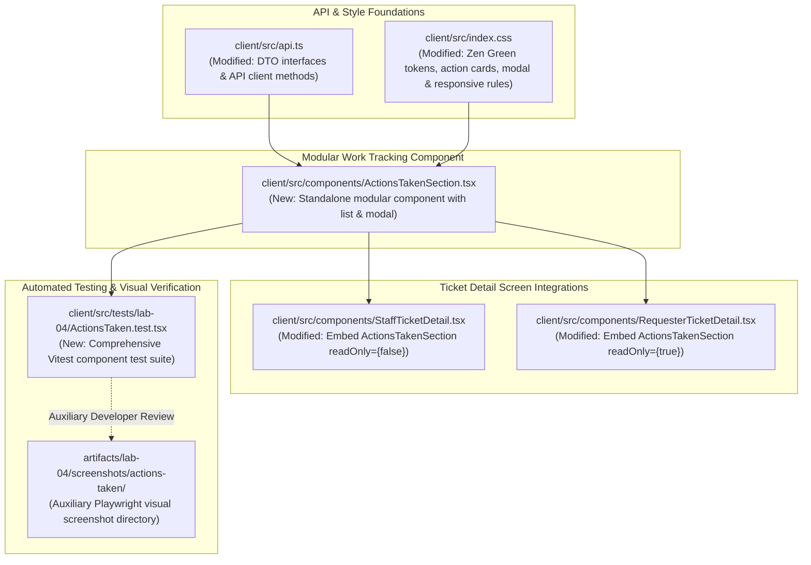
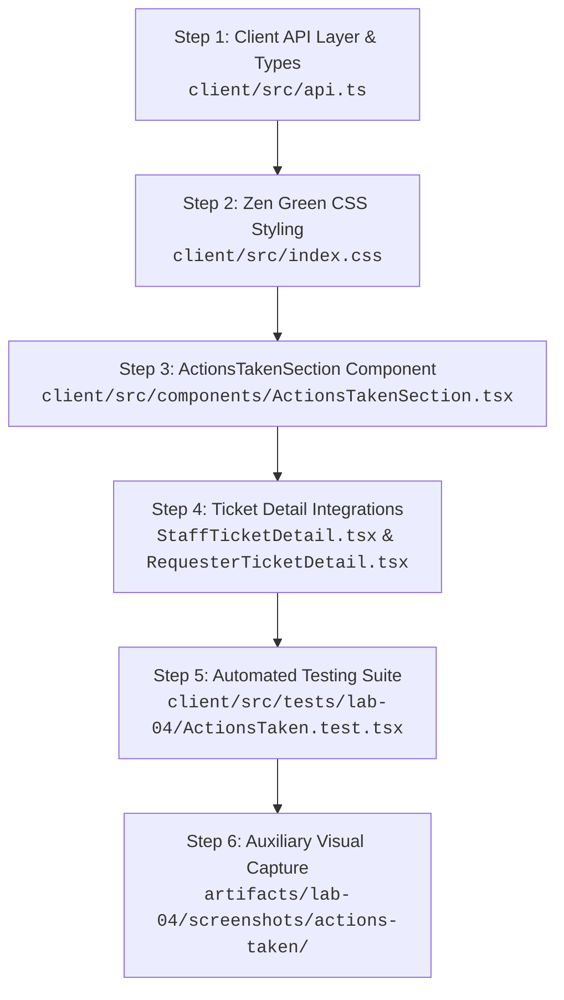

# Technical Implementation Plan: Issue 19 — Actions Taken UI, Ticket Detail Integration & Access Control

**Document ID**: PLAN-FEAT-19  
**Feature Title**: Actions Taken UI, Ticket Detail Integration & Access Control  
**Feature Branch**: `feature/19-actions-taken-ui` (Issue 19)  
**Base Branch**: `lab4-staging` (incorporating `feature/17-spec-and-tests` and `feature/18-actions-taken-foundation`)  
**Target Milestone**: TokTickIT Lab 4 (Sprint 4)  
**Authoritative Contract Reference**: [docs/features/19-actions-taken-ui/contract.md](./contract.md)  
**Master Specifications & Rubrics**:
* [TokTickIT-System-Level-SDS-v1.0.pdf](../../reference/TokTickIT-System-Level-SDS-v1.0.pdf) (§Architecture, §Data Conventions, §Security Invariants)
* [Lab_04_labsheet.pdf](../../reference/Lab_04_labsheet.pdf) (§1, §3, §4.1, §4.2, §7, §8, §10, §11, §12, §14 Part 3)
* [docs/lab-04/specification.md](../../lab-04/specification.md) (`FR-01`, `FR-02`, `FR-05`, `FR-06`, `BR-01`–`BR-06`, `BR-10`, `AC-01`–`AC-06`)
* [docs/lab-04/ui-spec.md](../../lab-04/ui-spec.md) (§1 Design Tokens, §2 Badges, §3.4 Actions Taken, §4 Responsive Breakpoints, §5 Feedback States, §6 Accessibility)
* [docs/lab-04/api-spec.md](../../lab-04/api-spec.md) (§2.1 Create Action Taken, §2.2 List Actions Taken, §2.3 Update Action Taken)
* [docs/lab-04/tests.md](../../lab-04/tests.md) (STS Test Catalog: `UI-ACT-01`, `UI-ACT-02`, `UI-ACT-03`, `E2E-01`)
* [docs/lab-04/poc-scope-and-issues.md](../../lab-04/poc-scope-and-issues.md) (Issue 19 Scope & Decomposition)
* [docs/features/18-actions-taken-foundation/contract.md](../18-actions-taken-foundation/contract.md) (Completed Backend Foundation)
* [AGENTS.md](../../../AGENTS.md) (Developer Work Norms: Strict Closed-World Rule, TDD, Theme Compliance, Blur Validation Rule)
**Document Status**: Ready for Review & Execution  

---

## 1. Target File Inventory

Below is the complete, exhaustive inventory of all client files to be created or modified for Issue 19:



### Detailed Target File Inventory Table

| Component | Path | Action | Responsibilities & Changes |
| :--- | :--- | :---: | :--- |
| **Client API Layer** | `client/src/api.ts` | `MODIFY` | Export TypeScript interfaces (`PerformedByUserDTO`, `ActionTakenDTO`, `CreateActionTakenPayload`, `UpdateActionTakenPayload`, `ActionTakenListResponse`, `ActionTakenSingleResponse`) and API client functions (`fetchActionsTaken`, `createActionTaken`, `updateActionTaken`) with robust HTTP error parsing. |
| **Theme & Stylesheet** | `client/src/index.css` | `MODIFY` | Define dedicated Zen Green classes and CSS variables for Action Taken cards (`.action-taken-card`), modal dialogs (`.action-modal`), follow-up callouts (`.action-followup-callout`), loading skeletons (`.action-skeleton`), and mobile fluid stacking (`@media (max-width: 767.98px)`). |
| **Modular Component** | `client/src/components/ActionsTakenSection.tsx` | `CREATE` | Core component managing state, chronological rendering, auto-attributed performer card, "+ Log Action Taken" trigger, Create/Edit modal dialog, conditional follow-up toggle, blur validation, busy spinner state, local error state preservation, empty state, and error retry banner. |
| **Staff Ticket Detail** | `client/src/components/StaffTicketDetail.tsx` | `MODIFY` | Import and embed `ActionsTakenSection` directly below ticket details/attachments and above dual-thread comments/notes with `readOnly={false}` and staff user context. |
| **Requester Ticket Detail** | `client/src/components/RequesterTicketDetail.tsx` | `MODIFY` | Import and embed `ActionsTakenSection` between attachments and public comments with `readOnly={true}`, ensuring complete suppression of create/edit controls and modals. |
| **Component Test Suite** | `client/src/tests/lab-04/ActionsTaken.test.tsx` | `CREATE` | Vitest + React Testing Library test suite executing tests `TEST-19-01` through `TEST-19-16` covering rendering, follow-up toggles, conditional validation, blur rules, API submissions, error preservation, edit modes, access control, empty/loading states, and responsive styling. |
| **Auxiliary Screenshots** | `artifacts/lab-04/screenshots/actions-taken/` | `PRESERVE` | Auxiliary visual verification directory for Playwright screenshots, strictly isolated from test assertion specifications per project rules. |

---

## 2. Phase 1: Client API Layer, Style Foundations & Component Skeleton

### 2.1. Client API Extensions (`client/src/api.ts`)
Extend `client/src/api.ts` with typed DTOs and API methods consuming the Issue 18 endpoints:

```typescript
// client/src/api.ts (Increment for Issue 19)

export interface PerformedByUserDTO {
  id: number;
  name: string;
  email: string;
  role: "IT_STAFF" | "ADMINISTRATOR" | "REQUESTER";
}

export interface ActionTakenDTO {
  id: number;
  ticketId: number;
  actionDateTime: string; // ISO 8601 string
  actionDescription: string;
  result: string;
  followUpRequired: boolean;
  followUpNote: string | null;
  attachmentNotes: string | null;
  performedBy: PerformedByUserDTO;
  createdAt: string; // ISO 8601 string
  updatedAt: string; // ISO 8601 string
}

export interface CreateActionTakenPayload {
  actionDateTime?: string; // Optional ISO 8601; defaults to NOW()
  actionDescription: string; // 5 - 1000 characters
  result: string; // 2 - 1000 characters
  followUpRequired: boolean;
  followUpNote?: string | null; // Required if followUpRequired is true (3 - 1000 chars)
  attachmentNotes?: string | null; // Optional, max 500 chars
}

export interface UpdateActionTakenPayload {
  actionDateTime?: string;
  actionDescription?: string;
  result?: string;
  followUpRequired?: boolean;
  followUpNote?: string | null;
  attachmentNotes?: string | null;
  versionTimestamp?: string; // Optimistic concurrency check against updatedAt
}

export interface ActionTakenListResponse {
  actionsTaken: ActionTakenDTO[];
}

export interface ActionTakenSingleResponse {
  actionTaken: ActionTakenDTO;
}

export async function fetchActionsTaken(ticketId: number): Promise<ActionTakenListResponse> {
  const response = await fetch(`/api/v1/tickets/${ticketId}/actions-taken`, {
    method: "GET",
    headers: { credentials: "same-origin" },
  });
  if (!response.ok) {
    const errorData = await response.json().catch(() => ({}));
    throw new Error(errorData.error?.message || `Failed to fetch actions taken (${response.status})`);
  }
  return response.json();
}

export async function createActionTaken(
  ticketId: number,
  payload: CreateActionTakenPayload
): Promise<ActionTakenSingleResponse> {
  const response = await fetch(`/api/v1/tickets/${ticketId}/actions-taken`, {
    method: "POST",
    headers: {
      "Content-Type": "application/json",
      credentials: "same-origin",
    },
    body: JSON.stringify(payload),
  });
  if (!response.ok) {
    const errorData = await response.json().catch(() => ({}));
    throw new Error(errorData.error?.message || `Failed to create action taken (${response.status})`);
  }
  return response.json();
}

export async function updateActionTaken(
  ticketId: number,
  actionId: number,
  payload: UpdateActionTakenPayload
): Promise<ActionTakenSingleResponse> {
  const response = await fetch(`/api/v1/tickets/${ticketId}/actions-taken/${actionId}`, {
    method: "PUT",
    headers: {
      "Content-Type": "application/json",
      credentials: "same-origin",
    },
    body: JSON.stringify(payload),
  });
  if (!response.ok) {
    const errorData = await response.json().catch(() => ({}));
    throw new Error(errorData.error?.message || `Failed to update action taken (${response.status})`);
  }
  return response.json();
}
```

### 2.2. Zen Green CSS Tokens & Styling Extensions (`client/src/index.css`)
Add explicit Zen Green classes conforming to `ui-spec.md` §1 and §3.4:

```css
/* client/src/index.css - Actions Taken UI Tokens & Components */

/* Action Taken Card Container */
.action-taken-card {
  background-color: var(--zen-surface);
  border: 1px solid var(--zen-border-neutral);
  border-radius: var(--zen-border-radius);
  padding: 16px 20px;
  margin-bottom: 16px;
  transition: box-shadow 0.15s ease-in-out, border-color 0.15s ease-in-out;
}

.action-taken-card:hover {
  border-color: var(--zen-secondary-green);
  box-shadow: 0 2px 8px rgba(0, 107, 60, 0.08);
}

/* Follow-up Note Callout Container */
.action-followup-callout {
  background-color: var(--zen-warning-bg);
  border-left: 4px solid var(--zen-warning-border);
  border-radius: 4px;
  padding: 10px 14px;
  margin-top: 12px;
  color: #92400E;
}

/* Modal Dialog Styles */
.action-modal-backdrop {
  position: fixed;
  inset: 0;
  background-color: rgba(28, 40, 38, 0.55);
  backdrop-filter: blur(2px);
  z-index: 1050;
  display: flex;
  align-items: center;
  justify-content: center;
  padding: 16px;
}

.action-modal-dialog {
  background-color: var(--zen-surface);
  border: 1px solid var(--zen-border-neutral);
  border-radius: var(--zen-border-radius-lg);
  width: 100%;
  max-width: 620px;
  max-height: 90vh;
  overflow-y: auto;
  box-shadow: 0 10px 25px -5px rgba(0, 0, 0, 0.2);
}

/* Performer Attribution Card in Form */
.performer-display-card {
  background-color: var(--zen-field-readonly-bg);
  border: 1px solid var(--zen-border-neutral);
  border-radius: var(--zen-border-radius);
  padding: 12px 16px;
  margin-bottom: 16px;
}

/* Loading Skeletons */
.action-skeleton {
  background: linear-gradient(90deg, #EAF6EF 25%, #F0F4F1 50%, #EAF6EF 75%);
  background-size: 200% 100%;
  animation: shimmer 1.5s infinite ease-in-out;
  border-radius: 4px;
}

@keyframes shimmer {
  0% { background-position: 200% 0; }
  100% { background-position: -200% 0; }
}

/* Empty State Container */
.action-empty-state {
  border: 2px dashed var(--zen-border-neutral);
  background-color: #FAFCFA;
  border-radius: var(--zen-border-radius);
  padding: 32px 20px;
  text-align: center;
}
```

### 2.3. Tri-Thread Visual Contrast Verification
Ensure clear DOM and CSS distinction across the three threads on the detail screen:
1. **Actions Taken**: White background (`#FFFFFF`), standard border (`#D1D5DB`), primary green heading (`#006B3C`), amber follow-up callout (`#FFFBEB`).
2. **Public Comments**: Pale green background (`#EAF6EF`), green border (`#0B7A46`), speech bubble icon `💬`.
3. **Internal Notes**: High-contrast amber background (`#FFFBEB`), amber barrier border (`#F59E0B`), lock icon `🔒`, confidential badge.

---

## 3. Phase 2: Form Controls, Validation & State Management

### 3.1. Form Control Architecture & Interactive States
In `client/src/components/ActionsTakenSection.tsx`, implement a comprehensive form state machine supporting both **Create Mode** and **Edit Mode**:

```typescript
// Local Form State Structure
interface ActionFormData {
  actionDateTime: string; // ISO string for datetime-local input
  actionDescription: string;
  result: string;
  followUpRequired: boolean;
  followUpNote: string;
  attachmentNotes: string;
}

// Initial state helpers
const getInitialFormData = (): ActionFormData => ({
  actionDateTime: new Date().toISOString().slice(0, 16), // YYYY-MM-DDTHH:mm
  actionDescription: "",
  result: "",
  followUpRequired: false,
  followUpNote: "",
  attachmentNotes: "",
});
```

### 3.2. Form Fields & Interactive Specifications

```
+--------------------------------------------------------------------------------------------------+
| Modal Header: "Log New Action Taken" / "Edit Action Taken"                                   [X] |
+--------------------------------------------------------------------------------------------------+
| 1. Performer Attribution (Read-Only Display Card):                                               |
|    - Performed by: {currentUser.name} ({currentUser.email}) [Role Badge]                         |
|    - Note: Auto-assigned from session. Permanent audit trail (BR-02, BR-06).                      |
|                                                                                                  |
| 2. Action Date/Time Input:                                                                       |
|    - <input type="datetime-local" className="form-control" />                                    |
|    - Value: defaults to now; cannot be in future (<= NOW()).                                     |
|    - Blur rule: If malformed date entered, field blanks out on blur (AGENTS.md §4).              |
|                                                                                                  |
| 3. Action Description Textarea:                                                                  |
|    - Required. Length: 5 - 1000 characters. Live character counter: "X / 1000 characters".       |
|                                                                                                  |
| 4. Result Textarea:                                                                              |
|    - Required. Length: 2 - 1000 characters. Live character counter: "X / 1000 characters".       |
|                                                                                                  |
| 5. Follow-up Required Toggle:                                                                    |
|    - <input type="checkbox" className="form-check-input" /> labeled "Follow-up Required?".       |
|    - If unchecked: Follow-up Note input is hidden and cleared to "".                             |
|    - If checked: Follow-up Note input dynamically renders below.                                 |
|                                                                                                  |
| 6. Follow-up Note Textarea (Conditionally Rendered):                                            |
|    - Visible ONLY when followUpRequired is true.                                                |
|    - Mandatory when visible: 3 - 1000 characters. Character counter.                             |
|                                                                                                  |
| 7. Attachment Notes Input:                                                                       |
|    - Optional: max 500 characters. Cross-reference file names or physical items.                 |
+--------------------------------------------------------------------------------------------------+
| Modal Footer:                                                                                    |
| [ Cancel ] (Disabled when submitting)               [ 💾 Save Action Taken ] (Busy with spinner) |
+--------------------------------------------------------------------------------------------------+
```

### 3.3. Blur Validation & Form Submission Rules
1. **Blur Blanking Rule (`AGENTS.md` §4)**:
   - When the user blurs an input that has an invalid format during entry (such as malformed datetime string), the field clears/blanks out immediately.
   - Validation error messages (`.zen-error-text`) and invalid styling (`.is-invalid`) are **never** shown on blur; they only trigger upon clicking the explicit **Save Action Taken** button.
2. **Submit Validation Matrix**:
   - `actionDateTime`: Must be valid date string and `new Date(actionDateTime).getTime() <= Date.now()`. Error: `"Action date/time cannot be in the future."`.
   - `actionDescription`: Must have `actionDescription.trim().length >= 5` and `<= 1000`. Error: `"Action description must be between 5 and 1000 characters."`.
   - `result`: Must have `result.trim().length >= 2` and `<= 1000`. Error: `"Result must be between 2 and 1000 characters."`.
   - `followUpNote`: If `followUpRequired === true`, must have `followUpNote.trim().length >= 3` and `<= 1000`. Error: `"Follow-up note is required when follow-up is needed (3-1000 characters)."`.
   - `attachmentNotes`: If populated, must have `attachmentNotes.trim().length <= 500`. Error: `"Attachment notes cannot exceed 500 characters."`.
3. **Submit Button Busy State**:
   - When submission begins:
     - `isSubmitting = true`
     - Button `disabled = true`
     - Text changes to `"Saving..."`
     - Inline spinner `<span className="spinner-border spinner-border-sm me-2" role="status" aria-hidden="true" />` renders.
     - Cancel button is disabled.
4. **Local Form State Preservation on Recoverable API Errors**:
   - If the backend API responds with an error (HTTP `400 Bad Request`, `409 Conflict`, or `500 Internal Error`):
     - The modal dialog **remains open**.
     - All user-entered text across Description, Result, Follow-up Note, and Attachment Notes is **preserved in component state**.
     - An error alert banner renders at the top of the modal with the message from the backend (`error.message`).
     - `isSubmitting` resets to `false`, allowing the user to correct the issue and retry without retyping their data.
5. **Optimistic Concurrency Control (`BR-10`)**:
   - In Edit Mode, `payload.versionTimestamp = editingAction.updatedAt`.
   - If HTTP `409 Conflict` is returned:
     - The error banner displays: `"This action taken record was modified by another user while you were editing. Please refresh and review the latest changes."`.

---

## 4. Phase 3: Role-Based Ticket Detail Integration

### 4.1. Integration in `StaffTicketDetail.tsx` (Operational Resolver View)
1. **Component Placement**:
   - Position `ActionsTakenSection` directly below the left-column `AttachmentSection` and right-column operational controls, as a full-width row (`<div className="row g-4 mb-4"><div className="col-12"><ActionsTakenSection ... /></div></div>`), directly preceding the Dual Collaboration Threads (`Public Comments` & `Internal Notes`).
2. **Prop Configuration**:
   ```tsx
   <ActionsTakenSection
     ticketId={ticket.id}
     readOnly={false}
     currentUser={user}
     onActionsChanged={(updatedActions) => {
       // Optional: update parent ticket state if needed
     }}
   />
   ```
3. **Capabilities Granted**:
   - Full "+ Log Action Taken" button rendered.
   - "Edit Action" button rendered on every action card.
   - Create and Edit modals fully operational.

### 4.2. Integration in `RequesterTicketDetail.tsx` (Customer View-Only)
1. **Component Placement**:
   - Position `ActionsTakenSection` immediately below `AttachmentSection` (line 493) and directly preceding `Public Comments Section` (line 495).
2. **Prop Configuration**:
   ```tsx
   <ActionsTakenSection
     ticketId={ticket.id}
     readOnly={true}
     currentUser={currentRequester ? { ...currentRequester, role: "REQUESTER" } : null}
   />
   ```
3. **Role Restrictions Enforced**:
   - `+ Log Action Taken` CTA button is **completely omitted from the DOM**.
   - `Edit Action` buttons are **completely omitted from all action cards**.
   - Modal dialog markup is **omitted from the DOM**.
   - Requesters see a clean, transparent, read-only chronological audit log of work done on their ticket.
   - If unowned ticket is queried, backend returns `403 Forbidden`, gracefully rendered as an access restricted notice.

---

## 5. Phase 4: Responsive Layout & Feedback States

### 5.1. Viewport Adaptation Plan
Guarantee **zero horizontal scrolling ($overflow-x: hidden$)** across all viewport dimensions:

1. **Desktop ($\ge 1200\text{px}$)**:
   - Full container width up to 1320px (`--zen-container-max-w`).
   - Side-by-side header row: Timestamp and Performer on left, "Edit Action" button aligned right.
   - Action Description and Result stacked with bold title tags.
   - Modal: Centered dialog, maximum width `620px`.
2. **Tablet ($768\text{px} - 1024\text{px}$)**:
   - Fluid 100% width container.
   - Stacked card header: Date on line 1, Performer badge and Edit button on line 2.
   - Modal: Centered dialog, maximum width `540px`, 16px lateral margins.
3. **Mobile ($< 768\text{px}$)**:
   - Fluid 100% width container with 12px card padding.
   - Complete vertical stacking: Timestamp $\rightarrow$ Performer $\rightarrow$ Edit button ($100\%$ width) $\rightarrow$ Description $\rightarrow$ Result $\rightarrow$ Follow-up.
   - Modal: Full-screen or bottom-sheet modal ($100\%$ width, 0px margin, full height scrolling). Form action buttons stack vertically with $100\%$ width.

### 5.2. Feedback States Plan
1. **Loading Skeletons**:
   - Render 2 pulsing shimmer placeholder cards when `isLoading === true`.
   - Shimmer animation using `.action-skeleton` class in `client/src/index.css`.
2. **Empty State**:
   - When `actions.length === 0`:
     - IT Staff View (`readOnly === false`):
       - Container with dashed border: *"No actions recorded yet. IT Staff must log actions taken before resolving this ticket."* with wrench/clipboard icon.
     - Requester View (`readOnly === true`):
       - Container with dashed border: *"No actions taken recorded yet. IT Staff will document technical steps as work progresses."*
3. **Error Banner with Retry Trigger**:
   - When API fails on initial fetch:
     - Error banner renders with message: `"Failed to load actions taken. [🔄 Retry]"`.
     - Clicking Retry re-invokes `loadActions()`.
4. **Temporary Confirmation Toasts**:
   - Successful creation or update displays a temporary green alert banner: *"Action taken recorded successfully."* which auto-dismisses after 4 seconds.

### 5.3. Auxiliary Playwright Visual Verification
* **Screenshots Target Directory**: `artifacts/lab-04/screenshots/actions-taken/`.
* **Captured Views**:
  - `actions-taken-desktop.png`: Staff view on 1280x800 viewport.
  - `actions-taken-tablet.png`: Staff view on 768x1024 tablet viewport.
  - `actions-taken-mobile.png`: Staff view on 375x667 mobile viewport.
  - `actions-taken-modal.png`: Create/edit modal dialog with follow-up toggle active.
  - `actions-taken-requester.png`: Requester read-only view.
* **Strict Rule**: Visual screenshots are auxiliary developer review assets only. They must **never** be asserted in `docs/lab-04/tests.md` or mixed into unit test assertion scripts.

---

## 6. Phase 5: Automated Component Testing (`client/src/tests/lab-04/ActionsTaken.test.tsx`)

Author the comprehensive Vitest test suite in `client/src/tests/lab-04/ActionsTaken.test.tsx` verifying Acceptance Criteria `AC-19.1` through `AC-19.4`:

### 6.1. Test Cases & Assertions Matrix

| Test ID | Scenario | Given / When / Then Flow | Assertion & Verification | Mapped AC / BR |
| :--- | :--- | :--- | :--- | :---: |
| **TEST-19-01** | Chronological Rendering | **Given** 2 actions with different timestamps<br/>**When** `ActionsTakenSection` loads<br/>**Then** actions render in ascending chronological order | Verify earliest timestamp is rendered first; check date, performer name, role badges, description, and result text in DOM. | `AC-19.1`, `BR-01` |
| **TEST-19-02** | Visual Tri-Thread Differentiation | **Given** Ticket detail screen with Actions, Comments, Notes<br/>**When** rendered<br/>**Then** cards exhibit distinct styles | Assert `.action-taken-card` has background `#FFFFFF`, comment has `#EAF6EF`, note has amber background `#FFFBEB`. | `AC-19.1`, `ui-spec §1` |
| **TEST-19-03** | Follow-Up Toggle Display | **Given** Create action modal open<br/>**When** user checks "Follow-up Required?"<br/>**Then** Follow-up Note input appears | Follow-up note input is absent initially; checking toggle renders input; unchecking hides and clears it. | `AC-19.2`, `BR-05` |
| **TEST-19-04** | Conditional Follow-Up Validation | **Given** "Follow-up Required?" is checked<br/>**When** user submits with empty note<br/>**Then** submission blocked with error | Assert validation error message `"Follow-up note is required when follow-up is needed"`; verify `createActionTaken` API not called. | `AC-19.2`, `BR-05` |
| **TEST-19-05** | Description Validation | **Given** Create action modal open<br/>**When** user enters description $< 5$ chars<br/>**Then** submission blocked with error | Assert error `"Action description must be between 5 and 1000 characters"`. | `AC-19.2`, `BR-04` |
| **TEST-19-06** | Future Date Validation | **Given** Create action modal open<br/>**When** user enters future datetime<br/>**Then** submission blocked with error | Assert error `"Action date/time cannot be in the future"`. | `AC-19.2`, `BR-04` |
| **TEST-19-07** | Blur Validation Blanking | **Given** Create action modal open<br/>**When** user enters malformed date and blurs<br/>**Then** field clears on blur | Assert input value becomes `""` on blur; no validation alert appears until submit button click. | `AC-19.2`, `AGENTS §4` |
| **TEST-19-08** | API Submission & Busy State | **Given** Valid form inputs<br/>**When** user clicks "Save Action Taken"<br/>**Then** API called, busy state shown, modal closes | Assert button disabled with spinner and text `"Saving..."`; mock API resolves; modal closes; action appears in list. | `AC-19.2`, `AC-01` |
| **TEST-19-09** | Form State Preservation on Error | **Given** Form with typed description and result<br/>**When** API rejects with error (400/500)<br/>**Then** modal stays open with inputs intact | Assert modal remains open; description, result, and notes maintain typed values; error alert banner displays message. | `AC-19.2` |
| **TEST-19-10** | Edit Action Mode | **Given** Existing action on card<br/>**When** user clicks "Edit Action"<br/>**Then** modal pre-fills with existing values | Assert fields populate; submit invokes `updateActionTaken`; original performer attribution is preserved. | `AC-19.2`, `AC-04` |
| **TEST-19-11** | Read-Only Access Control | **Given** `ActionsTakenSection` with `readOnly={true}`<br/>**When** rendered<br/>**Then** create and edit buttons omitted | Assert `queryByText("+ Log Action Taken")` is null; `queryByText("Edit Action")` is null; action cards render read-only. | `AC-19.3`, `BR-03` |
| **TEST-19-12** | Requester Detail Integration | **Given** `RequesterTicketDetail` mounted<br/>**When** rendered<br/>**Then** `ActionsTakenSection` in read-only mode | Verify `ActionsTakenSection` is embedded with `readOnly={true}`; requester cannot trigger create dialog. | `AC-19.3`, `AC-05` |
| **TEST-19-13** | Empty State Rendering | **Given** Ticket with zero actions (`actionsTaken: []`)<br/>**When** component loads<br/>**Then** empty state banner rendered | Assert text `"No actions recorded yet"` is visible. | `AC-19.4` |
| **TEST-19-14** | Loading Skeleton State | **Given** API fetch in flight (`isLoading: true`)<br/>**When** component mounts<br/>**Then** skeleton placeholders displayed | Assert skeleton elements with class `.action-skeleton` are present in DOM. | `AC-19.4` |
| **TEST-19-15** | Error Banner with Retry | **Given** Initial fetch fails<br/>**When** component renders<br/>**Then** error banner with Retry button shown | Assert error banner is rendered; clicking Retry button re-invokes API fetch function. | `AC-19.4` |
| **TEST-19-16** | Responsive Fluid Stacking | **Given** Component rendered<br/>**When** inspected<br/>**Then** no horizontal scroll styles exist | Assert fluid Bootstrap container and card wrapper classes with `overflow-x: hidden` compliance. | `AC-19.4`, `ui-spec §4` |

---

## 7. Execution Order & Verification Gates



### Step-by-Step Implementation Sequence:
1. **Step 1 (API & DTOs)**: Update `client/src/api.ts` with DTO interfaces and `fetchActionsTaken`, `createActionTaken`, `updateActionTaken` API functions.
2. **Step 2 (Styles & Tokens)**: Update `client/src/index.css` with dedicated Zen Green tokens, action card styling, modal backdrops, follow-up callouts, and responsive stacking rules.
3. **Step 3 (Modular Component)**: Author `client/src/components/ActionsTakenSection.tsx` with full state handling, chronological list, auto-attributed performer display, modal forms, blur validation, busy submit state, local state preservation, empty state, and error recovery.
4. **Step 4 (Detail View Integrations)**:
   - Embed `ActionsTakenSection` in `client/src/components/StaffTicketDetail.tsx` with `readOnly={false}`.
   - Embed `ActionsTakenSection` in `client/src/components/RequesterTicketDetail.tsx` with `readOnly={true}`.
5. **Step 5 (Automated Component Testing)**: Author `client/src/tests/lab-04/ActionsTaken.test.tsx` and run `npm test` to verify 100% pass across all 16 test cases (`TEST-19-01` to `TEST-19-16`).
6. **Step 6 (Auxiliary Visual Capture)**: Capture auxiliary Playwright visual screenshots into `artifacts/lab-04/screenshots/actions-taken/` for developer review.

