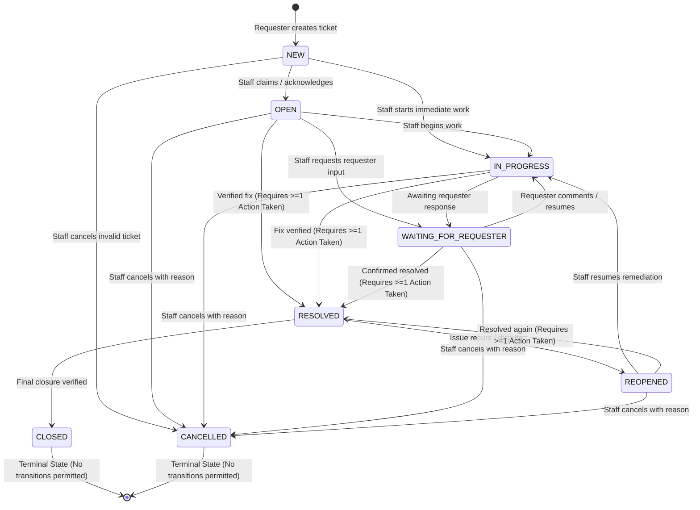

# Feature 20 Engineering Contract: Ticket Status Lifecycle, Concurrency & Resolution Gate

**Feature Title**: Ticket Status Lifecycle, Concurrency & Resolution Gate  
**Branch Name**: `feature/20-ticket-workflow` (Issue 20)  
**Base Branch**: `lab4-staging` (incorporating `feature/17-spec-and-tests`, `feature/18-actions-taken-foundation`, and `feature/19-actions-taken-ui`)  
**Document Status**: Approved Feature Engineering Contract  
**Author**: TokTickIT Engineering Team  
**Traceability References**:
* [TokTickIT-System-Level-SDS-v1.0.pdf](../../reference/TokTickIT-System-Level-SDS-v1.0.pdf) (§Architecture, §Data Conventions, §Security Invariants)
* [Lab_04_labsheet.pdf](../../reference/Lab_04_labsheet.pdf) (§1, §3, §4.1, §4.2, §5.1, §6.1, §10, §11, §12, §14 Part 2)
* [docs/lab-04/specification.md](../../lab-04/specification.md) (`FR-03`, `FR-05`, `BR-06`, `BR-07`, `BR-08`, `BR-09`, `BR-10`, `AC-07` to `AC-11`)
* [docs/lab-04/ui-spec.md](../../lab-04/ui-spec.md) (§3.5 Status Workflow Controls & Resolution Gate Feedback, §5 Feedback States)
* [docs/lab-04/api-spec.md](../../lab-04/api-spec.md) (§4 Ticket Status Workflow Endpoint, §1.2 Standard Error Envelope)
* [docs/lab-04/tests.md](../../lab-04/tests.md) (STS Test Catalog: `WRK-01` through `WRK-05`, `UI-WRK-01`, `UI-WRK-02`, `E2E-02`)
* [docs/lab-04/poc-scope-and-issues.md](../../lab-04/poc-scope-and-issues.md) (Issue 20 Scope & Implementation Plan)
* [docs/features/18-actions-taken-foundation/contract.md](../18-actions-taken-foundation/contract.md) (Completed Actions Taken Foundation)
* [docs/features/19-actions-taken-ui/contract.md](../19-actions-taken-ui/contract.md) (Completed Actions Taken UI)
* [AGENTS.md](../../../AGENTS.md) (Developer Work Norms: Strict Closed-World Rule, TDD, Theme Compliance, Blur Validation Rule)

---

## 1. Feature Goal & Scope

### 1.1. Strategic Objectives
Issue 20 implements the definitive ticket status lifecycle state machine, the mandatory backend resolution gate, optimistic concurrency protection, requester advisory resolution segregation, and frontend workflow controls for TokTickIT Sprint 4 (Lab 4).

In earlier labs, tickets supported rudimentary status assignments without verifying whether technical troubleshooting had occurred, and simultaneous updates by multiple service desk agents risked silent overwrites. Issue 20 binds the Actions Taken subsystem (delivered in Issues 18 and 19) directly into ticket closure rules and establishes strict concurrency safeguards:

1. **State Machine Transition Matrix Enforcement (`BR-06` / `BR-09`)**: Programmatically enforce valid transitions across all 8 ticket statuses (`NEW`, `OPEN`, `IN_PROGRESS`, `WAITING_FOR_REQUESTER`, `RESOLVED`, `CLOSED`, `REOPENED`, `CANCELLED`). Disallowed transitions must be rejected with HTTP `400 Bad Request` (`INVALID_STATUS_TRANSITION`).
2. **Mandatory Resolution Gate Invariant (`BR-07`)**: Guarantee at the backend database boundary that no ticket transitions to `RESOLVED` (or `CLOSED`) unless it possesses at least one valid recorded `ActionTaken` work item. Attempting to resolve an action-less ticket must be rejected with HTTP `400 Bad Request` (`RESOLUTION_REQUIRES_ACTION_TAKEN`) with the message `"Cannot resolve ticket without at least one recorded Action Taken."`.
3. **Requester Advisory Resolution Segregation (`BR-08`)**: Ensure that when a Requester clicks "Problem Appears Resolved", the system records `requesterResolvedAt = NOW()` purely as an advisory signal for IT Staff without mutating `currentStatus`. Formal resolution remains under the exclusive control of IT Staff and Administrators.
4. **Optimistic Concurrency Control (`BR-09` / `BR-10`)**: Protect ticket status transitions against stale overwrites and race conditions. Incoming status change requests must supply an `updatedAt` / `versionTimestamp` token matching the current database record; stale mismatches must immediately reject with HTTP `409 Conflict` (`STALE_RECORD_CONFLICT`).
5. **Interactive Frontend Workflow Controls (`StaffTicketDetail.tsx`)**:
   - Filter the status dropdown options to display strictly valid next states based on the current ticket status.
   - Display an informative warning guidance alert when `RESOLVED` is selected on an action-less ticket (`0` Actions Taken), preventing unexpected API failures.
   - Present a non-destructive `409 Conflict` banner that prompts the agent to reload the ticket without wiping active comment or note draft inputs.
   - Perform seamless in-place state and header badge updates upon successful transition without requiring a full browser reload.

### 1.2. In-Scope Deliverables
1. **Backend Status Transition Route Enhancement (`server/src/routes/staffTickets.ts`)**:
   - Update `ALLOWED_TRANSITIONS` to strictly match the 8-status transition matrix:
     - `NEW` $\rightarrow$ `OPEN`, `IN_PROGRESS`, `CANCELLED`
     - `OPEN` $\rightarrow$ `IN_PROGRESS`, `WAITING_FOR_REQUESTER`, `RESOLVED`, `CANCELLED`
     - `IN_PROGRESS` $\rightarrow$ `WAITING_FOR_REQUESTER`, `RESOLVED`, `CANCELLED`
     - `WAITING_FOR_REQUESTER` $\rightarrow$ `IN_PROGRESS`, `RESOLVED`, `CANCELLED`
     - `RESOLVED` $\rightarrow$ `CLOSED`, `REOPENED`
     - `CLOSED` $\rightarrow$ Terminal state (no transitions allowed)
     - `REOPENED` $\rightarrow$ `IN_PROGRESS`, `RESOLVED`, `CANCELLED`
     - `CANCELLED` $\rightarrow$ Terminal state (no transitions allowed)
   - Implement **Resolution Gate Guard**: When transitioning to `RESOLVED`, count child `ActionTaken` records (`prisma.actionTaken.count({ where: { ticketId } })`). If `count === 0`, reject with `400 Bad Request` and `RESOLUTION_REQUIRES_ACTION_TAKEN`.
   - Implement **Optimistic Concurrency Guard**: Verify incoming `versionTimestamp` / `updatedAt` against `ticket.updatedAt.toISOString()`. If mismatched, reject with `409 Conflict` and `STALE_RECORD_CONFLICT`.
   - Implement **Cancellation Reason Guard**: When transitioning to `CANCELLED`, validate non-empty `cancellationReason` ($\ge 5$ characters).
2. **Backend Requester Advisory Route Verification (`server/src/routes/tickets.ts`)**:
   - Re-verify `POST /api/v1/tickets/:id/resolve-request` updates `requesterResolvedAt = NOW()` while leaving `currentStatus` strictly unchanged.
3. **Frontend API Client Extensions (`client/src/api.ts`)**:
   - Enhance `transitionTicketStatus(ticketId: number, payload: TransitionTicketStatusPayload)` to send `status`, `cancellationReason`, and `versionTimestamp` (derived from `ticket.updatedAt`).
   - Define TypeScript interfaces: `TransitionTicketStatusPayload`, `TransitionTicketStatusResponse`.
4. **Staff Ticket Detail UI Enhancements (`client/src/components/StaffTicketDetail.tsx`)**:
   - Harmonize `ALLOWED_TRANSITIONS` with backend matrix, including terminal states for `CLOSED` and `CANCELLED`.
   - Track `actionsCount` from `ActionsTakenSection` via `onActionsChanged`.
   - Display inline warning guidance alert when selecting `RESOLVED` while `actionsCount === 0`.
   - Display modal dialog collecting cancellation reason when `CANCELLED` is selected.
   - Render non-destructive `409 Conflict` banner prompting reload without wiping draft public comments or internal notes.
   - In-place UI header status badge, meta timestamps, and allowed next transitions update upon successful transition.
5. **Automated Verification Test Suites**:
   - Backend API tests: `server/tests/lab-04/ticket-workflow.api.test.ts` (covering `WRK-01` through `WRK-05` and edge cases).
   - Frontend UI tests: `client/src/tests/lab-04/TicketWorkflow.test.tsx` (covering `UI-WRK-01`, `UI-WRK-02`, and workflow interactions).

### 1.3. Explicit Exclusions & Non-Goals
* **No Multi-Level Electronic Approval Hierarchies**: No departmental chair sign-offs, dean approvals, or cryptographic signature workflows.
* **No Distributed Saga or Rollback Transactions**: Database operations are atomic within a single PostgreSQL transaction; no multi-database distributed 2PC or compensation saga coordinator.
* **No Re-Opening Closed Tickets**: `CLOSED` is strictly terminal. Once a ticket is marked `CLOSED`, no transitions back to `OPEN`, `IN_PROGRESS`, or `REOPENED` are permitted. (If an identical issue re-emerges later, a new ticket must be submitted).
* **No Automated SLA Breach Timers or Escalation Engines**: No background daemon auto-escalating tickets or auto-closing after $N$ hours.
* **No Outbound Push/Email Channels**: No external emails, SMS, or webhook broadcasts upon status change.
* **No Labor Cost Accounting or Billing**: No timesheet calculations, billable hour tracking, or invoicing.
* **Playwright Screenshot Separation Rule**: Auxiliary screenshot generation to `artifacts/lab-04/screenshots/actions-taken/` is strictly visual evidence for developer review. Playwright visual assertions must never be added to `docs/lab-04/tests.md` or mixed into Jest/Vitest unit/API test suites.

---

## 2. Status Transition Matrix & State Machine Specification (BR-06)

### 2.1. Complete 8-Status Transition Matrix
The TokTickIT service desk operates on 8 discrete statuses. Transitions must strictly conform to the following directional graph:



### 2.2. Permitted Transitions & Boundary Rules Table

| Source Status | Permitted Target Statuses | Authorized Roles | Mandatory Guards & Business Validations |
| :--- | :--- | :--- | :--- |
| **`NEW`** | `OPEN`, `IN_PROGRESS`, `CANCELLED` | IT Staff, Admin | Assignment or initial acknowledgement; Immediate remediation; Cancellation requires reason ($\ge 5$ chars). |
| **`OPEN`** | `IN_PROGRESS`, `WAITING_FOR_REQUESTER`, `RESOLVED`, `CANCELLED` | IT Staff, Admin | Investigation starts; Clarification needed; Direct resolution (**BR-07 requires $\ge 1$ Action Taken**); Cancellation requires reason. |
| **`IN_PROGRESS`** | `WAITING_FOR_REQUESTER`, `RESOLVED`, `CANCELLED` | IT Staff, Admin | Requester feedback needed; **Resolution Gate (BR-07)**: Transition to `RESOLVED` requires $\ge 1$ recorded Action Taken; Cancellation requires reason. |
| **`WAITING_FOR_REQUESTER`** | `IN_PROGRESS`, `RESOLVED`, `CANCELLED` | IT Staff, Admin | Requester provided feedback / staff resumes; Requester confirmed resolution (**BR-07 requires $\ge 1$ Action Taken**); Cancellation requires reason. |
| **`RESOLVED`** | `CLOSED`, `REOPENED` | IT Staff, Admin | Final administrative closure; Reopening allowed if problem re-emerges before closure. |
| **`CLOSED`** | *None (Terminal)* | — | **Terminal State**: No transitions allowed. Re-opening closed tickets is strictly prohibited. |
| **`REOPENED`** | `IN_PROGRESS`, `RESOLVED`, `CANCELLED` | IT Staff, Admin | Active rework initiated; Re-resolved (**BR-07 requires $\ge 1$ Action Taken**); Cancellation requires reason. |
| **`CANCELLED`** | *None (Terminal)* | — | **Terminal State**: No transitions allowed. |

### 2.3. Disallowed Transition Rejection Policy
* Any status transition attempt not explicitly defined in the matrix above must be rejected by the backend with HTTP `400 Bad Request`.
* Error response envelope:
  ```json
  {
    "error": {
      "code": "INVALID_STATUS_TRANSITION",
      "message": "Cannot transition ticket status from <SOURCE> to <TARGET>.",
      "timestamp": "2026-10-31T12:00:00.000Z"
    }
  }
  ```
* Examples of disallowed transitions:
  - `NEW` $\rightarrow$ `RESOLVED` (`400 Bad Request`)
  - `NEW` $\rightarrow$ `CLOSED` (`400 Bad Request`)
  - `CLOSED` $\rightarrow$ `OPEN` or `REOPENED` (`400 Bad Request`)
  - `CANCELLED` $\rightarrow$ `NEW` or `OPEN` (`400 Bad Request`)
  - `RESOLVED` $\rightarrow$ `IN_PROGRESS` (`400 Bad Request` - must use `REOPENED`)

### 2.4. Cancellation Reason Requirement
* When transitioning to `CANCELLED`, the client payload must include a non-empty `cancellationReason`.
* The reason must be a string between 5 and 1,000 characters after whitespace trimming.
* If missing or fewer than 5 characters, the backend rejects with HTTP `400 Bad Request` (`VALIDATION_FAILED`) with message `"Cancellation reason must be at least 5 characters."`.
* When valid, the backend appends an internal note or audit entry recording: `"Ticket cancelled by <Staff Name>. Reason: <cancellationReason>"`.

---

## 3. Resolution Gate Invariant & Advisory Requester Resolution (BR-07 & BR-08)

### 3.1. Backend Resolution Gate Invariant (`BR-07`)
1. **Rule Definition**: A ticket cannot transition to `RESOLVED` (or `CLOSED`) unless there is **at least one valid recorded `ActionTaken`** record linked to `ticketId` in the database.
2. **Database Verification**:
   ```typescript
   if (targetStatus === TicketStatus.RESOLVED || targetStatus === TicketStatus.CLOSED) {
     const actionsCount = await prisma.actionTaken.count({
       where: { ticketId: ticket.id },
     });
     if (actionsCount === 0) {
       return res.status(400).json({
         error: {
           code: "RESOLUTION_REQUIRES_ACTION_TAKEN",
           message: "Cannot resolve ticket without at least one recorded Action Taken.",
           timestamp: new Date().toISOString(),
         },
       });
     }
   }
   ```
3. **Architectural Justification**: In an enterprise service desk, closing an incident without documenting the technical remedy undermines institutional knowledge, auditability, and root cause analysis. Enforcing this invariant at the database/API boundary prevents bypassed UI validation or programmatic misuse.
4. **Success Path**: When `actionsCount >= 1`, the transition to `RESOLVED` succeeds, `currentStatus` updates, and `updatedAt` is refreshed.

### 3.2. Requester Advisory Problem Resolution Separation (`BR-08`)
1. **User Action**: An authenticated Requester viewing their owned ticket (`ticket.requesterId === req.user.id`) may click the button `"Problem Appears Resolved"`.
2. **API Endpoint**: `POST /api/v1/tickets/:id/resolve-request`.
3. **Advisory Invariant**:
   - The backend records `requesterResolvedAt = NOW()`.
   - The backend **does not modify `currentStatus`**. (e.g., if ticket is `IN_PROGRESS`, it remains `IN_PROGRESS`).
   - The response returns HTTP `200 OK` with `{ message: "Problem resolution recorded.", requesterResolvedAt: string }`.
4. **Staff Awareness**:
   - In `StaffTicketDetail.tsx`, if `ticket.requesterResolvedAt` is truthy, a green alert banner indicates:
     `ℹ️ Requester indicated the problem appears resolved on <formatted date>. IT Staff review is required for formal closure.`
   - In `StaffTicketQueue.tsx`, a subtle checkmark badge `✓ Requester Resolved` informs resolvers that the customer is satisfied.
   - However, the staff member must still perform formal verification and ensure at least one Action Taken is recorded before transitioning the ticket to `RESOLVED`.

---

## 4. Optimistic Concurrency Control Specification (BR-09 / BR-10)

### 4.1. Concurrency Problem Definition
In a multi-user service desk, multiple IT Staff members may view the same ticket simultaneously. If Staff A transitions the ticket from `OPEN` to `IN_PROGRESS` while Staff B attempts to transition it to `CANCELLED`, or if Staff B updates priority while Staff A transitions status, uncoordinated updates could result in lost updates or illegal state overwrites.

### 4.2. Optimistic Locking Protocol
1. **Incoming Version Token**:
   - When submitting a status change via `PATCH /api/v1/staff/tickets/:id/status`, the client must provide a `versionTimestamp` (or `updatedAt`) string matching the ISO timestamp of the ticket when last fetched by the client.
2. **Server-Side Timestamp Comparison**:
   ```typescript
   if (versionTimestamp) {
     const clientTime = new Date(versionTimestamp).getTime();
     const serverTime = new Date(ticket.updatedAt).getTime();
     if (Math.abs(clientTime - serverTime) > 1000) { // allow 1s tolerance for rounding
       return res.status(409).json({
         error: {
           code: "STALE_RECORD_CONFLICT",
           message: "The ticket was modified by another user. Please reload the ticket to view the latest state.",
           timestamp: new Date().toISOString(),
         },
       });
     }
   }
   ```
3. **Conflict Rejection (`409 Conflict`)**:
   - If the database `updatedAt` has changed since the client fetched the ticket, the update is rejected immediately.
   - No database records are modified.

### 4.3. Client Concurrency UX & Draft Preservation
1. **Non-Destructive Conflict Banner**:
   - When a `409 Conflict` occurs, the UI presents an amber warning alert at the top of the ticket detail view:
     ```
     +--------------------------------------------------------------------------------------------------+
     | ⚠️ Update Conflict: Another staff member updated this ticket while you were viewing it.           |
     | Your status change was not applied to avoid overwriting their work.                             |
     | [ 🔄 Reload Ticket Data ]                                                                        |
     +--------------------------------------------------------------------------------------------------+
     ```
2. **Draft State Preservation**:
   - Clicking `Reload Ticket Data` re-fetches the latest ticket attributes from `GET /api/v1/tickets/:id`.
   - Any uncommitted draft text in Public Comments or Internal Notes textareas **must be preserved** and not wiped during reload.
   - The status selector resets to the newly permitted transitions according to the freshly loaded `currentStatus`.

---

## 5. Frontend Workflow Controls (`StaffTicketDetail.tsx`)

### 5.1. Dynamic Status Dropdown Filtering
In `StaffTicketDetail.tsx`, the status workflow card must dynamically render target options strictly permitted by `ALLOWED_TRANSITIONS[ticket.currentStatus]`:

```tsx
const ALLOWED_TRANSITIONS: Record<string, string[]> = {
  NEW: ["OPEN", "IN_PROGRESS", "CANCELLED"],
  OPEN: ["IN_PROGRESS", "WAITING_FOR_REQUESTER", "RESOLVED", "CANCELLED"],
  IN_PROGRESS: ["WAITING_FOR_REQUESTER", "RESOLVED", "CANCELLED"],
  WAITING_FOR_REQUESTER: ["IN_PROGRESS", "RESOLVED", "CANCELLED"],
  RESOLVED: ["CLOSED", "REOPENED"],
  CLOSED: [], // Terminal State
  REOPENED: ["IN_PROGRESS", "RESOLVED", "CANCELLED"],
  CANCELLED: [], // Terminal State
};
```

1. **Active Transitions Rendering**:
   - When `allowedNextStatuses.length > 0`: Renders `<select id="status-transition-select">` populated with valid targets.
   - When `allowedNextStatuses.length === 0`: Renders a neutral terminal badge:
     `Terminal status reached ({ticket.currentStatus}). No further transitions permitted.`
     The transition button is completely omitted.

### 5.2. Informative Resolution Gate Guidance Alert
When the user selects `RESOLVED` in the dropdown:
1. **Zero Actions Condition (`actionsCount === 0`)**:
   - A prominent amber guidance alert appears immediately below the dropdown:
     ```
     +--------------------------------------------------------------------------------------------------+
     | ⚠️ Resolution Blocked                                                                           |
     | You must log at least one Action Taken before this ticket can be resolved.                       |
     | Click '+ Log Action Taken' in the Actions Taken section above to document technical work.        |
     +--------------------------------------------------------------------------------------------------+
     ```
   - The `Transition to RESOLVED` button is disabled:
     `disabled={isUpdatingStatus || !selectedNextStatus || (selectedNextStatus === "RESOLVED" && actionsCount === 0)}`
   - A tooltip or aria-description explains: `"At least one Action Taken is required before resolution."`
2. **Actions Recorded Condition (`actionsCount >= 1`)**:
   - The warning alert is hidden.
   - The transition button is enabled with Zen Primary Green styling.

### 5.3. Cancellation Reason Modal
When the user selects `CANCELLED` and clicks `Transition to CANCELLED`:
1. An accessible confirmation modal dialog opens:
   - Header: `Confirm Ticket Cancellation`
   - Prompt: *"Please provide a reason for cancelling this ticket. This will be recorded in the audit trail."*
   - Textarea: `Cancellation Reason *` (min 5 characters, max 1,000 characters).
   - Buttons: `Confirm Cancellation` (Danger/Red button) and `Cancel` (dismisses modal).
2. Submitting with $< 5$ characters triggers inline validation error.
3. Submitting with valid text sends `{ status: "CANCELLED", cancellationReason, versionTimestamp }` to the API.

### 5.4. In-Place UI State & Header Badge Refresh
Upon successful status transition:
1. The backend responds with `200 OK` and `{ ticket: { id, currentStatus, updatedAt }, message }`.
2. The client updates local ticket state directly:
   ```typescript
   setTicket((prev) => prev ? { ...prev, currentStatus: res.ticket.currentStatus, updatedAt: res.ticket.updatedAt } : null);
   ```
3. Header status badge immediately reflects the new status styling (`badge-status-in-progress`, `badge-status-resolved`, etc.) without a full page reload.
4. Next allowed transitions recalculate automatically for the new state.
5. A temporary Zen Green success toast or banner announces: `"Ticket transitioned to <STATUS>."`.

---

## 6. REST API Endpoint Specifications

### 6.1. Transition Ticket Status
`PATCH /api/v1/staff/tickets/:id/status`

Transitions a ticket to a new permitted status according to the state machine. Enforces the Resolution Gate (`BR-07`), Cancellation reason, and Optimistic Concurrency (`BR-10`).

* **Authorization**: `IT_STAFF`, `ADMINISTRATOR`. (Requesters return `403 Forbidden`).
* **Path Parameters**:
  - `id` (integer, required): Target Ticket ID.
* **Request Headers**:
  - `Content-Type: application/json`
  - `Cookie: toktickit_session=<token>` or `Authorization: Bearer <token>`
* **Request Body**:
```json
{
  "status": "RESOLVED",
  "cancellationReason": null,
  "versionTimestamp": "2026-10-31T09:30:00.000Z"
}
```

* **Validation Rules**:
  - `status`: Mandatory valid `TicketStatus` enum string (`NEW`, `OPEN`, `IN_PROGRESS`, `WAITING_FOR_REQUESTER`, `RESOLVED`, `CLOSED`, `REOPENED`, `CANCELLED`).
  - Transition validity: Must match `ALLOWED_TRANSITIONS[ticket.currentStatus]`. Rejects invalid transitions with `400 Bad Request` (`INVALID_STATUS_TRANSITION`).
  - **Resolution Gate (`BR-07`)**: If `status === "RESOLVED"` or `"CLOSED"`, `prisma.actionTaken.count({ where: { ticketId } })` must be $\ge 1$. Rejects with `400 Bad Request` (`RESOLUTION_REQUIRES_ACTION_TAKEN`) if count is 0.
  - **Cancellation Rule**: If `status === "CANCELLED"`, `cancellationReason` is mandatory (string, min 5, max 1,000 characters). Rejects with `400 Bad Request` (`VALIDATION_FAILED`) if missing.
  - **Optimistic Concurrency (`BR-10`)**: If `versionTimestamp` is provided, must match `ticket.updatedAt` within 1 second. Rejects with `409 Conflict` (`STALE_RECORD_CONFLICT`) if mismatched.

* **Success Response `200 OK`**:
```json
{
  "ticket": {
    "id": 14,
    "ticketNumber": "TKT-2026-00014",
    "currentStatus": "RESOLVED",
    "updatedAt": "2026-10-31T10:45:00.000Z"
  },
  "message": "Ticket status updated to RESOLVED."
}
```

* **Error Responses**:
  - `400 Bad Request` (`RESOLUTION_REQUIRES_ACTION_TAKEN`):
    ```json
    {
      "error": {
        "code": "RESOLUTION_REQUIRES_ACTION_TAKEN",
        "message": "Cannot resolve ticket without at least one recorded Action Taken.",
        "timestamp": "2026-10-31T10:45:00.000Z"
      }
    }
    ```
  - `400 Bad Request` (`INVALID_STATUS_TRANSITION`):
    ```json
    {
      "error": {
        "code": "INVALID_STATUS_TRANSITION",
        "message": "Cannot transition ticket status from NEW to RESOLVED.",
        "timestamp": "2026-10-31T10:45:00.000Z"
      }
    }
    ```
  - `400 Bad Request` (`VALIDATION_FAILED`):
    ```json
    {
      "error": {
        "code": "VALIDATION_FAILED",
        "message": "Cancellation reason must be at least 5 characters.",
        "timestamp": "2026-10-31T10:45:00.000Z"
      }
    }
    ```
  - `401 Unauthorized` (`UNAUTHENTICATED`): User session missing or expired.
  - `403 Forbidden` (`FORBIDDEN`): User has role `REQUESTER`.
  - `404 Not Found` (`TICKET_NOT_FOUND`): Ticket does not exist.
  - `409 Conflict` (`STALE_RECORD_CONFLICT`):
    ```json
    {
      "error": {
        "code": "STALE_RECORD_CONFLICT",
        "message": "The ticket was modified by another user. Please reload the ticket to view the latest state.",
        "timestamp": "2026-10-31T10:45:00.000Z"
      }
    }
    ```

---

### 6.2. Requester Advisory Problem Resolution
`POST /api/v1/tickets/:id/resolve-request`

Records a Requester's indication that the reported problem appears resolved. Updates `requesterResolvedAt` timestamp without modifying ticket `currentStatus`.

* **Authorization**: Authenticated ticket requester (`ticket.requesterId === req.user.id`).
* **Path Parameters**:
  - `id` (integer, required): Target Ticket ID.
* **Success Response `200 OK`**:
```json
{
  "message": "Problem resolution recorded.",
  "requesterResolvedAt": "2026-10-31T11:00:00.000Z"
}
```
* **Business Invariant**: `ticket.currentStatus` remains unchanged.

---

### 6.3. Client API TypeScript DTOs (`client/src/api.ts`)

```typescript
// ============================================================================
// Ticket Status Workflow DTOs (Sprint 4 / Issue 20)
// ============================================================================

export interface TransitionTicketStatusPayload {
  status: string; // Target TicketStatus enum value
  cancellationReason?: string | null; // Required if status === 'CANCELLED'
  versionTimestamp?: string; // ISO 8601 string for optimistic concurrency check
}

export interface TransitionTicketStatusResponse {
  ticket: {
    id: number;
    ticketNumber: string;
    currentStatus: string;
    updatedAt: string;
  };
  message: string;
}

/**
 * PATCH /api/v1/staff/tickets/:id/status
 * Transition ticket status adhering to state machine, resolution gate & concurrency guard.
 */
export async function transitionTicketStatus(
  ticketId: number,
  payload: TransitionTicketStatusPayload | string
): Promise<TransitionTicketStatusResponse> {
  const body = typeof payload === "string" ? { status: payload } : payload;
  const res = await fetch(`${API_URL}/api/v1/staff/tickets/${ticketId}/status`, {
    method: "PATCH",
    headers: {
      "Content-Type": "application/json",
      Accept: "application/json",
    },
    credentials: "include",
    body: JSON.stringify(body),
  });

  const data = await res.json().catch(() => ({}));
  if (!res.ok) {
    const error: any = new Error(data.error?.message || `Failed to transition status (${res.status})`);
    error.status = res.status;
    error.code = data.error?.code;
    throw error;
  }
  return data;
}
```

---

## 7. Software Test Specification (STS) & Automated Test Mappings

Automated tests are divided between backend API integration tests and frontend React component tests:

### 7.1. Backend API Integration Tests (`server/tests/lab-04/ticket-workflow.api.test.ts`)

| Test ID | Route & Method | Mapped Rules | Scenario & Assertion | Expected Status |
| :--- | :--- | :--- | :--- | :---: |
| **WRK-01** | `PATCH /api/v1/staff/tickets/:id/status` | `AC-20.2`, `BR-07` | Staff attempts to resolve ticket with 0 Actions Taken. Rejects with error envelope. | `400 Bad Request` (`RESOLUTION_REQUIRES_ACTION_TAKEN`) |
| **WRK-02** | `PATCH /api/v1/staff/tickets/:id/status` | `AC-20.2`, `BR-07` | Staff transitions ticket with $\ge 1$ Action Taken to `RESOLVED`. Updates status. | `200 OK` |
| **WRK-03** | `POST /api/v1/tickets/:id/resolve-request` | `AC-20.3`, `BR-08` | Requester marks problem as resolved. Sets `requesterResolvedAt`; `currentStatus` stays unchanged. | `200 OK` |
| **WRK-04** | `PATCH /api/v1/staff/tickets/:id/status` | `AC-20.1`, `BR-06` | Invalid transition attempt (e.g. `NEW` $\rightarrow$ `RESOLVED` or `NEW` $\rightarrow$ `CLOSED`). | `400 Bad Request` (`INVALID_STATUS_TRANSITION`) |
| **WRK-05** | `PATCH /api/v1/staff/tickets/:id/status` | `AC-20.4`, `BR-09` | Status update submitted with stale `versionTimestamp`. Rejection prevents race condition. | `409 Conflict` (`STALE_RECORD_CONFLICT`) |
| **WRK-06** | `PATCH /api/v1/staff/tickets/:id/status` | `AC-20.1`, `BR-06` | Staff transitions ticket from `CLOSED` to any state. Rejection enforces terminal state. | `400 Bad Request` (`INVALID_STATUS_TRANSITION`) |
| **WRK-07** | `PATCH /api/v1/staff/tickets/:id/status` | `AC-20.1`, `BR-06` | Transition to `CANCELLED` without non-empty `cancellationReason` ($\ge 5$ chars). | `400 Bad Request` (`VALIDATION_FAILED`) |
| **WRK-08** | `PATCH /api/v1/staff/tickets/:id/status` | `AC-20.1`, `BR-06` | Requester attempts to transition ticket status. Blocked by role guard. | `403 Forbidden` (`FORBIDDEN`) |
| **WRK-09** | `PATCH /api/v1/staff/tickets/:id/status` | `AC-20.1`, `BR-06` | Valid sequence: `NEW` $\rightarrow$ `OPEN` $\rightarrow$ `IN_PROGRESS` $\rightarrow$ (log action) $\rightarrow$ `RESOLVED` $\rightarrow$ `CLOSED`. | `200 OK` on all steps |

### 7.2. Frontend UI Component Tests (`client/src/tests/lab-04/TicketWorkflow.test.tsx`)

| Test ID | Target Component | Mapped Rules | Scenario & DOM Assertion | Mapped AC |
| :--- | :--- | :--- | :--- | :---: |
| **UI-WRK-01** | `StaffTicketDetail` | `AC-20.2`, `BR-07` | Ticket has 0 Actions Taken. Selecting `RESOLVED` displays warning alert: *"Resolution Blocked: You must log at least one Action Taken before this ticket can be resolved."* Transition button disabled. | `AC-20.2` |
| **UI-WRK-02** | `StaffTicketDetail` | `AC-20.1`, `BR-06` | Status dropdown options match permitted transitions for current status (e.g., `NEW` allows only `OPEN`, `IN_PROGRESS`, `CANCELLED`). | `AC-20.1` |
| **UI-WRK-03** | `StaffTicketDetail` | `AC-20.1`, `BR-06` | Ticket in `CLOSED` or `CANCELLED` status renders terminal alert banner and no select dropdown or submit button. | `AC-20.1` |
| **UI-WRK-04** | `StaffTicketDetail` | `AC-20.4`, `BR-09` | Server returns HTTP `409 Conflict`. UI displays conflict banner with "Reload Ticket" button without clearing draft comments/notes. | `AC-20.4` |
| **UI-WRK-05** | `StaffTicketDetail` | `AC-20.1`, `BR-06` | Selecting `CANCELLED` opens modal requiring cancellation reason ($\ge 5$ chars); submitting calls API with reason. | `AC-20.1` |
| **UI-WRK-06** | `StaffTicketDetail` | `AC-20.1`, `BR-06` | Successful status transition updates header status badge and next dropdown options in-place without page reload. | `AC-20.1` |
| **UI-WRK-07** | `StaffTicketDetail` | `AC-20.3`, `BR-08` | When `requesterResolvedAt` is present, renders informational alert noting requester indicated problem appears resolved. | `AC-20.3` |

### 7.3. Critical Rule for Playwright Visual Verification
> [!IMPORTANT]
> Playwright screenshot generation is strictly an auxiliary visual verification step for developer review (saving screenshot artifacts to `artifacts/lab-04/screenshots/actions-taken/`). Do NOT add, alter, or mix Playwright visual checks into `docs/lab-04/tests.md` or existing STS/Jest/Vitest unit test specifications.

---

## 8. Acceptance Criteria (AC-20.1 to AC-20.4)

### AC-20.1: Enforcement of 8-State Transition Matrix & Invalid Transition Rejection
* **Given** an authenticated IT Staff member or Administrator viewing an active Ticket in `StaffTicketDetail.tsx`,
* **When** they inspect the status transition selector,
* **Then** the dropdown displays strictly permitted target states matching the matrix for the current status:
  - `NEW` displays `OPEN`, `IN_PROGRESS`, `CANCELLED`,
  - `OPEN` displays `IN_PROGRESS`, `WAITING_FOR_REQUESTER`, `RESOLVED`, `CANCELLED`,
  - `IN_PROGRESS` displays `WAITING_FOR_REQUESTER`, `RESOLVED`, `CANCELLED`,
  - `WAITING_FOR_REQUESTER` displays `IN_PROGRESS`, `RESOLVED`, `CANCELLED`,
  - `RESOLVED` displays `CLOSED`, `REOPENED`,
  - `REOPENED` displays `IN_PROGRESS`, `RESOLVED`, `CANCELLED`,
  - `CLOSED` and `CANCELLED` display a terminal status notice with no transition controls,
* **When** an invalid transition is submitted directly via API (e.g. `NEW` $\rightarrow$ `RESOLVED` or `CLOSED` $\rightarrow$ `REOPENED`),
* **Then** the backend rejects the request with HTTP `400 Bad Request` and error code `INVALID_STATUS_TRANSITION`,
* **When** transition to `CANCELLED` is submitted with missing or $< 5$ character reason,
* **Then** the request is rejected with HTTP `400 Bad Request` and error code `VALIDATION_FAILED`.

### AC-20.2: Mandatory Resolution Gate Requiring Recorded Actions Taken
* **Given** an active Ticket that contains **zero (`0`)** recorded `ActionTaken` work items (e.g., a newly created ticket),
* **When** an IT Staff user views the ticket and selects `RESOLVED` in the status dropdown,
* **Then** an informative warning alert immediately appears:
  *"Resolution Blocked: You must log at least one Action Taken before this ticket can be resolved."*,
* **And** the status confirmation button is disabled to prevent accidental submission,
* **When** an API call attempts `PATCH /api/v1/staff/tickets/:id/status` with `status: "RESOLVED"` on this action-less ticket,
* **Then** the backend rejects the request with HTTP `400 Bad Request`,
* **And** the response body contains error code `RESOLUTION_REQUIRES_ACTION_TAKEN` and message `"Cannot resolve ticket without at least one recorded Action Taken."`,
* **When** IT Staff records at least one Action Taken on the ticket and then selects `RESOLVED`,
* **Then** the warning alert is hidden, the button is enabled, and the transition succeeds with HTTP `200 OK`.

### AC-20.3: Advisory Requester Problem Resolution Separation
* **Given** an authenticated Requester viewing their owned Ticket (`ticket.requesterId === req.user.id`),
* **When** the Requester clicks the `"Problem Appears Resolved"` button,
* **Then** the API records the timestamp in `ticket.requesterResolvedAt`,
* **And** the `currentStatus` remains strictly unchanged (e.g. remains `IN_PROGRESS` or `OPEN`),
* **And** the IT Staff Ticket Detail view renders an informational banner notifying staff that the customer indicated the problem appears resolved, but formal review and resolution by IT Staff is still required.

### AC-20.4: Optimistic Concurrency Control with Non-Destructive Conflict Banner
* **Given** an IT Staff member viewing a Ticket Detail screen while another staff member transitions the ticket status in the background,
* **When** the first staff member submits a status transition with their stale `versionTimestamp` (matching their initial fetch),
* **Then** the backend compares the timestamp against the updated record and rejects the update with HTTP `409 Conflict`,
* **And** the response returns error code `STALE_RECORD_CONFLICT`,
* **And** `StaffTicketDetail.tsx` displays a visible conflict banner informing the user that the ticket was modified by another agent,
* **And** the banner provides a `"Reload Ticket Data"` button that refreshes ticket details and allowed transitions without clearing any user drafts in comment or internal note textareas.

---

## 9. Implementation Plan & Execution Sequence

When implementation begins, the engineering team must follow this exact order:

- [ ] **Step 1: Backend Route Enhancements (`server/src/routes/staffTickets.ts`)**:
  - Update `ALLOWED_TRANSITIONS` mapping to strictly reflect the 8-status matrix (`CLOSED` and `CANCELLED` terminal).
  - Add resolution gate check: count `prisma.actionTaken.count({ where: { ticketId } })` before allowing `RESOLVED` or `CLOSED`.
  - Add optimistic concurrency check: compare incoming `versionTimestamp` against `ticket.updatedAt`.
  - Add cancellation reason validation: require non-empty string $\ge 5$ chars when transitioning to `CANCELLED`.
- [ ] **Step 2: Client API Enhancements (`client/src/api.ts`)**:
  - Update `transitionTicketStatus` to accept `TransitionTicketStatusPayload` (`{ status, cancellationReason, versionTimestamp }`).
- [ ] **Step 3: Staff Ticket Detail UI Updates (`client/src/components/StaffTicketDetail.tsx`)**:
  - Update local `ALLOWED_TRANSITIONS` table to match backend matrix.
  - Track `actionsCount` from `ActionsTakenSection`.
  - Add resolution gate warning banner when `selectedNextStatus === 'RESOLVED' && actionsCount === 0`.
  - Add cancellation reason modal dialog.
  - Add non-destructive `409 Conflict` banner with reload handler.
  - In-place ticket state and badge update on success.
- [ ] **Step 4: Automated Verification Test Suites**:
  - Author and run `server/tests/lab-04/ticket-workflow.api.test.ts` (100% pass on WRK-01 through WRK-09).
  - Author and run `client/src/tests/lab-04/TicketWorkflow.test.tsx` (100% pass on UI-WRK-01 through UI-WRK-07).

