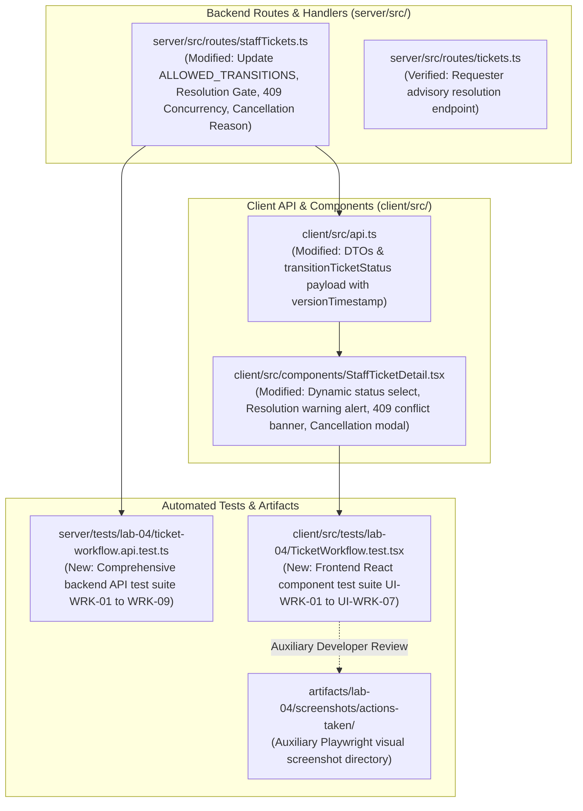

# Technical Implementation Plan: Issue 20 — Ticket Status Lifecycle, Concurrency & Resolution Gate

**Document ID**: PLAN-FEAT-20  
**Feature Title**: Ticket Status Lifecycle, Concurrency & Resolution Gate  
**Feature Branch**: `feature/20-ticket-workflow` (Issue 20)  
**Base Branch**: `lab4-staging` (incorporating `feature/17-spec-and-tests`, `feature/18-actions-taken-foundation`, and `feature/19-actions-taken-ui`)  
**Target Milestone**: TokTickIT Lab 4 (Sprint 4)  
**Authoritative Contract Reference**: [docs/features/20-ticket-workflow/contract.md](./contract.md)  
**Master Specifications & Traceability**:
* [TokTickIT-System-Level-SDS-v1.0.pdf](../../reference/TokTickIT-System-Level-SDS-v1.0.pdf) (§Architecture, §Data Conventions, §Security Invariants)
* [Lab_04_labsheet.pdf](../../reference/Lab_04_labsheet.pdf) (§1, §3, §4.1, §4.2, §5.1, §6.1, §10, §11, §12, §14 Part 2)
* [docs/lab-04/specification.md](../../lab-04/specification.md) (`FR-03`, `FR-05`, `BR-06`, `BR-07`, `BR-08`, `BR-09`, `BR-10`, `AC-07`–`AC-11`)
* [docs/lab-04/ui-spec.md](../../lab-04/ui-spec.md) (§3.5 Status Workflow Controls & Resolution Gate Feedback, §5 Feedback States)
* [docs/lab-04/api-spec.md](../../lab-04/api-spec.md) (§4 Ticket Status Workflow Endpoint, §1.2 Standard Error Envelope)
* [docs/lab-04/tests.md](../../lab-04/tests.md) (STS Test Catalog: `WRK-01`–`WRK-05`, `UI-WRK-01`, `UI-WRK-02`, `E2E-02`)
* [docs/lab-04/poc-scope-and-issues.md](../../lab-04/poc-scope-and-issues.md) (Issue 20 Scope & Implementation Plan)
* [docs/features/18-actions-taken-foundation/contract.md](../18-actions-taken-foundation/contract.md) (Actions Taken Backend Foundation)
* [docs/features/19-actions-taken-ui/contract.md](../19-actions-taken-ui/contract.md) (Actions Taken Client UI)
* [AGENTS.md](../../../AGENTS.md) (Developer Work Norms: Strict Closed-World Rule, TDD, Theme Compliance, Blur Validation Rule)
**Document Status**: Ready for Review & Execution  

---

## 1. Target File Inventory

Below is the complete inventory of all files to be created or modified for Issue 20:



### Detailed Target File Inventory Table

| Component | Path | Action | Responsibilities & Changes |
| :--- | :--- | :---: | :--- |
| **Backend Staff Routes** | `server/src/routes/staffTickets.ts` | `MODIFY` | Update `ALLOWED_TRANSITIONS` mapping (making `CLOSED` and `CANCELLED` terminal, allowing `NEW` $\rightarrow$ `IN_PROGRESS`, etc.); implement Resolution Gate check (`prisma.actionTaken.count`); implement optimistic concurrency check (`versionTimestamp` vs `ticket.updatedAt`); validate cancellation reason ($\ge 5$ chars); return standardized `{ ticket: { id, ticketNumber, currentStatus, updatedAt }, message }`. |
| **Backend Ticket Routes** | `server/src/routes/tickets.ts` | `VERIFY` | Re-verify `POST /api/v1/tickets/:id/resolve-request` updates `requesterResolvedAt = NOW()` while keeping `currentStatus` strictly unchanged (`BR-08`). |
| **Client API Client** | `client/src/api.ts` | `MODIFY` | Export `TransitionTicketStatusPayload` and `TransitionTicketStatusResponse` interfaces; update `transitionTicketStatus(ticketId, payload)` to pass `{ status, cancellationReason, versionTimestamp }` and parse error status/code. |
| **Staff Ticket Detail UI** | `client/src/components/StaffTicketDetail.tsx` | `MODIFY` | Update local `ALLOWED_TRANSITIONS` table; track `actionsCount` from `ActionsTakenSection`; render resolution gate blocker alert and disable transition button when selecting `RESOLVED` on `0`-action ticket; implement non-destructive `409 Conflict` banner with reload trigger preserving drafts; render cancellation modal; refresh header badge and metadata in-place. |
| **Backend Test Suite** | `server/tests/lab-04/ticket-workflow.api.test.ts` | `CREATE` | Supertest + Vitest test suite executing `WRK-01` through `WRK-09` covering resolution gate blocking, valid resolution, advisory requester resolution, invalid transition jumps, 409 conflict, terminal status constraints, cancellation reasons, and role authorization. |
| **Frontend Test Suite** | `client/src/tests/lab-04/TicketWorkflow.test.tsx` | `CREATE` | React Testing Library + Vitest test suite executing `UI-WRK-01` through `UI-WRK-07` covering resolution blocker warning, dynamic dropdown filtering, terminal state alerts, 409 draft preservation, cancellation reason modal, in-place header badge updates, and advisory alert rendering. |
| **Auxiliary Screenshots** | `artifacts/lab-04/screenshots/actions-taken/` | `PRESERVE` | Auxiliary visual verification directory for Playwright screenshots, strictly isolated from test assertion specifications per project rules. |

---

## 2. Phase 1: Status Transition Matrix & Validation Rules (`BR-06`)

### 2.1. Backend State Machine Updates (`server/src/routes/staffTickets.ts`)
The transition matrix in `server/src/routes/staffTickets.ts` must be updated from the legacy Lab 3 definition to strictly enforce the authoritative 8-status transition matrix:

```typescript
// server/src/routes/staffTickets.ts
export const ALLOWED_TRANSITIONS: Record<TicketStatus, TicketStatus[]> = {
  NEW: [TicketStatus.OPEN, TicketStatus.IN_PROGRESS, TicketStatus.CANCELLED],
  OPEN: [TicketStatus.IN_PROGRESS, TicketStatus.WAITING_FOR_REQUESTER, TicketStatus.RESOLVED, TicketStatus.CANCELLED],
  IN_PROGRESS: [TicketStatus.WAITING_FOR_REQUESTER, TicketStatus.RESOLVED, TicketStatus.CANCELLED],
  WAITING_FOR_REQUESTER: [TicketStatus.IN_PROGRESS, TicketStatus.RESOLVED, TicketStatus.CANCELLED],
  RESOLVED: [TicketStatus.CLOSED, TicketStatus.REOPENED],
  CLOSED: [], // Terminal State: No transitions allowed
  REOPENED: [TicketStatus.IN_PROGRESS, TicketStatus.RESOLVED, TicketStatus.CANCELLED],
  CANCELLED: [], // Terminal State: No transitions allowed
};
```

### 2.2. Validation & Error Handling Logic
In `transitionTicketStatus(req: Request, res: Response)`:
1. **Target Status Existence & Enum Validation**:
   - Verify `req.body.status` exists and is a valid enum value in `TicketStatus`.
   - If invalid or missing, respond with HTTP `400 Bad Request` (`VALIDATION_FAILED`).
2. **Transition Legality Check**:
   - Compare `targetStatus` against `ALLOWED_TRANSITIONS[ticket.currentStatus]`.
   - If `!allowed.includes(targetStatus)`, respond immediately with HTTP `400 Bad Request`:
     ```json
     {
       "error": {
         "code": "INVALID_STATUS_TRANSITION",
         "message": "Cannot transition ticket status from NEW to RESOLVED.",
         "timestamp": "2026-11-01T10:30:00.000Z"
       }
     }
     ```
3. **Cancellation Reason Validation**:
   - When `targetStatus === TicketStatus.CANCELLED`:
     - Inspect `req.body.cancellationReason`.
     - Trim whitespace. If undefined, null, or length $< 5$ characters, respond with HTTP `400 Bad Request`:
       ```json
       {
         "error": {
           "code": "VALIDATION_FAILED",
           "message": "Cancellation reason must be at least 5 characters.",
           "timestamp": "2026-11-01T10:30:00.000Z"
         }
       }
       ```
     - When valid, create an `internalNotes` record documenting the cancellation reason:
       `"Ticket cancelled by ${req.user.name}. Reason: ${cancellationReason}"`.

---

## 3. Phase 2: Resolution Gate Invariant & Concurrency Control (`BR-07`, `BR-08`, `BR-09`)

### 3.1. Resolution Gate Invariant (`BR-07`)
When `targetStatus === TicketStatus.RESOLVED` or `targetStatus === TicketStatus.CLOSED`:
1. Query child Action Taken count for the target ticket:
   ```typescript
   const actionsCount = await prisma.actionTaken.count({
     where: { ticketId: ticket.id },
   });
   ```
2. If `actionsCount === 0`:
   - Block transition immediately.
   - Return HTTP `400 Bad Request`:
     ```json
     {
       "error": {
         "code": "RESOLUTION_REQUIRES_ACTION_TAKEN",
         "message": "Cannot resolve ticket without at least one recorded Action Taken.",
         "timestamp": "2026-11-01T10:30:00.000Z"
       }
     }
     ```
3. If `actionsCount >= 1`:
   - Proceed with status transition.

### 3.2. Requester Advisory Problem Resolution Separation (`BR-08`)
1. Re-verify `POST /api/v1/tickets/:id/resolve-request` in `server/src/routes/tickets.ts`:
   - Authenticated requester only (`ticket.requesterId === req.user.id`).
   - If ticket is already `CLOSED` or `CANCELLED`, rejects with `400 Bad Request`.
   - Sets `requesterResolvedAt = new Date()`.
   - Leaves `ticket.currentStatus` strictly untouched (e.g. remains `IN_PROGRESS` or `OPEN`).
   - Responds with HTTP `200 OK`:
     ```json
     {
       "message": "Problem resolution recorded.",
       "requesterResolvedAt": "2026-11-01T10:30:00.000Z"
     }
     ```

### 3.3. Optimistic Concurrency Control (`BR-09` / `BR-10`)
1. When submitting `PATCH /api/v1/staff/tickets/:id/status`, client includes `versionTimestamp` (ISO date string of ticket's last known `updatedAt`).
2. Server validates timestamp concurrency:
   ```typescript
   const { versionTimestamp } = req.body;
   if (versionTimestamp) {
     const clientTime = new Date(versionTimestamp).getTime();
     const serverTime = new Date(ticket.updatedAt).getTime();
     // If difference exceeds 1000ms, flag as stale record collision
     if (Math.abs(clientTime - serverTime) > 1000) {
       return res.status(409).json({
         error: {
           code: "STALE_RECORD_CONFLICT",
           message: "The ticket was modified by another user. Please reload the ticket to view the latest state.",
           timestamp: new Date().toISOString(),
         },
       });
     }
   }
   ```
3. If matched, perform update and return updated ticket DTO:
   ```json
   {
     "ticket": {
       "id": 14,
       "ticketNumber": "TKT-2026-00014",
       "currentStatus": "RESOLVED",
       "updatedAt": "2026-11-01T10:35:00.000Z"
     },
     "message": "Ticket status updated to RESOLVED."
   }
   ```

---

## 4. Phase 3: Frontend Workflow Controls & UX (`StaffTicketDetail.tsx`)

### 4.1. Client API Client Updates (`client/src/api.ts`)
Extend `client/src/api.ts` to support the concurrency payload and structured response:

```typescript
export interface TransitionTicketStatusPayload {
  status: string;
  cancellationReason?: string | null;
  versionTimestamp?: string;
}

export interface TransitionTicketStatusResponse {
  ticket: {
    id: number;
    ticketNumber: string;
    currentStatus: string;
    updatedAt: string;
  };
  message: string;
}

export async function transitionTicketStatus(
  ticketId: number,
  payload: TransitionTicketStatusPayload | string
): Promise<TransitionTicketStatusResponse> {
  const body = typeof payload === "string" ? { status: payload } : payload;
  const res = await fetch(`${API_URL}/api/v1/staff/tickets/${ticketId}/status`, {
    method: "PATCH",
    headers: {
      "Content-Type": "application/json",
      Accept: "application/json",
    },
    credentials: "include",
    body: JSON.stringify(body),
  });

  const data = await res.json().catch(() => ({}));
  if (!res.ok) {
    const error: any = new Error(data.error?.message || `Failed to transition status (${res.status})`);
    error.status = res.status;
    error.code = data.error?.code;
    throw error;
  }
  return data;
}
```

### 4.2. Staff Ticket Detail Component Enhancements (`StaffTicketDetail.tsx`)

1. **Synchronize Allowed Transitions**:
   - Update client `ALLOWED_TRANSITIONS` table to match Phase 1 exactly.
   - If `ALLOWED_TRANSITIONS[ticket.currentStatus].length === 0`:
     Render terminal alert banner (`data-testid="terminal-status-notice"`) stating:
     `Terminal status reached ({ticket.currentStatus}). No further transitions permitted.`
2. **Resolution Gate Guidance Alert**:
   - Connect `onActionsChanged={(actions) => setActionsCount(actions.length)}` from `ActionsTakenSection`.
   - Also initialize `actionsCount` from `ticket.actionsTaken?.length ?? 0` on ticket load.
   - If `selectedNextStatus === "RESOLVED"` and `actionsCount === 0`:
     - Render warning alert (`data-testid="resolution-blocked-warning"`):
       ```html
       <div className="alert alert-warning py-2 px-3 small mt-2" data-testid="resolution-blocked-warning">
         ⚠️ <strong>Resolution Blocked:</strong> You must log at least one Action Taken before this ticket can be resolved.
       </div>
       ```
     - Disable the submit button:
       `disabled={isUpdatingStatus || !selectedNextStatus || (selectedNextStatus === "RESOLVED" && actionsCount === 0)}`
3. **Non-Destructive 409 Conflict Banner**:
   - Introduce state `concurrencyConflict: string | null = null`.
   - In `handleTransitionStatus`, catch errors where `error.status === 409` or `error.code === "STALE_RECORD_CONFLICT"`.
   - Display amber banner (`data-testid="concurrency-conflict-banner"`):
     ```html
     <div className="alert alert-warning alert-dismissible fade show mb-4" data-testid="concurrency-conflict-banner">
       <strong>⚠️ Update Conflict:</strong> Another staff member updated this ticket while you were working. Your status change was not applied to avoid overwriting their work.
       <button className="btn btn-outline-dark btn-sm ms-3" onClick={handleReloadTicketPreservingDrafts} data-testid="reload-ticket-btn">
         🔄 Reload Ticket Data
       </button>
     </div>
     ```
   - `handleReloadTicketPreservingDrafts`: Re-fetches ticket metadata via `getStaffTicketDetail(ticketId)` to update `ticket`, `currentStatus`, and `updatedAt`, while leaving `commentContent` and `internalNoteContent` unchanged!
4. **Cancellation Reason Modal Dialog**:
   - If `selectedNextStatus === "CANCELLED"`, clicking `Transition to CANCELLED` triggers modal `showCancelModal: boolean`.
   - Modal contains `<textarea>` for cancellation reason (min 5 chars).
   - Validating $\ge 5$ characters enables submit button.
   - On confirmation, calls `transitionTicketStatus(ticket.id, { status: "CANCELLED", cancellationReason, versionTimestamp: ticket.updatedAt })`.
5. **In-Place UI Header Status Badge Refresh**:
   - Upon successful transition:
     ```typescript
     const res = await transitionTicketStatus(ticket.id, {
       status: selectedNextStatus,
       versionTimestamp: ticket.updatedAt,
     });
     setTicket((prev) => prev ? {
       ...prev,
       currentStatus: res.ticket.currentStatus,
       status: res.ticket.currentStatus,
       updatedAt: res.ticket.updatedAt,
     } : null);
     ```
   - Automatically recalculates `allowedNextStatuses`.
   - Displays temporary green success message: `Ticket transitioned to ${res.ticket.currentStatus}.`.

---

## 5. Phase 4: Automated Testing & Verification Plan

### 5.1. Backend API Test Suite (`server/tests/lab-04/ticket-workflow.api.test.ts`)
Author comprehensive API integration tests using Vitest and Supertest:

```typescript
describe("Ticket Status Workflow & Resolution Gate API (Lab 4 / Issue 20)", () => {
  // WRK-01: Staff attempts to resolve ticket with 0 Actions Taken -> 400 Bad Request
  it("WRK-01: rejects transition to RESOLVED if ticket has 0 Actions Taken", async () => { ... });

  // WRK-02: Staff transitions ticket with >= 1 Action Taken to RESOLVED -> 200 OK
  it("WRK-02: allows transition to RESOLVED when ticket has >= 1 recorded Action Taken", async () => { ... });

  // WRK-03: Requester marks problem as resolved -> 200 OK; requesterResolvedAt updated, currentStatus unchanged
  it("WRK-03: records requester advisory resolution without altering ticket status", async () => { ... });

  // WRK-04: Invalid status transitions -> 400 Bad Request (INVALID_STATUS_TRANSITION)
  it("WRK-04: rejects invalid status transitions (e.g. NEW -> RESOLVED)", async () => { ... });

  // WRK-05: Optimistic concurrency collision -> 409 Conflict (STALE_RECORD_CONFLICT)
  it("WRK-05: rejects status update with 409 Conflict if versionTimestamp is stale", async () => { ... });

  // WRK-06: Terminal status enforcement for CLOSED -> 400 Bad Request
  it("WRK-06: rejects transitions from CLOSED status enforcing terminal invariant", async () => { ... });

  // WRK-07: Cancellation reason validation -> 400 Bad Request if < 5 characters
  it("WRK-07: requires non-empty cancellation reason (>= 5 chars) when status is CANCELLED", async () => { ... });

  // WRK-08: Role enforcement -> Requester cannot patch ticket status (403 Forbidden)
  it("WRK-08: rejects requester attempts to transition ticket status with 403 Forbidden", async () => { ... });

  // WRK-09: Complete end-to-end legal sequence
  it("WRK-09: successfully transitions ticket through full lifecycle with actions taken", async () => { ... });
});
```

### 5.2. Frontend Component Test Suite (`client/src/tests/lab-04/TicketWorkflow.test.tsx`)
Author React Testing Library component tests:

```typescript
describe("Ticket Workflow Controls & Resolution Gate UI (Lab 4 / Issue 20)", () => {
  // UI-WRK-01: Resolution gate guidance warning when 0 actions and RESOLVED selected
  it("UI-WRK-01: displays warning alert and disables transition button when RESOLVED selected on 0-action ticket", async () => { ... });

  // UI-WRK-02: Dynamic status dropdown options filtering based on current status
  it("UI-WRK-02: renders only permitted next status options matching transition matrix", async () => { ... });

  // UI-WRK-03: Terminal state notice for CLOSED and CANCELLED tickets
  it("UI-WRK-03: renders terminal status notice and conceals transition select for CLOSED ticket", async () => { ... });

  // UI-WRK-04: Non-destructive 409 Conflict banner preserving active user drafts
  it("UI-WRK-04: displays 409 conflict banner and reloads metadata without clearing draft comments/notes", async () => { ... });

  // UI-WRK-05: Cancellation reason modal validation and submission
  it("UI-WRK-05: enforces cancellation reason modal and submits payload when CANCELLED selected", async () => { ... });

  // UI-WRK-06: In-place header status badge and transition select update
  it("UI-WRK-06: updates header status badge and allowed options in-place upon successful transition", async () => { ... });

  // UI-WRK-07: Advisory requester resolution alert
  it("UI-WRK-07: renders advisory alert informing staff that requester marked problem resolved", async () => { ... });
});
```

### 5.3. Playwright Visual Verification Safeguard
* Playwright full-page screenshots are strictly saved to `artifacts/lab-04/screenshots/actions-taken/`.
* They serve purely as auxiliary developer visual verification.
* In accordance with project governance rules, Playwright screenshot checks will not be added to `docs/lab-04/tests.md` or mixed into unit/integration test specifications.

---

## 6. Execution Sequence & Dependency Order

The implementation must proceed in the following linear, verified order:

1. **Step 1: Backend Route Enhancements**:
   - Update `server/src/routes/staffTickets.ts` with updated `ALLOWED_TRANSITIONS`, Resolution Gate check, Optimistic Concurrency check, and Cancellation reason validation.
2. **Step 2: Client API Layer**:
   - Update `client/src/api.ts` with `TransitionTicketStatusPayload`, `TransitionTicketStatusResponse`, and updated `transitionTicketStatus`.
3. **Step 3: Frontend Component Enhancements**:
   - Update `client/src/components/StaffTicketDetail.tsx` with resolution warning alert, non-destructive 409 conflict banner, cancellation modal, and in-place badge refresh.
4. **Step 4: Automated Verification**:
   - Create and run `server/tests/lab-04/ticket-workflow.api.test.ts` (verify 100% pass on WRK-01 to WRK-09).
   - Create and run `client/src/tests/lab-04/TicketWorkflow.test.tsx` (verify 100% pass on UI-WRK-01 to UI-WRK-07).
   - Run complete repository regression test suite to ensure 0 regressions.

