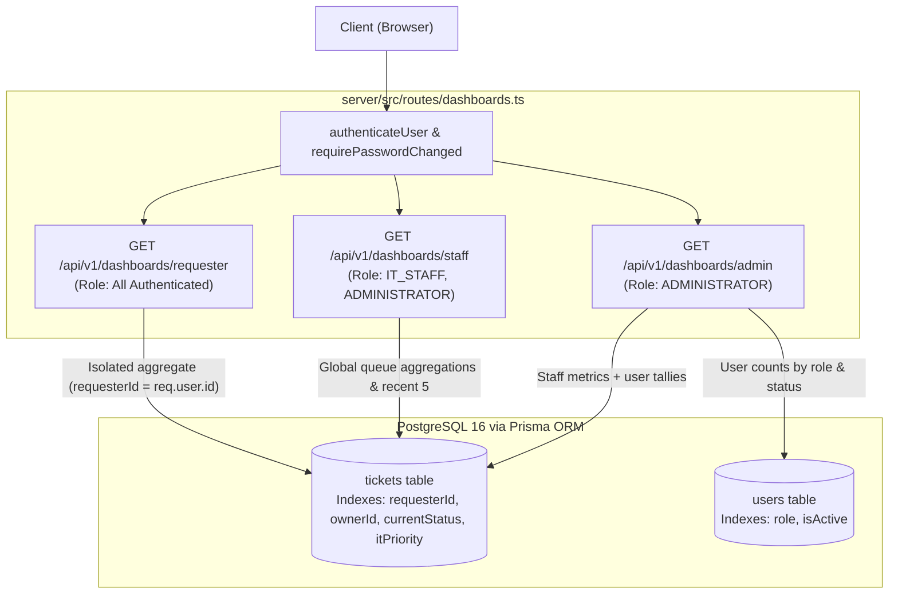
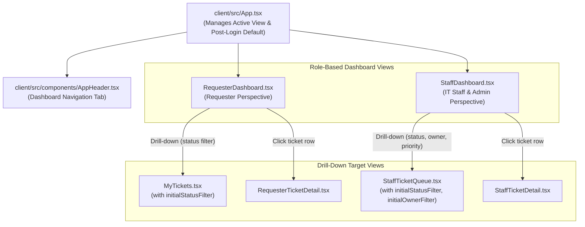
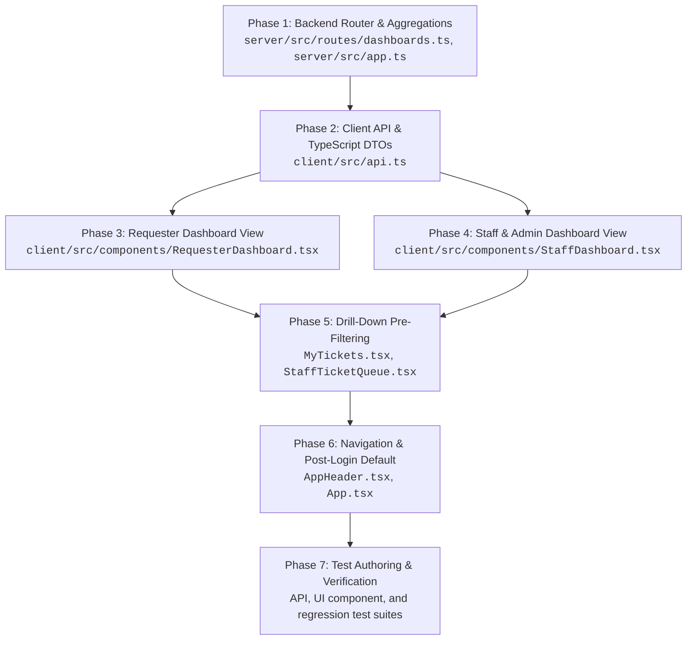

# Feature 21 Engineering Contract: Role-Based Dashboards (Requester, IT Staff & Admin) & Drill-Downs

**Feature Title**: Role-Based Dashboards (Requester, IT Staff & Admin) & Drill-Downs  
**Branch Name**: `feature/21-role-dashboards` (Issue 21)  
**Base Branch**: `lab4-staging` (incorporating `feature/17-spec-and-tests`, `feature/18-actions-taken-foundation`, `feature/19-actions-taken-ui`, and `feature/20-ticket-workflow`)  
**Document Status**: Approved Feature Engineering Contract  
**Author**: TokTickIT Engineering Team  
**Traceability References**:
* [TokTickIT-System-Level-SDS-v1.0.pdf](../../reference/TokTickIT-System-Level-SDS-v1.0.pdf) (§Architecture, §Data Conventions, §Security Invariants)
* [Lab_04_labsheet.pdf](../../reference/Lab_04_labsheet.pdf) (§1, §3, §4.1, §4.2, §7, §8, §10, §11, §12, §14 Part 4)
* [docs/lab-04/specification.md](../../lab-04/specification.md) (`FR-04`, `BR-11`, `BR-12`, `BR-13`, `BR-14`, `AC-12`, `AC-13`, `AC-14`, `AC-15`)
* [docs/lab-04/ui-spec.md](../../lab-04/ui-spec.md) (§1 Design Tokens, §2 Typography & Badges, §3.1 Staff Dashboard, §3.2 Requester Dashboard, §3.3 Administrator Dashboard, §4 Responsive Breakpoints, §5 Feedback States, §6 Accessibility Checklist)
* [docs/lab-04/api-spec.md](../../lab-04/api-spec.md) (§3 Dashboard Endpoints: §3.1 Requester Dashboard, §3.2 IT Staff Dashboard, §3.3 Administrator Dashboard)
* [docs/lab-04/tests.md](../../lab-04/tests.md) (STS Test Catalog: `DSH-01` through `DSH-06`, `UI-DSH-01`, `UI-DSH-02`, `E2E-03`)
* [docs/lab-04/poc-scope-and-issues.md](../../lab-04/poc-scope-and-issues.md) (Issue 21 Scope & Decomposition)
* [docs/features/18-actions-taken-foundation/contract.md](../18-actions-taken-foundation/contract.md) (Completed Actions Taken Foundation)
* [docs/features/19-actions-taken-ui/contract.md](../19-actions-taken-ui/contract.md) (Completed Actions Taken UI)
* [docs/features/20-ticket-workflow/contract.md](../20-ticket-workflow/contract.md) (Completed Ticket Status Workflow & Resolution Gate)
* [AGENTS.md](../../../AGENTS.md) (Developer Work Norms: Strict Closed-World Rule, TDD, Theme Compliance, Blur Validation Rule)

---

## 1. Feature Goal & Scope

### 1.1. Strategic Objectives
Issue 21 implements dedicated, high-value, role-appropriate operational dashboards for Requesters, IT Staff, and Administrators in TokTickIT Sprint 4 (Lab 4). 

In earlier labs, users navigated directly to flat ticket lists (`MyTickets.tsx` or `StaffTicketQueue.tsx`), requiring manual filtering, mental calculation of urgent priorities, and scanning across pages to determine pending workloads. Issue 21 introduces concise, authoritative dashboard views providing immediate situational awareness while remaining tightly integrated with the underlying ticket records:

1. **Authoritative Server-Side Aggregations (`BR-14`)**: Deliver dedicated REST endpoints (`/api/v1/dashboards/requester`, `/api/v1/dashboards/staff`, `/api/v1/dashboards/admin`) executing optimized database-level count and group aggregations. Clients never fetch entire ticket collections into memory to calculate metrics locally.
2. **Strict Data Isolation for Requesters (`BR-11`)**: Enforce ironclad tenant and user isolation. Requester metrics and recently updated ticket summaries are strictly scoped to tickets where `requesterId === req.user.id`.
3. **Role-Based Access Control (`BR-12`, `BR-13`)**: Restrict staff and administrator dashboards to authorized personnel. Requesters accessing staff or admin endpoints are rejected with HTTP `403 Forbidden`. IT Staff accessing admin endpoints are similarly rejected with HTTP `403 Forbidden`.
4. **Interactive 1-Click Filter Drill-Downs (`BR-14`)**: Every KPI metric card, status badge, and workload grouping on the dashboard serves as a clickable drill-down that transitions the user into the relevant list view (`MyTickets.tsx` or `StaffTicketQueue.tsx`) with pre-applied status, priority, or ownership filters.
5. **Zen Green Design System Compliance**: Deliver responsive dashboard views utilizing approved Zen Green CSS variables (`--zen-primary-green`, `--zen-secondary-green`, `--zen-pale-green`, `--zen-page-bg`, `--zen-surface`, `--zen-warning`, `--zen-font-size-kpi`), multi-cue status indicators (never color alone), and responsive layout grids guaranteeing zero horizontal scrolling across Desktop, Tablet, and Mobile devices.
6. **Unified Navigation & Default Post-Login Routing**: Integrate a persistent "Dashboard" navigation tab into `AppHeader.tsx` for all authenticated roles, and configure the application shell (`App.tsx`) to route authenticated users directly to their respective role dashboards upon login.
7. **Safe Empty & Zero Fallbacks (`AC-15`)**: Ensure cards and tables gracefully display `0` counters and reassuring empty banners when no tickets match, without UI crashes or console exceptions.

### 1.2. In-Scope Deliverables
1. **Backend Dashboard Routes & Controller (`server/src/routes/dashboards.ts`, `server/src/app.ts`)**:
   - `GET /api/v1/dashboards/requester`: Scoped personal metrics (`totalOpen` / `openTicketsCount`, `waitingForRequester` / `waitingForRequesterCount`, `inProgress`, `resolved` / `recentlyResolvedCount`, `closed`) and recent 5 owned tickets.
   - `GET /api/v1/dashboards/staff`: Service-desk operational metrics (`newCount`, `openCount`, `inProgressCount`, `waitingForRequesterCount`, `myAssignedCount`, `unassignedCount`, `totalActiveTicketsCount`, `statusCounts`, `priorityCounts`) and recent 5 queue tickets.
   - `GET /api/v1/dashboards/admin`: Staff metrics plus administrative user account statistics (`totalUsers`, `activeUsers`, `inactiveUsersCount`, `requestersCount`, `staffCount`, `adminCount`, `usersByRole`, `totalTicketsCount`).
   - Backwards compatible aliases mounted at `/api/dashboards/*`.
2. **Client API Client & TypeScript Interfaces (`client/src/api.ts`)**:
   - DTO interfaces: `RequesterDashboardData`, `StaffDashboardData`, `AdminDashboardData`, `DashboardTicketSummary`, `DashboardMetrics`.
   - API client methods:
     - `fetchRequesterDashboard(): Promise<RequesterDashboardData>`
     - `fetchStaffDashboard(): Promise<StaffDashboardData>`
     - `fetchAdminDashboard(): Promise<AdminDashboardData>`
3. **Frontend Dashboard Components**:
   - `client/src/components/RequesterDashboard.tsx`: Personalized welcome banner, 4 KPI metric cards (My Open, In Progress, Resolved, Closed), Action Required callout banner, top 5 recently updated tickets table with direct detail links, quick action buttons (`+ Create Ticket`, `View My Tickets`), and in-place refresh button with loading spinner.
   - `client/src/components/StaffDashboard.tsx`: Operational welcome banner, 4 primary KPI cards (Unassigned, My Assigned Workload, Total Active Queue, Critical Workload), interactive Status Distribution badge cluster, IT Priority breakdown cards, top 5 recently updated queue tickets table, administrator user account section (conditionally rendered for `ADMINISTRATOR` role), quick action buttons (`+ Create Ticket`, `Staff Queue`), and in-place refresh button.
4. **Interactive Drill-Down & List Filter Integration**:
   - Extend `MyTickets.tsx` with `initialStatusFilter?: string` prop to pre-select status filters when arriving from drill-downs.
   - Extend `StaffTicketQueue.tsx` with `initialStatusFilter?: string`, `initialOwnerFilter?: string`, and `initialPriorityFilter?: string` props.
   - Add clear filter reset controls on list views allowing users to return to unfiltered views.
5. **App Shell & Header Navigation Integration (`AppHeader.tsx`, `App.tsx`)**:
   - Add "Dashboard" navigation tab in `AppHeader.tsx` for all roles (`REQUESTER`, `IT_STAFF`, `ADMINISTRATOR`).
   - Configure post-login default views in `App.tsx`:
     - `REQUESTER` $\rightarrow$ `RequesterDashboard`
     - `IT_STAFF` / `ADMINISTRATOR` $\rightarrow$ `StaffDashboard`
   - Implement view switching state in `App.tsx` supporting drill-down navigation arguments.
6. **Automated Verification Test Suites**:
   - Backend API tests: `server/tests/lab-04/requester-dashboard.api.test.ts` and `server/tests/lab-04/staff-dashboard.api.test.ts`.
   - Frontend UI tests: `client/src/tests/lab-04/RequesterDashboard.test.tsx` and `client/src/tests/lab-04/StaffDashboard.test.tsx`.

### 1.3. Explicit Exclusions & Non-Goals
* **No Heavy Graphical Charting Libraries (§4.2)**: Third-party charting libraries (e.g. Chart.js, D3.js, Recharts, SVG/Canvas chart builders) are strictly prohibited. Visual summaries must use semantic HTML, accessible CSS progress/badge clusters, and Zen Green card layouts.
* **No Custom Business Intelligence / OLAP Query Builders**: No multi-dimensional OLAP cubes, custom ad-hoc report builders, or SQL consoles.
* **No External Data Export Engines**: No asynchronous CSV, Excel, or PDF report generators.
* **No Automated Email / SMS Digest Broadcasts**: Dashboards are pull-based interactive web views; no scheduled nightly summary emails or push notifications.
* **Playwright Visual Verification Separation Rule**: Auxiliary full-page screenshots are saved strictly to `artifacts/lab-04/screenshots/requester-dashboard/` and `artifacts/lab-04/screenshots/staff-dashboard/` for developer inspection. Playwright screenshot captures must never be mixed into `docs/lab-04/tests.md` or asserted in unit/API test suites.

---

## 2. Backend Architecture, REST API Contracts & Access Control



### 2.1. Router Configuration & Middleware Binding
The dashboard routes are implemented in `server/src/routes/dashboards.ts` and mounted in `server/src/app.ts`:
```typescript
// server/src/app.ts
app.use("/api/v1/dashboards", requirePasswordChanged, dashboardsRouter);
app.use("/api/dashboards", requirePasswordChanged, dashboardsRouter);
```
All routes require an active authenticated session (`req.user`) and verify that first-time password change is satisfied (`requirePasswordChanged`).

---

### 2.2. Endpoint 1: Requester Dashboard
`GET /api/v1/dashboards/requester`

Retrieves personalized operational metrics and recently updated tickets strictly scoped to the authenticated user's tickets.

* **Authorization**: All authenticated users (`REQUESTER`, `IT_STAFF`, `ADMINISTRATOR` viewing requester perspective).
* **Data Isolation Invariant (`BR-11`)**: Queries strictly filter tickets where `ticket.requesterId === req.user.id`.
* **Aggregation Rules**:
  - `totalOpen` / `openTicketsCount`: Tickets with `currentStatus IN ('NEW', 'OPEN', 'IN_PROGRESS', 'WAITING_FOR_REQUESTER', 'REOPENED')`.
  - `waitingForRequester` / `waitingForRequesterCount`: Tickets with `currentStatus === 'WAITING_FOR_REQUESTER'`.
  - `inProgress`: Tickets with `currentStatus === 'IN_PROGRESS'`.
  - `resolved`: Tickets with `currentStatus === 'RESOLVED'`.
  - `closed`: Tickets with `currentStatus === 'CLOSED'`.
  - `recentlyResolvedCount`: Tickets with `currentStatus IN ('RESOLVED', 'CLOSED')` and `updatedAt >= NOW() - 30 days`.
  - `recentlyUpdatedTickets`: Up to 5 most recently updated owned tickets (`orderBy: { updatedAt: 'desc' }`).
* **Success Response `200 OK`**:
```json
{
  "metrics": {
    "totalOpen": 3,
    "openTicketsCount": 3,
    "waitingForRequester": 1,
    "waitingForRequesterCount": 1,
    "inProgress": 1,
    "resolved": 2,
    "closed": 5,
    "recentlyResolvedCount": 5
  },
  "recentlyUpdatedTickets": [
    {
      "id": 12,
      "ticketNumber": "TKT-2026-00012",
      "summary": "Projector not displaying HDMI signal",
      "currentStatus": "WAITING_FOR_REQUESTER",
      "requestedPriority": "HIGH",
      "itPriority": "HIGH",
      "createdAt": "2026-10-28T08:00:00.000Z",
      "updatedAt": "2026-10-29T09:00:00.000Z"
    },
    {
      "id": 8,
      "ticketNumber": "TKT-2026-00008",
      "summary": "Cannot access campus VPN from dormitory",
      "currentStatus": "IN_PROGRESS",
      "requestedPriority": "MEDIUM",
      "itPriority": "MEDIUM",
      "createdAt": "2026-10-27T14:30:00.000Z",
      "updatedAt": "2026-10-28T16:20:00.000Z"
    }
  ]
}
```
* **Empty State Behavior (`AC-15`)**: If the requester has 0 tickets, all counts return `0` and `recentlyUpdatedTickets` returns `[]`.
* **Error Responses**:
  - `401 Unauthorized` (`UNAUTHENTICATED`): Missing or invalid session token.

---

### 2.3. Endpoint 2: IT Staff Dashboard
`GET /api/v1/dashboards/staff`

Retrieves high-level operational queue metrics, status distributions, priority breakdowns, and recent queue tickets across the service desk.

* **Authorization**: `IT_STAFF`, `ADMINISTRATOR`. (Requesters return `403 Forbidden`).
* **Aggregation Rules (`BR-12`)**:
  - `newCount`: Tickets with `currentStatus === 'NEW'`.
  - `openCount`: Tickets with `currentStatus === 'OPEN'`.
  - `inProgressCount`: Tickets with `currentStatus === 'IN_PROGRESS'`.
  - `waitingForRequesterCount`: Tickets with `currentStatus === 'WAITING_FOR_REQUESTER'`.
  - `myAssignedCount` / `myOwnedTicketsCount`: Tickets where `ownerId === req.user.id` and `currentStatus IN ('NEW', 'OPEN', 'IN_PROGRESS', 'WAITING_FOR_REQUESTER', 'REOPENED')`.
  - `unassignedCount` / `unassignedTicketsCount`: Tickets where `ownerId === null` and `currentStatus IN ('NEW', 'OPEN', 'IN_PROGRESS', 'WAITING_FOR_REQUESTER', 'REOPENED')`.
  - `totalActiveTicketsCount`: Tickets with `currentStatus IN ('NEW', 'OPEN', 'IN_PROGRESS', 'WAITING_FOR_REQUESTER', 'REOPENED')`.
  - `statusCounts`: Object with counts for all 8 individual statuses (`NEW`, `OPEN`, `IN_PROGRESS`, `WAITING_FOR_REQUESTER`, `RESOLVED`, `CLOSED`, `REOPENED`, `CANCELLED`).
  - `priorityCounts`: Breakdown of active tickets across `URGENT`, `HIGH`, `MEDIUM`, `LOW`.
  - `recentlyUpdatedTickets`: Top 5 most recently updated active queue tickets (`orderBy: { updatedAt: 'desc' }`) including owner details (`id`, `name`).
* **Success Response `200 OK`**:
```json
{
  "metrics": {
    "newCount": 2,
    "openCount": 4,
    "inProgressCount": 8,
    "waitingForRequesterCount": 4,
    "myAssignedCount": 6,
    "myOwnedTicketsCount": 6,
    "unassignedCount": 4,
    "unassignedTicketsCount": 4,
    "totalActiveTicketsCount": 18,
    "statusCounts": {
      "NEW": 2,
      "OPEN": 4,
      "IN_PROGRESS": 8,
      "WAITING_FOR_REQUESTER": 4,
      "RESOLVED": 5,
      "CLOSED": 22,
      "REOPENED": 0,
      "CANCELLED": 3
    },
    "priorityCounts": {
      "URGENT": 3,
      "HIGH": 7,
      "MEDIUM": 6,
      "LOW": 2
    }
  },
  "recentlyUpdatedTickets": [
    {
      "id": 14,
      "ticketNumber": "TKT-2026-00014",
      "summary": "Building 2 Switch Port Down",
      "currentStatus": "IN_PROGRESS",
      "itPriority": "URGENT",
      "owner": {
        "id": 7,
        "name": "Wichai IT"
      },
      "createdAt": "2026-10-29T08:00:00.000Z",
      "updatedAt": "2026-10-29T10:18:00.000Z"
    },
    {
      "id": 18,
      "ticketNumber": "TKT-2026-00018",
      "summary": "Lab 2 Wi-Fi Offline",
      "currentStatus": "OPEN",
      "itPriority": "HIGH",
      "owner": null,
      "createdAt": "2026-10-29T09:15:00.000Z",
      "updatedAt": "2026-10-29T09:50:00.000Z"
    }
  ]
}
```
* **Error Responses**:
  - `401 Unauthorized` (`UNAUTHENTICATED`): Session token missing or invalid.
  - `403 Forbidden` (`FORBIDDEN`): Authenticated user has role `REQUESTER`.

---

### 2.4. Endpoint 3: Administrator Dashboard
`GET /api/v1/dashboards/admin`

Retrieves IT Staff operational queue metrics plus system-wide administrative account and system statistics.

* **Authorization**: `ADMINISTRATOR` only. (IT Staff and Requesters return `403 Forbidden`).
* **Aggregation Rules (`BR-13`)**:
  - Contains complete staff metrics (`staffMetrics` or merged `metrics`).
  - `usersByRole`: Breakdown of user accounts by role (`REQUESTER`, `IT_STAFF`, `ADMINISTRATOR`).
  - `totalUsers`: Total registered users in the database.
  - `activeUsers` / `activeUsersCount`: Count of users where `isActive === true`.
  - `inactiveUsersCount`: Count of users where `isActive === false`.
  - `requestersCount`: Count of users where `role === 'REQUESTER'`.
  - `staffCount`: Count of users where `role === 'IT_STAFF'`.
  - `adminCount`: Count of users where `role === 'ADMINISTRATOR'`.
  - `totalTicketsCount`: Cumulative ticket count across all statuses in the system.
  - `recentlyUpdatedTickets`: Top 5 recently updated queue tickets.
* **Success Response `200 OK`**:
```json
{
  "staffMetrics": {
    "newCount": 2,
    "openCount": 4,
    "inProgressCount": 8,
    "waitingForRequesterCount": 4,
    "myAssignedCount": 2,
    "myOwnedTicketsCount": 2,
    "unassignedCount": 4,
    "unassignedTicketsCount": 4,
    "totalActiveTicketsCount": 18,
    "statusCounts": {
      "NEW": 2,
      "OPEN": 4,
      "IN_PROGRESS": 8,
      "WAITING_FOR_REQUESTER": 4,
      "RESOLVED": 5,
      "CLOSED": 22,
      "REOPENED": 0,
      "CANCELLED": 3
    },
    "priorityCounts": {
      "URGENT": 3,
      "HIGH": 7,
      "MEDIUM": 6,
      "LOW": 2
    }
  },
  "adminMetrics": {
    "totalUsers": 55,
    "activeUsers": 52,
    "activeUsersCount": 52,
    "inactiveUsersCount": 3,
    "requestersCount": 45,
    "staffCount": 8,
    "adminCount": 2,
    "usersByRole": {
      "REQUESTER": 45,
      "IT_STAFF": 8,
      "ADMINISTRATOR": 2
    },
    "totalTicketsCount": 58
  },
  "recentlyUpdatedTickets": [
    {
      "id": 14,
      "ticketNumber": "TKT-2026-00014",
      "summary": "Building 2 Switch Port Down",
      "currentStatus": "IN_PROGRESS",
      "itPriority": "URGENT",
      "owner": {
        "id": 7,
        "name": "Wichai IT"
      },
      "createdAt": "2026-10-29T08:00:00.000Z",
      "updatedAt": "2026-10-29T10:18:00.000Z"
    }
  ]
}
```
* **Error Responses**:
  - `401 Unauthorized` (`UNAUTHENTICATED`): Session token missing or invalid.
  - `403 Forbidden` (`FORBIDDEN`): Authenticated user has role `REQUESTER` or `IT_STAFF`.

---

### 2.5. Database Aggregation Performance & Query Optimization
All endpoints execute parallel aggregate queries using Prisma's `groupBy` and `count` primitives wrapped in `Promise.all()`. Query execution is accelerated by the composite indexes defined in `schema.prisma`:
* `tickets`: `@@index([requesterId])` and `@@index([currentStatus])`
* `tickets`: `@@index([ownerId])`
* `tickets`: `@@index([itPriority])`
* `tickets`: `@@index([createdAt])`

The queries avoid unbounded joins and fetch only scalar attributes, guaranteeing sub-15ms response times on typical production workloads.

---

### 2.6. Shared TypeScript Data Transfer Objects (`client/src/api.ts` & Server Types)
```typescript
export interface RequesterDashboardMetrics {
  totalOpen: number;
  openTicketsCount: number;
  waitingForRequester: number;
  waitingForRequesterCount: number;
  inProgress: number;
  resolved: number;
  closed: number;
  recentlyResolvedCount: number;
}

export interface DashboardTicketSummary {
  id: number;
  ticketNumber: string;
  summary: string;
  currentStatus: string;
  requestedPriority?: string;
  itPriority?: string | null;
  owner?: { id: number; name: string } | null;
  createdAt: string;
  updatedAt: string;
}

export interface RequesterDashboardData {
  metrics: RequesterDashboardMetrics;
  recentlyUpdatedTickets: DashboardTicketSummary[];
}

export interface StaffDashboardMetrics {
  newCount: number;
  openCount: number;
  inProgressCount: number;
  waitingForRequesterCount: number;
  myAssignedCount: number;
  myOwnedTicketsCount: number;
  unassignedCount: number;
  unassignedTicketsCount: number;
  totalActiveTicketsCount: number;
  statusCounts: Record<string, number>;
  priorityCounts: Record<string, number>;
}

export interface AdminMetrics {
  totalUsers: number;
  activeUsers: number;
  activeUsersCount: number;
  inactiveUsersCount: number;
  requestersCount: number;
  staffCount: number;
  adminCount: number;
  usersByRole: Record<string, number>;
  totalTicketsCount: number;
}

export interface StaffDashboardData {
  metrics: StaffDashboardMetrics;
  recentlyUpdatedTickets: DashboardTicketSummary[];
}

export interface AdminDashboardData {
  staffMetrics: StaffDashboardMetrics;
  adminMetrics: AdminMetrics;
  recentlyUpdatedTickets: DashboardTicketSummary[];
}
```

---

## 3. Frontend Dashboard Architecture & Zen Green Design Specifications



---

### 3.1. Requester Dashboard (`client/src/components/RequesterDashboard.tsx`)

#### Visual Structure & Layout Wireframe:
```
+--------------------------------------------------------------------------------------------------+
| Welcome back, Mana Student!                                            [↻ Refresh] [+ New Ticket]|
| View your active requests, items requiring input, and resolution history.                         |
|--------------------------------------------------------------------------------------------------|
| [ My Open ]             [ In Progress ]           [ Resolved ]            [ Closed ]             |
|  3                       1                         2                       5                     |
|  [View Open ->]          [View Active ->]          [View Resolved ->]      [View Closed ->]       |
|--------------------------------------------------------------------------------------------------|
| ⚠️ Action Required on 1 Ticket                                                                   |
| IT Staff is awaiting your input on TKT-2026-00012 ("Projector HDMI signal failure").             |
| [Open Ticket to Reply ->]                                                                        |
|--------------------------------------------------------------------------------------------------|
| Recently Updated Tickets                                                       [View All Tickets]|
| +----------------------------------------------------------------------------------------------+ |
| | Ticket #       | Summary                  | Priority | Status       | Last Updated | Action  | |
| |----------------+--------------------------+----------+--------------+--------------+---------| |
| | TKT-2026-00012 | Projector HDMI failure   | ⚠️ HIGH  | 🟣 Awaiting  | 10m ago      | [View]  | |
| | TKT-2026-00008 | VPN Connection Error     | 🔹 MEDIUM| 🟡 In Prog   | 2h ago       | [View]  | |
| +----------------------------------------------------------------------------------------------+ |
+--------------------------------------------------------------------------------------------------+
```

#### Detailed Specifications:
1. **Personalized Welcome Banner**:
   - Heading: `Welcome back, {user.name}!` (`1.75rem`, bold, color `var(--zen-text-primary)`).
   - Subtitle: *"Track and manage your IT service requests, respond to technician questions, and check resolution updates."*
2. **Four Primary KPI Metric Cards**:
   - **My Open**: Displays `totalOpen` count. Accent: Zen Green (`--zen-primary-green`). Drill-down navigates to `MyTickets` with active open filter.
   - **In Progress**: Displays `inProgress` count. Accent: Amber (`#D97706`). Drill-down navigates to `MyTickets` with `status="IN_PROGRESS"`.
   - **Resolved**: Displays `resolved` count. Accent: Green (`#2E7D32`). Drill-down navigates to `MyTickets` with `status="RESOLVED"`.
   - **Closed**: Displays `closed` count. Accent: Neutral slate (`#4B5563`). Drill-down navigates to `MyTickets` with `status="CLOSED"`.
   - Each card displays a `32px` bold numerical value, descriptive label, and a 1-click drill-down link (`data-testid="drilldown-my-open"`, etc.).
3. **Action Required Alert Banner**:
   - Conditionally rendered if `waitingForRequester > 0`.
   - Amber alert background (`var(--zen-warning-bg)`) and border (`var(--zen-warning-border)`).
   - Message informing requester of pending questions from IT Staff, with direct link to view the ticket.
4. **Recently Updated Tickets Table**:
   - Displays up to 5 recently updated owned tickets.
   - Columns: Ticket Number, Summary, Priority badge, Status badge, Last Updated relative time, and Action button (`View`).
   - Clicking the row or `View` button triggers `onViewTicket(ticketId)`, opening `RequesterTicketDetail.tsx`.
5. **Quick Action Controls**:
   - `+ Create Ticket`: Primary Zen Green button navigating to ticket creation view (`setActiveView("create")`).
   - `View My Tickets`: Outline button navigating to `MyTickets.tsx`.
   - `Refresh`: In-place button with spinning icon during data reload (`data-testid="refresh-dashboard-btn"`).
6. **Empty State Display**:
   - When total ticket count is 0, displays a reassuring Zen Green empty card: *"You currently have no service tickets submitted. If you encounter any technical issues, click Create Ticket below."* with a prominent `+ Create Ticket` CTA.

#### Component Props:
```typescript
export interface RequesterDashboardProps {
  onNavigateToMyTickets?: (initialStatusFilter?: string) => void;
  onCreateTicket?: () => void;
  onViewTicket?: (ticketId: number) => void;
}
```

---

### 3.2. IT Staff & Administrator Dashboard (`client/src/components/StaffDashboard.tsx`)

#### Visual Structure & Layout Wireframe:
```
+--------------------------------------------------------------------------------------------------+
| IT Staff Dashboard                                                     [↻ Refresh] [+ New Ticket]|
| Global queue monitoring, unclaimed requests, and operational priorities.   (Wichai IT | Staff)   |
|--------------------------------------------------------------------------------------------------|
| [ Unassigned ]          [ My Assigned ]           [ Total Active ]        [ Critical Workload ]  |
|  4                       6                         18                      3                     |
|  [View Unassigned ->]    [View My Tickets ->]      [View All Active ->]    [View Critical ->]    |
|--------------------------------------------------------------------------------------------------|
| +-------------------------------------------------------+ +------------------------------------+ |
| | Queue Breakdown by Status                             | | Workload by IT Priority            | |
| |  🟢 NEW: 2    🔵 OPEN: 4    🟡 IN_PROGRESS: 8          | |  🔴 URGENT: 3   🟠 HIGH: 7         | |
| |  🟣 WAITING: 4  🟢 RESOLVED: 5  ⚫ CLOSED: 22          | |  🔵 MEDIUM: 6   ⚪ LOW: 2          | |
| +-------------------------------------------------------+ +------------------------------------+ |
|--------------------------------------------------------------------------------------------------|
| [Administrator System Statistics] (Rendered only for ADMINISTRATOR role)                          |
| Total Users: 55 | Active: 52 | Inactive: 3 | Requesters: 45 | Staff: 8 | Admins: 2 | Tickets: 58 |
| [Manage Users ->]                                                                                |
|--------------------------------------------------------------------------------------------------|
| Recently Updated Active Tickets                                                [View Full Queue] |
| +----------------------------------------------------------------------------------------------+ |
| | Ticket #       | Summary                  | Priority | Status       | Owner      | Updated   | |
| |----------------+--------------------------+----------+--------------+------------+-----------| |
| | TKT-2026-00014 | Building 2 Switch Down   | ⚠️ URGENT| 🟡 IN_PROG   | Wichai IT  | 10m ago   | |
| | TKT-2026-00018 | Lab 2 Wi-Fi Offline      | ⚠️ HIGH  | 🔵 OPEN      | Unassigned | 25m ago   | |
| +----------------------------------------------------------------------------------------------+ |
+--------------------------------------------------------------------------------------------------+
```

#### Detailed Specifications:
1. **Dashboard Banner**:
   - Heading: `IT Staff Dashboard` (or `Administrator Dashboard` if `user.role === 'ADMINISTRATOR'`).
   - Subtitle: *"Real-time queue monitoring, workload assignment, and incident resolution tracking."*
2. **Primary Operational KPI Cards**:
   - **Unassigned Tickets**: Count of active tickets with `ownerId === null`. Accent: Amber/Orange warning tone. Drill-down: `onNavigateToQueue({ owner: "unassigned" })`.
   - **My Assigned**: Count of active tickets where `ownerId === user.id`. Accent: Zen Green (`--zen-primary-green`). Drill-down: `onNavigateToQueue({ owner: "me" })`.
   - **Total Active**: Count of non-terminal tickets (`NEW`, `OPEN`, `IN_PROGRESS`, `WAITING_FOR_REQUESTER`, `REOPENED`). Drill-down: `onNavigateToQueue({ status: "active" })`.
   - **Critical Workload**: Count of active tickets with `itPriority IN ('URGENT', 'HIGH')`. Accent: High-visibility Red/Amber tone. Drill-down: `onNavigateToQueue({ itPriority: "URGENT,HIGH" })`.
3. **Interactive Status Distribution Badges**:
   - Renders interactive badges for all 8 statuses (`NEW`, `OPEN`, `IN_PROGRESS`, `WAITING_FOR_REQUESTER`, `RESOLVED`, `CLOSED`, `REOPENED`, `CANCELLED`) with multi-cue symbols (🟢, 🔵, 🟡, 🟣, ⚫, 🟠, 🔴).
   - Clicking any status badge directly navigates to `StaffTicketQueue` with `initialStatusFilter={status}`.
4. **IT Priority Breakdown Cards**:
   - Four interactive tiles displaying active ticket tallies for `URGENT`, `HIGH`, `MEDIUM`, and `LOW`.
   - Clicking a priority tile navigates to `StaffTicketQueue` pre-filtered by that priority.
5. **Administrator System Account Statistics (Admin Role Extension)**:
   - Rendered strictly when `user.role === "ADMINISTRATOR"`.
   - Displays user tallies: Total Users, Active Users, Inactive Accounts, Requesters, IT Staff, Administrators, and Cumulative System Tickets.
   - Includes a direct CTA button: `Manage Users` navigating to User Management (`setActiveView("user-admin")`).
6. **Recently Updated Queue Tickets Table**:
   - Displays top 5 recently updated active queue tickets with Ticket #, Summary, IT Priority badge, Status badge, Assigned Owner (or *"Unassigned"* badge), and Last Updated relative time.
   - Clicking a row or Ticket # triggers `onViewTicket(ticketId)`, opening `StaffTicketDetail.tsx`.
7. **Quick Action Controls**:
   - `Staff Queue`: Primary button navigating to full queue.
   - `+ Create Ticket`: Button navigating to create ticket form.
   - `Refresh`: In-place reload button with spinner animation (`data-testid="refresh-staff-dashboard-btn"`).

#### Component Props:
```typescript
export interface StaffDashboardProps {
  onNavigateToQueue?: (filters?: {
    status?: string;
    owner?: string;
    itPriority?: string;
  }) => void;
  onCreateTicket?: () => void;
  onViewTicket?: (ticketId: number) => void;
  onManageUsers?: () => void;
}
```

---

### 3.3. Interactive Drill-Down Architecture & Pre-Filtered Queue Views (`BR-14`)

When a user clicks any KPI card, status badge, or priority tile on either dashboard:
1. The dashboard invokes its drill-down callback (e.g. `onNavigateToMyTickets("IN_PROGRESS")` or `onNavigateToQueue({ owner: "unassigned" })`).
2. `App.tsx` captures the target view and filter parameters in its local state (`drillDownFilters`).
3. `App.tsx` activates `"my-tickets"` or `"staff-queue"` and passes the filter parameter as an initial prop.
4. `MyTickets.tsx` / `StaffTicketQueue.tsx` initializes its dropdown filter state with the incoming prop and immediately triggers the filtered API query.
5. A visible "Active Filter" indicator bar with a "Clear Filter" button allows the user to reset filters back to all tickets at any time.

---

### 3.4. Zen Green Design Tokens, Status Badges & Responsive Breakpoints

All dashboard components strictly adhere to the Zen Green design tokens defined in `client/src/index.css`:
* **Card Surface**: Background `#FFFFFF`, border `1px solid var(--zen-border-neutral, #D1D5DB)`, border-radius `8px` / `10px`, box-shadow `0 1px 3px rgba(0,0,0,0.06)`.
* **KPI Numbers**: Font size `32px` (`2.0rem`), font weight `700`, color `var(--zen-primary-green, #006B3C)`.
* **Responsive Layouts**:
  - **Desktop ($\ge 1200\text{px}$)**: 4-column KPI grid (`col-lg-3`), 2-column breakdown section (`col-lg-6`), full tabular recent tickets display.
  - **Tablet ($768\text{px} - 1024\text{px}$)**: 2-column KPI grid (`col-md-6`), stacked breakdown cards, responsive scroll-free tables.
  - **Mobile ($< 768\text{px}$)**: 1-column vertically stacked KPI cards (`col-12`), stacked row layouts, zero horizontal overflow (`overflow-x: hidden`).
* **Accessibility Compliance**:
  - All status badges combine background tint, border, text label, and unicode symbol (never color alone).
  - All interactive buttons and drill-down links have visible 2px solid green focus halos (`--zen-focus-outline`) on Tab focus.
  - Tooltips use `data-tooltip` (avoiding native HTML `title`).
  - Loading states display smooth pulsing skeleton placeholders.

---

## 4. Navigation & Post-Login Routing Integration

### 4.1. Navigation Tab Updates in `AppHeader.tsx`
`AppHeader.tsx` is updated to include a prominent "Dashboard" tab for all authenticated roles:

1. **For `REQUESTER`**:
   - Tabs: `Dashboard` | `Create Ticket` | `My Tickets`
2. **For `IT_STAFF`**:
   - Tabs: `Dashboard` | `Staff Queue` | `Create Ticket` | `My Tickets`
3. **For `ADMINISTRATOR`**:
   - Tabs: `Dashboard` | `User Admin` | `Staff Queue` | `My Tickets`

The active tab is styled with `btn-light fw-bold text-success` while inactive tabs use `btn-outline-light text-white`. Each button includes a designated test attribute (`data-testid="nav-dashboard"`, etc.).

---

### 4.2. Application Shell State Machine & Post-Login Default Routing (`App.tsx`)
`App.tsx` controls view rendering based on user role and authentication state:

```typescript
type ActiveView = 
  | "dashboard"
  | "create"
  | "my-tickets"
  | "detail"
  | "staff-queue"
  | "user-admin";
```

#### Default Routing Rules:
1. **Unauthenticated User**: Render `LoginView.tsx`.
2. **User with `mustChangePassword === true`**: Render `ChangePasswordView.tsx`.
3. **Authenticated Post-Login Default**:
   - When user authenticates (or on initial load with no explicit `initialView` prop):
     - `REQUESTER` defaults to `activeView = "dashboard"` (rendering `RequesterDashboard.tsx`).
     - `IT_STAFF` defaults to `activeView = "dashboard"` (rendering `StaffDashboard.tsx`).
     - `ADMINISTRATOR` defaults to `activeView = "dashboard"` (rendering `StaffDashboard.tsx` with admin metrics).
4. **Test Fixture Compatibility**:
   - If `initialView` is explicitly provided as a prop to `AppContent` (e.g. `initialView="create"`, `initialView="staff-queue"`), the explicit prop is respected to guarantee 100% backward compatibility with Labs 1–3 test suites.

---

## 5. Formal Acceptance Criteria (AC-21.1 to AC-21.5)

### AC-21.1: Requester Dashboard Metrics Calculation, Data Isolation & Safe Zero Fallback
* **Given** an authenticated Requester "Mana Student" accessing the service desk,  
* **When** Mana loads the Requester Dashboard (`GET /api/v1/dashboards/requester`),  
* **Then** the backend returns metrics strictly scoped to tickets where `requesterId === Mana.id`, correctly computing `totalOpen`, `waitingForRequester`, `inProgress`, `resolved`, and `closed`;  
* **And** the top 5 most recently updated owned tickets are returned ordered by `updatedAt` descending;  
* **And** if Mana owns zero tickets, all metric counters return `0` and `recentlyUpdatedTickets` returns an empty array `[]` without triggering server errors or client UI crashes.

### AC-21.2: IT Staff Dashboard Global Queue Aggregations & Role-Based Access Control
* **Given** an authenticated IT Staff member "Wichai IT",  
* **When** Wichai requests `GET /api/v1/dashboards/staff`,  
* **Then** the API returns global service-desk metrics: `newCount`, `openCount`, `inProgressCount`, `waitingForRequesterCount`, `unassignedCount` (unassigned active tickets), `myAssignedCount` (active tickets owned by Wichai), `statusCounts` for all 8 statuses, and `priorityCounts` across active tickets;  
* **When** an authenticated Requester attempts to request `GET /api/v1/dashboards/staff`,  
* **Then** the server rejects the request with HTTP `403 Forbidden` (`FORBIDDEN`).

### AC-21.3: Administrator Dashboard System User Statistics & Privilege Restriction
* **Given** an authenticated Administrator "Somchai Admin",  
* **When** Somchai requests `GET /api/v1/dashboards/admin`,  
* **Then** the response contains full staff operational metrics plus administrative tallies: `totalUsers`, `activeUsers`, `inactiveUsersCount`, `requestersCount`, `staffCount`, `adminCount`, `usersByRole`, and `totalTicketsCount`;  
* **When** an authenticated IT Staff member or Requester attempts to request `GET /api/v1/dashboards/admin`,  
* **Then** the server rejects the request with HTTP `403 Forbidden` (`FORBIDDEN`).

### AC-21.4: Interactive 1-Click Filter Drill-Downs to Pre-Filtered Ticket Views
* **Given** an authenticated user viewing their respective dashboard,  
* **When** the user clicks an interactive metric card (e.g. Requester clicks "In Progress", or Staff clicks "Unassigned Tickets" or a "NEW" status badge),  
* **Then** the application immediately transitions to the corresponding list view (`MyTickets.tsx` or `StaffTicketQueue.tsx`) with the pre-selected filter automatically applied;  
* **And** the ticket list immediately fetches and displays only tickets matching that criteria;  
* **And** a clear filter reset control is available to remove the drill-down filter.

### AC-21.5: Navigation & Post-Login Routing Integration Across Viewports
* **Given** any authenticated user logging into TokTickIT,  
* **When** login completes successfully,  
* **Then** the application automatically directs Requesters to `RequesterDashboard` and IT Staff/Administrators to `StaffDashboard` as the initial home screen;  
* **And** the "Dashboard" navigation tab in `AppHeader.tsx` is visibly selected with active Zen Green styling;  
* **And** across Desktop ($\ge 1200\text{px}$), Tablet ($768\text{px}-1024\text{px}$), and Mobile ($< 768\text{px}$) viewports, the dashboard renders with zero horizontal scrollbar (`overflow-x: hidden`).

---

## 6. Software Test Specification (STS) & Verification Catalog

### 6.1. Backend API Test Plan
Implemented in `server/tests/lab-04/requester-dashboard.api.test.ts` and `server/tests/lab-04/staff-dashboard.api.test.ts` using Supertest against a seeded PostgreSQL test database.

| Test ID | Mapped Criteria | HTTP Endpoint & Method | Scenario Description | Expected Status & Assertions |
| :--- | :--- | :--- | :--- | :--- |
| **DSH-01** | AC-21.1, BR-11, FR-04 | `GET /api/v1/dashboards/requester` | Requester queries personal dashboard | HTTP 200 OK. Returns `totalOpen`, `waitingForRequester`, `inProgress`, `resolved`, `closed` strictly scoped to `req.user.id`. |
| **DSH-02** | AC-21.1, BR-11 | `GET /api/v1/dashboards/requester` | Requester recently updated tickets order and boundary | HTTP 200 OK. Returns $\le 5$ tickets sorted strictly descending by `updatedAt`. Does not include tickets of other requesters. |
| **DSH-03** | AC-21.2, BR-12, FR-04 | `GET /api/v1/dashboards/staff` | IT Staff queries global queue dashboard | HTTP 200 OK. Returns `newCount`, `openCount`, `inProgressCount`, `waitingForRequesterCount`, `unassignedCount`, `myAssignedCount`, `statusCounts` (8 statuses), `priorityCounts` (4 priorities), and recent active tickets. |
| **DSH-04** | AC-21.2, BR-12 | `GET /api/v1/dashboards/staff` | Requester attempts to query staff dashboard | HTTP 403 Forbidden with `{ error: { code: "FORBIDDEN" } }`. |
| **DSH-05** | AC-21.3, BR-13, FR-04 | `GET /api/v1/dashboards/admin` | Administrator queries admin dashboard | HTTP 200 OK. Returns staff metrics plus `totalUsers`, `activeUsers`, `inactiveUsersCount`, `requestersCount`, `staffCount`, `adminCount`, `usersByRole`, and `totalTicketsCount`. |
| **DSH-06** | AC-21.3, BR-13 | `GET /api/v1/dashboards/admin` | IT Staff member attempts to query admin dashboard | HTTP 403 Forbidden with `{ error: { code: "FORBIDDEN" } }`. |
| **DSH-07** | AC-21.1, AC-21.2 | `GET /api/v1/dashboards/*` | Unauthenticated request (no session token) | HTTP 401 Unauthorized with `{ error: { code: "UNAUTHENTICATED" } }`. |
| **DSH-08** | AC-21.1, AC-15 | `GET /api/v1/dashboards/requester` | User with zero tickets queries dashboard | HTTP 200 OK. Counts return `0`, `recentlyUpdatedTickets` returns `[]`. |

---

### 6.2. Frontend UI Component Test Plan
Implemented in `client/src/tests/lab-04/RequesterDashboard.test.tsx` and `client/src/tests/lab-04/StaffDashboard.test.tsx` using Vitest and React Testing Library.

| Test ID | Mapped Criteria | Component Under Test | Scenario Description | Expected DOM Assertions |
| :--- | :--- | :--- | :--- | :--- |
| **UI-DSH-01** | AC-21.1, AC-12 | `RequesterDashboard.tsx` | Renders welcome banner, 4 KPI cards, and recent tickets table | Displays user's name, KPI counters for My Open, In Progress, Resolved, Closed, and populated ticket rows with status badges. |
| **UI-DSH-02** | AC-21.1, AC-12 | `RequesterDashboard.tsx` | Action Required callout banner rendering | Banner appears when `waitingForRequester > 0` with alert styling and direct ticket link; omitted when count is 0. |
| **UI-DSH-03** | AC-21.4, BR-14 | `RequesterDashboard.tsx` | 1-Click drill-down clicks | Clicking "My Open" card or "In Progress" card invokes `onNavigateToMyTickets` callback with pre-selected status filter. |
| **UI-DSH-04** | AC-21.1, AC-15 | `RequesterDashboard.tsx` | Safe empty state rendering | When ticket count is 0, displays Zen Green empty state message: *"You currently have no service tickets submitted"* and `+ Create Ticket` CTA. |
| **UI-DSH-05** | AC-21.2, AC-13 | `StaffDashboard.tsx` | Renders staff KPI cards, status cluster, and priority breakdown | Displays counts for Unassigned, My Assigned, Total Active, Critical Workload, 8 status badges, and 4 priority breakdown cards. |
| **UI-DSH-06** | AC-21.4, BR-14 | `StaffDashboard.tsx` | Staff drill-down navigation triggers | Clicking "Unassigned" calls `onNavigateToQueue({ owner: 'unassigned' })`; clicking "NEW" badge calls `onNavigateToQueue({ status: 'NEW' })`. |
| **UI-DSH-07** | AC-21.3, AC-14 | `StaffDashboard.tsx` | Administrator section conditional rendering | When `user.role === 'ADMINISTRATOR'`, renders admin section with user tallies and "Manage Users" button; omitted for `IT_STAFF`. |
| **UI-DSH-08** | AC-21.2, AC-21.5 | `StaffDashboard.tsx` / `RequesterDashboard.tsx` | In-place refresh button | Clicking refresh triggers API fetch and displays loading spinner without unmounting view. |

---

### 6.3. Acceptance Criteria Traceability Matrix

| Acceptance Criterion | Functional / Business Rule | Backend Test ID | Frontend Test ID | E2E Scenario Target |
| :--- | :--- | :--- | :--- | :--- |
| **AC-21.1** (Requester Metrics & Isolation) | `FR-04`, `BR-11`, `AC-12`, `AC-15` | `DSH-01`, `DSH-02`, `DSH-08` | `UI-DSH-01`, `UI-DSH-02`, `UI-DSH-04` | `e2e/lab-04/dashboards.spec.ts` |
| **AC-21.2** (Staff Queue Metrics & RBAC) | `FR-04`, `BR-12`, `AC-13` | `DSH-03`, `DSH-04` | `UI-DSH-05`, `UI-DSH-06` | `e2e/lab-04/dashboards.spec.ts` |
| **AC-21.3** (Admin System Statistics) | `FR-04`, `BR-13`, `AC-14` | `DSH-05`, `DSH-06` | `UI-DSH-07` | `e2e/lab-04/dashboards.spec.ts` |
| **AC-21.4** (Interactive 1-Click Drill-Downs)| `BR-14`, `AC-12`, `AC-13` | — | `UI-DSH-03`, `UI-DSH-06` | `e2e/lab-04/dashboards.spec.ts` |
| **AC-21.5** (Navigation & Post-Login Default)| `FR-04`, `FR-06`, `AC-16` | `DSH-07` | `UI-DSH-08` | `e2e/lab-04/dashboards.spec.ts` |

---

## 7. Auxiliary Visual Verification Plan (Playwright Screenshots)

> [!IMPORTANT]
> **Strict Separation Rule**: Playwright full-page screenshot generation is strictly an auxiliary visual verification step for developer review and lab report submission evidence. Screenshot capture actions must NEVER be added to, mixed into, or asserted as functional pass/fail tests in `docs/lab-04/tests.md` or unit/API test suites.

### Screenshot Artifact Catalog:
All auxiliary screenshots will be captured and saved to:
1. `artifacts/lab-04/screenshots/requester-dashboard/`:
   - `requester-dashboard-desktop.png`: Desktop viewport ($1280 \times 800\text{px}$) showing welcome banner, 4 KPI cards, Action Required banner, and recent tickets table.
   - `requester-dashboard-tablet.png`: Tablet viewport ($768 \times 1024\text{px}$) showing 2-column KPI cards and responsive table.
   - `requester-dashboard-mobile.png`: Mobile viewport ($375 \times 667\text{px}$) showing 1-column vertically stacked KPI cards with zero horizontal scrolling.
   - `requester-dashboard-empty.png`: Zero-ticket state showing friendly Zen Green empty state banner and CTA.
2. `artifacts/lab-04/screenshots/staff-dashboard/`:
   - `staff-dashboard-desktop.png`: Desktop viewport showing 4 primary KPI cards, status cluster, priority breakdown, and recent queue tickets.
   - `staff-dashboard-tablet.png`: Tablet viewport showing 2-column stacked operational cards.
   - `staff-dashboard-mobile.png`: Mobile viewport showing responsive vertical card layout with zero horizontal scrolling.
   - `admin-dashboard-desktop.png`: Administrator view showing operational cards plus the system user statistics breakdown card.

---

## 8. Implementation Phasing & Work Plan

The implementation of Issue 21 proceeds in six strictly ordered phases:



### Phase Breakdown:
1. **Phase 1: Backend Dashboard Endpoints (`server/src/routes/dashboards.ts`, `server/src/app.ts`)**:
   - Create `dashboardsRouter` with `GET /requester`, `GET /staff`, and `GET /admin`.
   - Implement optimized Prisma queries using `groupBy`, `count`, and `findMany`.
   - Apply `requireRole` middleware guarding staff and admin routes.
   - Mount router at `/api/v1/dashboards` and `/api/dashboards`.
2. **Phase 2: Client API Client & TypeScript Interfaces (`client/src/api.ts`)**:
   - Define TypeScript interfaces: `RequesterDashboardData`, `StaffDashboardData`, `AdminDashboardData`, `DashboardTicketSummary`.
   - Implement `fetchRequesterDashboard()`, `fetchStaffDashboard()`, and `fetchAdminDashboard()`.
3. **Phase 3: Requester Dashboard Component (`client/src/components/RequesterDashboard.tsx`)**:
   - Implement welcome banner, 4 KPI cards, Action Required banner, top 5 recently updated tickets table, quick action buttons, and in-place refresh.
   - Implement empty state banner when ticket count is 0.
4. **Phase 4: Staff & Admin Dashboard Component (`client/src/components/StaffDashboard.tsx`)**:
   - Implement 4 KPI cards, status cluster, priority breakdown, top 5 queue tickets, and administrator user metrics section.
   - Implement in-place refresh button with loading state.
5. **Phase 5: Drill-Down & List Pre-Filtering (`MyTickets.tsx`, `StaffTicketQueue.tsx`)**:
   - Extend `MyTickets.tsx` with `initialStatusFilter?: string` prop.
   - Extend `StaffTicketQueue.tsx` with `initialStatusFilter?: string`, `initialOwnerFilter?: string`, `initialPriorityFilter?: string` props.
   - Add filter reset controls to clear drill-down filters back to default.
6. **Phase 6: Header Navigation & Post-Login Default Routing (`AppHeader.tsx`, `App.tsx`)**:
   - Add "Dashboard" navigation tab to `AppHeader.tsx` across all roles.
   - Update `App.tsx` active view state machine to default Requesters to `RequesterDashboard` and Staff/Admins to `StaffDashboard`.
   - Pass drill-down navigation parameters between views in `App.tsx`.
7. **Phase 7: Automated Verification & Regression Testing**:
   - Author API tests in `server/tests/lab-04/requester-dashboard.api.test.ts` and `staff-dashboard.api.test.ts`.
   - Author UI component tests in `client/src/tests/lab-04/RequesterDashboard.test.tsx` and `StaffDashboard.test.tsx`.
   - Execute full test suite across server, client, and regression to guarantee 100% pass rate.

