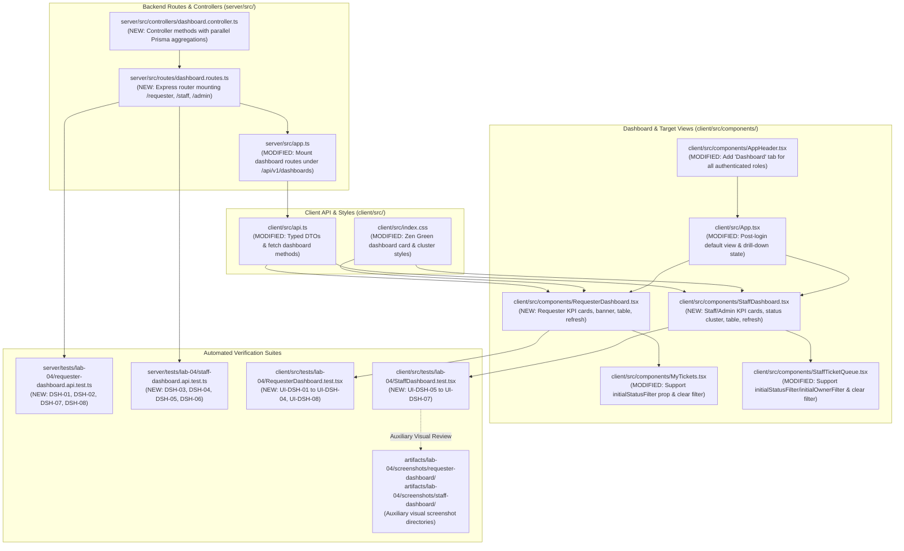

# Technical Implementation Plan: Issue 21 — Role-Based Dashboards (Requester, IT Staff & Admin) & Drill-Downs

**Document ID**: PLAN-FEAT-21  
**Feature Title**: Role-Based Dashboards (Requester, IT Staff & Admin) & Drill-Downs  
**Feature Branch**: `feature/21-role-dashboards` (Issue 21)  
**Base Branch**: `lab4-staging` (incorporating `feature/17-spec-and-tests`, `feature/18-actions-taken-foundation`, `feature/19-actions-taken-ui`, and `feature/20-ticket-workflow`)  
**Target Milestone**: TokTickIT Lab 4 (Sprint 4)  
**Authoritative Contract Reference**: [docs/features/21-role-dashboards/contract.md](./contract.md)  
**Master Specifications & Traceability**:
* [TokTickIT-System-Level-SDS-v1.0.pdf](../../reference/TokTickIT-System-Level-SDS-v1.0.pdf) (§Architecture, §Data Conventions, §Security Invariants)
* [Lab_04_labsheet.pdf](../../reference/Lab_04_labsheet.pdf) (§1, §3, §4.1, §4.2, §7, §8, §10, §11, §12, §14 Part 4)
* [docs/lab-04/specification.md](../../lab-04/specification.md) (`FR-04`, `BR-11`, `BR-12`, `BR-13`, `BR-14`, `AC-12`, `AC-13`, `AC-14`, `AC-15`)
* [docs/lab-04/ui-spec.md](../../lab-04/ui-spec.md) (§1 Design Tokens, §2 Badges, §3.1 Staff Dashboard, §3.2 Requester Dashboard, §3.3 Admin Dashboard, §4 Responsive Breakpoints, §5 Feedback States, §6 Accessibility)
* [docs/lab-04/api-spec.md](../../lab-04/api-spec.md) (§3 Dashboard Endpoints: §3.1 Requester Dashboard, §3.2 IT Staff Dashboard, §3.3 Administrator Dashboard)
* [docs/lab-04/tests.md](../../lab-04/tests.md) (STS Test Catalog: `DSH-01`–`DSH-06`, `UI-DSH-01`, `UI-DSH-02`, `E2E-03`)
* [docs/lab-04/poc-scope-and-issues.md](../../lab-04/poc-scope-and-issues.md) (Issue 21 Scope & Decomposition)
* [docs/features/21-role-dashboards/contract.md](./contract.md) (Approved Feature Engineering Contract)
* [AGENTS.md](../../../AGENTS.md) (Developer Work Norms: Strict Closed-World Rule, TDD, Theme Compliance, Blur Validation Rule)
**Document Status**: Ready for Review & Execution  

---

## 1. Target File Inventory

Below is the complete, exhaustive inventory of all backend, frontend, styling, and verification files to be created or modified for Issue 21:



### Detailed Target File Inventory Table

| Component Tier | File Path | Action | Responsibilities & Changes |
| :--- | :--- | :---: | :--- |
| **Backend Controller** | `server/src/controllers/dashboard.controller.ts` | `CREATE` | Core aggregation controller containing `getRequesterDashboard`, `getStaffDashboard`, and `getAdminDashboard`. Executes parallel Prisma queries (`groupBy`, `count`, `findMany`), enforces data isolation, aggregates queue tallies, and formats response envelopes. |
| **Backend Routes** | `server/src/routes/dashboard.routes.ts` | `CREATE` | Express router defining `GET /requester`, `GET /staff`, and `GET /admin` with `requireAuth` and `requireRole` middleware. Also aliased at `server/src/routes/dashboards.ts` for clean re-exports. |
| **Express Application** | `server/src/app.ts` | `MODIFY` | Mount `dashboardRoutes` at `/api/v1/dashboards` and backwards-compatible `/api/dashboards`, protected by `requirePasswordChanged`. |
| **Client API Layer** | `client/src/api.ts` | `MODIFY` | Export TypeScript interfaces (`RequesterDashboardData`, `StaffDashboardData`, `AdminDashboardData`, `DashboardTicketSummary`, `DashboardMetrics`) and client methods (`fetchRequesterDashboard`, `fetchStaffDashboard`, `fetchAdminDashboard`). |
| **Theme & Stylesheet** | `client/src/index.css` | `MODIFY` | Define reusable Zen Green dashboard classes (`.dashboard-kpi-card`, `.dashboard-kpi-number`, `.dashboard-status-cluster`, `.dashboard-banner`, `.dashboard-refresh-btn`, skeleton pulsing animations). |
| **Requester Dashboard** | `client/src/components/RequesterDashboard.tsx` | `CREATE` | Dedicated portal for Requesters: personalized welcome banner, 4 KPI cards (My Open, In Progress, Resolved, Closed), Action Required alert banner, top 5 recently updated owned tickets table, quick action buttons, in-place refresh, and zero-ticket empty state. |
| **Staff & Admin Dashboard**| `client/src/components/StaffDashboard.tsx` | `CREATE` | Operational dashboard for IT Staff & Administrators: 4 primary KPI cards (Unassigned, My Assigned, Total Active Queue, Critical Workload), 8-status distribution badge cluster, 4-priority breakdown cards, top 5 active queue tickets table, administrator user tallies section (for `ADMINISTRATOR` role), quick action buttons, and loading spinner refresh. |
| **Header Navigation** | `client/src/components/AppHeader.tsx` | `MODIFY` | Add "Dashboard" navigation tab (`data-testid="nav-dashboard"`) for all authenticated roles (`REQUESTER`, `IT_STAFF`, `ADMINISTRATOR`) with active Zen Green tab highlight styling. |
| **Application Shell** | `client/src/App.tsx` | `MODIFY` | Update view state machine: set default post-login view to `RequesterDashboard` for Requesters and `StaffDashboard` for Staff/Admin. Handle drill-down filter state propagation to `MyTickets` and `StaffTicketQueue`. |
| **Requester Ticket List** | `client/src/components/MyTickets.tsx` | `MODIFY` | Accept `initialStatusFilter?: string` prop. Initialize status filter state from prop and synchronize via `useEffect`. Add visible filter reset button when pre-filtered. |
| **Staff Ticket Queue** | `client/src/components/StaffTicketQueue.tsx` | `MODIFY` | Accept `initialStatusFilter?: string`, `initialOwnerFilter?: string`, and `initialPriorityFilter?: string` props. Synchronize filter states and add visible filter reset button. |
| **Backend API Tests (Requester)** | `server/tests/lab-04/requester-dashboard.api.test.ts` | `CREATE` | Supertest integration test suite covering `DSH-01`, `DSH-02`, `DSH-07`, `DSH-08` verifying scoped counts, data isolation, ordering, empty fallbacks, and 401 unauthenticated. |
| **Backend API Tests (Staff/Admin)**| `server/tests/lab-04/staff-dashboard.api.test.ts` | `CREATE` | Supertest integration test suite covering `DSH-03`, `DSH-04`, `DSH-05`, `DSH-06` verifying global queue metrics, 8-status distribution, RBAC 403 checks, and admin user statistics. |
| **Frontend UI Tests (Requester)** | `client/src/tests/lab-04/RequesterDashboard.test.tsx` | `CREATE` | React Testing Library test suite covering `UI-DSH-01` to `UI-DSH-04`, `UI-DSH-08` verifying welcome banner, KPI cards, Action Required banner, drill-downs, empty states, and in-place refresh. |
| **Frontend UI Tests (Staff)** | `client/src/tests/lab-04/StaffDashboard.test.tsx` | `CREATE` | React Testing Library test suite covering `UI-DSH-05` to `UI-DSH-08` verifying 4 KPI cards, status cluster, priority breakdown, admin section, drill-downs, and refresh spinner. |
| **Auxiliary Screenshots** | `artifacts/lab-04/screenshots/requester-dashboard/`<br>`artifacts/lab-04/screenshots/staff-dashboard/` | `PRESERVE` | Playwright screenshot directories strictly isolated for developer visual inspection; excluded from automated functional test assertions. |

---

## 2. Phase 1: Backend Query Endpoints, Controllers & Data Isolation

### 2.1. Backend Controller (`server/src/controllers/dashboard.controller.ts`)

Create `server/src/controllers/dashboard.controller.ts` with three dedicated handler functions:

#### 1. `getRequesterDashboard(req: Request, res: Response)`:
* **Authentication & Guard**: Verify `req.user` exists.
* **Data Isolation (`BR-11`)**: `const requesterId = req.user.id;`.
* **Prisma Parallel Queries**:
  ```typescript
  const prisma = getPrisma();
  const thirtyDaysAgo = new Date(Date.now() - 30 * 24 * 60 * 60 * 1000);

  const [statusGroups, recentlyResolvedCount, recentlyUpdatedTickets] = await Promise.all([
    // Group counts by status for this requester
    prisma.ticket.groupBy({
      by: ["currentStatus"],
      where: { requesterId },
      _count: { _all: true },
    }),
    // Count resolved/closed within last 30 days
    prisma.ticket.count({
      where: {
        requesterId,
        currentStatus: { in: ["RESOLVED", "CLOSED"] },
        updatedAt: { gte: thirtyDaysAgo },
      },
    }),
    // Top 5 recently updated tickets owned by this requester
    prisma.ticket.findMany({
      where: { requesterId },
      orderBy: { updatedAt: "desc" },
      take: 5,
      select: {
        id: true,
        ticketNumber: true,
        summary: true,
        currentStatus: true,
        requestedPriority: true,
        itPriority: true,
        createdAt: true,
        updatedAt: true,
      },
    }),
  ]);
  ```
* **Aggregation Logic**:
  * Extract counts map from `statusGroups`:
    - `totalOpen` / `openTicketsCount`: Sum of counts for `NEW`, `OPEN`, `IN_PROGRESS`, `WAITING_FOR_REQUESTER`, `REOPENED`.
    - `waitingForRequester` / `waitingForRequesterCount`: Count for `WAITING_FOR_REQUESTER` (defaults to 0).
    - `inProgress`: Count for `IN_PROGRESS` (defaults to 0).
    - `resolved`: Count for `RESOLVED` (defaults to 0).
    - `closed`: Count for `CLOSED` (defaults to 0).
    - `recentlyResolvedCount`: Explicit 30-day count from query.
* **Safe Zero Fallback (`AC-15`)**: If no tickets exist, all counts return `0` and `recentlyUpdatedTickets` returns `[]`.
* **Response Envelope**: Returns `200 OK` with `{ metrics, recentlyUpdatedTickets }`.

#### 2. `getStaffDashboard(req: Request, res: Response)`:
* **Authentication & Role Guard (`BR-12`)**:
  * Verify `req.user` has `role === "IT_STAFF" || role === "ADMINISTRATOR"`.
  * If `role === "REQUESTER"`, return `403 Forbidden` (`FORBIDDEN`).
* **Prisma Parallel Queries**:
  ```typescript
  const prisma = getPrisma();
  const activeStatuses = ["NEW", "OPEN", "IN_PROGRESS", "WAITING_FOR_REQUESTER", "REOPENED"];

  const [
    statusGroups,
    activePriorityGroups,
    unassignedCount,
    myAssignedCount,
    recentlyUpdatedTickets,
  ] = await Promise.all([
    // 1. Count by status across all tickets
    prisma.ticket.groupBy({
      by: ["currentStatus"],
      _count: { _all: true },
    }),
    // 2. Count active tickets by itPriority
    prisma.ticket.groupBy({
      by: ["itPriority"],
      where: { currentStatus: { in: activeStatuses } },
      _count: { _all: true },
    }),
    // 3. Unassigned active tickets (ownerId === null)
    prisma.ticket.count({
      where: {
        ownerId: null,
        currentStatus: { in: activeStatuses },
      },
    }),
    // 4. My assigned active tickets (ownerId === req.user.id)
    prisma.ticket.count({
      where: {
        ownerId: req.user.id,
        currentStatus: { in: activeStatuses },
      },
    }),
    // 5. Top 5 recently updated active tickets
    prisma.ticket.findMany({
      where: { currentStatus: { in: activeStatuses } },
      orderBy: { updatedAt: "desc" },
      take: 5,
      select: {
        id: true,
        ticketNumber: true,
        summary: true,
        currentStatus: true,
        itPriority: true,
        owner: { select: { id: true, name: true } },
        createdAt: true,
        updatedAt: true,
      },
    }),
  ]);
  ```
* **Aggregation Logic**:
  * Build complete `statusCounts` map initialized to 0 for all 8 statuses (`NEW`, `OPEN`, `IN_PROGRESS`, `WAITING_FOR_REQUESTER`, `RESOLVED`, `CLOSED`, `REOPENED`, `CANCELLED`).
  * Build complete `priorityCounts` map initialized to 0 for all 4 priorities (`URGENT`, `HIGH`, `MEDIUM`, `LOW`).
  * Compute `newCount`, `openCount`, `inProgressCount`, `waitingForRequesterCount`, and `totalActiveTicketsCount`.
* **Response Envelope**: Returns `200 OK` with `{ metrics, recentlyUpdatedTickets }`.

#### 3. `getAdminDashboard(req: Request, res: Response)`:
* **Authentication & Role Guard (`BR-13`)**:
  * Verify `req.user.role === "ADMINISTRATOR"`.
  * If `role === "IT_STAFF" || role === "REQUESTER"`, return `403 Forbidden` (`FORBIDDEN`).
* **Prisma Parallel Queries**:
  * Reuses staff aggregation queries to obtain `staffMetrics` and `recentlyUpdatedTickets`.
  * Executes administrative queries:
    ```typescript
    const [userRoleGroups, activeUsersCount, inactiveUsersCount, totalTicketsCount] = await Promise.all([
      prisma.user.groupBy({
        by: ["role"],
        _count: { _all: true },
      }),
      prisma.user.count({ where: { isActive: true } }),
      prisma.user.count({ where: { isActive: false } }),
      prisma.ticket.count(),
    ]);
    ```
* **Aggregation Logic**:
  * Map `usersByRole`: `{ REQUESTER: count, IT_STAFF: count, ADMINISTRATOR: count }`.
  * Extract `requestersCount`, `staffCount`, `adminCount`, `totalUsers` (`activeUsersCount + inactiveUsersCount`).
* **Response Envelope**: Returns `200 OK` with `{ staffMetrics, adminMetrics, recentlyUpdatedTickets }`.

---

### 2.2. Backend Routes & Mounting (`server/src/routes/dashboard.routes.ts`, `server/src/app.ts`)

1. **`server/src/routes/dashboard.routes.ts`**:
   ```typescript
   import { Router } from "express";
   import {
     getRequesterDashboard,
     getStaffDashboard,
     getAdminDashboard,
   } from "../controllers/dashboard.controller.js";
   import { requireAuth, requireRole } from "../middleware/auth.js";

   export const dashboardRoutes = Router();

   dashboardRoutes.get("/requester", requireAuth, getRequesterDashboard);
   dashboardRoutes.get("/staff", requireAuth, requireRole("IT_STAFF", "ADMINISTRATOR"), getStaffDashboard);
   dashboardRoutes.get("/admin", requireAuth, requireRole("ADMINISTRATOR"), getAdminDashboard);
   ```

2. **Mounting in `server/src/app.ts`**:
   ```typescript
   import { dashboardRoutes } from "./routes/dashboard.routes.js";
   // ...
   app.use("/api/v1/dashboards", requirePasswordChanged, dashboardRoutes);
   app.use("/api/dashboards", requirePasswordChanged, dashboardRoutes);
   ```

---

### 2.3. Client API Extensions (`client/src/api.ts`)

Export TypeScript DTO interfaces and client methods with standardized error handling:
```typescript
// Interfaces for Requester Dashboard
export interface RequesterDashboardMetrics {
  totalOpen: number;
  openTicketsCount: number;
  waitingForRequester: number;
  waitingForRequesterCount: number;
  inProgress: number;
  resolved: number;
  closed: number;
  recentlyResolvedCount: number;
}

export interface DashboardTicketSummary {
  id: number;
  ticketNumber: string;
  summary: string;
  currentStatus: string;
  requestedPriority?: string;
  itPriority?: string | null;
  owner?: { id: number; name: string } | null;
  createdAt: string;
  updatedAt: string;
}

export interface RequesterDashboardData {
  metrics: RequesterDashboardMetrics;
  recentlyUpdatedTickets: DashboardTicketSummary[];
}

// Interfaces for Staff & Admin Dashboard
export interface StaffDashboardMetrics {
  newCount: number;
  openCount: number;
  inProgressCount: number;
  waitingForRequesterCount: number;
  myAssignedCount: number;
  myOwnedTicketsCount: number;
  unassignedCount: number;
  unassignedTicketsCount: number;
  totalActiveTicketsCount: number;
  statusCounts: Record<string, number>;
  priorityCounts: Record<string, number>;
}

export interface AdminMetrics {
  totalUsers: number;
  activeUsers: number;
  activeUsersCount: number;
  inactiveUsersCount: number;
  requestersCount: number;
  staffCount: number;
  adminCount: number;
  usersByRole: Record<string, number>;
  totalTicketsCount: number;
}

export interface StaffDashboardData {
  metrics: StaffDashboardMetrics;
  recentlyUpdatedTickets: DashboardTicketSummary[];
}

export interface AdminDashboardData {
  staffMetrics: StaffDashboardMetrics;
  adminMetrics: AdminMetrics;
  recentlyUpdatedTickets: DashboardTicketSummary[];
}

// API Client Methods
export async function fetchRequesterDashboard(): Promise<RequesterDashboardData>;
export async function fetchStaffDashboard(): Promise<StaffDashboardData>;
export async function fetchAdminDashboard(): Promise<AdminDashboardData>;
```

---

## 3. Phase 2: Frontend Dashboard Components & Zen Green Styling

### 3.1. Requester Dashboard (`client/src/components/RequesterDashboard.tsx`)

#### Component Architecture & State Machine:
* **State**:
  * `data: RequesterDashboardData | null`
  * `isLoading: boolean` (initial `true`)
  * `isRefreshing: boolean` (for in-place refresh button)
  * `errorMessage: string | null`
* **Lifecycle**:
  * `useEffect` on mount triggers `loadDashboard()`.
  * Manual refresh button triggers `loadDashboard(true)` setting `isRefreshing = true` without clearing existing DOM data.
* **UI Sections**:
  1. **Header Banner**: Personalized greeting: `"Welcome back, {user.name}!"` with subtitle copy. Action buttons: `[↻ Refresh]` (`data-testid="refresh-dashboard-btn"`) and `[+ Create Ticket]`.
  2. **Four Primary KPI Cards Grid**:
     * **My Open**: Card displays `data.metrics.totalOpen`, green accent border, and drill-down link `"View Open Tickets ->"` (`data-testid="drilldown-my-open"`).
     * **In Progress**: Card displays `data.metrics.inProgress`, amber accent border, and drill-down link `"View In Progress ->"` (`data-testid="drilldown-in-progress"`).
     * **Resolved**: Card displays `data.metrics.resolved`, dark-green accent border, and drill-down link `"View Resolved ->"` (`data-testid="drilldown-resolved"`).
     * **Closed**: Card displays `data.metrics.closed`, neutral slate accent border, and drill-down link `"View Closed ->"` (`data-testid="drilldown-closed"`).
  3. **Action Required Alert Banner**:
     * Rendered conditionally if `data.metrics.waitingForRequester > 0`.
     * Styled with `--zen-warning-bg` and `--zen-warning-border`.
     * Informs user: `"⚠️ Action Required on {count} Ticket(s): IT Staff is awaiting your input."`.
     * Direct link button: `"Review Questions ->"` triggers drill-down with `status: "WAITING_FOR_REQUESTER"`.
  4. **Recent Tickets Table**:
     * Displays up to 5 tickets in a clean Zen Green card table.
     * Columns: Ticket Number, Summary, Priority badge, Status badge, Last Updated relative time (`"10m ago"` / formatted date), Action CTA button (`View`).
     * Clicking ticket row or `View` button triggers `onViewTicket(ticket.id)`.
  5. **Empty State**:
     * Rendered when total tickets is `0`.
     * Reassuring Zen Green banner: `"You currently have no service tickets submitted. If you encounter any technical issues, click Create Ticket below."` with `+ Create Ticket` CTA.

#### Prop Interface:
```typescript
export interface RequesterDashboardProps {
  onNavigateToMyTickets?: (initialStatusFilter?: string) => void;
  onCreateTicket?: () => void;
  onViewTicket?: (ticketId: number) => void;
}
```

---

### 3.2. Staff & Administrator Dashboard (`client/src/components/StaffDashboard.tsx`)

#### Component Architecture & State Machine:
* **State**:
  * `staffData: StaffDashboardData | null`
  * `adminData: AdminDashboardData | null`
  * `isLoading: boolean`
  * `isRefreshing: boolean`
  * `errorMessage: string | null`
* **Lifecycle**:
  * Evaluates authenticated user role from `useAuth()`.
  * If `user.role === "ADMINISTRATOR"`, calls `fetchAdminDashboard()`.
  * If `user.role === "IT_STAFF"`, calls `fetchStaffDashboard()`.
* **UI Sections**:
  1. **Header Banner**: Title: `"IT Staff Dashboard"` or `"Administrator Dashboard"` with role badge (`IT Staff` / `Administrator`) and technician name. Action buttons: `[↻ Refresh]` with spinner (`data-testid="refresh-staff-dashboard-btn"`) and `[Staff Queue]`.
  2. **Primary Operational KPI Cards Grid (4 Cards)**:
     * **Unassigned Tickets**: `data.metrics.unassignedCount`, amber warning badge, drill-down `"View Unassigned ->"` (`data-testid="drilldown-unassigned"`).
     * **My Assigned**: `data.metrics.myAssignedCount`, Zen Green accent, drill-down `"View My Workload ->"` (`data-testid="drilldown-my-assigned"`).
     * **Total Active Queue**: `data.metrics.totalActiveTicketsCount`, blue queue accent, drill-down `"View Active Queue ->"` (`data-testid="drilldown-active-queue"`).
     * **Critical Workload**: Sum of `URGENT` and `HIGH` active tickets, red alert accent, drill-down `"View Critical ->"` (`data-testid="drilldown-critical"`).
  3. **Queue Breakdown Clusters**:
     * **Workload by Status**: Interactive cluster of 8 status badges (`NEW`, `OPEN`, `IN_PROGRESS`, `WAITING_FOR_REQUESTER`, `RESOLVED`, `CLOSED`, `REOPENED`, `CANCELLED`). Each badge displays its symbol and count, and clicking triggers drill-down: `onNavigateToQueue({ status })`.
     * **Workload by IT Priority**: Interactive tiles for `URGENT`, `HIGH`, `MEDIUM`, `LOW`. Clicking triggers drill-down: `onNavigateToQueue({ itPriority })`.
  4. **Administrator System Statistics Section**:
     * Conditionally rendered strictly when `user.role === "ADMINISTRATOR"`.
     * High-density summary card showing:
       - Registered Users by Role: Requesters, IT Staff, Administrators.
       - Account Status: Active accounts vs Inactive accounts.
       - System Ticket Volume: Total cumulative tickets.
       - Quick Action Button: `[Manage Users ->]` (`data-testid="admin-manage-users-btn"`) triggering `onManageUsers()`.
  5. **Recently Updated Active Tickets Table**:
     * Top 5 active queue tickets.
     * Columns: Ticket Number, Summary, IT Priority badge, Status badge, Owner (with name or `"Unassigned"` badge), Last Updated relative time.
     * Clicking row triggers `onViewTicket(ticket.id)`.

#### Prop Interface:
```typescript
export interface StaffDashboardProps {
  onNavigateToQueue?: (filters?: {
    status?: string;
    owner?: string;
    itPriority?: string;
  }) => void;
  onCreateTicket?: () => void;
  onViewTicket?: (ticketId: number) => void;
  onManageUsers?: () => void;
}
```

---

### 3.3. Target List View Integration (`MyTickets.tsx`, `StaffTicketQueue.tsx`)

#### 1. `MyTickets.tsx` Modifications:
* Update props interface:
  ```typescript
  interface MyTicketsProps {
    onCreateTicket?: () => void;
    onViewTicket?: (ticketId: number) => void;
    initialStatusFilter?: string; // New prop for drill-down support
  }
  ```
* Initialize `selectedStatus` state:
  ```typescript
  const [selectedStatus, setSelectedStatus] = useState<string>(initialStatusFilter || "");
  ```
* Add synchronization effect:
  ```typescript
  useEffect(() => {
    if (initialStatusFilter !== undefined) {
      setSelectedStatus(initialStatusFilter);
      setCurrentPage(1);
    }
  }, [initialStatusFilter]);
  ```
* Add prominent filter reset badge when `selectedStatus` or filters are active:
  ```tsx
  {selectedStatus && (
    <div className="alert alert-info py-2 px-3 d-flex align-items-center justify-content-between mb-3">
      <span>Filtered by status: <strong>{selectedStatus}</strong></span>
      <button className="btn btn-sm btn-outline-secondary" onClick={() => setSelectedStatus("")}>
        Clear Filter
      </button>
    </div>
  )}
  ```

#### 2. `StaffTicketQueue.tsx` Modifications:
* Update props interface:
  ```typescript
  export interface StaffTicketQueueProps {
    onViewTicket?: (ticketId: number) => void;
    initialStatusFilter?: string;
    initialOwnerFilter?: string;
    initialPriorityFilter?: string;
  }
  ```
* Initialize and synchronize `status`, `owner`, and `itPriority` states from props with corresponding `useEffect` hooks.
* Display an active drill-down filter banner with a "Reset to All Queue" button to restore unfiltered view.

---

### 3.4. Zen Green Design System Extensions (`client/src/index.css`)
Add dedicated dashboard classes utilizing existing Zen Green tokens:
```css
/* Dashboard KPI Card */
.dashboard-kpi-card {
  background-color: var(--zen-surface);
  border: 1px solid var(--zen-border-neutral);
  border-radius: var(--zen-border-radius-lg, 10px);
  padding: 1.25rem;
  transition: transform 0.15s ease, box-shadow 0.15s ease;
}
.dashboard-kpi-card:hover {
  transform: translateY(-2px);
  box-shadow: 0 4px 12px rgba(0, 107, 60, 0.08);
}
.dashboard-kpi-number {
  font-size: var(--zen-font-size-kpi, 32px);
  font-weight: 700;
  color: var(--zen-primary-green);
  line-height: 1.1;
}
.dashboard-kpi-label {
  font-size: 0.875rem;
  font-weight: 600;
  color: var(--zen-text-muted);
  text-transform: uppercase;
  letter-spacing: 0.03em;
}
.dashboard-drilldown-link {
  font-size: 0.8125rem;
  font-weight: 600;
  color: var(--zen-secondary-green);
  text-decoration: none;
  cursor: pointer;
}
.dashboard-drilldown-link:hover {
  text-decoration: underline;
}

/* Status Cluster Badge */
.dashboard-status-badge-btn {
  cursor: pointer;
  border-radius: 20px;
  padding: 0.35rem 0.75rem;
  font-size: 0.8125rem;
  font-weight: 600;
  transition: all 0.15s ease;
}
.dashboard-status-badge-btn:hover {
  transform: scale(1.05);
  box-shadow: 0 2px 6px rgba(0, 0, 0, 0.12);
}
```

---

## 4. Phase 3: AppHeader Navigation & Login Routing Integration

### 4.1. Navigation Tab Updates (`client/src/components/AppHeader.tsx`)
Update `AppHeader.tsx` to include the "Dashboard" navigation tab across all authenticated user roles:

```typescript
// client/src/components/AppHeader.tsx
interface AppHeaderProps {
  activeView?: "dashboard" | "create" | "my-tickets" | "staff-queue" | "user-admin";
  onViewChange?: (view: any) => void;
}
```

#### Nav Tabs by Role:
1. **`REQUESTER`**:
   * `[Dashboard]` (`data-testid="nav-dashboard"`)
   * `[Create Ticket]` (`data-testid="nav-create-ticket"`)
   * `[My Tickets]` (`data-testid="nav-my-tickets"`)
2. **`IT_STAFF`**:
   * `[Dashboard]` (`data-testid="nav-dashboard"`)
   * `[Staff Queue]` (`data-testid="nav-staff-queue"`)
   * `[Create Ticket]` (`data-testid="nav-create-ticket"`)
   * `[My Tickets]` (`data-testid="nav-my-tickets"`)
3. **`ADMINISTRATOR`**:
   * `[Dashboard]` (`data-testid="nav-dashboard"`)
   * `[User Admin]` (`data-testid="nav-user-admin"`)
   * `[Staff Queue]` (`data-testid="nav-staff-queue"`)
   * `[My Tickets]` (`data-testid="nav-my-tickets"`)

Active tab styling applies `btn-light fw-bold text-success` while inactive tabs use `btn-outline-light text-white`.

---

### 4.2. Application Shell Routing & Default Post-Login Views (`client/src/App.tsx`)

#### State Updates:
```typescript
type ActiveView =
  | "dashboard"
  | "create"
  | "my-tickets"
  | "detail"
  | "staff-queue"
  | "user-admin";

interface DrillDownFilterState {
  status?: string;
  owner?: string;
  itPriority?: string;
}
```

#### Default Post-Login View Logic:
```typescript
const [activeView, setActiveView] = useState<ActiveView>(
  initialView || "dashboard"
);
const [drillDownFilters, setDrillDownFilters] = useState<DrillDownFilterState>({});

useEffect(() => {
  if (!initialView && user) {
    setActiveView("dashboard");
  }
}, [user?.id, user?.role, initialView]);
```

#### View Routing Dispatcher:
```tsx
{activeView === "dashboard" ? (
  user.role === "REQUESTER" ? (
    <RequesterDashboard
      onCreateTicket={() => setActiveView("create")}
      onNavigateToMyTickets={(status) => {
        setDrillDownFilters({ status });
        setActiveView("my-tickets");
      }}
      onViewTicket={(ticketId) => {
        setSelectedTicketId(ticketId);
        setActiveView("detail");
      }}
    />
  ) : (
    <StaffDashboard
      onCreateTicket={() => setActiveView("create")}
      onNavigateToQueue={(filters) => {
        setDrillDownFilters(filters || {});
        setActiveView("staff-queue");
      }}
      onViewTicket={(ticketId) => {
        setSelectedTicketId(ticketId);
        setActiveView("detail");
      }}
      onManageUsers={() => setActiveView("user-admin")}
    />
  )
) : activeView === "my-tickets" ? (
  <MyTickets
    initialStatusFilter={drillDownFilters.status}
    onCreateTicket={() => setActiveView("create")}
    onViewTicket={(ticketId) => {
      setSelectedTicketId(ticketId);
      setActiveView("detail");
    }}
  />
) : activeView === "staff-queue" ? (
  <StaffTicketQueue
    initialStatusFilter={drillDownFilters.status}
    initialOwnerFilter={drillDownFilters.owner}
    initialPriorityFilter={drillDownFilters.itPriority}
    onViewTicket={(ticketId) => {
      setSelectedTicketId(ticketId);
      setActiveView("detail");
    }}
  />
) : /* detail, user-admin, create ... */}
```

#### Clearing Filters on Direct Nav Click:
When the user clicks `"My Tickets"` or `"Staff Queue"` directly in `AppHeader`, `handleHeaderViewChange` resets `drillDownFilters` to `{}` so the user sees the complete unfiltered list.

---

## 5. Phase 4: Automated Testing & Playwright Safeguard

### 5.1. Backend API Test Implementation Plan

#### Test File 1: `server/tests/lab-04/requester-dashboard.api.test.ts`
* **Test Fixture Setup**:
  - Run database seed (`await seed()`).
  - Authenticate Requester 1 (Sompong IT: `sompong.it@kmutt.ac.th`).
  - Authenticate Requester 2 (Kittisak Student: `kittisak.stu@kmutt.ac.th`).
* **Test Cases**:
  - `DSH-01`: Scoped personal metric counts. Verifies `totalOpen`, `waitingForRequester`, `inProgress`, `resolved`, `closed` strictly match tickets owned by Sompong.
  - `DSH-02`: Recently updated tickets ordering and boundary. Verifies array length $\le 5$, sorted strictly by `updatedAt DESC`, and contains zero tickets belonging to Kittisak.
  - `DSH-07`: Unauthenticated rejection. Calling endpoint without cookie returns `401 Unauthorized`.
  - `DSH-08`: Safe zero fallback. Create a new user with 0 tickets; querying dashboard returns HTTP 200 with all metric counters equal to `0` and `recentlyUpdatedTickets: []`.

#### Test File 2: `server/tests/lab-04/staff-dashboard.api.test.ts`
* **Test Fixture Setup**:
  - Authenticate IT Staff (Wichai IT: `wichai.it@kmutt.ac.th`).
  - Authenticate Administrator (Admin TokTick: `admin.toktick@kmutt.ac.th`).
  - Authenticate Requester (Sompong IT: `sompong.it@kmutt.ac.th`).
* **Test Cases**:
  - `DSH-03`: Global queue metrics. Staff user receives correct `newCount`, `openCount`, `inProgressCount`, `waitingForRequesterCount`, `unassignedCount` (`ownerId === null`), `myAssignedCount` (`ownerId === wichai.id`), complete 8-status distribution, 4-priority breakdown, and top 5 recent active tickets.
  - `DSH-04`: Role boundary guard. Requester query to `GET /api/v1/dashboards/staff` returns `403 Forbidden` (`FORBIDDEN`).
  - `DSH-05`: Administrator system statistics. Administrator query to `GET /api/v1/dashboards/admin` returns complete staff metrics plus `totalUsers`, `activeUsers`, `inactiveUsersCount`, `requestersCount`, `staffCount`, `adminCount`, `usersByRole`, and `totalTicketsCount`.
  - `DSH-06`: Staff privilege restriction. IT Staff query to `GET /api/v1/dashboards/admin` returns `403 Forbidden` (`FORBIDDEN`).

---

### 5.2. Frontend UI Component Test Implementation Plan

#### Test File 1: `client/src/tests/lab-04/RequesterDashboard.test.tsx`
* **Mocks**: Mock `api.fetchRequesterDashboard` and `useAuth()`.
* **Test Cases**:
  - `UI-DSH-01`: Renders welcome banner with user name, 4 KPI cards (`My Open`, `In Progress`, `Resolved`, `Closed`), and populated recent tickets table.
  - `UI-DSH-02`: Action Required banner renders when `waitingForRequester > 0` and is omitted when count is 0.
  - `UI-DSH-03`: Clicking "View In Progress ->" invokes `onNavigateToMyTickets("IN_PROGRESS")`.
  - `UI-DSH-04`: Zero-ticket state displays reassurance banner: *"You currently have no service tickets submitted"* and `+ Create Ticket` CTA.
  - `UI-DSH-08`: Clicking refresh button calls `fetchRequesterDashboard()` and toggles spinning state.

#### Test File 2: `client/src/tests/lab-04/StaffDashboard.test.tsx`
* **Mocks**: Mock `api.fetchStaffDashboard`, `api.fetchAdminDashboard`, and `useAuth()`.
* **Test Cases**:
  - `UI-DSH-05`: IT Staff view renders 4 operational KPI cards (`Unassigned`, `My Assigned`, `Total Active`, `Critical Workload`), 8 status badges, and 4 priority breakdown cards.
  - `UI-DSH-06`: Clicking "Unassigned" calls `onNavigateToQueue({ owner: "unassigned" })`; clicking "NEW" status badge calls `onNavigateToQueue({ status: "NEW" })`.
  - `UI-DSH-07`: Administrator view renders administrative user statistics section with role counts and `[Manage Users ->]` CTA; section is omitted for `IT_STAFF`.
  - `UI-DSH-08`: In-place refresh button triggers data reload with animated spinner.

---

### 5.3. Acceptance Criteria Traceability Matrix

| Acceptance Criterion | Verification Target | Test ID | Target Test File |
| :--- | :--- | :--- | :--- |
| **AC-21.1** (Requester Metrics, Isolation & Empty Fallback) | Backend & UI | `DSH-01`, `DSH-02`, `DSH-08`, `UI-DSH-01`, `UI-DSH-04` | `requester-dashboard.api.test.ts`, `RequesterDashboard.test.tsx` |
| **AC-21.2** (Staff Queue Aggregations & RBAC) | Backend & UI | `DSH-03`, `DSH-04`, `UI-DSH-05`, `UI-DSH-06` | `staff-dashboard.api.test.ts`, `StaffDashboard.test.tsx` |
| **AC-21.3** (Admin System Tallies & Privilege Boundaries) | Backend & UI | `DSH-05`, `DSH-06`, `UI-DSH-07` | `staff-dashboard.api.test.ts`, `StaffDashboard.test.tsx` |
| **AC-21.4** (Interactive 1-Click Drill-Downs) | Frontend UI | `UI-DSH-03`, `UI-DSH-06` | `RequesterDashboard.test.tsx`, `StaffDashboard.test.tsx` |
| **AC-21.5** (Navigation & Post-Login Default Routing) | Frontend UI & Shell | `DSH-07`, `UI-DSH-08` | `requester-dashboard.api.test.ts`, `RequesterDashboard.test.tsx` |

---

### 5.4. Auxiliary Visual Verification Plan & Playwright Safeguard

> [!IMPORTANT]
> **Playwright Safeguard**: Full-page Playwright screenshot generation is strictly an auxiliary visual verification step for developer review and lab report submission evidence. Screenshot capture must **NEVER** be added to, mixed into, or asserted as functional pass/fail tests in `docs/lab-04/tests.md` or existing STS/Jest/Vitest unit test suites.

#### Designated Screenshot Destinations:
* `artifacts/lab-04/screenshots/requester-dashboard/`:
  - `requester-dashboard-desktop.png`: Desktop viewport ($1280 \times 800\text{px}$)
  - `requester-dashboard-tablet.png`: Tablet viewport ($768 \times 1024\text{px}$)
  - `requester-dashboard-mobile.png`: Mobile viewport ($375 \times 667\text{px}$)
  - `requester-dashboard-empty.png`: Zero-ticket state
* `artifacts/lab-04/screenshots/staff-dashboard/`:
  - `staff-dashboard-desktop.png`: Desktop viewport with operational workload cards
  - `staff-dashboard-tablet.png`: Tablet viewport with 2-column card layout
  - `staff-dashboard-mobile.png`: Mobile viewport with vertical cards and zero horizontal scroll
  - `admin-dashboard-desktop.png`: Administrator view with user account breakdown card

---

## 6. Execution Sequence & Dependency Order Checklist

The implementation must proceed in the following strict chronological sequence:

- [ ] **Step 1: Backend Controller & Router**
  - Create `server/src/controllers/dashboard.controller.ts` with `getRequesterDashboard`, `getStaffDashboard`, and `getAdminDashboard`.
  - Create `server/src/routes/dashboard.routes.ts` mapping endpoints with middleware guards.
  - Mount router in `server/src/app.ts` under `/api/v1/dashboards` and `/api/dashboards`.
- [ ] **Step 2: Backend API Automated Verification**
  - Author `server/tests/lab-04/requester-dashboard.api.test.ts`.
  - Author `server/tests/lab-04/staff-dashboard.api.test.ts`.
  - Run server tests: `npm test server/tests/lab-04/*dashboard.api.test.ts` to confirm green pass.
- [ ] **Step 3: Client API Layer & Types**
  - Update `client/src/api.ts` with DTO interfaces and client methods `fetchRequesterDashboard`, `fetchStaffDashboard`, `fetchAdminDashboard`.
- [ ] **Step 4: Requester Dashboard Component**
  - Author `client/src/components/RequesterDashboard.tsx` with welcome banner, 4 KPI cards, Action Required banner, recent tickets table, in-place refresh, and empty state.
  - Author `client/src/tests/lab-04/RequesterDashboard.test.tsx` and verify passing.
- [ ] **Step 5: Staff & Admin Dashboard Component**
  - Author `client/src/components/StaffDashboard.tsx` with 4 operational cards, status cluster, priority tiles, admin user tallies section, and refresh spinner.
  - Author `client/src/tests/lab-04/StaffDashboard.test.tsx` and verify passing.
- [ ] **Step 6: Target List View Pre-Filtering**
  - Extend `client/src/components/MyTickets.tsx` with `initialStatusFilter` and clear filter control.
  - Extend `client/src/components/StaffTicketQueue.tsx` with `initialStatusFilter`, `initialOwnerFilter`, `initialPriorityFilter` and clear filter control.
- [ ] **Step 7: Header Navigation & Post-Login Default Routing**
  - Update `client/src/components/AppHeader.tsx` to add "Dashboard" navigation tab across all roles.
  - Update `client/src/App.tsx` state machine to default to `RequesterDashboard` or `StaffDashboard`, wiring drill-down filter arguments.
- [ ] **Step 8: Full Regression & Visual Inspection**
  - Run full test passes across `server/` and `client/` to verify 100% pass rate with zero regressions on Labs 1–3 suites.
  - Capture auxiliary screenshot evidence to `artifacts/lab-04/screenshots/`.

