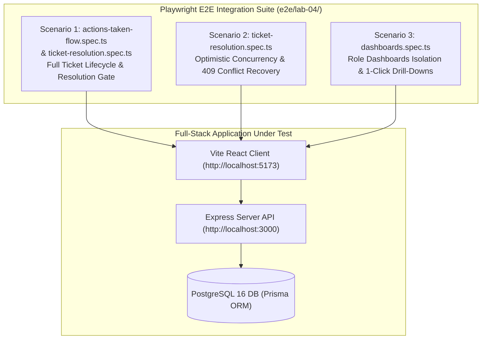
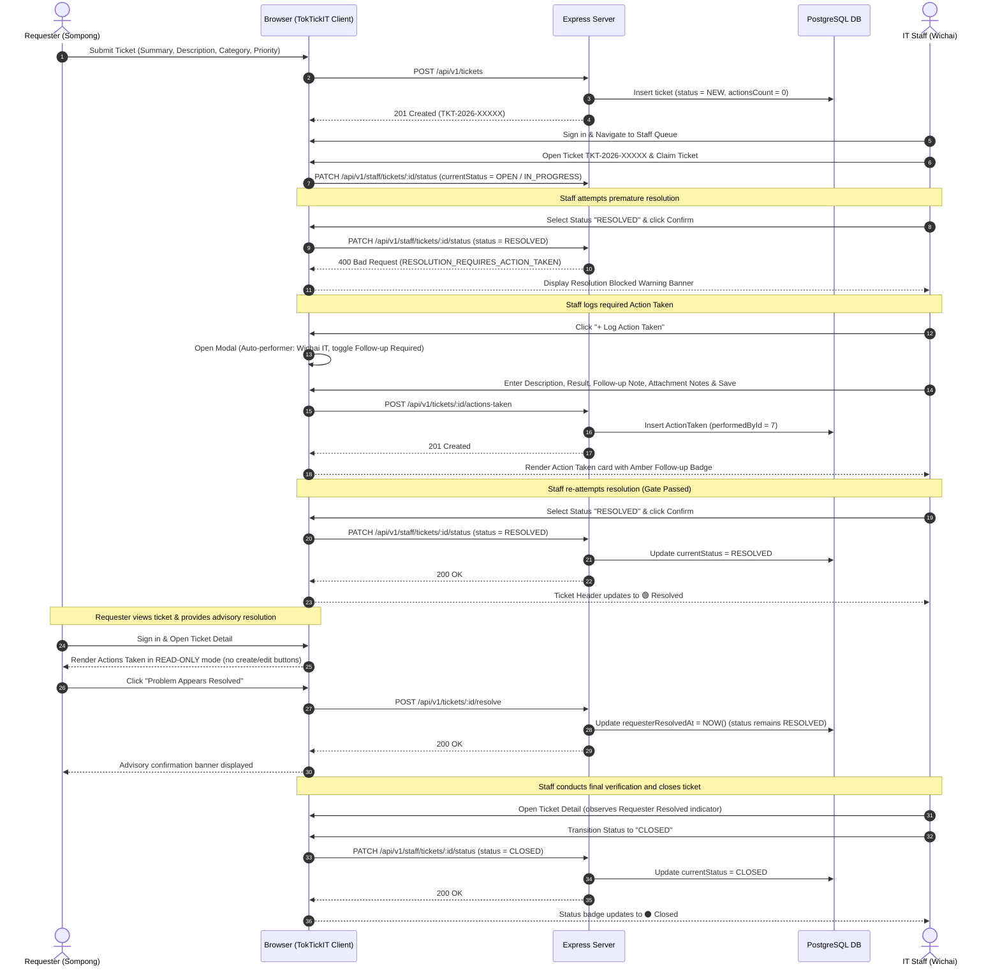
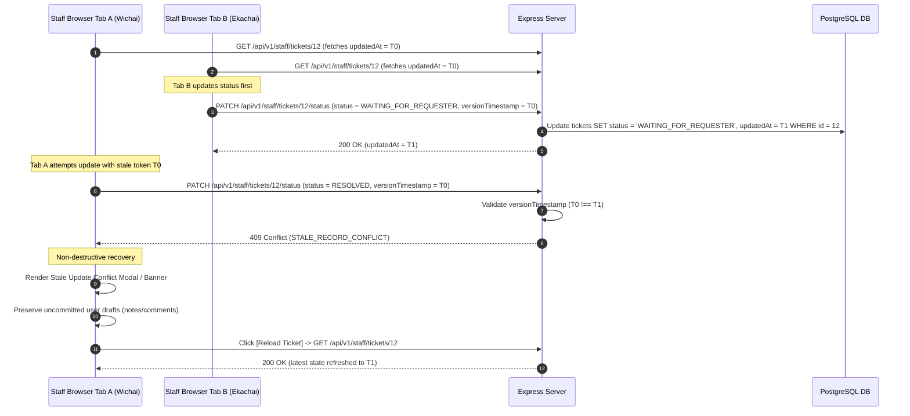
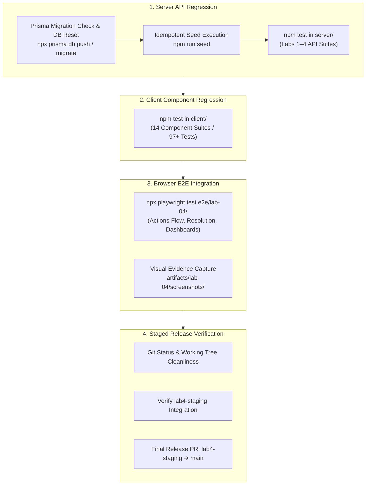

# Feature 22 Engineering Contract: Final Regression, Accessibility, E2E Polish & Staged Release Verification

**Feature Title**: Final Regression, Accessibility, E2E Polish & Staged Release Verification  
**Branch Name**: `feature/22-regression-polish-release` (Issue 22 / Sprint 4 Milestone Completion)  
**Base Branch**: `lab4-staging` (incorporating `feature/17-spec-and-tests`, `feature/18-actions-taken-foundation`, `feature/19-actions-taken-ui`, `feature/20-ticket-workflow`, and `feature/21-role-dashboards`)  
**Document Status**: Approved Feature Engineering Contract Baseline  
**Author**: TokTickIT Engineering Team  
**Traceability References**:
* [TokTickIT-System-Level-SDS-v1.0.pdf](../../reference/TokTickIT-System-Level-SDS-v1.0.pdf) (§Architecture Style p. 4–5, §Technology Stack p. 6, §Authorization Model p. 10, §Data Conventions, §Security Invariants p. 16, §Testing Architecture p. 17)
* [Lab_04_labsheet.pdf](../../reference/Lab_04_labsheet.pdf) (§1, §2, §3, §4.1–4.4, §5.1–5.2, §6, §7 Zen Green Theme Spec, §8.1–8.6, §9, §10, §11, §12, §13, §14 Parts 1–9 Rubric)
* [TokTickIT_GitHub_Workflow_Guide_TH_EN.pdf](../../reference/TokTickIT_GitHub_Workflow_Guide_TH_EN.pdf) (Kanban Board, PR Workflow, Peer Review Norms)
* [docs/lab-04/specification.md](../../lab-04/specification.md) (`FR-01` through `FR-06`, `BR-01` through `BR-14`, `AC-01` through `AC-16`, DoD §9)
* [docs/lab-04/ui-spec.md](../../lab-04/ui-spec.md) (Zen Green Design Tokens, Typography, Badges, Screens 1–4, Responsive Breakpoints §4, Feedback States §5, Accessibility Checklist §6)
* [docs/lab-04/api-spec.md](../../lab-04/api-spec.md) (REST Endpoints `/api/v1/tickets/:id/actions-taken`, `/api/v1/staff/tickets/:id/status`, `/api/v1/dashboards/*`, Standard Error Envelopes)
* [docs/lab-04/tests.md](../../lab-04/tests.md) (Software Test Specification STS-LAB-04: Tiers 1–4, `ACT-01`–`ACT-08`, `WRK-01`–`WRK-05`, `DSH-01`–`DSH-06`, `UI-ACT-01`–`UI-DSH-02`, `E2E-01`–`E2E-03`)
* [docs/lab-04/poc-scope-and-issues.md](../../lab-04/poc-scope-and-issues.md) (Issue 22 Decomposition & 60-Point Course Rubric Mapping)
* [docs/features/18-actions-taken-foundation/contract.md](../18-actions-taken-foundation/contract.md) (Feature 18 Approved Contract Baseline)
* [docs/features/19-actions-taken-ui/contract.md](../19-actions-taken-ui/contract.md) (Feature 19 Approved Contract Baseline)
* [docs/features/20-ticket-workflow/contract.md](../20-ticket-workflow/contract.md) (Feature 20 Approved Contract Baseline)
* [docs/features/21-role-dashboards/contract.md](../21-role-dashboards/contract.md) (Feature 21 Approved Contract Baseline)
* [AGENTS.md](../../../AGENTS.md) (Developer Work Norms: Strict Closed-World Rule, TDD, Theme & Style Compliance, Blur Validation Rule)

---

## 1. Feature Goal & Scope

### 1.1. Strategic Objectives
Issue 22 represents the final capstone integration, accessibility audit, multi-viewport visual polish, end-to-end test suite completion, and staged release readiness milestone for TokTickIT Sprint 4 (Lab 4). Following the successful delivery, peer review, and merge of all preceding functional feature slices into `lab4-staging`:
- `feature/17-spec-and-tests` (Issue 17: Sprint 4 Engineering Contract, UI/API Specifications & STS Test Planning)
- `feature/18-actions-taken-foundation` (Issue 18: Actions Taken Data Model, Prisma Migration, Seed Data & Backend APIs)
- `feature/19-actions-taken-ui` (Issue 19: Actions Taken UI, Ticket Detail Integration & Access Control)
- `feature/20-ticket-workflow` (Issue 20: Ticket Status Lifecycle, Concurrency & Resolution Gate)
- `feature/21-role-dashboards` (Issue 21: Role-Based Dashboards for Requester, IT Staff & Admin and 1-Click Drill-Downs)

Issue 22 unifies all capabilities across Labs 1 through 4 into a hardened, rock-solid service desk platform. It guarantees that multi-role authentication, ticket creation, file attachments, public comments, internal notes, granular actions taken, resolution gates, status workflows, and interactive dashboards operate seamlessly together without regressions, console errors, or accessibility barriers.

The primary objectives of Issue 22 are:
1. **Playwright E2E Browser Test Suite Implementation (`e2e/lab-04/`)**:
   - Establish formal, deterministic browser integration test suites under `e2e/lab-04/` (`actions-taken-flow.spec.ts`, `ticket-resolution.spec.ts`, `dashboards.spec.ts`) validating end-to-end multi-role workflows across real browsers.
   - Exercise the full service-desk lifecycle: Requester ticket submission $\rightarrow$ IT Staff triage $\rightarrow$ premature resolution attempt blocked by Resolution Gate (`400 Bad Request`) $\rightarrow$ Action Taken logging with conditional follow-up note $\rightarrow$ formal resolution transition $\rightarrow$ Requester advisory resolution acknowledgment $\rightarrow$ staff ticket closure.
   - Validate optimistic concurrency control (`409 Conflict` on stale updates) and role dashboard data isolation with 1-click drill-downs.
2. **WCAG 2.1 AA Accessibility & Keyboard Navigability Conformance**:
   - Audit and enforce keyboard navigability across all views: visible focus rings (`2px solid #0B7A46`), logical tab order, skip links, and Escape key modal dismissal.
   - Enforce semantic HTML elements (`h1`–`h4`), form label associations (`htmlFor`/`id`), and screen-reader accessible live regions (`role="alert"`, `aria-live="polite"`) for feedback banners.
   - Enforce multi-cue status indicators (never color alone) and contrast ratio compliance ($\ge 4.5:1$ for normal text, $\ge 3:1$ for large headings/metrics) across all Zen Green palette tokens.
3. **Zen Green UI Visual Polish & Multi-Viewport Responsive Stability**:
   - Audit all screens against KMUTT IT Service Desk "Zen Green" design tokens (`--zen-primary-green: #006B3C`, `--zen-secondary-green: #0B7A46`, `--zen-pale-green: #EAF6EF`, `--zen-page-bg: #F5F7F6`, `--zen-surface: #FFFFFF`).
   - Guarantee zero horizontal scrolling (`overflow-x: hidden`) across Desktop ($\ge 1200\text{px}$), Tablet ($768\text{px}-1024\text{px}$), and Mobile ($< 768\text{px}$) viewports down to $320\text{px}$.
   - Ensure consistent loading skeletons, non-flashing empty states, and polished card alignments across all views.
4. **Full-Stack Regression Verification Pipeline (100% Passing Tests)**:
   - Verify that all Server API test suites pass (`npm test` in `server/`, covering Labs 1–4 with zero failures), ensuring database migrations, schema alignments, and seed data execute cleanly.
   - Verify that all Client UI component test suites pass (`npm test` in `client/`, covering 14 test suites with 100% passing tests).
   - Verify that all Playwright E2E suites pass (`npx playwright test e2e/lab-04/`) without flakiness or timeouts.
5. **Course Submission Visual Evidence Capture & Documentation Sync**:
   - Generate high-resolution visual evidence screenshots across device viewports under `artifacts/lab-04/screenshots/` (`actions-taken/`, `staff-dashboard/`, `requester-dashboard/`, `ticket-workflow/`, `regression/`).
   - Finalize `docs/lab-04/tests.md` with complete passing test logs and updated `Pass` status across all catalog entries.
   - Complete `docs/lab-04/reviewer.md` with full peer review records across Issues 17–22.
   - Complete `docs/lab-04/ai-use.md` with key prompts and an authentic "My Reflection" on AI agent collaboration in SDD.
6. **Staged Release Readiness Verification (`lab4-staging` $\rightarrow$ `main`)**:
   - Confirm clean working tree, verified database migration reset, and readiness for the final Release PR from `lab4-staging` into `main`.

---

### 1.2. In-Scope Deliverables

| Deliverable Area | Target Path / Artifact | Core Purpose & Scope |
| :--- | :--- | :--- |
| **Playwright E2E Suite 1: Actions Taken Flow** | `e2e/lab-04/actions-taken-flow.spec.ts` | Multi-role browser flow: IT Staff creates, edits, and verifies Actions Taken; Requester verifies read-only rendering without mutation controls (`AC-01` to `AC-06`). |
| **Playwright E2E Suite 2: Ticket Resolution & Gate** | `e2e/lab-04/ticket-resolution.spec.ts` | Complete lifecycle: Requester submits ticket $\rightarrow$ Staff blocked by Resolution Gate $\rightarrow$ Staff logs Action Taken $\rightarrow$ Staff resolves ticket $\rightarrow$ Requester advisory resolution $\rightarrow$ Staff closes ticket $\rightarrow$ Concurrency stale update `409 Conflict` recovery (`AC-07` to `AC-11`). |
| **Playwright E2E Suite 3: Role Dashboards** | `e2e/lab-04/dashboards.spec.ts` | Requester isolated metrics and drill-down $\rightarrow$ IT Staff operational queue metrics and drill-down $\rightarrow$ Admin system user tallies and drill-down (`AC-12` to `AC-15`). |
| **Playwright Evidence Generator** | `e2e/lab-04/*screenshots.spec.ts` | Automated capture of responsive visual evidence across Desktop, Tablet, and Mobile viewports into `artifacts/lab-04/screenshots/`. |
| **Accessibility & Keyboard Navigability** | `client/src/index.css`, components | Visible focus rings (`--zen-focus-outline`), logical tab indices, skip link, Escape key modal dismiss, ARIA labels, semantic headings, and color contrast compliance. |
| **Responsive UI & Layout Polish** | `client/src/index.css`, dashboard/detail views | Zero horizontal overflow (`overflow-x: hidden`), fluid responsive grid/card wrapping, touch targets ($\ge 44\text{px}-48\text{px}$), loading skeletons, and empty state cards. |
| **Database & Server Regression Alignment** | `server/prisma/`, `server/tests/` | Prisma schema, migration, and seed alignment ensuring 100% passing tests across all Lab 1–4 server test suites. |
| **Client Regression Verification** | `client/src/tests/` | 100% passing Vitest component tests across all Lab 1–4 client test suites. |
| **Screenshot Artifacts Directory** | `artifacts/lab-04/screenshots/*` | High-res PNG visual evidence organized in `actions-taken/`, `staff-dashboard/`, `requester-dashboard/`, `ticket-workflow/`, and `regression/`. |
| **Software Test Specification (STS)** | `docs/lab-04/tests.md` | Finalized test catalog with `Pass` statuses, verified completion baseline, and execution logs across all 4 tiers per Labsheet §10 & §14 Part 3. |
| **Peer Review Record** | `docs/lab-04/reviewer.md` | Authoritative peer review records, PR numbers, reviewer comments, and author responses for Issues 17–22 per Labsheet §14 Part 1. |
| **AI Use & Reflection Dossier** | `docs/lab-04/ai-use.md` | 6–10 curated key prompts with action logs and comprehensive reflective essay on SDD and agentic pair-programming per Labsheet §14 Part 4. |
| **Staged Release Verification** | `lab4-staging` $\rightarrow$ `main` | Final staging release check, clean migration reset, and readiness verification for merge into production `main`. |

---

### 1.3. Explicit Exclusions & Non-Goals (§4.2)
To preserve strict engineering boundaries under the Closed-World Rule:
* **No Heavy Performance Load Testing**: No simulated load generation with thousands of concurrent virtual users (e.g. k6, JMeter). Verification focuses on functional concurrency, data integrity, and fast response times on local test instances.
* **No Cloud / Production CDN Infrastructure**: Cloudflare Workers, AWS CloudFront, GCP Cloud CDN, or external SSL termination certificates are strictly out of scope. Local development and test environments (`localhost:3000` / `localhost:5173`) are the sole targets.
* **No Internationalization (i18n) Localization Engines**: No third-party i18n libraries (e.g. `react-i18next`) or multi-locale translation dictionaries beyond the standard English labels and bilingual Thai contextual references established in the lab specifications.
* **No Automated SLAs or Background Daemon Escalations**: No timed SLA breach cron jobs, automated escalation emails, or background worker processes.
* **No Third-Party Graphical Charting Engines**: Prohibited by Labsheet §4.2. Metric summaries strictly utilize semantic HTML, Zen Green card layouts, and accessible badge clusters.
* **Playwright Visual Verification Separation Rule**: Auxiliary full-page screenshots captured during E2E runs are saved strictly to `artifacts/lab-04/screenshots/`. E2E screenshot captures must never be mixed into or alter unit/API assertions in `docs/lab-04/tests.md`.

---

## 2. Playwright E2E Lifecycle Scenarios (`e2e/lab-04/`)



### 2.1. Scenario 1: Full Lifecycle & Resolution Gate (`actions-taken-flow.spec.ts`, `ticket-resolution.spec.ts`)
This scenario exercises the complete end-to-end service desk lifecycle across both Requester and IT Staff user roles, verifying the **Resolution Gate (BR-07)**, **Performer Attribution (BR-02)**, and **Requester Advisory Resolution Separation (BR-08)**:



#### Step-by-Step E2E Assertions:
1. **Ticket Creation by Requester**:
   - Requester logs in (`sompong.it@kmutt.ac.th` / `Password123!`), navigates to Create Ticket view.
   - Submits valid ticket: Summary *"Conference Room B HDMI Port Not Outputting"*, Category *"Hardware"*, Related System *"Classroom AV"*, Requested Priority *"High"*.
   - Verifies ticket creation succeeds and captures generated ticket number `TKT-2026-XXXXX`.
2. **Staff Triage & Resolution Gate Block**:
   - IT Staff logs in (`wichai.it@kmutt.ac.th` / `Password123!`), navigates to Staff Queue, searches for the newly created ticket, and opens Ticket Detail.
   - Claims ownership and transitions ticket to `OPEN` or `IN_PROGRESS`.
   - Attempts to transition status directly to `RESOLVED` while ticket has 0 Actions Taken.
   - Verifies backend rejects transition with HTTP `400 Bad Request` (`code: RESOLUTION_REQUIRES_ACTION_TAKEN`).
   - Verifies UI displays clear warning: *"Resolution Blocked: You must log at least one Action Taken before this ticket can be resolved."* Status remains un-transitioned.
3. **Action Taken Logging**:
   - Staff clicks `+ Log Action Taken` button.
   - Verifies modal displays non-editable auto-performer card: *"Performed by: Wichai IT (auto-assigned from your session)"*.
   - Fills Description (*"Tested HDMI transmitter in rack; found loose cable"*), Result (*"Reseated cable; 4K video signal restored"*).
   - Toggles `Follow-up Required?` checkbox; confirms conditional `Follow-up Note` textarea appears dynamically.
   - Enters Follow-up Note (*"Order replacement 2m braided cable during next maintenance window"*) and Attachment Notes (*"Uploaded photo of damaged cable clip"*).
   - Submits modal. Verifies HTTP `201 Created` response.
   - Verifies Action Taken appears in chronological list with amber `⚠️ Follow-up Required` callout badge and formatted timestamp.
4. **Successful Resolution Transition**:
   - Staff selects `RESOLVED` from the status dropdown.
   - Verifies Resolution Gate now allows transition because Actions Taken count is $\ge 1$.
   - Clicks `Confirm Status Change`. Verifies status updates to `RESOLVED` with green badge (🟢 Resolved).
5. **Requester Read-Only View & Advisory Resolution**:
   - Requester logs back in and opens the ticket detail view.
   - Verifies Actions Taken section is rendered in **Read-Only** mode: `+ Log Action Taken` and `Edit Action` buttons are strictly absent from the DOM (`AC-05`, `AC-06`).
   - Clicks `Problem Appears Resolved` button.
   - Verifies `requesterResolvedAt` timestamp is recorded and advisory message appears: *"Requester indicated problem appears resolved"*.
   - Verifies ticket status remains `RESOLVED` without premature closure.
6. **Final Ticket Closure**:
   - IT Staff reloads the ticket, observes the advisory requester resolution indicator.
   - Selects permitted next status `CLOSED` and confirms transition.
   - Verifies ticket status transitions to `CLOSED` (⚫ Closed) cleanly.

---

### 2.2. Scenario 2: Concurrency & Stale Updates (`ticket-resolution.spec.ts`)
This scenario verifies that TokTickIT guards against race conditions and lost updates when multiple staff members or browser tabs interact with the same ticket simultaneously (`BR-10`, `AC-11`):



#### Step-by-Step E2E Assertions:
1. **Parallel Session Simulation**:
   - Staff member loads ticket detail in Browser Context A, obtaining initial `updatedAt` token $T_0$.
   - A concurrent process or second browser session modifies the same ticket (e.g. changing status to `WAITING_FOR_REQUESTER`), advancing the database `updatedAt` to $T_1$.
2. **Stale Modification Submission**:
   - Browser Context A submits a status change using the stale token $T_0$.
   - Verifies server rejects the update with HTTP `409 Conflict` (`code: STALE_RECORD_CONFLICT`).
3. **Graceful Non-Destructive Recovery**:
   - Verifies UI catches the `409 Conflict` and presents an informative warning banner:
     > ⚠️ **Update Conflict**: Another staff member updated this ticket while you were working. Your changes were not applied to avoid overwriting their work. [Reload Ticket]
   - Verifies active comment or note form inputs are **preserved** (not wiped out).
   - Clicks `Reload Ticket`. Verifies ticket data refreshes to the current server state ($T_1$) with in-place badge synchronization.

---

### 2.3. Scenario 3: Role Dashboards & 1-Click Drill-Downs (`dashboards.spec.ts`)
This scenario validates role-appropriate operational dashboards, metric boundary isolation, authoritative server-side calculation, and seamless 1-click drill-downs into filtered views (`BR-11`, `BR-12`, `BR-13`, `BR-14`, `AC-12` to `AC-15`):

```mermaid
graph TD
    subgraph RequesterRole ["1. Requester Journey (sompong.it@kmutt.ac.th)"]
        REQ_LOGIN["Login as Requester"] --> REQ_DASH["Requester Dashboard (/requester/dashboard)"]
        REQ_DASH --> REQ_METRICS["Verify Scoped Metrics:<br/>• My Open Tickets<br/>• Action Required (Waiting)<br/>• Recently Resolved (30d)"]
        REQ_DASH --> REQ_BANNER["Action Required Callout Banner<br/>(if waitingForRequester > 0)"]
        REQ_DASH --> REQ_DRILL["1-Click Drill-Down: Click 'My Open' Card"]
        REQ_DRILL --> MY_TICKETS["MyTickets View pre-filtered by Status"]
    end

    subgraph StaffRole ["2. IT Staff Journey (wichai.it@kmutt.ac.th)"]
        STAFF_LOGIN["Login as IT Staff"] --> STAFF_DASH["IT Staff Dashboard (/staff/dashboard)"]
        STAFF_DASH --> STAFF_METRICS["Verify Operational KPI Cards:<br/>• Unassigned Tickets<br/>• My Owned Tickets<br/>• Total Active Queue<br/>• Critical / High Workload"]
        STAFF_DASH --> STAFF_BREAKDOWN["Status Badges & IT Priority Breakdown"]
        STAFF_DASH --> STAFF_DRILL["1-Click Drill-Down: Click 'Unassigned' Card"]
        STAFF_DRILL --> STAFF_QUEUE["StaffTicketQueue View with owner=unassigned"]
    end

    subgraph AdminRole ["3. Admin Journey (admin.toktick@kmutt.ac.th)"]
        ADMIN_LOGIN["Login as Administrator"] --> ADMIN_DASH["Admin Dashboard (/admin/dashboard)"]
        ADMIN_DASH --> ADMIN_METRICS["Staff Metrics + User Account Tallies:<br/>• Requesters, Staff, Admins<br/>• Active vs. Inactive Accounts<br/>• Total Cumulative Tickets"]
        ADMIN_DASH --> ADMIN_DRILL["1-Click Drill-Down: Click 'Manage Users'"]
        ADMIN_DRILL --> USER_MGMT["User Management Directory (/admin/users)"]
    end
```



#### Step-by-Step E2E Assertions:
1. **Requester Dashboard Journey**:
   - Requester logs in and lands on `/requester/dashboard` by default (`AC-21.5`).
   - Verifies displayed metric cards strictly reflect tickets owned by the authenticated requester (`BR-11`):
     - `My Open`: Tickets in `NEW`, `OPEN`, `IN_PROGRESS`, `REOPENED`.
     - `Action Required`: Tickets in `WAITING_FOR_REQUESTER`.
     - `Recently Resolved`: Tickets in `RESOLVED` or `CLOSED` updated in the last 30 days.
   - Verifies Action Required amber callout banner displays if `waitingForRequesterCount > 0` with direct links.
   - Clicks `My Open` KPI card. Verifies browser transitions to `MyTickets.tsx` with status filter automatically pre-selected.
2. **IT Staff Dashboard Journey**:
   - IT Staff logs in and lands on `/staff/dashboard` by default (`AC-21.5`).
   - Verifies 4 operational KPI metric cards display:
     - `Unassigned Tickets` (`ownerId === null`).
     - `My Owned Tickets` (`ownerId === req.user.id`).
     - `Total Active Tickets` (`currentStatus IN ('NEW', 'OPEN', 'IN_PROGRESS', 'WAITING_FOR_REQUESTER', 'REOPENED')`).
     - `Urgent / High Priority` active tickets.
   - Verifies Status Distribution badge cluster and IT Priority cards render accurate counts.
   - Clicks `Unassigned Tickets` KPI card. Verifies transition to `StaffTicketQueue.tsx` with filter `owner=unassigned` pre-applied.
3. **Administrator Dashboard Journey**:
   - Administrator logs in and lands on `/admin/dashboard`.
   - Verifies IT Staff operational dashboard renders with appended Administrative System Metrics section (`BR-13`):
     - Total registered users broken down by role (`REQUESTER`, `IT_STAFF`, `ADMINISTRATOR`).
     - Account health: Active accounts count vs. Inactive accounts count.
     - Total cumulative tickets count across the entire database.
   - Clicks `Manage Users` quick action button. Verifies transition to `/admin/users` User Management view.

---

## 3. Accessibility & Usability (WCAG 2.1 AA Compliance)

TokTickIT must strictly satisfy WCAG 2.1 Level AA accessibility standards across all views and interactive workflows.

### 3.1. Keyboard Navigability & Focus Management
1. **Visible Focus Rings (`--zen-focus-outline`)**:
   - Every interactive control (buttons, links, inputs, selects, textareas, checkboxes) must display a high-contrast focus indicator upon keyboard focus:
     ```css
     :focus-visible {
       outline: 2px solid var(--zen-focus-ring-color, #0B7A46) !important;
       outline-offset: 2px !important;
       box-shadow: 0 0 0 3px rgba(11, 122, 70, 0.20) !important;
     }
     ```
   - No interactive element may suppress focus outlines (`outline: none` without replacement is strictly prohibited).
2. **Logical Tab Navigation**:
   - Tab sequence follows natural reading order: Header navigation $\rightarrow$ main action toolbar $\rightarrow$ filter controls $\rightarrow$ table/card items $\rightarrow$ pagination.
   - Modal dialogs trap keyboard focus while open: Tab and Shift+Tab cycle exclusively through modal interactive elements.
3. **Modal Keyboard Dismissal**:
   - Pressing the `Escape` key immediately dismisses any open modal dialog (Create Action modal, Edit Action modal, Cancellation Reason modal, User modal) without saving uncommitted changes.
4. **Skip to Main Content Link**:
   - The root application shell includes an accessible skip link (`<a href="#main-content" class="skip-link">Skip to main content</a>`) that becomes visible upon initial Tab key press, allowing screen-reader and keyboard users to bypass header navigation.

---

### 3.2. Semantic Structure, Labels & ARIA Attributes
1. **Semantic Heading Hierarchy (`h1`–`h4`)**:
   - Every view features exactly one `h1` representing the page purpose (e.g. `IT Staff Dashboard`, `My Tickets`, `Staff Ticket Queue`).
   - Major view sections use `h2` (e.g. `Actions Taken by IT Staff`, `Recently Updated Tickets`, `Public Comments`).
   - Subsection cards and modal titles use `h3` and `h4`. Headings are never skipped (no `h3` directly following `h1`).
2. **Form Label Association (`htmlFor` / `id`)**:
   - Every input, select, and textarea element has an explicit `id` mapped directly to a `<label htmlFor="...">` element.
   - Mandatory inputs render a visual asterisk with `<span class="text-danger ms-1" aria-hidden="true">*</span>` and include `aria-required="true"`.
   - Conditional inputs (e.g. Follow-up Note) reference their governing toggle via `aria-describedby` or explicit helper text.
3. **Live Regions for Screen-Reader Announcements (`role="alert"`)**:
   - All dynamic error banners, validation alerts, and optimistic concurrency warnings use `role="alert"` and `aria-live="assertive"`.
   - Success confirmations and in-place status badge updates use `aria-live="polite"`.
4. **Accessible Tooltips**:
   - Informative tooltips use `data-tooltip="..."` with accessible CSS hover/focus styling. The native HTML `title` attribute is avoided to prevent inaccessible screen-reader clipping (`AGENTS.md` §4).

---

### 3.3. Color Contrast Compliance & Multi-Cue Indicators
1. **Contrast Ratio Compliance**:
   - Normal body text ($\ge 16\text{px}$) satisfies minimum contrast ratio of **4.5:1** against underlying backgrounds.
   - Large text ($\ge 24\text{px}$ or bold $\ge 18\text{px}$, including `32px` KPI metric numbers) satisfies minimum contrast ratio of **3.0:1**.
   - Verified Zen Green Contrast Pairings:
     - Primary Green (`#006B3C`) on White (`#FFFFFF`): **7.8:1** (Passes AAA).
     - Secondary Green (`#0B7A46`) on White (`#FFFFFF`): **5.9:1** (Passes AA).
     - Charcoal Body Text (`#1C2826`) on Page Background (`#F5F7F6`): **13.5:1** (Passes AAA).
     - Warning Text (`#92400E`) on Amber Tint (`#FEF3C7`): **6.2:1** (Passes AA).
     - Error Text (`#B3261E`) on Pink Tint (`#FDF2F2`): **6.8:1** (Passes AA).
2. **Multi-Cue Status & Priority Indicators (Never Color Alone)**:
   - Every ticket status and IT priority badge combines three independent perceptual cues:
     1. Distinct background tint and border.
     2. Explicit, fully spelled text label.
     3. Accessible unicode symbol/icon (e.g. 🟢 New, 🔵 Open, 🟡 In Progress, 🟣 Awaiting User, 🟢 Resolved, ⚫ Closed, 🟠 Reopened, 🔴 Cancelled).

---

## 4. UI Polish & Responsive Stability

### 4.1. Multi-Viewport Layout Rules

| Viewport Tier | Screen Width | Dashboard Grid | Actions Taken Grid | Ticket Detail & Modals | Overflow Enforcement |
| :--- | :--- | :--- | :--- | :--- | :--- |
| **Desktop** | $\ge 1200\text{px}$ | 4-column KPI grid (`grid-template-columns: repeat(4, 1fr)`); 2-col distribution breakdown; full data table | Full-width container; side-by-side action metadata, description, result, and edit trigger | Dual-column ticket attributes and action log; centered modal ($600\text{px}$ max width) | `overflow-x: hidden` on viewport container; zero horizontal scrollbar |
| **Tablet** | $768\text{px} - 1024\text{px}$ | 2-column KPI grid (`repeat(2, 1fr)`); stacked workload distribution; responsive table | Compact stacked action card; date and performer on single header line | Single-column stacked detail panels; centered modal ($520\text{px}$ max width) | `overflow-x: hidden`; table container uses internal scroll wrapper if necessary |
| **Mobile** | $< 768\text{px}$ | 1-column vertically stacked KPI cards; card-based queue/ticket list | Full-width mobile card layout; action fields stacked vertically; full-width action buttons | Full-width mobile layout; bottom-sheet or full-width modal ($100\%$ width); touch targets $\ge 44\text{px}-48\text{px}$ | `overflow-x: hidden` strictly enforced down to $320\text{px}$; no clipped content |

---

### 4.2. Visual Feedback States & Polish
1. **Loading Skeletons**:
   - Dashboard metric cards render smooth pulsing skeleton boxes (`--zen-pale-green` pulse animation) while API queries execute, eliminating layout jump.
   - Actions Taken card list and queue tables render placeholder skeleton rows during initial fetch.
2. **Reassuring Empty States**:
   - When a dashboard metric or queue yields 0 records, cards display a clean `0` counter and tables display a friendly Zen Green empty box with an icon (e.g. *"No unassigned tickets pending. Excellent job!"*).
   - When a ticket has 0 Actions Taken, the detail view displays: *"No actions recorded yet. IT Staff must log actions taken before resolving this ticket."*
3. **Form Blur Validation Rule (`AGENTS.md` §4)**:
   - Invalid formatting during input entry clears/blanks out on blur.
   - Field-level validation messages and error summaries appear only upon clicking the explicit **Save / Submit** button, preventing intrusive premature errors while typing.
4. **Button Loading States**:
   - Submit buttons (e.g. `Save Action Taken`, `Confirm Status Change`, `Sign In`) disable immediately upon click and display an animated inline spinner to prevent accidental double-submission.

---

## 5. Full Regression Verification Pipeline

The release verification pipeline guarantees that 100% of all automated test suites across server, client, and browser tiers pass with zero failures:



### 5.1. Server API Regression Suite (`server/`)
* **Execution Command**: `npm test --prefix server`
* **Test Coverage Requirements**:
  - Lab 1: Categories (`categories.test.ts`), Health (`health.test.ts`).
  - Lab 2: Ticket Creation (`create-ticket.api.test.ts`), Requester Directory (`requesters.api.test.ts`), My Tickets (`my-tickets.api.test.ts`), Attachments (`attachments.api.test.ts`), Ticket Detail (`ticket-detail.api.test.ts`).
  - Lab 3: Authentication (`auth.api.test.ts`), Authorization (`authorization.api.test.ts`), Staff Queue (`staff-queue.api.test.ts`), Staff Ticket Detail (`staff-ticket-detail.api.test.ts`), Comments & Internal Notes (`comments-notes.api.test.ts`), User Management (`users-admin.api.test.ts`).
  - Lab 4: Actions Taken APIs (`actions-taken.api.test.ts`), Ticket Workflow & Resolution Gate (`ticket-workflow.api.test.ts`), Requester Dashboard (`requester-dashboard.api.test.ts`), Staff & Admin Dashboards (`staff-dashboard.api.test.ts`).
* **Database Pre-condition**: Database schema fully synchronized with `prisma.schema` (including `requesterResolvedAt`, `ActionTaken` model, and performance composite indexes) and seeded idempotently via `seed.ts`.
* **Success Criterion**: 100% of test suites pass with **0 failures and 0 unhandled exceptions**.

---

### 5.2. Client UI Component Regression Suite (`client/`)
* **Execution Command**: `npm test --prefix client`
* **Test Coverage Requirements**:
  - Lab 1: App Shell (`App.test.tsx`).
  - Lab 2: Create Ticket (`CreateTicket.test.tsx`), My Tickets (`MyTickets.test.tsx`), Requester Ticket Detail (`RequesterTicketDetail.test.tsx`), Attachments (`AttachmentSection.test.tsx`).
  - Lab 3: Login (`Login.test.tsx`), Change Password (`ChangePassword.test.tsx`), Staff Ticket Queue (`StaffTicketQueue.test.tsx`), Staff Ticket Detail (`StaffTicketDetail.test.tsx`), User Management (`UserManagement.test.tsx`).
  - Lab 4: Actions Taken Section (`ActionsTaken.test.tsx`), Ticket Workflow Controls (`TicketWorkflow.test.tsx`), Requester Dashboard (`RequesterDashboard.test.tsx`), Staff & Admin Dashboards (`StaffDashboard.test.tsx`).
* **Success Criterion**: All 14 test files pass, yielding $\ge 97$ passing tests with **0 failed assertions**.

---

### 5.3. Playwright Browser E2E Test Suite (`e2e/lab-04/`)
* **Execution Command**: `npx playwright test e2e/lab-04/`
* **Official Test Suite Specs**:
  - `e2e/lab-04/actions-taken-flow.spec.ts`: Validates full Actions Taken CRUD, auto-performer derivation, conditional follow-up note validation, and requester read-only view.
  - `e2e/lab-04/ticket-resolution.spec.ts`: Validates ticket lifecycle, resolution gate block (`400 Bad Request`), resolution unblock after logging action, requester advisory resolution, final closure, and optimistic concurrency `409 Conflict` recovery.
  - `e2e/lab-04/dashboards.spec.ts`: Validates Requester personal dashboard, IT Staff operational queue metrics, Admin user account metrics, and 1-click drill-downs into filtered views.
* **Visual Evidence Generation**:
  - Runs screenshot generation specs saving PNG visual evidence to `artifacts/lab-04/screenshots/`:
    - `actions-taken/`: Desktop, Tablet, Mobile, and Modal screenshots.
    - `requester-dashboard/`: Desktop, Tablet, Mobile, and drill-down screenshots.
    - `staff-dashboard/`: Desktop, Tablet, Mobile, and queue drill-down screenshots.
    - `ticket-workflow/`: Resolution Gate blocked warning and concurrency conflict modal screenshots.
* **Playwright Specification Separation Rule**: Screenshot artifacts are strictly visual deliverables; they do not alter unit/API assertions in `docs/lab-04/tests.md`.

---

## 6. Acceptance Criteria (AC-22.1 to AC-22.5)

### AC-22.1: End-to-End Multi-Role Workflow & Resolution Gate Verification
* **Given** an authenticated Requester and IT Staff member operating on the integrated TokTickIT system,
* **When** the Requester creates a new ticket, the IT Staff claims it, attempts to set status to `RESOLVED` with 0 Actions Taken, logs a valid Action Taken with follow-up required, transitions to `RESOLVED`, the Requester indicates advisory resolution, and Staff closes the ticket,
* **Then**:
  1. The premature resolution attempt is rejected with HTTP `400 Bad Request` (`code: RESOLUTION_REQUIRES_ACTION_TAKEN`) and displays an inline warning banner.
  2. The Action Taken is persisted with auto-attributed performer identity (`performedById`) matching the staff member, displaying an amber follow-up badge.
  3. Status transition to `RESOLVED` succeeds once $\ge 1$ Action Taken exists.
  4. The Requester views the ticket in read-only mode (creation/edit buttons omitted), and clicking `Problem Appears Resolved` timestamps `requesterResolvedAt` without altering ticket status.
  5. The IT Staff member successfully closes the ticket to `CLOSED` (⚫ Closed).

---

### AC-22.2: Concurrency Conflict Detection & Non-Destructive Recovery
* **Given** a ticket loaded in a staff browser context with version token $T_0$,
* **When** a concurrent update modifies the record in the database (advancing the timestamp to $T_1$) and the first client attempts a status transition with stale token $T_0$,
* **Then**:
  1. The API rejects the request with HTTP `409 Conflict` (`code: STALE_RECORD_CONFLICT`).
  2. The UI catches the conflict and displays a non-destructive warning modal instructing the user to reload the ticket.
  3. Any uncommitted comment or note drafts in the user's active inputs are preserved without data loss.
  4. Clicking `Reload Ticket` refreshes ticket data to $T_1$ with synchronized badges.

---

### AC-22.3: Role-Based Dashboard Isolation & Drill-Down Verification
* **Given** authenticated users logged in as Requester, IT Staff, and Administrator,
* **When** each user accesses their role-appropriate dashboard view,
* **Then**:
  1. The Requester Dashboard displays metrics (`openTicketsCount`, `waitingForRequesterCount`, `recentlyResolvedCount`) and recent tickets strictly isolated to tickets owned by that requester (`requesterId === req.user.id`).
  2. The IT Staff Dashboard displays unassigned queue count, personal assigned workload, total active queue, status distributions, and priority breakdowns across the service desk.
  3. The Administrator Dashboard displays all IT Staff operational metrics plus system user tallies (`usersByRole`, active vs. inactive accounts, cumulative tickets).
  4. Clicking any KPI metric card or status badge performs a 1-click drill-down opening `MyTickets.tsx` or `StaffTicketQueue.tsx` with corresponding status/owner filters pre-applied.

---

### AC-22.4: WCAG 2.1 AA Accessibility & Multi-Viewport Responsive Polish
* **Given** any screen within the TokTickIT application viewed across Desktop ($\ge 1200\text{px}$), Tablet ($768\text{px}-1024\text{px}$), and Mobile ($< 768\text{px}$) devices,
* **When** navigating via keyboard (Tab, Shift+Tab, Enter, Escape) or interacting with form inputs and status badges,
* **Then**:
  1. All interactive elements display a prominent visible focus ring (`2px solid #0B7A46`) with halo.
  2. All modals trap focus while open and close immediately upon pressing the `Escape` key.
  3. All status badges combine background color, border, text label, and distinct unicode symbol (never color alone).
  4. Text color pairings satisfy minimum contrast ratios ($\ge 4.5:1$ for body, $\ge 3.0:1$ for KPI values/headings).
  5. The entire application exhibits **zero horizontal scrollbar (`overflow-x: hidden`)** across all viewports down to $320\text{px}$.
  6. Form inputs with formatting errors clear on blur, and validation summaries trigger only on explicit Save/Submit button clicks.

---

### AC-22.5: Full-Stack Regression Stability & Staged Release Verification
* **Given** the complete TokTickIT repository codebase on branch `feature/22-regression-polish-release`,
* **When** running the full verification suite against a cleanly migrated database,
* **Then**:
  1. `npm test` in `server/` executes all Lab 1–4 API tests with 100% passing results and 0 failures.
  2. `npm test` in `client/` executes all 14 component test suites with 100% passing results.
  3. `npx playwright test e2e/lab-04/` executes all browser integration suites with 100% passing results.
  4. High-resolution visual screenshot artifacts are captured and saved cleanly under `artifacts/lab-04/screenshots/`.
  5. `docs/lab-04/tests.md`, `reviewer.md`, and `ai-use.md` are synchronized and finalized with complete verification evidence.
  6. Branch is verified and ready for merge into `lab4-staging`, followed by the final Release PR into `main`.

---

## 7. Acceptance Criteria Traceability Matrix

| AC ID | Criterion Summary | Verification Mechanism | Designated Test / Evidence Path |
| :--- | :--- | :--- | :--- |
| **AC-22.1** | Multi-Role Workflow & Resolution Gate | Playwright E2E Suite | `e2e/lab-04/actions-taken-flow.spec.ts`<br/>`e2e/lab-04/ticket-resolution.spec.ts` |
| **AC-22.2** | Concurrency Conflict (409) & Recovery | Playwright E2E & API Suite | `e2e/lab-04/ticket-resolution.spec.ts`<br/>`server/tests/lab-04/ticket-workflow.api.test.ts` |
| **AC-22.3** | Role Dashboard Isolation & Drill-Downs | Playwright E2E & API Suite | `e2e/lab-04/dashboards.spec.ts`<br/>`server/tests/lab-04/*dashboard.api.test.ts` |
| **AC-22.4** | WCAG 2.1 AA A11y & Responsive Polish | Multi-Viewport E2E & CSS Audit | `client/src/index.css`<br/>`artifacts/lab-04/screenshots/*` |
| **AC-22.5** | Full-Stack Regression & Release Verification | Full-Repository Test Execution | `server/` (100% pass)<br/>`client/` (100% pass)<br/>`e2e/lab-04/` (100% pass)<br/>`docs/lab-04/tests.md` |

---

## 8. Definition of Done (DoD) Checklist for Issue 22

To complete Issue 22 and qualify the release for merging into `lab4-staging` and subsequently `main`, the engineering team must verify:

- [ ] **Contract Authoring**: `docs/features/22-regression-polish-release/contract.md` is approved and committed.
- [ ] **Database Integrity**: Prisma migrations and seed scripts execute cleanly, establishing `actions_taken` table, `requesterResolvedAt` column, and composite indexes.
- [ ] **Server Regression Verification**: All server test suites (`npm test` in `server/`) pass 100% across Labs 1 through 4 with 0 failures.
- [ ] **Client Regression Verification**: All client test suites (`npm test` in `client/`) pass 100% across all 14 component test suites with 0 failures.
- [ ] **Playwright E2E Suites**: All test suites under `e2e/lab-04/` (`actions-taken-flow.spec.ts`, `ticket-resolution.spec.ts`, `dashboards.spec.ts`) pass cleanly.
- [ ] **Accessibility Audit**: Keyboard focus rings (`--zen-focus-outline`), Escape modal dismiss, skip links, semantic headings (`h1`–`h4`), ARIA alerts, and 4.5:1 text contrast ratios verified across all views.
- [ ] **Responsive Visual Polish**: Zero horizontal scrolling (`overflow-x: hidden`) verified across Desktop ($\ge 1200\text{px}$), Tablet ($768\text{px}-1024\text{px}$), and Mobile ($< 768\text{px}$) viewports down to $320\text{px}$.
- [ ] **Visual Evidence Artifacts**: High-resolution screenshots generated and stored in `artifacts/lab-04/screenshots/` without polluting unit test specifications in `tests.md`.
- [ ] **Course Documentation Completed**:
  - `docs/lab-04/tests.md`: Updated to `Verified Completion Baseline` with full passing test logs and `Pass` status.
  - `docs/lab-04/reviewer.md`: Fully populated with peer review records for Issues 17–22.
  - `docs/lab-04/ai-use.md`: Finalized with 6–10 selected prompts and "My Reflection" essay.
- [ ] **Staged Release**: Pull Request submitted from `feature/22-regression-polish-release` into `lab4-staging`, peer reviewed, merged, and staged for final release to `main`.

