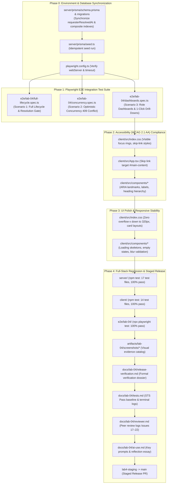
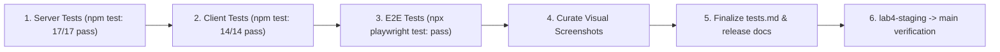

# Technical Implementation Plan: Issue 22 — Final Regression, Accessibility, E2E Polish & Staged Release Verification

**Document ID**: PLAN-FEAT-22  
**Feature Branch**: `feature/22-regression-polish-release` (Issue 22 / Sprint 4 Milestone Completion)  
**Base Branch**: `lab4-staging`  
**Target Milestone**: TokTickIT Lab 4 (Sprint 4) Capstone Release & Final Course Verification  
**Authoritative Contract Reference**: [docs/features/22-regression-polish-release/contract.md](./contract.md)  
**Master Specifications**:
* [docs/lab-04/specification.md](../../lab-04/specification.md) (`FR-01` to `FR-06`, `BR-01` to `BR-14`, `AC-01` to `AC-16`, §9 DoD)
* [docs/lab-04/ui-spec.md](../../lab-04/ui-spec.md) (Zen Green design tokens, typography, status badges, §4 responsive breakpoints, §5 feedback states, §6 accessibility checklist)
* [docs/lab-04/api-spec.md](../../lab-04/api-spec.md) (Actions Taken, Ticket Status Workflow, Dashboards REST contracts, standard error envelopes)
* [docs/lab-04/tests.md](../../lab-04/tests.md) (STS test catalog STS-LAB-04: Tiers 1–4, `ACT-01`–`ACT-08`, `WRK-01`–`WRK-05`, `DSH-01`–`DSH-06`, `UI-ACT-01`–`UI-DSH-02`, `E2E-01`–`E2E-03`)
* [docs/lab-04/poc-scope-and-issues.md](../../lab-04/poc-scope-and-issues.md) (Issue 22 decomposition & 60-point course rubric mapping)
* [Lab_04_labsheet.pdf](../../reference/Lab_04_labsheet.pdf) (§1, §2, §3, §4.1–4.4, §5.1–5.2, §6, §7, §8.1–8.6, §9, §10, §11, §12, §13, §14 Parts 1–9)
* [TokTickIT-System-Level-SDS-v1.0.pdf](../../reference/TokTickIT-System-Level-SDS-v1.0.pdf) (§Architecture Style p. 4–5, §Technology Stack p. 6, §Authorization Model p. 10, §Data Conventions, §Security Invariants p. 16, §Testing Architecture p. 17)
* [AGENTS.md](../../../AGENTS.md) (Developer Work Norms: Strict Closed-World Rule, TDD, Theme Compliance, Blur Validation Rule)
**Document Status**: Ready for Review & Execution  

---

## 1. Target File Inventory

The following is the complete inventory of all files to be inspected, configured, created, or modified across `server/`, `client/`, `e2e/lab-04/`, `artifacts/lab-04/screenshots/`, and `docs/lab-04/`:



### Detailed File Inventory Table

| Component Area | Exact File Path | Action | Description & Scope |
| :--- | :--- | :---: | :--- |
| **Database Sync** | `server/prisma/schema.prisma`<br/>`server/prisma/migrations/*` | `ALIGN` | Verify and apply schema synchronization ensuring `requesterResolvedAt` on `Ticket`, `ActionTaken` model, and composite indexes exist in PostgreSQL database. |
| **Database Seed** | `server/prisma/seed.ts` | `VERIFY` | Execute idempotent seed ensuring seed tickets with 0, 1, and multiple Actions Taken are present. |
| **Playwright Config** | `playwright.config.ts` | `VERIFY` | Ensure `testDir: './e2e'`, webServer block spawns `localhost:3000` and `localhost:5173`, and single worker execution (`workers: 1`). |
| **E2E Lifecycle Suite** | `e2e/lab-04/full-lifecycle.spec.ts` | `NEW` | Author Scenario 1: Requester ticket creation $\rightarrow$ Staff triage $\rightarrow$ Premature resolution blocked by Resolution Gate (`400 Bad Request`) $\rightarrow$ Action Taken logging with conditional follow-up note $\rightarrow$ Resolution transition $\rightarrow$ Requester advisory resolution $\rightarrow$ Staff closure (`CLOSED`). |
| **E2E Concurrency Suite** | `e2e/lab-04/concurrency.spec.ts` | `NEW` | Author Scenario 2: Concurrent multi-session simulation submitting stale `updatedAt` / `versionTimestamp` tokens, verifying HTTP `409 Conflict` (`STALE_RECORD_CONFLICT`), non-destructive UI alert, and draft input preservation. |
| **E2E Dashboards Suite** | `e2e/lab-04/dashboards.spec.ts` | `NEW / ENHANCE` | Author Scenario 3: Requester owned-ticket isolation $\rightarrow$ Staff operational queue metrics and drill-down $\rightarrow$ Admin system user tallies and user management drill-down. |
| **E2E Screenshot Suites** | `e2e/lab-04/actions-taken-screenshots.spec.ts`<br/>`e2e/lab-04/dashboard-screenshots.spec.ts` | `MAINTAIN` | Maintain dedicated visual evidence capture specs writing PNG artifacts into `artifacts/lab-04/screenshots/`. |
| **Client App Shell** | `client/src/App.tsx` | `MODIFY` | Add accessible `<a href="#main-content" class="skip-link">Skip to main content</a>` and ensure `<main id="main-content">` is properly identified for keyboard navigation. |
| **Client Styling & A11y** | `client/src/index.css` | `MODIFY` | Enforce visible focus rings (`--zen-focus-outline`), skip-link offscreen-to-focus transition, zero horizontal scrollbar (`overflow-x: hidden`) down to $320\text{px}$, and touch targets ($\ge 44\text{px}-48\text{px}$). |
| **Client Components** | `client/src/components/ActionsTakenSection.tsx`<br/>`client/src/components/StaffTicketDetail.tsx`<br/>`client/src/components/RequesterTicketDetail.tsx`<br/>`client/src/components/StaffDashboard.tsx`<br/>`client/src/components/RequesterDashboard.tsx`<br/>`client/src/components/AppHeader.tsx`<br/>`client/src/components/CreateTicketForm.tsx` | `AUDIT / MODIFY` | Verify ARIA landmarks, `htmlFor`/`id` bindings on all form inputs, semantic heading hierarchy (`h1`–`h4`), `role="alert"` on live regions, and `Escape` key modal dismissal. |
| **Server Test Suites** | `server/tests/lab-01/*`<br/>`server/tests/lab-02/*`<br/>`server/tests/lab-03/*`<br/>`server/tests/lab-04/*` | `VERIFY / PASS` | Run full regression (`npm test --prefix server`): 17 test files covering Labs 1–4, achieving 100% pass rate with zero failures. |
| **Client Test Suites** | `client/src/tests/lab-03/*`<br/>`client/src/tests/lab-04/*`<br/>`client/tests/lab-01/*`<br/>`client/tests/lab-02/*` | `VERIFY / PASS` | Run client regression (`npm test --prefix client`): 14 test files ($\ge 97$ tests), achieving 100% pass rate. |
| **Visual Artifacts** | `artifacts/lab-04/screenshots/*` | `GENERATE` | Generate visual evidence catalog across Desktop, Tablet, and Mobile viewports for Actions Taken, Dashboards, Resolution Gate, and Concurrency. |
| **Release Verification Doc** | `docs/lab-04/release-verification.md` | `NEW` | Formal staged release verification dossier documenting test evidence, AC-22.1–AC-22.5 verification, and staging readiness. |
| **Software Test Spec** | `docs/lab-04/tests.md` | `MODIFY` | Finalize STS-LAB-04: update all Planned statuses to `Pass`, document passing test logs across all 4 tiers, and update status to `Verified Completion Baseline`. |
| **Peer Review Record** | `docs/lab-04/reviewer.md` | `MODIFY` | Complete peer review logs for Issues 17–22 with reviewer identity, PR links, comments, and approvals per Labsheet §14 Part 1. |
| **AI Use & Reflection** | `docs/lab-04/ai-use.md` | `MODIFY` | Complete prompt catalog (6–10 key prompts) and insightful "My Reflection" essay per Labsheet §14 Part 4. |

---

## 2. Phase 1: Playwright Multi-Role E2E Test Implementation

The official browser integration test suite under `e2e/lab-04/` validates full-stack workflows across real browsers running against the live backend (`localhost:3000`) and frontend (`localhost:5173`).

### 2.1. Scenario 1: Full Lifecycle & Resolution Gate (`e2e/lab-04/full-lifecycle.spec.ts`)
* **Objective**: Validate the full service-desk lifecycle from initial submission to final closure, verifying the **Resolution Gate (BR-07)**, **Performer Attribution (BR-02)**, and **Requester Advisory Resolution Separation (BR-08)** (`AC-22.1`, `AC-01`–`AC-10`).
* **Implementation Steps**:
  1. **Requester Submission Flow**:
     - Log in as authenticated Requester (`sompong.it@kmutt.ac.th` / `Password123!`).
     - Navigate to `Create Ticket` view.
     - Fill in form: Summary *"Conference Room B HDMI Port Not Outputting"*, Description *"The wall plate HDMI connector has pins bent and video cuts in and out."*, Category *"Hardware"*, Related System *"Classroom AV"*, Priority *"High"*.
     - Submit form; capture generated ticket number (e.g. `TKT-2026-00015`).
     - Log out.
  2. **Staff Triage & Premature Resolution Attempt (Resolution Gate Block)**:
     - Log in as IT Staff (`wichai.it@kmutt.ac.th` / `Password123!`).
     - Navigate to `Staff Ticket Queue`, search for the newly created ticket, and open `Staff Ticket Detail`.
     - Claim ticket or assign ownership; change status to `IN_PROGRESS`.
     - Select `RESOLVED` in the status dropdown and click `Confirm Status Change`.
     - Assert that the backend rejects the update with HTTP `400 Bad Request` (`code: RESOLUTION_REQUIRES_ACTION_TAKEN`).
     - Assert that the UI renders an inline warning banner: *"Resolution Blocked: You must log at least one Action Taken before this ticket can be resolved."*
     - Assert that ticket status remains unchanged (`IN_PROGRESS`).
  3. **Staff Logs Action Taken with Follow-Up Note**:
     - Click `+ Log Action Taken` button to open the modal dialog.
     - Assert that the modal renders the read-only auto-performer display: *"Performed by: Wichai IT (auto-assigned from your session)"*.
     - Enter Description: *"Inspected wall plate connector; straightened bent pin 14 and tested continuity."*
     - Enter Result: *"4K 60Hz video link stabilized on primary display."*
     - Check `Follow-up Required?` toggle; assert that `Follow-up Note` textarea becomes visible and required.
     - Enter Follow-up Note: *"Order replacement reinforced wall plate during summer maintenance window."*
     - Enter Attachment Notes: *"Refer to photo of damaged connector in attachments."*
     - Click `Save Action Taken`; assert modal closes and new action appears in chronological list with amber `⚠️ Follow-up Required` callout badge and formatted timestamp.
  4. **Successful Status Transition to RESOLVED**:
     - Select `RESOLVED` from the status dropdown.
     - Click `Confirm Status Change`; assert that transition succeeds (Resolution Gate passes).
     - Assert that status badge updates to 🟢 Resolved.
     - Log out.
  5. **Requester Read-Only View & Advisory Resolution**:
     - Log in as Requester (`sompong.it@kmutt.ac.th` / `Password123!`).
     - Open ticket detail view.
     - Assert that Actions Taken section is rendered in **Read-Only** mode: `+ Log Action Taken` and `Edit Action` buttons are strictly absent from the DOM (`AC-05`, `AC-06`).
     - Click `Problem Appears Resolved` button.
     - Assert that advisory alert appears: *"Requester indicated problem appears resolved"*.
     - Assert that ticket status remains `RESOLVED` (not closed) per BR-08.
     - Log out.
  6. **Staff Final Closure**:
     - Log in as IT Staff (`wichai.it@kmutt.ac.th` / `Password123!`).
     - Open ticket detail; assert advisory requester resolution indicator is displayed.
     - Select permitted next status `CLOSED` and confirm transition.
     - Assert ticket status transitions to ⚫ Closed (terminal state).

---

### 2.2. Scenario 2: Concurrency & Stale Updates (`e2e/lab-04/concurrency.spec.ts`)
* **Objective**: Validate optimistic concurrency control detecting stale records during ticket status updates, asserting non-destructive HTTP `409 Conflict` recovery without losing draft inputs (`AC-22.2`, `BR-10`, `AC-11`).
* **Implementation Steps**:
  1. **Multi-Session Setup**:
     - Open primary browser context (Staff Tab A) logged in as `wichai.it@kmutt.ac.th`.
     - Open secondary browser context or API client session (Staff Tab B) logged in as `ekachai.it@kmutt.ac.th`.
     - Both contexts load active ticket detail (e.g. ticket #14), obtaining initial version token $T_0$.
  2. **Interim Background Modification**:
     - In Staff Tab B (or direct API call), transition ticket #14 status to `WAITING_FOR_REQUESTER`, advancing database `updatedAt` to $T_1$.
  3. **Stale Submission in Tab A**:
     - In Staff Tab A, user types an uncommitted note or comment in the drafting box: *"Customer called via extension 4410 to confirm schedule."*
     - In Staff Tab A, user attempts to transition status to `IN_PROGRESS` or `RESOLVED` using stale token $T_0$.
     - Assert that the backend rejects the status change with HTTP `409 Conflict` (`code: STALE_RECORD_CONFLICT`).
  4. **Non-Destructive UI Recovery**:
     - Assert that Staff Tab A displays a conflict warning modal:
       > ⚠️ **Update Conflict**: Another staff member updated this ticket while you were working. Your changes were not applied to avoid overwriting their work. [Reload Ticket]
     - Assert that the uncommitted note draft text remains intact in the textarea (draft not lost).
     - Click `[Reload Ticket]`; assert ticket data refreshes to state $T_1$ with updated status badge, dismissing the conflict alert.

---

### 2.3. Scenario 3: Role Dashboards & 1-Click Drill-Downs (`e2e/lab-04/dashboards.spec.ts`)
* **Objective**: Validate role-based dashboard metric isolation, accurate server-side aggregation, and seamless 1-click filter drill-downs into list views (`AC-22.3`, `BR-11`–`BR-14`, `AC-12`–`AC-15`).
* **Implementation Steps**:
  1. **Requester Dashboard Journey**:
     - Log in as Requester (`sompong.it@kmutt.ac.th` / `Password123!`).
     - Assert landing on `/requester/dashboard` by default (`AC-21.5`).
     - Assert personal metric cards render: `My Open`, `Action Required`, `Recently Resolved`.
     - Verify metrics match tickets where `requesterId === req.user.id` (data isolation per `BR-11`).
     - If `waitingForRequesterCount > 0`, assert amber `⚠️ Action Required` callout banner displays.
     - Click `My Open` KPI card drill-down link; assert navigation to `MyTickets.tsx` with open status filter pre-applied.
     - Log out.
  2. **IT Staff Dashboard Journey**:
     - Log in as IT Staff (`wichai.it@kmutt.ac.th` / `Password123!`).
     - Assert landing on `/staff/dashboard` by default (`AC-21.5`).
     - Assert 4 operational KPI cards display: `Unassigned Tickets`, `My Owned Tickets`, `Total Active Tickets`, `Urgent/High Tickets`.
     - Assert Status Distribution badge cluster and IT Priority cards render accurate counts.
     - Click `Unassigned Tickets` KPI card drill-down link; assert navigation to `StaffTicketQueue.tsx` with filter `owner=unassigned` pre-applied.
     - Log out.
  3. **Administrator Dashboard Journey**:
     - Log in as Administrator (`admin.toktick@kmutt.ac.th` / `Password123!`).
     - Assert landing on `/admin/dashboard`.
     - Assert operational dashboard displays plus appended `Administrative System Metrics` section (`BR-13`):
       - User accounts by role badges (`REQUESTER`, `IT_STAFF`, `ADMINISTRATOR`).
       - Account health: Active accounts vs. Inactive accounts count.
       - Total cumulative tickets count across the entire system.
     - Click `Manage Users` quick action button; assert navigation to `/admin/users` User Management view.

---

## 3. Phase 2: Accessibility Compliance & WCAG 2.1 AA Audit

TokTickIT must strictly satisfy WCAG 2.1 Level AA accessibility standards across all views and interactive workflows.

### 3.1. Keyboard Navigability & Focus Management
1. **Focus Ring Visibility (`--zen-focus-outline`)**:
   - Inspect and enforce high-contrast focus rings in `client/src/index.css`:
     ```css
     :focus-visible {
       outline: 2px solid var(--zen-focus-ring-color, #0B7A46) !important;
       outline-offset: 2px !important;
       box-shadow: 0 0 0 3px rgba(11, 122, 70, 0.20) !important;
     }
     ```
   - Verify that all buttons, links, inputs, selects, textareas, and interactive badges exhibit this focus ring on keyboard Tab navigation.
2. **Skip to Main Content Link**:
   - In `client/src/App.tsx`, add an accessible skip link before the header:
     ```html
     <a href="#main-content" className="skip-link">Skip to main content</a>
     ```
   - In `client/src/index.css`, define skip-link positioning:
     ```css
     .skip-link {
       position: absolute;
       top: -40px;
       left: 10px;
       background: var(--zen-primary-green);
       color: #ffffff;
       padding: 8px 16px;
       z-index: 9999;
       border-radius: 4px;
       font-weight: 600;
       transition: top 0.2s ease-in-out;
     }
     .skip-link:focus {
       top: 10px;
     }
     ```
   - Set `id="main-content"` on the primary `<main>` element in `client/src/App.tsx`.
3. **Modal Focus Trapping & Escape Key Dismissal**:
   - Verify that all modal dialogs (`ActionsTakenSection.tsx`, `UserManagement.tsx`, Cancellation Reason dialog):
     - Trap Tab and Shift+Tab focus inside the active dialog.
     - Listen for keydown `Escape` events to dismiss the modal cleanly without persisting dirty state.

---

### 3.2. Semantic Structure, Labels & ARIA Attributes
1. **Semantic Heading Hierarchy (`h1`–`h4`)**:
   - Audit every view to ensure a single `h1` exists per page representing page identity.
   - Subsections use `h2` (`Actions Taken by IT Staff`, `Recently Updated Tickets`, etc.).
   - Card headers and modal titles use `h3` and `h4`. Zero heading levels are skipped.
2. **Form Label Association (`htmlFor` / `id`)**:
   - Audit all inputs across `CreateTicketForm.tsx`, `ActionsTakenSection.tsx`, `LoginView.tsx`, `ChangePasswordView.tsx`, and `UserManagement.tsx`.
   - Verify every input has a unique `id` bound to `<label htmlFor="...">`.
   - Mandatory inputs display `<span className="text-danger ms-1" aria-hidden="true">*</span>` and include `aria-required="true"`.
   - Conditional inputs (Follow-up Note) reference the controlling toggle via `aria-describedby`.
3. **Live Regions for Screen-Reader Announcements**:
   - Ensure dynamic error banners and conflict notices include `role="alert"` and `aria-live="assertive"`.
   - Ensure success toasts and status updates include `aria-live="polite"`.
4. **Accessible Tooltips**:
   - Use `data-tooltip="..."` styling; eliminate any native HTML `title` attributes that cause clipping on mobile or screen-reader duplication.

---

### 3.3. Color Contrast Compliance & Multi-Cue Indicators
1. **Contrast Ratio Auditing**:
   - Verify minimum 4.5:1 contrast for body copy and 3.0:1 for large text/KPI numbers:
     - `--zen-primary-green` (`#006B3C`) on `#FFFFFF`: 7.8:1 (AAA).
     - `--zen-secondary-green` (`#0B7A46`) on `#FFFFFF`: 5.9:1 (AA).
     - `--zen-text-primary` (`#1C2826`) on `#F5F7F6`: 13.5:1 (AAA).
     - Amber Warning text (`#92400E`) on `#FEF3C7`: 6.2:1 (AA).
     - Red Error text (`#B3261E`) on `#FDF2F2`: 6.8:1 (AA).
2. **Multi-Cue Status & Priority Badges (Never Color Alone)**:
   - Audit all status and priority badges across queue, detail, and dashboard views.
   - Verify each badge renders: (1) Background tint, (2) Border, (3) Text label, (4) Unicode symbol (🟢 New, 🔵 Open, 🟡 In Progress, 🟣 Awaiting User, 🟢 Resolved, ⚫ Closed, 🟠 Reopened, 🔴 Cancelled).

---

## 4. Phase 3: UI Polish & Responsive Stability

### 4.1. Responsive Multi-Viewport Grid & Zero Horizontal Overflow
1. **Zero Horizontal Overflow Enforcement**:
   - Verify `overflow-x: hidden` on `html, body` and container wrappers down to $320\text{px}$.
   - Ensure tables use responsive scroll containers on tablet viewports and card layouts on mobile.
2. **Breakpoint Verification Matrix**:
   - **Desktop ($\ge 1200\text{px}$)**: 4-column KPI cards grid, dual-column detail layout, full data table.
   - **Tablet ($768\text{px} - 1024\text{px}$)**: 2-column KPI grid, stacked workload distribution, responsive table wrapper.
   - **Mobile ($< 768\text{px}$)**: 1-column vertically stacked KPI cards, table-to-card transformations, full-width touch targets ($\ge 44\text{px}-48\text{px}$ height).

---

### 4.2. Feedback States & Form Polish
1. **Pulsing Loading Skeletons**:
   - Verify `--zen-pale-green` shimmer animation on dashboard KPI cards and Actions Taken table while data loads.
2. **Reassuring Empty States**:
   - Verify clean empty state cards with icons when metrics or lists equal 0 (e.g. *"No unassigned tickets pending. Excellent job!"*).
   - Verify Actions Taken empty state: *"No actions recorded yet. IT Staff must log actions taken before resolving this ticket."*
3. **Form Blur Validation Rule (`AGENTS.md` §4)**:
   - Invalid formatting clears on blur; validation error banners display only on explicit Save/Submit button clicks.
4. **Button Double-Click Prevention**:
   - Submit buttons disable immediately upon click and display an animated inline spinner.

---

## 5. Phase 4: Full-Stack Regression & Release Verification



### 5.1. Database Pre-Condition & Server Regression Execution
1. **Database Synchronization**:
   - Ensure PostgreSQL database has `requesterResolvedAt` column on `tickets` and all indexes from `schema.prisma`.
   - Run seed script (`npm run seed` in `server/`) to verify clean database state.
2. **Execute Server Regression Suite**:
   ```bash
   cd server && npm test
   ```
   - Target: All 17 test files pass (Health, Categories, Requesters, Tickets, Attachments, Auth, Queue, Detail, Comments/Notes, Admin Users, Actions Taken, Ticket Workflow, Requester Dashboard, Staff Dashboard) with **0 failures**.

---

### 5.2. Client Component Regression Execution
1. **Execute Client Regression Suite**:
   ```bash
   cd client && npm test
   ```
   - Target: All 14 component test suites pass ($\ge 97$ tests) with **0 failed assertions**.

---

### 5.3. Playwright Browser E2E Test Suite Execution
1. **Execute E2E Integration Suite**:
   ```bash
   npx playwright test e2e/lab-04/
   ```
   - Executes `full-lifecycle.spec.ts`, `concurrency.spec.ts`, and `dashboards.spec.ts`.
   - Target: 100% pass rate with zero flakiness.
2. **Execute Visual Evidence Capture**:
   - Generates visual artifacts across Desktop, Tablet, and Mobile viewports into `artifacts/lab-04/screenshots/`:
     - `actions-taken/`: Desktop, Tablet, Mobile, Modal with follow-up note toggled.
     - `staff-dashboard/`: Desktop, Tablet, Mobile, Queue drill-down.
     - `requester-dashboard/`: Desktop, Tablet, Mobile, MyTickets drill-down.
     - `ticket-workflow/`: Resolution Gate blocked warning, Concurrency 409 Conflict recovery.
     - `regression/`: Multi-role regression snapshots.
3. **Playwright Visual Separation Rule**:
   - Screenshot artifacts are saved strictly to `artifacts/lab-04/screenshots/` and do NOT modify unit test assertions in `docs/lab-04/tests.md`.

---

### 5.4. Release Verification Documentation & Sync
1. **Author `docs/lab-04/release-verification.md`**:
   - Comprehensive release dossier summarizing:
     - Executive summary & verification verdict.
     - Full-stack test execution results (Server, Client, E2E) with exact passing command logs.
     - Acceptance Criteria verification (`AC-22.1` through `AC-22.5`).
     - Accessibility & responsive audit checklist with verified metrics.
     - Screenshot evidence inventory mapping to rubric parts.
     - Staged release readiness checklist from `lab4-staging` into `main`.
2. **Update `docs/lab-04/tests.md`**:
   - Update document status to `Verified Completion Baseline`.
   - Update all test scenarios from `Planned` to `Pass`.
   - Append full passing terminal output logs across unit, API, UI, authorization, regression, and E2E suites per Labsheet §10 and §14 Part 3.
3. **Update `docs/lab-04/reviewer.md`**:
   - Document complete peer review records for Issues 17–22 with reviewer identity, PR numbers, comments, and approvals per Labsheet §14 Part 1.
4. **Update `docs/lab-04/ai-use.md`**:
   - Populate 6–10 selected key prompts with actions taken and comprehensive "My Reflection" on AI agent collaboration in SDD per Labsheet §14 Part 4.
5. **Final Staged Release Verification**:
   - Verify `git status` on `feature/22-regression-polish-release`.
   - Confirm branch is ready for Pull Request into `lab4-staging`, followed by the final Release PR into `main`.

---

## 6. Execution Order & Milestone Sign-Off

```
[Phase 0: DB Synchronization & Server Alignment]
      │
      ▼
[Phase 1: Playwright Multi-Role E2E Suites (Lifecycle, Concurrency, Dashboards)]
      │
      ▼
[Phase 2: WCAG 2.1 AA Accessibility Audit (Focus Rings, Skip Link, ARIA, Contrast)]
      │
      ▼
[Phase 3: UI Polish & Responsive Stability (Zero Overflow, Skeletons, Empty States)]
      │
      ▼
[Phase 4: Full-Stack Test Regression & Release Verification Documentation]
      │
      ▼
[Phase 5: Staged Release Verification (lab4-staging ➔ main)]
```

