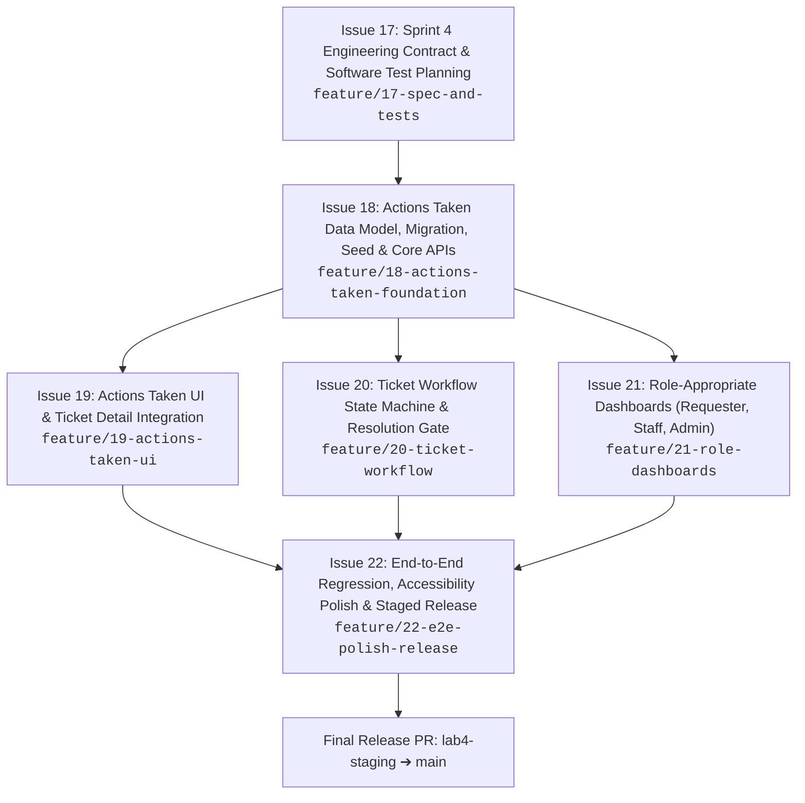

# TokTickIT Sprint 4 (Lab 4) — Scope & Issue Decomposition

**Document Status**: Official Implementation Plan  
**Target Sprint**: TokTickIT Lab 4 (Sprint 4) — Actions Taken, Dashboards, and Final Regression  
**Base Branch**: `lab4-staging`  
**Initial Active Branch**: `feature/17-spec-and-tests`  
**Traceability Reference**: [Lab_04_labsheet.pdf](../reference/Lab_04_labsheet.pdf) (§11, §12)  

---

## 1. Sprint Architecture & Delivery Plan

### 1.1. Sprint Goal
Complete the core TokTickIT service-desk workflow by delivering:
1. **Actions Taken Subsystem**: Parent-child work item tracking under each Ticket, capturing Action Date/Time, Description, Result, auto-derived Performer, Follow-Up Required toggle, conditional Follow-Up Note, and Attachment Notes.
2. **Definitive Ticket Status Workflow & Resolution Gate**: Strict state machine enforcement across all 8 statuses, ensuring no ticket transitions to `RESOLVED` or `CLOSED` without at least one recorded Action Taken, while maintaining Requester advisory resolution separation.
3. **Role-Appropriate Dashboards**: Concise, high-value summary dashboards for Requesters (owned tickets, tickets waiting for input, recent resolutions), IT Staff (unassigned tickets, personal workload, status/priority breakdown), and Administrators (system user tallies).
4. **Full Regression Hardening**: Preserving 100% of functionality from Labs 1–3 under the Zen Green design system with comprehensive Unit, API, UI, and E2E test verification.

### 1.2. Git & GitHub Engineering Workflow
* All feature branches are cut from `lab4-staging` and merged back into `lab4-staging` via peer-reviewed Pull Requests.
* The designated peer reviewer reviews and merges approved PRs; the PR author responds to all review comments.
* When all feature slices are verified on `lab4-staging`, a final release PR is submitted from `lab4-staging` into `main`.
* The GitHub Project Kanban board tracks issues through the 6 approved states:  
  `Backlog` $\rightarrow$ `Specified` $\rightarrow$ `Started` $\rightarrow$ `PR Review` $\rightarrow$ `Fixing` $\rightarrow$ `Done`.

---

## 2. Six Planned GitHub Issues for Sprint 4

---

### Issue 17: Sprint 4 Engineering Contract & Software Test Planning
* **Branch Name**: `feature/17-spec-and-tests`
* **Target Branch**: `lab4-staging`
* **Scope**:
  - Author `docs/lab-04/specification.md`, `ui-spec.md`, `api-spec.md`, and `tests.md`.
  - Author scaffolding templates `reviewer.md`, `ai-use.md`, and `poc-scope-and-issues.md`.
  - Create directory scaffolding: `server/tests/lab-04/`, `client/src/tests/lab-04/`, `e2e/lab-04/`, and `artifacts/lab-04/screenshots/`.
* **Explicit Exclusions**: No application code, migrations, or test assertion scripts.

---

### Issue 18: Actions Taken Data Model, Migration, Seed & Core APIs
* **Branch Name**: `feature/18-actions-taken-foundation`
* **Target Branch**: `lab4-staging`
* **Scope**:
  - Prisma schema increment: `ActionTaken` model, relations to `Ticket` and `User`, composite indexes.
  - Safe database migration and rollback verification.
  - Idempotent seed script (`server/prisma/seed.ts`) populating tickets with 0, 1, and multiple Actions Taken.
  - REST endpoints: `POST /api/v1/tickets/:id/actions-taken`, `GET /api/v1/tickets/:id/actions-taken`, `PUT /api/v1/tickets/:id/actions-taken/:actionId`.
  - Authorization & validation middleware (session-derived performer, conditional follow-up note, requester read-only access).
  - API integration tests in `server/tests/lab-04/actions-taken.api.test.ts`.

---

### Issue 19: Actions Taken UI & Ticket Detail Integration
* **Branch Name**: `feature/19-actions-taken-ui`
* **Target Branch**: `lab4-staging`
* **Scope**:
  - Integrate Actions Taken line-item table/card list on Ticket Detail screen.
  - Modal dialog for logging and editing actions with auto-performer display card.
  - Dynamic toggle for Follow-Up Required with conditionally displayed and validated Follow-up Note input.
  - Read-only rendering for Requesters (create/edit controls omitted).
  - Component tests in `client/src/tests/lab-04/ActionsTaken.test.tsx`.

---

### Issue 20: Ticket Workflow State Machine & Resolution Gate
* **Branch Name**: `feature/20-ticket-workflow`
* **Target Branch**: `lab4-staging`
* **Scope**:
  - Implement Resolution Gate (BR-07) blocking `RESOLVED` and `CLOSED` transitions when Actions Taken count is 0.
  - State machine validator for all 8 statuses (`PATCH /api/v1/staff/tickets/:id/status`).
  - Optimistic concurrency control (`409 Conflict`) for stale record updates.
  - Dynamic status selection UI displaying only permitted target states.
  - Cancellation reason modal and feedback alerts.
  - Tests in `server/tests/lab-04/ticket-workflow.api.test.ts` and `client/src/tests/lab-04/TicketWorkflow.test.tsx`.

---

### Issue 21: Role-Appropriate Dashboards (Requester, Staff, Admin)
* **Branch Name**: `feature/21-role-dashboards`
* **Target Branch**: `lab4-staging`
* **Scope**:
  - Backend endpoints: `GET /api/v1/dashboards/requester`, `GET /api/v1/dashboards/staff`, `GET /api/v1/dashboards/admin`.
  - Efficient database aggregation queries utilizing composite indexes.
  - Frontend Requester Dashboard view with personal KPI cards, Action Required banner, and recent tickets table.
  - Frontend IT Staff Dashboard view with unassigned workload, personal assignments, status distribution, and priority breakdown.
  - Frontend Administrator Dashboard with system user account tallies.
  - Direct 1-click drill-downs into filtered queue and detail screens.
  - Tests in `server/tests/lab-04/*dashboard.api.test.ts` and `client/src/tests/lab-04/*Dashboard.test.tsx`.

---

### Issue 22: End-to-End Regression, Accessibility Polish & Staged Release
* **Branch Name**: `feature/22-e2e-polish-release`
* **Target Branch**: `lab4-staging`
* **Scope**:
  - Full Playwright E2E suites: `actions-taken-flow.spec.ts`, `ticket-resolution.spec.ts`, `dashboards.spec.ts`.
  - Multi-viewport verification (Desktop, Tablet, Mobile) with zero horizontal scrolling.
  - Auxiliary visual screenshot capture to `artifacts/lab-04/screenshots/`.
  - Complete regression verification across all Lab 1, 2, and 3 test suites.
  - Completion of `reviewer.md` and `ai-use.md`.
  - Staging verification and final PR creation from `lab4-staging` to `main`.

