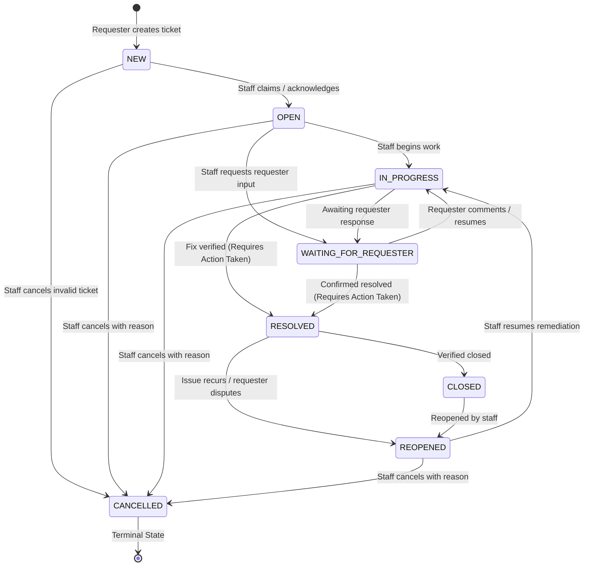
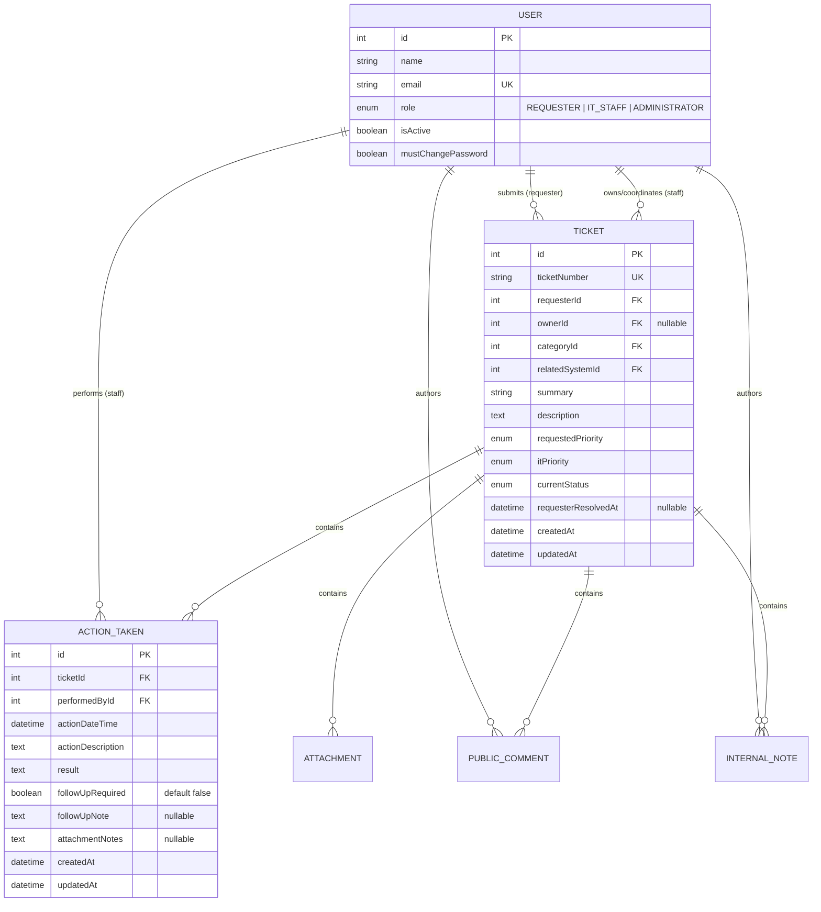

# TokTickIT Sprint 4 (Lab 4) — Engineering Specification

**Document Title**: Sprint 4 Feature Software Design Specification (Feature SDS)  
**Document ID**: SPEC-LAB-04  
**Version**: 1.0 (Approved Baseline)  
**Status**: Ready for Implementation  
**Base Branch**: `lab4-staging`  
**Active Working Branch**: `feature/17-spec-and-tests`  
**Course**: CPE 334 Introduction to Software Engineering in the Age of AI Agents (Semester 1/2026)  
**Reference Traceability**:
* [TokTickIT-System-Level-SDS-v1.0.pdf](../reference/TokTickIT-System-Level-SDS-v1.0.pdf) (System-Level Architecture SDS-SYS-001)
* [Lab_04_labsheet.pdf](../reference/Lab_04_labsheet.pdf) (Sprint 4 Scope, Business Rules, Rubrics)
* [poc-scope-and-issues.md](./poc-scope-and-issues.md) (Sprint 4 Implementation Plan)
* [specification.md](../lab-03/specification.md) (Lab 3 Engineering Contract Baseline)
* [AGENTS.md](../../AGENTS.md) (Developer Work Norms & Engineering Contract Workflow)

---

## 1. Sprint Goal

Deliver the culminating product increment for TokTickIT that completes the core service-desk lifecycle, empowers IT Staff with a reliable way to plan, track, and record granular work through **Actions Taken**, enforces a strict **Ticket Resolution Gate** and status state machine, introduces **Role-Appropriate Dashboards** for Requesters, IT Staff, and Administrators, and hardens the full-stack system to guarantee 100% regression stability across all capabilities built in Labs 1 through 3 under the Zen Green design system.

---

## 2. Stakeholder Request Interpretation

> “The service desk can now receive Tickets and IT Staff can communicate with Requesters, but we still need a reliable way to plan and track the actual work. Add Actions Taken under each Ticket. Each action should contain Action Date/Time, Action Description, Result, Performed by (auto), Follow-Up Required?, Follow-up Note (required when follow-up is needed), Attachment Notes (what file to look for images etc.) The primary Ticket Owner remains responsible for coordinating the Ticket as a whole. Requesters may continue to indicate that the problem appears resolved, but IT Staff must review the work and formally update the Ticket. Add useful dashboards for Requesters and IT Staff, but keep them concise and connected to the detailed screens. Finally, polish and harden the complete application so that all earlier features continue to work consistently under the Zen Green design language.” — *Lab 4 Stakeholder Request (§3)*

### Key Architectural & Operational Takeaways:
1. **Granular Work Tracking (Actions Taken)**: While a Ticket maintains a single primary Ticket Owner responsible for overall coordination, multiple IT Staff members may participate in investigation and remediation. Each discrete operational task must be recorded as an Action Taken line item with auto-attributed performer identity, objective result, follow-up requirements, and file cross-references.
2. **Strict Resolution Gate**: A Requester's indication that a problem appears resolved remains strictly advisory. A ticket cannot transition to `RESOLVED` or `CLOSED` without at least one recorded Action Taken and formal verification by IT Staff or Administrators.
3. **Concise Operational Dashboards**: High-density operational summaries must provide immediate situational awareness for Requesters (tickets waiting on their input, open tickets, recent resolutions) and IT Staff/Administrators (unassigned tickets, claimed workload, status distributions, urgent priorities) with zero-friction drill-down to filtered lists.
4. **Complete Regression Continuity**: Authentication, role boundaries, ticket submission, attachments, comments, internal notes, and administrative account management from Labs 1–3 must continue functioning flawlessly without breaking changes.

---

## 3. Scope Boundaries

### 3.1. Included Scope
1. **Actions Taken Data Model & Management**:
   - Parent-child relational model linking multiple `ActionTaken` records to a parent `Ticket`.
   - Attributes: `actionDateTime` (editable historical timestamp, not future), `actionDescription` (mandatory text), `result` (mandatory outcome text), `performedById` (auto-derived from authenticated staff session), `followUpRequired` (boolean toggle), `followUpNote` (conditionally required when follow-up is needed, cleared when not), and `attachmentNotes` (optional file/image cross-reference notes).
   - CRUD capabilities: IT Staff and Administrators can create and update Actions Taken records. Requesters have read-only visibility for Actions Taken on tickets they own.
2. **Definitive Ticket Status Workflow & Resolution Gate**:
   - Enforcement of the complete 8-state transition matrix: `NEW`, `OPEN`, `IN_PROGRESS`, `WAITING_FOR_REQUESTER`, `RESOLVED`, `CLOSED`, `REOPENED`, `CANCELLED`.
   - **Resolution Gate**: Rejection of status transitions to `RESOLVED` or `CLOSED` if the ticket has zero Actions Taken records.
   - Separation of Requester advisory indication (`requesterResolvedAt`) from formal staff resolution.
   - Cancellation requires a non-empty explanation note.
3. **Role-Appropriate Dashboards**:
   - **Requester Dashboard**: Scoped strictly to authenticated user's tickets; displays Open Tickets count, Tickets Waiting for Requester count, Recently Resolved count (past 30 days), and a table of the 5 most recently updated owned tickets with drill-down links.
   - **IT Staff Dashboard**: Displays Unassigned Tickets count, My Owned Tickets count, Total Active Tickets count, Status distribution breakdown, IT Priority breakdown for active tickets, and a table of the 5 most recently updated active tickets with drill-down links.
   - **Administrator Dashboard**: Extends IT Staff operational dashboard with system user tallies (users by role, active vs. inactive accounts, total ticket volume).
   - Authoritative server-side aggregation with optimized database indexing.
4. **Concurrency & Safe Update Protection**:
   - Optimistic concurrency control detecting stale records during ticket status updates and Action Taken edits, returning HTTP `409 Conflict`.
5. **UI & Design System Extensions**:
   - Responsive Zen Green dashboard cards, action line-item tables, create/edit modals, conditional form inputs, and status workflow controls.
   - Full responsiveness across Desktop ($\ge 1200\text{px}$), Tablet ($768\text{px}-1024\text{px}$), and Mobile ($< 768\text{px}$) with zero horizontal scrolling.
6. **Full Regression Hardening**:
   - 100% test coverage across Unit, API Integration, UI Component, and Browser E2E suites.

### 3.2. Explicitly Excluded Scope (§4.2)
* **No SLA Clocks & Escalation Engines**: No automatic SLA timers, warning alarms, breach notifications, or on-call staff rotation schedules.
* **No External Communication Channels**: No outbound email, SMS, LINE messaging, webhook dispatches, or mobile push notifications.
* **No Inventory & Cost Accounting**: No spare-parts tracking, inventory consumption logging, purchase requisition workflows, or service cost accounting.
* **No Timesheet Billing & Labor Calculation**: No hourly labor rate calculations, staff timesheet submissions, or client billing calculations.
* **No Multi-Level Electronic Approvals**: No multi-signature sign-offs, hierarchical escalation approvals, or cryptographic e-signatures.
* **No Business Intelligence Warehouses**: No custom OLAP report builders, export pipelines (CSV/Excel/PDF exports), or multi-dimensional data cubes.
* **No Multi-Tenancy & Cloud Clustering**: No multi-tenant campus partitioning or multi-region distributed clustering.
* **No Unapproved Product Expansions**: Any feature not explicitly codified in this specification is strictly prohibited under the Closed-World Rule.

---

## 4. Functional Requirements (FR)

* **FR-01 (Actions Taken Logging & Relational Management)**:  
  The system shall enable IT Staff and Administrators to create and update multiple Action Taken records under any accessible ticket. Each record must capture the Action Date/Time, Action Description, Result, auto-attributed Performer, Follow-Up Required toggle, conditional Follow-Up Note, and optional Attachment Notes. Requesters shall have read-only visibility into Actions Taken for their owned tickets.

* **FR-02 (Multi-Staff Collaboration with Single Ticket Ownership)**:  
  The system shall maintain a single primary Ticket Owner responsible for overall ticket coordination while allowing different IT Staff members to independently perform actions and log Actions Taken entries. The performer identity shall be derived strictly from the authenticated user's session.

* **FR-03 (Ticket Status Workflow & Formal Resolution Gate)**:  
  The system shall enforce the 8-state ticket transition matrix (`NEW`, `OPEN`, `IN_PROGRESS`, `WAITING_FOR_REQUESTER`, `RESOLVED`, `CLOSED`, `REOPENED`, `CANCELLED`). The backend shall strictly reject transitions to `RESOLVED` or `CLOSED` unless the ticket contains at least one recorded Action Taken. A Requester's "Problem Appears Resolved" indication shall remain advisory and recorded without changing the ticket status.

* **FR-04 (Role-Appropriate Operational Dashboards)**:  
  The system shall compute and serve dedicated dashboard views for Requesters, IT Staff, and Administrators. Dashboards shall present authoritative aggregate metrics and recent ticket tables with direct drill-down navigation to detailed views.

* **FR-05 (Optimistic Concurrency & Conflict Control)**:  
  The system shall guard against concurrent updates and stale overwrites on ticket statuses and Action Taken records. When a client submits an update with a stale timestamp, the API shall reject the modification with HTTP `409 Conflict`.

* **FR-06 (Full-Stack Regression, Accessibility & System Polish)**:  
  The system shall preserve all pre-existing functionality from Labs 1–3 (authentication, password changes, ticket submission, attachments, comments, internal notes, admin user management) within the Zen Green design language, ensuring complete keyboard accessibility, feedback states, and zero horizontal overflow across all viewports.

---

## 5. Business Rules (BR)

* **BR-01 (Parent-Child Ticket Cardinality)**:  
  Every Action Taken record belongs to exactly one Ticket (`ticketId`). When querying ticket details, Actions Taken must be returned ordered chronologically by `actionDateTime` ascending.

* **BR-02 (Independent Performer & Ownership Separation)**:  
  The primary Ticket Owner coordinates the ticket as a whole, but an Action Taken may be executed and logged by any active IT Staff member or Administrator. The `performedById` must be automatically derived from the server session (`req.user.id`) and cannot be spoofed, altered, or overridden by the client.

* **BR-03 (Role-Based Action Taken Access Control)**:  
  - `REQUESTER`: Permitted strictly read-only access to Actions Taken on tickets where `ticket.requesterId === req.user.id`. Any `POST`, `PUT`, or `DELETE` attempt by a Requester must return HTTP `403 Forbidden`.
  - `IT_STAFF` & `ADMINISTRATOR`: Permitted to create and update Actions Taken records on any accessible ticket.

* **BR-04 (Mandatory Action Taken Attributes & Boundaries)**:  
  - `actionDateTime`: Required timestamp. Defaults to the current server timestamp; can be adjusted to reflect when work physically occurred, but cannot be in the future (`actionDateTime <= NOW()`).
  - `actionDescription`: Mandatory string, 5 to 1,000 characters after trimming whitespace.
  - `result`: Mandatory string, 2 to 1,000 characters after trimming whitespace.
  - `followUpRequired`: Mandatory boolean (default `false`).
  - `attachmentNotes`: Optional string up to 500 characters describing physical items or uploaded attachments.

* **BR-05 (Conditional Follow-Up Note Enforcement)**:  
  - If `followUpRequired === true`, `followUpNote` is **strictly mandatory** (non-empty string, 3 to 1,000 characters after trimming).
  - If `followUpRequired === false`, `followUpNote` must be cleared/nullified by the backend.

* **BR-06 (Immutability of Performer Audit Trail)**:  
  Once an Action Taken record is created, its original performer identity (`performedById`) is permanent and cannot be reassigned to another staff member. Updates modify only the editable fields (`actionDateTime`, `actionDescription`, `result`, `followUpRequired`, `followUpNote`, `attachmentNotes`) and record `updatedAt`.

* **BR-07 (Mandatory Ticket Resolution Gate Invariant)**:  
  A Ticket cannot transition to `RESOLVED` or `CLOSED` unless it has **at least one valid recorded Action Taken**. Any attempt by IT Staff or an Administrator to set status to `RESOLVED` or `CLOSED` on a ticket with zero Actions Taken must be rejected by the backend with HTTP `400 Bad Request` (`RESOLUTION_REQUIRES_ACTION_TAKEN`).

* **BR-08 (Requester Advisory Resolution Separation)**:  
  An authenticated Requester viewing an owned ticket may click "Problem Appears Resolved". This action sets `requesterResolvedAt = NOW()` and displays advisory confirmation, but **does not** change the ticket status to `RESOLVED` or `CLOSED`. Formal status resolution remains the exclusive authority of IT Staff and Administrators per BR-07.

* **BR-09 (Definitive Status Transition State Machine)**:  
  Status changes must strictly follow the approved state machine:
  - `NEW` $\rightarrow$ `OPEN`, `CANCELLED`.
  - `OPEN` $\rightarrow$ `IN_PROGRESS`, `WAITING_FOR_REQUESTER`, `CANCELLED`.
  - `IN_PROGRESS` $\rightarrow$ `WAITING_FOR_REQUESTER`, `RESOLVED` (subject to BR-07), `CANCELLED`.
  - `WAITING_FOR_REQUESTER` $\rightarrow$ `IN_PROGRESS`, `RESOLVED` (subject to BR-07).
  - `RESOLVED` $\rightarrow$ `CLOSED`, `REOPENED`.
  - `CLOSED` $\rightarrow$ `REOPENED`.
  - `REOPENED` $\rightarrow$ `IN_PROGRESS`, `CANCELLED`.
  - `CANCELLED` is terminal; no further transitions are allowed.
  - Transitions to `CANCELLED` require a non-empty cancellation note (min 5 characters).

* **BR-10 (Optimistic Concurrency & Stale Update Handling)**:  
  Ticket status updates and Action Taken edits must validate timestamp currency against `updatedAt`. If another user has modified the record in the interim, the API must reject the update with HTTP `409 Conflict` (`STALE_RECORD_CONFLICT`), instructing the client to reload data.

* **BR-11 (Requester Dashboard Metric Boundaries)**:  
  The Requester Dashboard computes metrics strictly scoped to tickets where `requesterId === req.user.id`:
  1. `openTicketsCount`: Tickets with status `NEW`, `OPEN`, `IN_PROGRESS`, or `REOPENED`.
  2. `waitingForRequesterCount`: Tickets with status `WAITING_FOR_REQUESTER`.
  3. `recentlyResolvedCount`: Tickets resolved within the last 30 calendar days (`status IN ('RESOLVED', 'CLOSED')` and `updatedAt >= NOW() - 30 days`).
  4. `recentlyUpdatedTickets`: Top 5 most recently updated tickets owned by the requester.

* **BR-12 (IT Staff Dashboard Metric Boundaries)**:  
  The IT Staff Dashboard computes operational metrics across the service desk:
  1. `unassignedTicketsCount`: Open tickets with `ownerId === null`.
  2. `myOwnedTicketsCount`: Open tickets where `ownerId === req.user.id`.
  3. `totalActiveTicketsCount`: Tickets with status `NEW`, `OPEN`, `IN_PROGRESS`, `WAITING_FOR_REQUESTER`, `REOPENED`.
  4. `statusCounts`: Breakdown of ticket counts across all 8 individual statuses.
  5. `priorityCounts`: Breakdown of active ticket counts across `LOW`, `MEDIUM`, `HIGH`, `URGENT`.
  6. `recentlyUpdatedTickets`: Top 5 most recently updated active tickets.

* **BR-13 (Administrator Dashboard Extended Metrics)**:  
  The Administrator Dashboard contains all IT Staff operational metrics plus administrative system tallies:
  1. `usersByRole`: Count of registered users grouped by role (`REQUESTER`, `IT_STAFF`, `ADMINISTRATOR`).
  2. `activeUsersCount`: Total users where `isActive === true`.
  3. `inactiveUsersCount`: Total users where `isActive === false`.
  4. `totalTicketsCount`: Cumulative ticket count across the entire system.

* **BR-14 (Authoritative Server-Side Calculation & Drill-Down)**:  
  All dashboard counters and aggregates must be computed by the database runtime via dedicated API endpoints. Clients must never download entire ticket tables to compute totals in memory. Each dashboard metric card must provide a clickable drill-down opening the relevant filtered queue or detail view.

---

## 6. Ticket Status Transition Matrix

| Source Status | Permitted Target Statuses | Authorized Roles | Mandatory Guards & Business Validations |
| :--- | :--- | :--- | :--- |
| `NEW` | `OPEN`, `CANCELLED` | IT Staff, Admin | Assignment or open acknowledgement; Cancellation requires reason text ($\ge 5$ chars). |
| `OPEN` | `IN_PROGRESS`, `WAITING_FOR_REQUESTER`, `CANCELLED` | IT Staff, Admin | Begins investigation or requests user clarification; Cancellation requires reason. |
| `IN_PROGRESS` | `WAITING_FOR_REQUESTER`, `RESOLVED`, `CANCELLED` | IT Staff, Admin | **Resolution Gate (BR-07)**: Transition to `RESOLVED` requires $\ge 1$ recorded Action Taken. Cancellation requires reason. |
| `WAITING_FOR_REQUESTER` | `IN_PROGRESS`, `RESOLVED` | IT Staff, Admin | Reopening investigation or resolving after verification (**BR-07 requires $\ge 1$ Action Taken**). |
| `RESOLVED` | `CLOSED`, `REOPENED` | IT Staff, Admin | Final closure after verification; Reopening allowed if problem recurs. |
| `CLOSED` | `REOPENED` | IT Staff, Admin | Exceptional reopen when identical root cause re-emerges. |
| `REOPENED` | `IN_PROGRESS`, `CANCELLED` | IT Staff, Admin | Resuming active remediation or cancelling if invalid. |
| `CANCELLED` | *None (Terminal)* | — | Read-only terminal state; no transitions permitted. |

---

## 7. Database Design & Migration Strategy

### 7.1. Database Design Decisions & Justifications (§5.1)

#### Decision 1: Dedicated `ActionTaken` Table with Relational Parent-Child Foreign Keys
* **Schema Definition**: Model `ActionTaken` mapped to database table `actions_taken` with primary key `id`, foreign key `ticketId` referencing `tickets(id)` with `onDelete: Cascade`, foreign key `performedById` referencing `users(id)` with `onDelete: Restrict`, `actionDateTime` (DateTime), `actionDescription` (Text), `result` (Text), `followUpRequired` (Boolean, default `false`), `followUpNote` (Text, nullable), `attachmentNotes` (Text, nullable), `createdAt` (DateTime), and `updatedAt` (DateTime).
* **Engineering Justification**: Decouples the work execution audit trail from ticket header attributes. A ticket is a high-level incident container coordinated by a primary `ownerId`, whereas `actions_taken` captures discrete, potentially multi-actor operational tasks. Normalizing this into a dedicated table ensures clean 1-to-many cardinality, enforces database-level referential integrity against the central `User` identity table, and allows chronological indexing (`@@index([ticketId, actionDateTime])`).

#### Decision 2: Server-Derived Performer Foreign Key with Deletion Restriction (`onDelete: Restrict`)
* **Schema Definition**: Foreign key `performedById` strictly references `User(id)` with `onDelete: Restrict`.
* **Engineering Justification**: Upholds the institutional audit trail required by IT service desk compliance. By enforcing `onDelete: Restrict`, the database strictly prohibits deleting any staff user who has recorded operational work. Furthermore, auto-populating `performedById` from the verified session prevents performer spoofing and guarantees that displayed names remain synchronized if a staff member updates their profile name.

#### Decision 3: Specialized Composite Indexes for Dashboard Aggregation Performance
* **Schema Definition**: 
  - `tickets`: `@@index([requesterId, currentStatus, updatedAt])`
  - `tickets`: `@@index([ownerId, currentStatus])`
  - `actions_taken`: `@@index([ticketId, actionDateTime])`
* **Engineering Justification**: Dashboards aggregate metrics across thousands of tickets and fetch the top 5 recent items. Without targeted indexes, dashboard queries degrade into full table scans. Composite indexes ensure sub-10ms response times for both Requester and IT Staff dashboards on standard PostgreSQL instances.

### 7.2. Entity-Relationship Model (Sprint 4 Increments)

### 7.3. Legacy Migration & Backfill Strategy
1. **Preservation of Pre-Existing Data**:
   - The Prisma migration creates the new `actions_taken` table and required indexes without altering, renaming, or dropping existing columns in `users`, `tickets`, `attachments`, `public_comments`, or `internal_notes`.
   - All existing foreign keys, user passwords, attachments, and comments remain intact with 100% data fidelity.
2. **Legacy Tickets Without Actions Taken**:
   - Pre-existing tickets from Labs 1–3 contain zero `actions_taken` records.
   - The query layer gracefully treats missing actions as an empty list (`actionsTaken: []`).
   - Legacy tickets already in `RESOLVED` or `CLOSED` state prior to Lab 4 remain valid and accessible.
   - Any active legacy ticket (`NEW`, `OPEN`, `IN_PROGRESS`, `WAITING_FOR_REQUESTER`, `REOPENED`) will be subject to the **Resolution Gate (BR-07)** upon any future transition attempt to `RESOLVED` or `CLOSED`, requiring staff to log an Action Taken before resolution can succeed.
3. **Idempotent Seed Data Plan (`server/prisma/seed.ts`)**:
   - Seeds realistic Actions Taken across sample tickets:
     - Tickets with **0** Actions Taken (to verify Resolution Gate blocks).
     - Tickets with **1** Action Taken by the ticket owner.
     - Tickets with **multiple** Actions Taken logged by different IT Staff members (verifying multi-staff collaboration per BR-02).
     - Actions Taken with `followUpRequired: true` and non-empty `followUpNote`.
     - Actions Taken with `attachmentNotes` cross-referencing uploaded images.

---

## 8. Acceptance Criteria (AC-01 to AC-16)

* **AC-01 (Create Valid Action Taken by IT Staff)**:  
  *Given* an authenticated IT Staff member or Administrator viewing an active Ticket,  
  *When* submitting valid Action Taken data (description, result, date/time),  
  *Then* the record is persisted under the target Ticket with HTTP 201 Created, and the performer is automatically set to the authenticated user.

* **AC-02 (Auto-Derived Performer Audit Trail)**:  
  *Given* an authenticated IT Staff member "Wichai IT" logging an Action Taken,  
  *When* the creation request is processed,  
  *Then* `performedById` is populated from the authenticated session, cannot be overridden by client parameters, and displays "Wichai IT" upon retrieval.

* **AC-03 (Conditional Follow-Up Note Enforcement)**:  
  *Given* an IT Staff member submitting an Action Taken with `followUpRequired = true`,  
  *When* the `followUpNote` is empty or whitespace,  
  *Then* the submission is rejected with HTTP 400 Bad Request; when a non-empty note is supplied, the record is successfully saved.

* **AC-04 (Update Existing Action Taken by Staff)**:  
  *Given* an existing Action Taken record,  
  *When* an IT Staff member updates the description, result, or follow-up note via `PUT`,  
  *Then* the record is updated, `updatedAt` is refreshed, and the original `performedById` remains unchanged.

* **AC-05 (Requester Read-Only Visibility of Actions Taken)**:  
  *Given* an authenticated Requester viewing their owned Ticket,  
  *When* the Ticket Detail view loads,  
  *Then* all recorded Actions Taken are visible in read-only mode without create or edit controls.

* **AC-06 (Requester Write Prevention on Actions Taken - 403 Forbidden)**:  
  *Given* an authenticated Requester,  
  *When* attempting to `POST` or `PUT` an Action Taken record,  
  *Then* the request is rejected with HTTP 403 Forbidden.

* **AC-07 (Resolution Gate Block on Ticket Without Actions Taken)**:  
  *Given* an active Ticket with zero recorded Actions Taken,  
  *When* IT Staff attempts to transition the status to `RESOLVED` or `CLOSED`,  
  *Then* the backend rejects the request with HTTP 400 Bad Request (`RESOLUTION_REQUIRES_ACTION_TAKEN`) and the status remains unchanged.

* **AC-08 (Successful Ticket Resolution With Recorded Action Taken)**:  
  *Given* an active Ticket containing at least one recorded Action Taken,  
  *When* IT Staff transitions the status to `RESOLVED`,  
  *Then* the status updates to `RESOLVED`, the change is recorded, and the UI displays the resolved badge.

* **AC-09 (Requester Advisory Resolution Indication)**:  
  *Given* an authenticated Requester viewing an open owned Ticket,  
  *When* clicking "Problem Appears Resolved",  
  *Then* `requesterResolvedAt` is timestamped, but the Ticket status remains unchanged (e.g. `IN_PROGRESS`).

* **AC-10 (Ticket Status Transition Matrix Enforcement)**:  
  *Given* a Ticket in status `NEW`,  
  *When* an IT Staff user attempts an invalid transition directly to `RESOLVED` or `CLOSED`,  
  *Then* the transition is rejected with HTTP 400 Bad Request.

* **AC-11 (Optimistic Concurrency & Stale Update Conflict Rejection - 409 Conflict)**:  
  *Given* a client submitting a status update or Action Taken edit with a stale `versionTimestamp`,  
  *When* the record has been modified by another user in the interim,  
  *Then* the request is rejected with HTTP 409 Conflict (`STALE_RECORD_CONFLICT`).

* **AC-12 (Requester Dashboard Scoped Metrics & Drill-Down)**:  
  *Given* an authenticated Requester,  
  *When* accessing the Requester Dashboard (`GET /api/v1/dashboards/requester`),  
  *Then* the system returns metrics and recent tickets strictly scoped to that Requester, with working drill-down links to My Tickets and Ticket Detail.

* **AC-13 (IT Staff Dashboard Operational Metrics & Drill-Down)**:  
  *Given* an authenticated IT Staff member,  
  *When* accessing the IT Staff Dashboard (`GET /api/v1/dashboards/staff`),  
  *Then* the system returns unassigned ticket counts, user-owned ticket counts, status/priority distributions, and recent tickets with working queue drill-down links.

* **AC-14 (Administrator Dashboard Extended System Metrics)**:  
  *Given* an authenticated Administrator,  
  *When* accessing the Admin Dashboard (`GET /api/v1/dashboards/admin`),  
  *Then* the response includes all staff operational metrics plus total users by role and active/inactive account tallies.

* **AC-15 (Dashboard Empty States & Safe Fallbacks)**:  
  *Given* a system state with zero matching tickets for a dashboard metric,  
  *When* the dashboard loads,  
  *Then* cards display `0` cleanly and tables display friendly empty state messages without UI crashes or console errors.

* **AC-16 (Full Regression Continuity Across Labs 1–3)**:  
  *Given* the complete TokTickIT test suite,  
  *When* executing all pre-existing tests for Auth, Requester Tickets, Attachments, Comments, Notes, and Admin User Management,  
  *Then* all tests pass 100% without modification or regression.

---

## 9. Product Definition of Done (DoD)

Before declaring Sprint 4 complete and merging `lab4-staging` into `main`, the engineering team must satisfy every item on this checklist:

1. **Engineering Contract Established**:
   - `docs/lab-04/specification.md`, `ui-spec.md`, `api-spec.md`, and `tests.md` are authored, peer-reviewed, and merged on `lab4-staging` before feature implementation.
2. **Database Integrity & Migrations**:
   - Prisma schema updated with `ActionTaken` model and performance indexes.
   - Migration runs cleanly forward and rollbacks are verified without data loss.
   - Idempotent seed script populates realistic tickets with 0, 1, and multiple Actions Taken.
3. **Core Workflow & Security Invariants**:
   - Actions Taken CRUD operational for IT Staff/Admin and strictly read-only for Requesters (`403 Forbidden` on write).
   - Performer audit trail is auto-derived from session and immutable.
   - Resolution Gate strictly blocks resolving tickets with zero Actions Taken.
   - Requester advisory resolution indication remains separate from formal status changes.
   - Optimistic concurrency control rejects stale updates with HTTP 409 Conflict.
4. **Dashboards & Zen Green UI Polish**:
   - Dedicated Requester, IT Staff, and Admin Dashboards operational with verified backend calculations and drill-down links.
   - Actions Taken section seamlessly integrated into Ticket Detail with create/edit modals and conditional follow-up note input.
   - Responsive layouts verified on Desktop ($\ge 1200\text{px}$), Tablet ($768\text{px}-1024\text{px}$), and Mobile ($< 768\text{px}$) with zero horizontal scrolling.
   - Complete accessibility checklist fulfilled: non-color status cues, visible focus rings, ARIA labels, and `data-tooltip` usage.
5. **Automated Test Verification**:
   - 100% of Acceptance Criteria (`AC-01` to `AC-16`) covered by automated test suites.
   - Server API test suite passes (`server/tests/lab-04/`).
   - Client UI component test suite passes (`client/src/tests/lab-04/`).
   - Browser E2E test suite passes (`e2e/lab-04/`).
   - Full regression suite across Labs 1–3 passes with 0 failures.
6. **Artifacts & Demonstration Evidence**:
   - Auxiliary Playwright screenshot artifacts generated in `artifacts/lab-04/screenshots/`.
   - `docs/lab-04/reviewer.md` and `docs/lab-04/ai-use.md` fully completed with authentic peer review logs and reflection essay.

---

## 10. Assumptions & Architectural Decisions

1. **Date/Time Input Flexibility**: Action Date/Time defaults to the current moment (`NOW()`) when the modal opens, but staff can backdate it to record when physical troubleshooting occurred in the field. It cannot be set to a future date.
2. **Performer Immutability vs. Editing**: When an Action Taken is edited, the original performer (`performedById`) is retained permanently to guarantee auditability.
3. **Resolution Gate Scope**: The resolution gate applies when transitioning from any status into `RESOLVED` or `CLOSED`. Reopening a ticket (`RESOLVED` $\rightarrow$ `REOPENED`) does not require new actions, but subsequently resolving it again requires that the ticket contains at least one Action Taken.
4. **Dashboard Time Boundary**: "Recently Resolved" tickets on the Requester Dashboard use a rolling 30-calendar-day window based on `updatedAt`.

