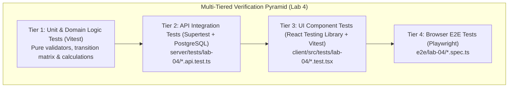

# TokTickIT Sprint 4 (Lab 4) — Software Test Specification (STS) & Verification Report (fill this in)

**Document Title**: Sprint 4 Software Test Specification (STS) & Verification Plan  
**Document ID**: STS-LAB-04  
**Status**: Template (To be completed during test implementation & verification)  
**Project**: TokTickIT — CPE 334 Introduction to Software Engineering in the Age of AI Agents  
**Target Milestone**: Lab 4 (Sprint 4) Actions Taken, Dashboards, and Final Regression  
**Author:** Muhammad Asad Aziz — 67070503472  
**Base Branch**: `lab4-staging`  
**Active Working Branch**: `feature/17-spec-and-tests`  
**Test Frameworks**: Vitest 2.1.9, Supertest 7.0.0, React Testing Library 16.1.0, Playwright 1.49.1  
**Database**: PostgreSQL 16 with Prisma ORM 5.22.0  
**Traceability Reference**: [specification.md](./specification.md), [ui-spec.md](./ui-spec.md), [api-spec.md](./api-spec.md), [Lab_04_labsheet.pdf](../reference/Lab_04_labsheet.pdf) (§10, §14)

---

## 1. Test Strategy & Quality Architecture



> [!NOTE]
> **Auxiliary Playwright Screenshot Rule**: Playwright full-page screenshots are saved strictly to `artifacts/lab-04/screenshots/` (`staff-dashboard/`, `requester-dashboard/`, `actions-taken/`) as auxiliary visual verification evidence for developer review. They are never asserted as functional pass/fail test logic in this test specification.

---

## 2. Acceptance Criteria Traceability Matrix

### 2.1. Issue 17 Specification Deliverables
| Criterion ID | Criterion Summary | Verification Target | Status |
| :--- | :--- | :--- | :---: |
| **AC-17.1** | Sprint 4 Engineering Contract authored with FR-01–FR-06, BR-01–BR-14, DB Justifications & AC-01–AC-16 | `docs/lab-04/specification.md` | |
| **AC-17.2** | UI Specification authored with Zen Green tokens, layouts, breakpoints, feedback states & a11y checklist | `docs/lab-04/ui-spec.md` | |
| **AC-17.3** | REST API Contract authored with DTO schemas, endpoints, query parameters, status codes & safe errors | `docs/lab-04/api-spec.md` | |
| **AC-17.4** | Software Test Specification & Directory Scaffolding created across server, client, e2e, and screenshot paths | `docs/lab-04/tests.md` + directories | |

### 2.2. Sprint 4 Functional Acceptance Criteria Traceability (AC-01 to AC-16)

| AC ID | Criterion Summary | Server Test File | Client Test File | E2E Test File | Status |
| :--- | :--- | :--- | :--- | :--- | :---: |
| **AC-01** | Create Valid Action Taken by IT Staff | `server/tests/lab-04/actions-taken.api.test.ts` | `client/src/tests/lab-04/ActionsTaken.test.tsx` | `e2e/lab-04/actions-taken-flow.spec.ts` | |
| **AC-02** | Auto-Derived Performer Audit Trail | `server/tests/lab-04/actions-taken.api.test.ts` | `client/src/tests/lab-04/ActionsTaken.test.tsx` | `e2e/lab-04/actions-taken-flow.spec.ts` | |
| **AC-03** | Conditional Follow-Up Note Enforcement | `server/tests/lab-04/actions-taken.api.test.ts` | `client/src/tests/lab-04/ActionsTaken.test.tsx` | `e2e/lab-04/actions-taken-flow.spec.ts` | |
| **AC-04** | Update Existing Action Taken by Staff | `server/tests/lab-04/actions-taken.api.test.ts` | `client/src/tests/lab-04/ActionsTaken.test.tsx` | `e2e/lab-04/actions-taken-flow.spec.ts` | |
| **AC-05** | Requester Read-Only Visibility of Actions Taken | `server/tests/lab-04/actions-taken.api.test.ts` | `client/src/tests/lab-04/ActionsTaken.test.tsx` | `e2e/lab-04/actions-taken-flow.spec.ts` | |
| **AC-06** | Requester Write Prevention on Actions Taken (403) | `server/tests/lab-04/actions-taken.api.test.ts` | `client/src/tests/lab-04/ActionsTaken.test.tsx` | `e2e/lab-04/actions-taken-flow.spec.ts` | |
| **AC-07** | Resolution Gate Block on Ticket with Zero Actions | `server/tests/lab-04/ticket-workflow.api.test.ts` | `client/src/tests/lab-04/TicketWorkflow.test.tsx` | `e2e/lab-04/ticket-resolution.spec.ts` | |
| **AC-08** | Successful Ticket Resolution With Recorded Action | `server/tests/lab-04/ticket-workflow.api.test.ts` | `client/src/tests/lab-04/TicketWorkflow.test.tsx` | `e2e/lab-04/ticket-resolution.spec.ts` | |
| **AC-09** | Requester Advisory Resolution Indication | `server/tests/lab-04/ticket-workflow.api.test.ts` | `client/src/tests/lab-04/TicketWorkflow.test.tsx` | `e2e/lab-04/ticket-resolution.spec.ts` | |
| **AC-10** | Status Transition Matrix Enforcement | `server/tests/lab-04/ticket-workflow.api.test.ts` | `client/src/tests/lab-04/TicketWorkflow.test.tsx` | `e2e/lab-04/ticket-resolution.spec.ts` | |
| **AC-11** | Optimistic Concurrency & Stale Update Conflict (409) | `server/tests/lab-04/ticket-workflow.api.test.ts` | `client/src/tests/lab-04/TicketWorkflow.test.tsx` | `e2e/lab-04/ticket-resolution.spec.ts` | |
| **AC-12** | Requester Dashboard Scoped Metrics & Drill-Down | `server/tests/lab-04/requester-dashboard.api.test.ts` | `client/src/tests/lab-04/RequesterDashboard.test.tsx` | `e2e/lab-04/dashboards.spec.ts` | |
| **AC-13** | IT Staff Dashboard Operational Metrics & Drill-Down | `server/tests/lab-04/staff-dashboard.api.test.ts` | `client/src/tests/lab-04/StaffDashboard.test.tsx` | `e2e/lab-04/dashboards.spec.ts` | |
| **AC-14** | Administrator Dashboard Extended System Metrics | `server/tests/lab-04/staff-dashboard.api.test.ts` | `client/src/tests/lab-04/StaffDashboard.test.tsx` | `e2e/lab-04/dashboards.spec.ts` | |
| **AC-15** | Dashboard Empty States & Safe Fallbacks | `server/tests/lab-04/staff-dashboard.api.test.ts` | `client/src/tests/lab-04/StaffDashboard.test.tsx` | `e2e/lab-04/dashboards.spec.ts` | |
| **AC-16** | Full Regression Continuity Across Labs 1–3 | Pre-existing test suites | Pre-existing test suites | Pre-existing test suites | |

---

## 3. Planned Tests Catalog

| Test ID | Tier | Mapped AC / Rule | Test Scenario Description | Expected Result | Designated Test File | Final Status |
| :--- | :--- | :--- | :--- | :--- | :--- | :---: |
| **ACT-01** | API | AC-01, FR-01, BR-04 | Staff creates valid Action Taken (`POST /api/v1/tickets/:id/actions-taken`) | HTTP 201; returns saved DTO with auto-populated performer | `server/tests/lab-04/actions-taken.api.test.ts` | |
| **ACT-02** | API | AC-02, BR-02, BR-06 | Performer ID is auto-derived from session and cannot be spoofed | HTTP 201; `performedById` equals `req.user.id`; client body override ignored | `server/tests/lab-04/actions-taken.api.test.ts` | |
| **ACT-03** | API | AC-03, BR-05 | `followUpRequired = true` without `followUpNote` | HTTP 400 Bad Request (`VALIDATION_FAILED`) | `server/tests/lab-04/actions-taken.api.test.ts` | |
| **ACT-04** | API | AC-03, BR-05 | `followUpRequired = true` with valid `followUpNote` | HTTP 201 Created; note persisted | `server/tests/lab-04/actions-taken.api.test.ts` | |
| **ACT-05** | API | AC-04, BR-04 | Staff updates Action Taken description and result (`PUT`) | HTTP 200 OK; updated fields saved; `performedById` unchanged | `server/tests/lab-04/actions-taken.api.test.ts` | |
| **ACT-06** | API | AC-05, BR-03 | Requester retrieves Actions Taken for owned ticket (`GET`) | HTTP 200 OK; returns array of actions | `server/tests/lab-04/actions-taken.api.test.ts` | |
| **ACT-07** | API | AC-06, BR-03 | Requester attempts to create Action Taken (`POST`) | HTTP 403 Forbidden | `server/tests/lab-04/actions-taken.api.test.ts` | |
| **ACT-08** | API | AC-06, BR-03 | Requester attempts to update Action Taken (`PUT`) | HTTP 403 Forbidden | `server/tests/lab-04/actions-taken.api.test.ts` | |
| **WRK-01** | API | AC-07, FR-03, BR-07 | Staff attempts to resolve ticket with 0 Actions Taken | HTTP 400 Bad Request (`RESOLUTION_REQUIRES_ACTION_TAKEN`) | `server/tests/lab-04/ticket-workflow.api.test.ts` | |
| **WRK-02** | API | AC-08, BR-07 | Staff transitions ticket with $\ge 1$ Action Taken to `RESOLVED` | HTTP 200 OK; ticket status updated to `RESOLVED` | `server/tests/lab-04/ticket-workflow.api.test.ts` | |
| **WRK-03** | API | AC-09, BR-08 | Requester marks problem as resolved | HTTP 200 OK; `requesterResolvedAt` set; status unchanged | `server/tests/lab-04/ticket-workflow.api.test.ts` | |
| **WRK-04** | API | AC-10, BR-09 | Invalid transition (e.g. `NEW` $\rightarrow$ `CLOSED`) | HTTP 400 Bad Request (`INVALID_STATUS_TRANSITION`) | `server/tests/lab-04/ticket-workflow.api.test.ts` | |
| **WRK-05** | API | AC-11, BR-10 | Stale `versionTimestamp` submitted on status change | HTTP 409 Conflict (`STALE_RECORD_CONFLICT`) | `server/tests/lab-04/ticket-workflow.api.test.ts` | |
| **DSH-01** | API | AC-12, FR-04, BR-11 | Requester queries dashboard (`GET /api/v1/dashboards/requester`) | HTTP 200 OK; returns open, waiting, resolved counts strictly for user | `server/tests/lab-04/requester-dashboard.api.test.ts` | |
| **DSH-02** | API | AC-12, BR-11 | Requester dashboard returns top 5 recently updated owned tickets | HTTP 200 OK; maximum 5 items sorted by `updatedAt` desc | `server/tests/lab-04/requester-dashboard.api.test.ts` | |
| **DSH-03** | API | AC-13, FR-04, BR-12 | Staff queries dashboard (`GET /api/v1/dashboards/staff`) | HTTP 200 OK; returns unassigned, owned, status and priority counts | `server/tests/lab-04/staff-dashboard.api.test.ts` | |
| **DSH-04** | API | AC-13, BR-12 | Requester attempts to access Staff Dashboard | HTTP 403 Forbidden | `server/tests/lab-04/staff-dashboard.api.test.ts` | |
| **DSH-05** | API | AC-14, BR-13 | Administrator queries dashboard (`GET /api/v1/dashboards/admin`) | HTTP 200 OK; returns staff metrics + user counts by role and active status | `server/tests/lab-04/staff-dashboard.api.test.ts` | |
| **DSH-06** | API | AC-14, BR-13 | Staff user attempts to access Admin Dashboard | HTTP 403 Forbidden | `server/tests/lab-04/staff-dashboard.api.test.ts` | |
| **UI-ACT-01** | UI | AC-01, AC-02 | Actions Taken card renders list, auto-performer card, and date | Action lines rendered with performer name and formatted timestamp | `client/src/tests/lab-04/ActionsTaken.test.tsx` | |
| **UI-ACT-02** | UI | AC-03 | Toggling "Follow-up Required" dynamically shows/hides note input | Input appears on check; error shows on submit if empty | `client/src/tests/lab-04/ActionsTaken.test.tsx` | |
| **UI-ACT-03** | UI | AC-05, AC-06 | Requester viewing Ticket Detail sees read-only actions, no action button | "+ Log Action Taken" button omitted; actions list rendered | `client/src/tests/lab-04/ActionsTaken.test.tsx` | |
| **UI-WRK-01** | UI | AC-07 | Status dropdown shows resolution warning if ticket has 0 actions | Warning alert displayed: "Resolution Blocked: Log at least one action" | `client/src/tests/lab-04/TicketWorkflow.test.tsx` | |
| **UI-WRK-02** | UI | AC-10 | Status dropdown renders only valid next statuses for current status | Invalid transitions excluded from DOM options | `client/src/tests/lab-04/TicketWorkflow.test.tsx` | |
| **UI-DSH-01** | UI | AC-12 | Requester dashboard renders metric cards and action-required banner | 3 metric cards rendered; banner shown if waiting tickets $> 0$ | `client/src/tests/lab-04/RequesterDashboard.test.tsx` | |
| **UI-DSH-02** | UI | AC-13 | Staff dashboard renders KPI cards, status badges, and priority table | 4 KPI cards and breakdown widgets rendered with drill-down links | `client/src/tests/lab-04/StaffDashboard.test.tsx` | |
| **E2E-01** | E2E | AC-01, AC-05 | Full journey: Staff logs action, Requester views read-only action | End-to-end multi-role flow succeeds across browser viewports | `e2e/lab-04/actions-taken-flow.spec.ts` | |
| **E2E-02** | E2E | AC-07, AC-08 | Full journey: Staff blocked by resolution gate, logs action, resolves | Resolution succeeds; status badge updates to "Resolved" | `e2e/lab-04/ticket-resolution.spec.ts` | |
| **E2E-03** | E2E | AC-12, AC-13 | Full journey: Requester and Staff navigate dashboards with drill-downs | Clicking card opens pre-filtered ticket queue/detail view | `e2e/lab-04/dashboards.spec.ts` | |

---

## 4. Test Execution Evidence & Terminal Logs (Paste Below)

### 4.1. Server API Tests Execution
* **Command**: `npm test` (in `server/`)
* **Output / Screenshot**:
```text
<!-- Paste your passing server test terminal output here -->
```

### 4.2. Client UI Tests Execution
* **Command**: `npm test` (in `client/`)
* **Output / Screenshot**:
```text
<!-- Paste your passing client test terminal output here -->
```

### 4.3. Playwright End-to-End Multi-Viewport Suite Execution
* **Command**: `npx playwright test e2e/lab-04/`
* **Output / Screenshot**:
```text
<!-- Paste your passing Playwright test terminal output here -->
```

### 4.4. Full Regression Verification Suite Execution (Labs 1–3)
* **Command**: Full repository test pass
* **Output**:
```text
<!-- Paste your passing full regression test terminal output here -->
```

### 4.5. Visual Evidence Artifacts Summary
<!-- List the generated screenshot files from artifacts/lab-04/screenshots/ here -->

