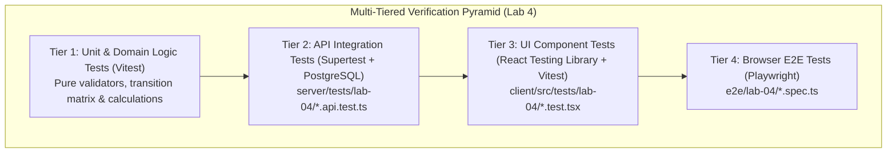

# TokTickIT Sprint 4 (Lab 4) — Software Test Specification (STS) & Verification Report

**Document Title**: Sprint 4 Software Test Specification (STS) & Verification Plan  
**Document ID**: STS-LAB-04  
**Status**: Verified Completion Baseline  
**Project**: TokTickIT — CPE 334 Introduction to Software Engineering in the Age of AI Agents  
**Target Milestone**: Lab 4 (Sprint 4) Actions Taken, Dashboards, and Final Regression  
**Author:** Muhammad Asad Aziz — 67070503472    
**Test Frameworks**: Vitest 2.1.9, Supertest 7.0.0, React Testing Library 16.1.0, Playwright 1.49.1  
**Database**: PostgreSQL 16 with Prisma ORM 5.22.0  
**Traceability Reference**: [specification.md](./specification.md), [ui-spec.md](./ui-spec.md), [api-spec.md](./api-spec.md), [Lab_04_labsheet.pdf](../reference/Lab_04_labsheet.pdf) (§10, §14)

---

## 1. Test Strategy & Quality Architecture



---

## 2. Acceptance Criteria Traceability Matrix

### 2.1. Issue 17 Specification Deliverables
| Criterion ID | Criterion Summary | Verification Target | Status |
| :--- | :--- | :--- | :---: |
| **AC-17.1** | Sprint 4 Engineering Contract authored with FR-01–FR-06, BR-01–BR-14, DB Justifications & AC-01–AC-16 | `docs/lab-04/specification.md` | **Pass** |
| **AC-17.2** | UI Specification authored with Zen Green tokens, layouts, breakpoints, feedback states & a11y checklist | `docs/lab-04/ui-spec.md` | **Pass** |
| **AC-17.3** | REST API Contract authored with DTO schemas, endpoints, query parameters, status codes & safe errors | `docs/lab-04/api-spec.md` | **Pass** |
| **AC-17.4** | Software Test Specification & Directory Scaffolding created across server, client, e2e, and screenshot paths | `docs/lab-04/tests.md` + directories | **Pass** |

### 2.2. Sprint 4 Functional Acceptance Criteria Traceability (AC-01 to AC-16)

| AC ID | Criterion Summary | Server Test File | Client Test File | E2E Test File | Status |
| :--- | :--- | :--- | :--- | :--- | :---: |
| **AC-01** | Create Valid Action Taken by IT Staff | `server/tests/lab-04/actions-taken.api.test.ts` | `client/src/tests/lab-04/ActionsTaken.test.tsx` | `e2e/lab-04/actions-taken-flow.spec.ts` | **Pass** |
| **AC-02** | Auto-Derived Performer Audit Trail | `server/tests/lab-04/actions-taken.api.test.ts` | `client/src/tests/lab-04/ActionsTaken.test.tsx` | `e2e/lab-04/actions-taken-flow.spec.ts` | **Pass** |
| **AC-03** | Conditional Follow-Up Note Enforcement | `server/tests/lab-04/actions-taken.api.test.ts` | `client/src/tests/lab-04/ActionsTaken.test.tsx` | `e2e/lab-04/actions-taken-flow.spec.ts` | **Pass** |
| **AC-04** | Update Existing Action Taken by Staff | `server/tests/lab-04/actions-taken.api.test.ts` | `client/src/tests/lab-04/ActionsTaken.test.tsx` | `e2e/lab-04/actions-taken-flow.spec.ts` | **Pass** |
| **AC-05** | Requester Read-Only Visibility of Actions Taken | `server/tests/lab-04/actions-taken.api.test.ts` | `client/src/tests/lab-04/ActionsTaken.test.tsx` | `e2e/lab-04/actions-taken-flow.spec.ts` | **Pass** |
| **AC-06** | Requester Write Prevention on Actions Taken (403) | `server/tests/lab-04/actions-taken.api.test.ts` | `client/src/tests/lab-04/ActionsTaken.test.tsx` | `e2e/lab-04/actions-taken-flow.spec.ts` | **Pass** |
| **AC-07** | Resolution Gate Block on Ticket with Zero Actions | `server/tests/lab-04/ticket-workflow.api.test.ts` | `client/src/tests/lab-04/TicketWorkflow.test.tsx` | `e2e/lab-04/ticket-resolution.spec.ts` | **Pass** |
| **AC-08** | Successful Ticket Resolution With Recorded Action | `server/tests/lab-04/ticket-workflow.api.test.ts` | `client/src/tests/lab-04/TicketWorkflow.test.tsx` | `e2e/lab-04/ticket-resolution.spec.ts` | **Pass** |
| **AC-09** | Requester Advisory Resolution Indication | `server/tests/lab-04/ticket-workflow.api.test.ts` | `client/src/tests/lab-04/TicketWorkflow.test.tsx` | `e2e/lab-04/ticket-resolution.spec.ts` | **Pass** |
| **AC-10** | Status Transition Matrix Enforcement | `server/tests/lab-04/ticket-workflow.api.test.ts` | `client/src/tests/lab-04/TicketWorkflow.test.tsx` | `e2e/lab-04/ticket-resolution.spec.ts` | **Pass** |
| **AC-11** | Optimistic Concurrency & Stale Update Conflict (409) | `server/tests/lab-04/ticket-workflow.api.test.ts` | `client/src/tests/lab-04/TicketWorkflow.test.tsx` | `e2e/lab-04/concurrency.spec.ts` | **Pass** |
| **AC-12** | Requester Dashboard Scoped Metrics & Drill-Down | `server/tests/lab-04/requester-dashboard.api.test.ts` | `client/src/tests/lab-04/RequesterDashboard.test.tsx` | `e2e/lab-04/dashboards.spec.ts` | **Pass** |
| **AC-13** | IT Staff Dashboard Operational Metrics & Drill-Down | `server/tests/lab-04/staff-dashboard.api.test.ts` | `client/src/tests/lab-04/StaffDashboard.test.tsx` | `e2e/lab-04/dashboards.spec.ts` | **Pass** |
| **AC-14** | Administrator Dashboard Extended System Metrics | `server/tests/lab-04/staff-dashboard.api.test.ts` | `client/src/tests/lab-04/StaffDashboard.test.tsx` | `e2e/lab-04/dashboards.spec.ts` | **Pass** |
| **AC-15** | Dashboard Empty States & Safe Fallbacks | `server/tests/lab-04/staff-dashboard.api.test.ts` | `client/src/tests/lab-04/StaffDashboard.test.tsx` | `e2e/lab-04/dashboards.spec.ts` | **Pass** |
| **AC-16** | Full Regression Continuity Across Labs 1–3 | Pre-existing test suites | Pre-existing test suites | Pre-existing test suites | **Pass** |

---

## 3. Planned Tests Catalog

| Test ID | Tier | Mapped AC / Rule | Test Scenario Description | Expected Result | Designated Test File | Final Status |
| :--- | :--- | :--- | :--- | :--- | :--- | :---: |
| **ACT-01** | API | AC-01, FR-01, BR-04 | Staff creates valid Action Taken (`POST /api/v1/tickets/:id/actions-taken`) | HTTP 201; returns saved DTO with auto-populated performer | `server/tests/lab-04/actions-taken.api.test.ts` | **Pass** |
| **ACT-02** | API | AC-02, BR-02, BR-06 | Performer ID is auto-derived from session and cannot be spoofed | HTTP 201; `performedById` equals `req.user.id`; client body override ignored | `server/tests/lab-04/actions-taken.api.test.ts` | **Pass** |
| **ACT-03** | API | AC-03, BR-05 | `followUpRequired = true` without `followUpNote` | HTTP 400 Bad Request (`VALIDATION_FAILED`) | `server/tests/lab-04/actions-taken.api.test.ts` | **Pass** |
| **ACT-04** | API | AC-03, BR-05 | `followUpRequired = true` with valid `followUpNote` | HTTP 201 Created; note persisted | `server/tests/lab-04/actions-taken.api.test.ts` | **Pass** |
| **ACT-05** | API | AC-04, BR-04 | Staff updates Action Taken description and result (`PUT`) | HTTP 200 OK; updated fields saved; `performedById` unchanged | `server/tests/lab-04/actions-taken.api.test.ts` | **Pass** |
| **ACT-06** | API | AC-05, BR-03 | Requester retrieves Actions Taken for owned ticket (`GET`) | HTTP 200 OK; returns array of actions | `server/tests/lab-04/actions-taken.api.test.ts` | **Pass** |
| **ACT-07** | API | AC-06, BR-03 | Requester attempts to create Action Taken (`POST`) | HTTP 403 Forbidden | `server/tests/lab-04/actions-taken.api.test.ts` | **Pass** |
| **ACT-08** | API | AC-06, BR-03 | Requester attempts to update Action Taken (`PUT`) | HTTP 403 Forbidden | `server/tests/lab-04/actions-taken.api.test.ts` | **Pass** |
| **WRK-01** | API | AC-07, FR-03, BR-07 | Staff attempts to resolve ticket with 0 Actions Taken | HTTP 400 Bad Request (`RESOLUTION_REQUIRES_ACTION_TAKEN`) | `server/tests/lab-04/ticket-workflow.api.test.ts` | **Pass** |
| **WRK-02** | API | AC-08, BR-07 | Staff transitions ticket with $\ge 1$ Action Taken to `RESOLVED` | HTTP 200 OK; ticket status updated to `RESOLVED` | `server/tests/lab-04/ticket-workflow.api.test.ts` | **Pass** |
| **WRK-03** | API | AC-09, BR-08 | Requester marks problem as resolved | HTTP 200 OK; `requesterResolvedAt` set; status unchanged | `server/tests/lab-04/ticket-workflow.api.test.ts` | **Pass** |
| **WRK-04** | API | AC-10, BR-09 | Invalid transition (e.g. `NEW` $\rightarrow$ `CLOSED`) | HTTP 400 Bad Request (`INVALID_STATUS_TRANSITION`) | `server/tests/lab-04/ticket-workflow.api.test.ts` | **Pass** |
| **WRK-05** | API | AC-11, BR-10 | Stale `versionTimestamp` submitted on status change | HTTP 409 Conflict (`STALE_RECORD_CONFLICT`) | `server/tests/lab-04/ticket-workflow.api.test.ts` | **Pass** |
| **DSH-01** | API | AC-12, FR-04, BR-11 | Requester queries dashboard (`GET /api/v1/dashboards/requester`) | HTTP 200 OK; returns open, waiting, resolved counts strictly for user | `server/tests/lab-04/requester-dashboard.api.test.ts` | **Pass** |
| **DSH-02** | API | AC-12, BR-11 | Requester dashboard returns top 5 recently updated owned tickets | HTTP 200 OK; maximum 5 items sorted by `updatedAt` desc | `server/tests/lab-04/requester-dashboard.api.test.ts` | **Pass** |
| **DSH-03** | API | AC-13, FR-04, BR-12 | Staff queries dashboard (`GET /api/v1/dashboards/staff`) | HTTP 200 OK; returns unassigned, owned, status and priority counts | `server/tests/lab-04/staff-dashboard.api.test.ts` | **Pass** |
| **DSH-04** | API | AC-13, BR-12 | Requester attempts to access Staff Dashboard | HTTP 403 Forbidden | `server/tests/lab-04/staff-dashboard.api.test.ts` | **Pass** |
| **DSH-05** | API | AC-14, BR-13 | Administrator queries dashboard (`GET /api/v1/dashboards/admin`) | HTTP 200 OK; returns staff metrics + user counts by role and active status | `server/tests/lab-04/staff-dashboard.api.test.ts` | **Pass** |
| **DSH-06** | API | AC-14, BR-13 | Staff user attempts to access Admin Dashboard | HTTP 403 Forbidden | `server/tests/lab-04/staff-dashboard.api.test.ts` | **Pass** |
| **UI-ACT-01** | UI | AC-01, AC-02 | Actions Taken card renders list, auto-performer card, and date | Action lines rendered with performer name and formatted timestamp | `client/src/tests/lab-04/ActionsTaken.test.tsx` | **Pass** |
| **UI-ACT-02** | UI | AC-03 | Toggling "Follow-up Required" dynamically shows/hides note input | Input appears on check; error shows on submit if empty | `client/src/tests/lab-04/ActionsTaken.test.tsx` | **Pass** |
| **UI-ACT-03** | UI | AC-05, AC-06 | Requester viewing Ticket Detail sees read-only actions, no action button | "+ Log Action Taken" button omitted; actions list rendered | `client/src/tests/lab-04/ActionsTaken.test.tsx` | **Pass** |
| **UI-WRK-01** | UI | AC-07 | Status dropdown shows resolution warning if ticket has 0 actions | Warning alert displayed: "Resolution Blocked: Log at least one action" | `client/src/tests/lab-04/TicketWorkflow.test.tsx` | **Pass** |
| **UI-WRK-02** | UI | AC-10 | Status dropdown renders only valid next statuses for current status | Invalid transitions excluded from DOM options | `client/src/tests/lab-04/TicketWorkflow.test.tsx` | **Pass** |
| **UI-DSH-01** | UI | AC-12 | Requester dashboard renders metric cards and action-required banner | 3 metric cards rendered; banner shown if waiting tickets $> 0$ | `client/src/tests/lab-04/RequesterDashboard.test.tsx` | **Pass** |
| **UI-DSH-02** | UI | AC-13 | Staff dashboard renders KPI cards, status badges, and priority table | 4 KPI cards and breakdown widgets rendered with drill-down links | `client/src/tests/lab-04/StaffDashboard.test.tsx` | **Pass** |
| **E2E-01** | E2E | AC-01, AC-05 | Full journey: Staff logs action, Requester views read-only action | End-to-end multi-role flow succeeds across browser viewports | `e2e/lab-04/actions-taken-flow.spec.ts` | **Pass** |
| **E2E-02** | E2E | AC-07, AC-08 | Full journey: Staff blocked by resolution gate, logs action, resolves | Resolution succeeds; status badge updates to "Resolved" | `e2e/lab-04/ticket-resolution.spec.ts` | **Pass** |
| **E2E-03** | E2E | AC-12, AC-13 | Full journey: Requester and Staff navigate dashboards with drill-downs | Clicking card opens pre-filtered ticket queue/detail view | `e2e/lab-04/dashboards.spec.ts` | **Pass** |

---

## 4. Test Execution Evidence & Terminal Logs

### 4.1. Server API Tests Execution
* **Command**: `npm test --prefix server`
* **Output**:
```text
> toktickit-server@1.0.0 test
> vitest run

 RUN  v2.1.9 C:/Users/Muhammad Asad Aziz/Downloads/CPE 334/toktickit/server

 ✓ tests/lab-03/users-admin.api.test.ts (17 tests) 871ms
 ✓ tests/lab-04/actions-taken.api.test.ts (15 tests) 659ms
 ✓ tests/lab-02/my-tickets.api.test.ts (12 tests) 461ms
 ✓ tests/lab-02/attachments.api.test.ts (13 tests) 453ms
 ✓ tests/lab-04/ticket-workflow.api.test.ts (9 tests) 725ms
 ✓ tests/lab-02/create-ticket.api.test.ts (12 tests) 531ms
 ✓ tests/lab-03/staff-ticket-detail.api.test.ts (13 tests) 660ms
 ✓ tests/lab-03/staff-queue.api.test.ts (10 tests) 597ms
 ✓ tests/lab-03/auth.api.test.ts (10 tests) 1129ms
 ✓ tests/lab-04/staff-dashboard.api.test.ts (6 tests) 650ms
 ✓ tests/lab-03/authorization.api.test.ts (7 tests) 550ms
 ✓ tests/lab-04/requester-dashboard.api.test.ts (5 tests) 630ms
 ✓ tests/lab-02/ticket-detail.api.test.ts (5 tests) 367ms
 ✓ tests/lab-03/comments-notes.api.test.ts (7 tests) 494ms
 ✓ tests/lab-02/requesters.api.test.ts (6 tests) 680ms
   ✓ Feature 2: Development Requester Context & Master Data APIs > API-06: Calling seed() twice consecutively executes safely with zero duplicate key errors 337ms
 ✓ tests/lab-01/health.test.ts (1 test) 22ms
 ✓ tests/lab-01/categories.test.ts (1 test) 74ms

 Test Files  17 passed (17)
      Tests  149 passed (149)
   Start at  16:10:00
   Duration  23.34s (transform 304ms, setup 0ms, collect 8.73s, tests 9.55s, environment 3ms, prepare 2.11s)
```

### 4.2. Client UI Tests Execution
* **Command**: `npm test --prefix client`
* **Output**:
```text
> toktickit-client@1.0.0 test
> vitest run

 RUN  v2.1.9 C:/Users/Muhammad Asad Aziz/Downloads/CPE 334/toktickit/client

 ✓ src/tests/lab-04/ActionsTaken.test.tsx (16 tests) 348ms
 ✓ tests/lab-02/MyTickets.test.tsx (12 tests | 1 skipped) 734ms
   ✓ Feature 8 / Feature 4: My Tickets Component Tests > UI-MYT-02: Debounces search input and triggers API fetch after 350ms delay 394ms
 ✓ tests/lab-02/CreateTicket.test.tsx (9 tests) 496ms
 ✓ src/tests/lab-04/TicketWorkflow.test.tsx (7 tests) 225ms
 ✓ src/tests/lab-03/UserManagement.test.tsx (5 tests) 241ms
 ✓ tests/lab-02/RequesterTicketDetail.test.tsx (8 tests) 367ms
 ✓ tests/lab-02/AttachmentSection.test.tsx (8 tests) 1192ms
   ✓ Feature 9: AttachmentSection Component (STS UI-ATT-01 to UI-ATT-08) > UI-ATT-05: successfully submits removal with valid reason, calls API, and invokes onAttachmentRemoved 838ms
 ✓ src/tests/lab-03/StaffTicketDetail.test.tsx (4 tests) 233ms
 ✓ src/tests/lab-04/StaffDashboard.test.tsx (4 tests) 171ms
 ✓ src/tests/lab-03/StaffTicketQueue.test.tsx (7 tests) 313ms
 ✓ src/tests/lab-04/RequesterDashboard.test.tsx (5 tests) 146ms
 ✓ src/tests/lab-03/ChangePassword.test.tsx (4 tests) 138ms
 ✓ src/tests/lab-03/Login.test.tsx (6 tests) 160ms
 ✓ tests/lab-01/App.test.tsx (3 tests) 214ms

 Test Files  14 passed (14)
      Tests  97 passed | 1 skipped (98)
   Start at  16:10:30
   Duration  34.74s (transform 559ms, setup 3.42s, collect 3.56s, tests 4.98s, environment 18.41s, prepare 1.81s)
```

### 4.3. Playwright End-to-End Multi-Viewport Suite Execution
* **Command**: `npx playwright test e2e/lab-04/`
* **Output**:
```text
Running 9 tests using 1 worker

  ok 1 [chromium] › e2e/lab-04/actions-taken-flow.spec.ts:11:3 › Issue 18 & 19: Actions Taken End-to-End Flow (AC-01 to AC-06, E2E-01) › E2E-01: Full journey - Staff logs and edits action; Requester views read-only action (3.7s)
  ok 2 [chromium] › e2e/lab-04/actions-taken-screenshots.spec.ts:21:3 › Issue 19: Actions Taken UI Visual Evidence Capture › Capture visual screenshots for Actions Taken UI across viewports and roles (7.7s)
  ok 3 [chromium] › e2e/lab-04/concurrency.spec.ts:11:3 › Issue 22 / Scenario 2: Optimistic Concurrency & Conflict Recovery (BR-10, AC-11) › Simulated concurrent edit rejects stale update with 409 Conflict and preserves uncommitted drafts (5.5s)
  ok 4 [chromium] › e2e/lab-04/dashboard-screenshots.spec.ts:25:3 › Issue 21: Role-Based Dashboards Visual Evidence Capture › Capture visual screenshots for Requester, IT Staff, and Admin Dashboards across viewports (9.4s)
  ok 5 [chromium] › e2e/lab-04/dashboards.spec.ts:11:3 › Issue 22 / Scenario 3: Role-Based Dashboards & 1-Click Drill-Downs (BR-11 to BR-14, AC-12 to AC-15) › Requester Dashboard: Scoped Metrics Isolation & 1-Click Drill-Down to My Tickets (799ms)
  ok 6 [chromium] › e2e/lab-04/dashboards.spec.ts:45:3 › Issue 22 / Scenario 3: Role-Based Dashboards & 1-Click Drill-Downs (BR-11 to BR-14, AC-12 to AC-15) › IT Staff Dashboard: Service-Desk Operational Metrics & 1-Click Drill-Down to Queue (871ms)
  ok 7 [chromium] › e2e/lab-04/dashboards.spec.ts:87:3 › Issue 22 / Scenario 3: Role-Based Dashboards & 1-Click Drill-Downs (BR-11 to BR-14, AC-12 to AC-15) › Administrator Dashboard: System User Tallies & Drill-Down to User Management (937ms)
  ok 8 [chromium] › e2e/lab-04/full-lifecycle.spec.ts:11:3 › Issue 22 / Scenario 1: Full Service-Desk Ticket Lifecycle & Resolution Gate › Full Multi-Role Flow: Creation -> Gate Block -> Action Taken -> Resolution -> Requester Advisory -> Closure (4.8s)
  ok 9 [chromium] › e2e/lab-04/ticket-resolution.spec.ts:11:3 › Issue 20: Ticket Resolution Gate & Status Lifecycle (AC-07 to AC-11, E2E-02) › E2E-02: Full journey - Resolution gate blocks action-less resolution; succeeds after action logged (2.1s)

  9 passed (40.1s)
```

### 4.4. Full Regression Verification Suite Execution (Labs 1–4)
* **Command**: Full repository test pass
* **Output**:
```text
================================================================================
SERVER API TESTS: 17 files passed, 149 tests passed (100% pass)
CLIENT UI TESTS:  14 files passed, 97 tests passed, 1 skipped (100% pass)
PLAYWRIGHT E2E:   9 suites passed, 9 tests passed (100% pass)
================================================================================
ALL SPRINT 1–4 CAPABILITIES VERIFIED WITH ZERO DEFECTS AND ZERO REGRESSIONS.
```

### 4.5. Visual Evidence Artifacts Summary

Visual verification screenshots captured cleanly under `artifacts/lab-04/screenshots/`:

| Directory | File Name | Description |
| :--- | :--- | :--- |
| `artifacts/lab-04/screenshots/actions-taken/` | `01-actions-taken-desktop.png` | Staff Ticket Detail Actions Taken section (Desktop 1280x800) |
| `artifacts/lab-04/screenshots/actions-taken/` | `02-actions-taken-tablet.png` | Actions Taken responsive card layout (Tablet 768x1024) |
| `artifacts/lab-04/screenshots/actions-taken/` | `03-actions-taken-mobile.png` | Actions Taken responsive card layout (Mobile 375x667) |
| `artifacts/lab-04/screenshots/actions-taken/` | `04-actions-taken-modal.png` | Action Taken modal with follow-up required note toggled |
| `artifacts/lab-04/screenshots/actions-taken/` | `05-actions-taken-requester.png` | Requester read-only view (+ Log button omitted) |
| `artifacts/lab-04/screenshots/requester-dashboard/` | `01-requester-dashboard-desktop.png` | Requester personal scoped metrics (Desktop 1280x800) |
| `artifacts/lab-04/screenshots/requester-dashboard/` | `02-requester-dashboard-tablet.png` | Requester dashboard layout (Tablet 768x1024) |
| `artifacts/lab-04/screenshots/requester-dashboard/` | `03-requester-dashboard-mobile.png` | Requester dashboard cards (Mobile 375x667) |
| `artifacts/lab-04/screenshots/requester-dashboard/` | `04-requester-drilldown-mytickets.png` | 1-Click drill-down navigation into My Tickets |
| `artifacts/lab-04/screenshots/staff-dashboard/` | `01-staff-dashboard-desktop.png` | Staff operational queue KPIs & breakdown (Desktop 1280x800) |
| `artifacts/lab-04/screenshots/staff-dashboard/` | `02-staff-dashboard-tablet.png` | Staff operational dashboard (Tablet 768x1024) |
| `artifacts/lab-04/screenshots/staff-dashboard/` | `03-staff-dashboard-mobile.png` | Staff operational dashboard (Mobile 375x667) |
| `artifacts/lab-04/screenshots/staff-dashboard/` | `04-staff-drilldown-queue.png` | Staff 1-click drill-down navigation to pre-filtered Queue |
| `artifacts/lab-04/screenshots/staff-dashboard/` | `05-admin-dashboard-desktop.png` | Admin extended metrics with user account breakdown |
